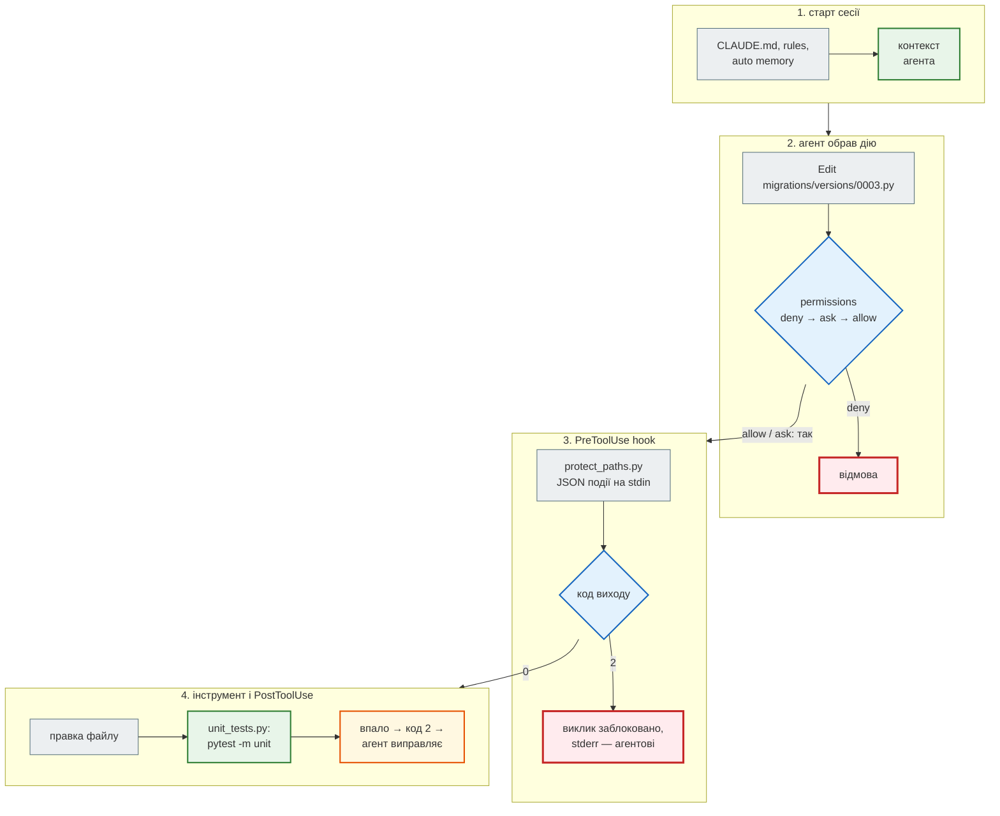
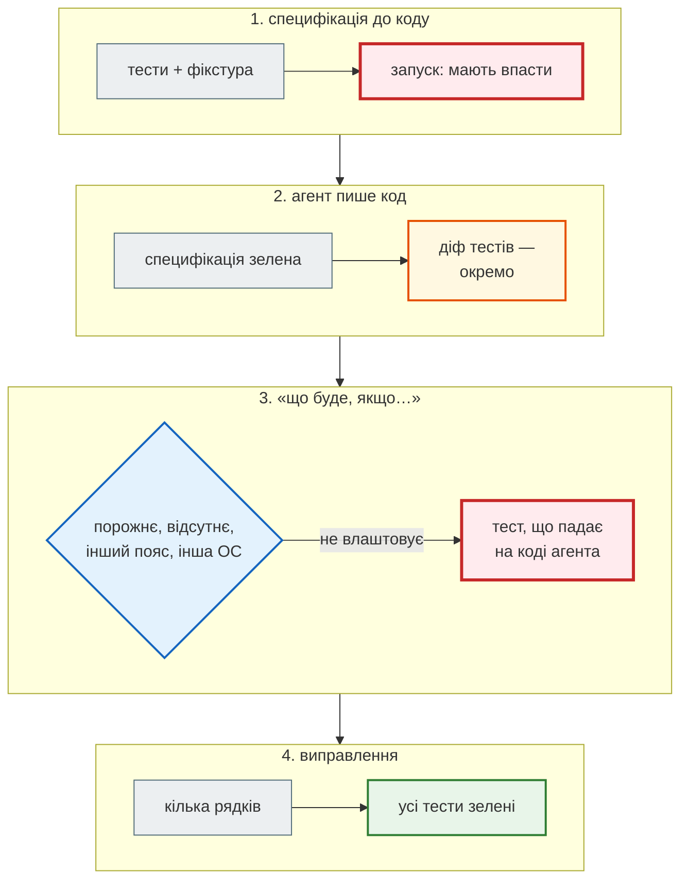

# AI-агент у проєкті: `CLAUDE.md`, дозволи, hooks, skills, MCP

## Проблема { #problem }

AI-агент для розробки (тут — Claude Code) не лише пише текст: він читає файли, редагує код, запускає `pytest`, `git`, `alembic` і сам вирішує, що робити далі. Тож питання вже не «чи гарний код він напише», а інші:

- звідки агент знає правила проєкту, яких не видно з коду;
- що він **не зможе** зробити, хоч би що вирішив (прочитати `.env`, зробити `git push`, відкотити міграцію);
- що станеться **завжди** після його правки (тести), а не «якщо не забуде»;
- як перевірити результат, якщо всі тести зелені.

[Крок 6](../tutorials/06_ai_dev_tools/index.md) відповідає на це для News Hub і проводить експеримент «одне завдання — два запити». Ця сторінка — довідник механізмів: де лежать файли, як читаються правила, які є події hooks і що з цього справді межа безпеки.

Інструмент змінюється щомісяця. Усі факти тут звірено з [документацією Claude Code](https://code.claude.com/docs/en/overview) станом на листопад 2026. Якщо щось не працює, джерело правди — `claude --help` і документація.

## Ментальна модель { #mental-model }

Агент працює циклом: прочитав → вирішив → викликав інструмент → прочитав результат. Кожен механізм вбудовується у своє місце циклу:



| Механізм | Де живе | Що дає | Гарантія |
|---|---|---|---|
| `CLAUDE.md`, rules | Markdown у репозиторії | контекст: команди, правила | ні — агент зазвичай слухається |
| skill | `.claude/skills/<назва>/SKILL.md` | порядок роботи одною командою `/назва` | ні — це теж контекст |
| permissions | `settings.json` | що інструментам дозволено | так, для інструментів агента |
| hook | `settings.json` + скрипт | команда, що виконується на подію | так, виконується завжди |
| sandbox | `settings.json` | межі файлів і мережі для Bash на рівні ОС | так |
| MCP | `.mcp.json`, `~/.claude.json` | нові інструменти: база, трекер задач, Sentry | — це розширення можливостей |

## Встановлення і запуск { #install }

```bash
curl -fsSL https://claude.ai/install.sh | bash      # macOS, Linux, WSL — рекомендовано
irm https://claude.ai/install.ps1 | iex             # Windows PowerShell
claude --version
claude doctor                                       # діагностика встановлення й налаштувань
```

Інші способи: `brew install --cask claude-code`, `winget install Anthropic.ClaudeCode`, `npm install -g @anthropic-ai/claude-code` (Node.js 22+, без `sudo`). Запускати — **з кореня проєкту**: звідти агент бачить код і `CLAUDE.md`.

| Команда | Що робить |
|---|---|
| `claude` / `claude "запит"` | інтерактивна сесія |
| `claude -p "запит"` | один запит без інтерфейсу, відповідь у stdout — скрипти, CI |
| `claude -c` / `claude -r` | продовжити останню розмову / обрати зі списку |
| `claude -w назва` | сесія в окремому git worktree: дві задачі не заважають одна одній |
| `claude --bg "запит"`, `claude agents` | фонова сесія; список фонових сесій |
| `claude mcp …` | MCP-сервери ([нижче](#mcp)) |

| Прапорець | Для чого |
|---|---|
| `--model <аліас або назва>` | модель; назви змінюються — дивись [Model configuration](https://code.claude.com/docs/en/model-config) |
| `--effort high` | рівень зусиль: `low`, `medium`, `high`, `xhigh`, `max` |
| `--permission-mode plan` | режим дозволів ([нижче](#modes)) |
| `--allowedTools "Bash(pytest *)"`, `--disallowedTools …` | дозволити / заборонити інструменти на цю сесію |
| `--add-dir ../shared` | доступ ще до однієї папки |
| `--append-system-prompt "…"` | додати інструкцію до системного промпту |
| `--output-format json`, `--json-schema '{…}'`, `--max-budget-usd 2` | лише з `-p`: JSON-результат, відповідь за схемою, ліміт витрат |

## Як ставити задачу { #task }

Агент знає лише те, що є в репозиторії та в запиті. Найсильніша частина запиту — **перевірний критерій готовності**: тест, який має пройти, команда, яка має дати нуль помилок.

```text
✗ «Додай джерело новин Українська правда».
✓ «Додай джерело "Українська правда" (RSS). Специфікація — tests/unit/test_pravda.py,
   зразок стрічки — tests/fixtures/pravda_rss.xml. Зроби, щоб проходили pytest і
   mypy --strict news_hub, тести не змінюй. Наприкінці перелічи рішення, які ухвалив сам.»
```

Чим закінчились саме ці два запити на тому самому проєкті — [експеримент кроку 6](../tutorials/06_ai_dev_tools/two_prompts.md).

| Прийом | Навіщо |
|---|---|
| спершу план: `--permission-mode plan` або «не пиши код, лише план» | побачити підхід до того, як змінено 10 файлів |
| обмежити простір: «лише `news_hub/rss.py` і `models.py`» | менший діф — легше рецензувати |
| вставити помилку повністю (traceback) | агент бачить те саме, що й ти |
| «перелічи рішення, які ухвалив сам» | неявні рішення стають видимими для рецензії |
| велику задачу — частинами | кожну частину перевіряєш тестами до наступної |

## `CLAUDE.md` і rules { #claude-md }

`CLAUDE.md` — Markdown, який агент отримує на початку кожної сесії. Що в нього писати для News Hub і чому застарілий файл гірший за відсутній — [крок 6](../tutorials/06_ai_dev_tools/ai_ready_project.md#claude-md). Тут — як файли знаходяться й складаються.

| Файл | Для кого |
|---|---|
| `/etc/claude-code/CLAUDE.md` (Linux, WSL), `/Library/Application Support/ClaudeCode/CLAUDE.md` (macOS), `C:\Program Files\ClaudeCode\CLAUDE.md` (Windows) | організація; кладе адміністратор |
| `~/.claude/CLAUDE.md` | ти, усі проєкти |
| `./CLAUDE.md` або `./.claude/CLAUDE.md` | команда; у git |
| `./CLAUDE.local.md` | ти, цей проєкт; додай у `.gitignore` |

- **Файли додаються, а не перекривають один одного.** `CLAUDE.md` і `CLAUDE.local.md` читаються з поточної папки й **усіх батьківських** при запуску. Файли в підпапках підвантажуються, коли агент читає чи редагує файл у тій підпапці.
- **`AGENTS.md`** (спільний формат кількох AI-інструментів) Claude Code читає замість `CLAUDE.md`, лише якщо `CLAUDE.md` немає ніде на шляху (з версії 2.1.277). Щоб мати один файл для всіх інструментів, документація радить рядок `@AGENTS.md` на початку `CLAUDE.md`.
- **Імпорти.** `@README.md` чи `@docs/deploy.md` у тексті підключає файл; вкладеність — до чотирьох рівнів; відносний шлях — від файлу, що імпортує. У бектиках (`` `@README.md` ``) і в блоках коду — просто текст.
- **Правила для частини файлів** — `.claude/rules/*.md` з полем `paths:`. Такий файл потрапляє в контекст, лише коли агент читає чи редагує файл, що збігається з шаблоном. Без `paths` — завантажується на старті, як `CLAUDE.md`.

```markdown title=".claude/rules/api.md"
---
paths:
  - "news_hub/api.py"
  - "tests/integration/**"
---
- Кожен новий ендпоінт — тест у tests/integration/ і рядок у README.
- Помилки — HTTPException з українським detail, не голий 500.
```

- **Розмір.** Документація радить до 200 рядків на файл. Конкретне («`pytest -m unit` після кожної зміни») корисне, загальне («пиши якісний код») — ні.
- **`/init`** у сесії створює чернетку `CLAUDE.md` за кодом проєкту (команди збірки, тести, домовленості), а якщо файл уже є — пропонує покращення. Чернетку треба перечитати: правил, яких не видно з коду, у ній не буде. **`/memory`** показує, що саме завантажено.

### Auto memory { #auto-memory }

Крім `CLAUDE.md`, який пишеш ти, агент веде власні нотатки: твої виправлення, вподобання, знайдені команди.

| | `CLAUDE.md` | auto memory |
|---|---|---|
| хто пише | ти (і команда через git) | агент |
| де | у репозиторії | `~/.claude/projects/<проєкт>/memory/`, індекс `MEMORY.md` |
| що завантажується | увесь файл | перші 200 рядків або 25 КБ індексу |
| видно команді | так | ні |

Вимкнути: перемикач у `/memory`, `"autoMemoryEnabled": false` у налаштуваннях або змінна `CLAUDE_CODE_DISABLE_AUTO_MEMORY=1`. Нотатки — не місце для правил команди: колега їх не побачить. Те, що має знати кожен, — у `CLAUDE.md`.

## Налаштування і дозволи { #permissions }

Налаштування — JSON. Якщо той самий ключ задано на кількох рівнях, діє вищий:

1. **managed** — політика організації; не перевизначається;
2. **командний рядок** — `--settings`, `--permission-mode`, `--allowedTools`…;
3. **`.claude/settings.local.json`** — ти, цей проєкт (не в git);
4. **`.claude/settings.json`** — проєкт, у git;
5. **`~/.claude/settings.json`** — ти, усі проєкти.

Списки (`permissions.allow`, `deny`) не замінюються, а **зливаються** з усіх рівнів.

### Синтаксис правил { #rule-syntax }

| Правило | Що покриває |
|---|---|
| `Bash(pytest *)` | `pytest` з будь-якими аргументами; пробіл перед `*` важливий |
| `Bash(git push *)` | будь-який `git push` |
| `Read(./.env)` | файл `.env` відносно поточної папки (`./шлях` і `шлях` — те саме) |
| `Edit(/migrations/**)` | `/` на початку — від папки, до якої належить файл налаштувань (для проєктних — корінь проєкту), **не** від кореня диска |
| `Read(//etc/**)` | `//` — абсолютний шлях від кореня файлової системи |
| `Read(~/.aws/**)` | від домашньої папки |
| `WebFetch` | інструмент цілком |

- **Порядок перевірки: `deny` → `ask` → `allow`, перше збігання вирішує.** Широке `Bash(git *)` в `allow` не відкриє `git push`, якщо він у `deny`.
- **Складена команда ділиться на частини** (`&&`, `||`, `;`, `|`, `&`, перенос рядка), і дозволеною має бути **кожна**. `Bash(pytest *)` не дозволить `pytest && rm -rf .`.
- **Довіра до папки.** `allow` з `.claude/settings.json` проєкту діє лише після того, як ти прийняв діалог довіри при першому інтерактивному запуску. `deny` і `ask` діють одразу — вони лише звужують. `claude -p` діалогу не показує: у недовіреній папці `allow` з файлу не застосовується, а в stderr з'являється попередження. Крок 6 на це натрапив — [знахідка](../tutorials/06_ai_dev_tools/ai_ready_project.md#trust).

!!! warning "Що виконується без довіри"
    За документацією, у режимі `-p` hooks проєкту, його `env` і сервери з `.mcp.json` запускаються **без запиту**, навіть у недовіреній папці. Тож `claude -p` у щойно клонованому чужому репозиторії — це виконання чужого коду. Спершу переглянь `.claude/` і `.mcp.json`, як переглядаєш `setup.py`.

### Режими { #modes }

| `--permission-mode` | Поведінка |
|---|---|
| `default` (в інтерфейсі — Manual) | питає перед першим використанням кожного інструменту |
| `acceptEdits` | правки файлів і прості файлові команди (`mkdir`, `mv`, `cp`) у робочих папках — без запиту |
| `plan` | лише читає й складає план; файлів не змінює |
| `auto` | виконує сам; окремий класифікатор перевіряє дії перед виконанням |
| `dontAsk` | усе, що вимагало б запиту, — відхиляє; працює лише дозволене правилами |
| `bypassPermissions` | без запитів — лише в одноразовому контейнері без секретів |

### Sandbox { #sandbox }

Permissions стосуються інструментів агента. Але `Bash(python *)` запускає довільний код, і правило `Read(./.env)` не завадить скрипту відкрити `.env` сам. **Sandbox** обмежує команди Bash на рівні ОС: які файли вони бачать і на які домени ходять. Працює на macOS, Linux і WSL2 (у «рідному» Windows і WSL1 — ні), вмикається командою `/sandbox`, за замовчуванням вимкнений.

```json title=".claude/settings.json (фрагмент)"
{
  "sandbox": {
    "enabled": true,
    "filesystem": {"allowWrite": ["/tmp/build"], "denyRead": ["~/.aws", "./.env"]},
    "network": {"allowedDomains": ["github.com", "pypi.org", "files.pythonhosted.org"]}
  }
}
```

## Hooks { #hooks }

**Hook** — дія, яку Claude Code виконує сам на подію; агент не може її «забути». Типи: `command` (команда оболонки), `http`, `mcp_tool`, `prompt`, `agent` (експериментальний).

| Подія | Коли | Для чого |
|---|---|---|
| `PreToolUse` | перед інструментом; **може заблокувати** | не давати редагувати застосовані міграції |
| `PostToolUse` | після інструменту | тести чи лінтер після кожної правки |
| `PermissionRequest` | коли агент мав би спитати дозволу | автоматичне рішення за власними правилами |
| `UserPromptSubmit` | ти надіслав запит | додати контекст, відхилити запит |
| `Stop`, `SubagentStop` | агент / субагент закінчив відповідь | остаточна перевірка |
| `SessionStart`, `SessionEnd`, `PreCompact` | початок, кінець сесії, стиснення розмови | підготовка середовища, журнал |

Усього подій 33 — повний список у [Hooks reference](https://code.claude.com/docs/en/hooks). Hook типу `command` отримує на stdin JSON: спільні поля `session_id`, `cwd`, `hook_event_name`, а для подій інструментів — `tool_name` і `tool_input` (для файлів — `tool_input.file_path`). Шлях до проєкту — у змінній `$CLAUDE_PROJECT_DIR`.

| Код виходу | `PreToolUse` | `PostToolUse` |
|---|---|---|
| `0` | продовжити | продовжити |
| `2` | **заблокувати виклик**; stderr — причина для агента | інструмент уже виконано; stderr іде агентові як помилка, яку треба виправити |
| інший | некритична помилка hook; продовжуємо | те саме |

`PostToolUse`-hook кроку 6 запускає `pytest -m unit` після кожної правки `.py` — [розбір](../tutorials/06_ai_dev_tools/ai_ready_project.md#hook). Тут — інший бік: `PreToolUse`, що **не пускає** правку.

### Приклад: `PreToolUse` проти правки міграцій { #pre-tool-use }

Застосовану міграцію Alembic не редагують — пишуть нову: інакше бази, де стара версія вже виконана, розійдуться з кодом. Правило можна записати в `CLAUDE.md`, але hook спрацює завжди. [`claude_hooks/protect_paths.py`](https://github.com/NikoriakViktor/news_hub/blob/main/examples/integrations/claude_hooks/protect_paths.py):

```python title="examples/integrations/claude_hooks/protect_paths.py (фрагмент)"
PROTECTED_DIRS = ("migrations/versions",)            # застосовану міграцію не редагують — пишуть нову
PROTECTED_NAMES = (".env",)


def reason(event: dict[str, object]) -> str | None:
    tool_input = event.get("tool_input")
    if not isinstance(tool_input, dict):
        return None
    raw = str(tool_input.get("file_path", "")).replace("\\", "/")
    cwd = str(event.get("cwd", "")).replace("\\", "/").rstrip("/")
    path = PurePosixPath(raw[len(cwd) + 1:] if cwd and raw.startswith(cwd + "/") else raw)
    if ".." in path.parts:
        return f"{raw}: шлях з '..' — працюй лише з файлами проєкту"
    if path.name in PROTECTED_NAMES or (path.name.startswith(".env.") and path.name != ".env.example"):
        return f"{raw}: секрети не редагуються агентом; приклад змінних — у .env.example"
    ...


def main() -> int:
    try:
        event = json.load(sys.stdin)
    except json.JSONDecodeError:
        print("protect_paths: на stdin не JSON", file=sys.stderr)
        return 1                                     # не 2: зламаний hook не повинен блокувати все підряд
    if (why := reason(event)) is not None:
        print(why, file=sys.stderr)
        return 2
    return 0
```

```json title=".claude/settings.json (фрагмент)"
"hooks": {
  "PreToolUse": [
    {"matcher": "Edit|Write",
     "hooks": [{"type": "command", "command": "python \"$CLAUDE_PROJECT_DIR/.claude/hooks/protect_paths.py\""}]}
  ]
}
```

Hook — звичайна програма, тож перевіряється без агента: подаємо ту саму подію, яку надіслав би Claude Code.

```text
$ echo '{"tool_name": "Edit", "cwd": "/home/you/news_hub", "tool_input": {"file_path": "/home/you/news_hub/news_hub/api.py"}}' | python protect_paths.py; echo "exit=$?"
exit=0
$ echo '{"tool_name": "Edit", "cwd": "/home/you/news_hub", "tool_input": {"file_path": "/home/you/news_hub/migrations/versions/0003_subscriptions.py"}}' | python protect_paths.py; echo "exit=$?"
/home/you/news_hub/migrations/versions/0003_subscriptions.py: застосовану міграцію не змінюють — створи нову: alembic revision --autogenerate
exit=2
$ echo '{"tool_name": "Edit", "cwd": "/home/you/news_hub", "tool_input": {"file_path": "/home/you/news_hub/.env"}}' | python protect_paths.py; echo "exit=$?"
/home/you/news_hub/.env: секрети не редагуються агентом; приклад змінних — у .env.example
exit=2
```

І тест, щоб наступна «оптимізація» hook не відкрила те, що він закривав:

```python title="examples/integrations/claude_hooks/test_protect_paths.py (фрагмент)"
@pytest.mark.parametrize("path", [f"{CWD}/news_hub/api.py", f"{CWD}/tests/unit/test_api.py",
                                  f"{CWD}/.env.example", f"{CWD}/docs/migrations/versions.md"])
def test_allowed(path: str) -> None:
    result = run(event(path))
    assert (result.returncode, result.stderr) == (0, "")


@pytest.mark.parametrize("path", [f"{CWD}/.env", f"{CWD}/.env.production",
                                  f"{CWD}/migrations/versions/0003_subscriptions.py", "migrations/versions/x.py",
                                  f"{CWD}/../other/secret.py"])
def test_blocked(path: str) -> None:
    result = run(event(path, tool="Write"))
    assert result.returncode == 2 and path in result.stderr
```

```text
$ pytest -q claude_hooks
...........                                                              [100%]
11 passed in 0.79s
```

- `docs/migrations/versions.md` — не міграція: перевіряється сегмент шляху `migrations/versions/`, а не підрядок. Та сама помилка, що `endswith` для доменів у [кроці 5](../tutorials/05_api_testing/index.md).
- Зіпсований вхід — код `1`, не `2`: hook, що сам зламався, не має блокувати кожну правку.

!!! warning "Hook — не межа безпеки"
    `protect_paths.py` бачить лише інструменти `Edit` і `Write`. `Bash(echo … > .env)` чи `python -c "…"` він не бачить, а регулярний вираз проти `rm -rf` обходиться `cd / && rm -rf …` чи `/bin/rm`. Hook захищає від **випадкової** правки й перевіряє якість. Межа — `permissions.deny` і sandbox.

## Skills і субагенти { #skills }

**Skill** — власна команда агента: папка з `SKILL.md`. Skill `/add-news-source` кроку 6 — [розбір](../tutorials/06_ai_dev_tools/ai_ready_project.md#skill).

| Де | Для кого |
|---|---|
| `~/.claude/skills/<назва>/SKILL.md` | ти, усі проєкти |
| `.claude/skills/<назва>/SKILL.md` | проєкт, у git |
| `<плагін>/skills/<назва>/SKILL.md` | там, де встановлено плагін |

Старий формат `.claude/commands/<назва>.md` працює так само; skill може мати поруч допоміжні файли (скрипти, шаблони).

| У тексті skill | Що підставляється |
|---|---|
| `$ARGUMENTS` | усе, що написано після `/назва` |
| `$ARGUMENTS[0]`, `$0` | перший аргумент (рахуємо з нуля) |
| `$component` | іменований аргумент з поля `arguments:` |
| `` !`git status --short` `` | вивід команди — виконується **до** того, як текст потрапить до агента |

| Поле frontmatter | Що робить |
|---|---|
| `name`, `description` | назва в меню `/`; опис, за яким агент вирішує, коли skill доречний |
| `argument-hint`, `arguments` | підказка аргументів; іменовані аргументи |
| `disable-model-invocation: true` | викликаєш лише ти, агент сам — ні |
| `user-invocable: false` | навпаки: лише агент |
| `allowed-tools`, `disallowed-tools` | інструменти без запиту / заборонені, поки skill активний |
| `model`, `effort` | модель і зусилля для цього skill |
| `context: fork`, `agent` | виконати в окремому субагенті |
| `paths` | активувати лише для відповідних файлів |
| `hooks` | hooks, що діють, поки skill активний |

**Субагент** — окремий агент зі своїм контекстом і своїми інструментами: `.claude/agents/<назва>.md` (проєкт) або `~/.claude/agents/` (ти). Обов'язкові поля — `name` і `description`; `tools`, `model`, `permissionMode` та інші — за потреби:

```markdown title=".claude/agents/reviewer.md"
---
name: reviewer
description: Рецензія діфу news_hub — шукає випадки, яких не перевіряють тести. Нічого не редагує.
tools: Read, Grep, Glob, Bash
---
Прочитай `git diff`. Для кожної зміненої функції спитай «що буде, якщо…»: порожній вхід,
відсутнє поле, інший часовий пояс, інша ОС. Кожну знахідку оформи як тест, що падає.
```

Рецензент без `Edit` і `Write` не «виправить» тест, щоб той пройшов: таких інструментів у нього немає. `Bash` лишається для `git diff` і `pytest` — і його межі задають ті самі `permissions`.

## MCP — зовнішні інструменти { #mcp }

**Model Context Protocol** — відкритий стандарт, через який агент отримує інструменти й дані ззовні: базу даних, трекер задач, Sentry. MCP-сервер — окрема програма: локальна (`stdio`) або віддалена (`http`).

```bash
claude mcp add --transport http sentry https://mcp.sentry.dev/mcp          # віддалений; OAuth — /mcp у сесії
claude mcp add --transport http tracker https://tracker.example/mcp --header "Authorization: Bearer $TOKEN"
claude mcp add db -- npx -y @bytebase/dbhub --dsn "postgresql://readonly@localhost/news_hub"   # після -- — команда сервера
claude mcp list
claude mcp get sentry
claude mcp remove sentry
```

| `--scope` | Де діє | Де записано |
|---|---|---|
| `local` (за замовчуванням) | ти, цей проєкт | `~/.claude.json` |
| `project` | усі, хто клонував | `.mcp.json` у корені, у git |
| `user` | ти, усі проєкти | `~/.claude.json` |

```json title=".mcp.json"
{
  "mcpServers": {
    "sentry": {"type": "http", "url": "https://mcp.sentry.dev/mcp"},
    "db": {"type": "stdio", "command": "npx", "args": ["-y", "@bytebase/dbhub", "--dsn", "${DATABASE_URL}"]}
  }
}
```

- Секрети — лише через `${ЗМІННА}` (або `${ЗМІННА:-типове}`), ніколи текстом у файлі з git.
- Сервери з `.mcp.json` в інтерактивній сесії запускаються лише після твого схвалення (`claude mcp reset-project-choices` — забути рішення). У `-p` — див. [попередження вище](#permissions).
- Користувач бази для MCP — **лише читання**. Агент, якому дали `DROP TABLE`, рано чи пізно знайде причину його виконати.

## Автоматизація: `-p`, CI, Agent SDK { #automation }

```bash
git diff main | claude -p "рецензія діфу: баги й безпека, коротко"

claude -p "Додай джерело …" \
  --permission-mode acceptEdits \
  --allowedTools "Bash(pytest *)" "Bash(mypy *)" \
  --max-budget-usd 5 --output-format json > run.json
```

`--output-format json` повертає `result`, `session_id`, вартість `total_cost_usd`, а з `--json-schema` — ще `structured_output`. Так зручно порівнювати запуски — як в [експерименті кроку 6](../tutorials/06_ai_dev_tools/two_prompts.md#runs).

**GitHub Actions** — дія `anthropics/claude-code-action@v1`; найпростіше налаштувати командою `/install-github-app` у сесії:

```yaml title=".github/workflows/claude.yml"
name: Claude Code
on:
  issue_comment:
    types: [created]
jobs:
  claude:
    if: contains(github.event.comment.body, '@claude')
    runs-on: ubuntu-latest
    permissions:
      contents: write
      pull-requests: write
      issues: write
      id-token: write
    steps:
      - uses: actions/checkout@v6
        with:
          fetch-depth: 1
      - uses: anthropics/claude-code-action@v1
        with:
          anthropic_api_key: ${{ secrets.ANTHROPIC_API_KEY }}
```

Дія перевіряє, що той, хто викликав агента в issue чи PR, має право запису в репозиторій (винятки — `allowed_non_write_users`, `allowed_bots`). Ключ — лише в GitHub Secrets. Текст чужого PR — це чужий промпт: агент, що його читає, не повинен мати `bypassPermissions` і секретів понад потрібне.

**Agent SDK** — той самий агент (інструменти, дозволи, hooks, `CLAUDE.md`) як бібліотека:

```python
# pip install claude-agent-sdk
import asyncio

from claude_agent_sdk import ClaudeAgentOptions, query


async def main() -> None:
    options = ClaudeAgentOptions(allowed_tools=["Read", "Grep", "Bash(pytest *)"], permission_mode="acceptEdits")
    async for message in query(prompt="Знайди непротестовані функції в news_hub/", options=options):
        print(message)

asyncio.run(main())
```

Це не те саме, що SDK моделі (`pip install anthropic`): там ти сам надсилаєш повідомлення моделі й сам пишеш цикл — про це [наступна сторінка](llm_api.md).

## Рецензія AI-коду тестами { #review }

Зелені тести, які агент запускав сам, кажуть одне: код робить те, про що **спитали**. Рецензент шукає інше — що буде там, де специфікація мовчала. Метод:



- **Кожна знахідка — тест, що падає на коді агента.** Без тесту виправлення — думка рецензента; з тестом — вимога, яку наступна зміна не зламає непомітно. Як це виглядало для RSS-парсера — [3 failed → виправлення](../tutorials/06_ai_dev_tools/review_with_tests.md#before).
- **Перевір тести самих тестів.** Навмисно зламай код (прибери перевірку, зміни межу на одиницю) — чи впаде хоч один тест? Якщо ні, тест перевіряє не те.
- **Нова залежність — на PyPI очима.** Агент може впевнено вигадати пакет із правдоподібною назвою; хтось може зареєструвати саме таку назву. Тому в кроці 6 `pip install` — у `deny`.
- **Повний чекліст** — [крок 6](../tutorials/06_ai_dev_tools/review_with_tests.md#checklist).

## У News Hub { #news-hub }

| Файл | Що робить | Крок |
|---|---|---|
| [`CLAUDE.md`](https://github.com/NikoriakViktor/news_hub/blob/main/steps/12_ci_cd/CLAUDE.md) | команди, структура, правила застосунку; росте з кожним кроком | 6–12 |
| [`.claude/settings.json`](https://github.com/NikoriakViktor/news_hub/blob/main/steps/12_ci_cd/.claude/settings.json) | `allow`: `pytest`, `mypy`, `git diff/status`; `ask`: правка `tests/`; `deny`: `.env`, `pip install`, `git push`, `alembic downgrade`, `WebFetch` | 6 |
| [`.claude/hooks/unit_tests.py`](https://github.com/NikoriakViktor/news_hub/blob/main/steps/12_ci_cd/.claude/hooks/unit_tests.py) | `PostToolUse`: `pytest -m unit` після правки `.py` | 6 |
| [`.claude/skills/add-news-source/SKILL.md`](https://github.com/NikoriakViktor/news_hub/blob/main/steps/12_ci_cd/.claude/skills/add-news-source/SKILL.md) | `/add-news-source`: фікстура → тести, що падають → парсер → домени | 6 |

`PreToolUse`-hook з цієї сторінки в News Hub не підключено: це приклад з `examples/integrations/`. Додати його — скопіювати `protect_paths.py` у `.claude/hooks/` і додати блок `PreToolUse` у `settings.json`.

## Типові помилки { #mistakes }

| Помилка | Наслідок | Як правильно |
|---|---|---|
| правило безпеки лише в `CLAUDE.md` | агент зазвичай слухається, але не завжди | `permissions.deny`, sandbox |
| hook-«чорний список» як захист | обходиться іншою командою | hook — для якості; межа — `deny` і sandbox |
| `Edit(/migrations/**)` як «абсолютний шлях» | `/` — від папки налаштувань, а не від кореня диска | `//` для абсолютного шляху |
| `allow` у `.claude/settings.json` «не працює» | папку не довірено або запуск через `-p` | один інтерактивний запуск і діалог довіри; або `--allowedTools` |
| `claude -p` у щойно клонованому чужому репозиторії | hooks і `.mcp.json` виконуються без запиту | спершу переглянути `.claude/` і `.mcp.json` |
| застарілий `CLAUDE.md` | агент упевнено шукає те, чого немає | міняти разом з кодом, як README |
| секрет текстом у `.mcp.json` | ключ у git | `${ЗМІННА}` |
| `bypassPermissions` на робочій машині | агент робить усе, включно з помилками | лише одноразовий контейнер |
| «тести проходять» без перевірки діфу тестів | тест змінили, щоб пройшов | `ask: Edit(./tests/**)`, рецензія діфу тестів |

## Налагодження { #debugging }

- **Що агент знає?** `/memory` — завантажені `CLAUDE.md`, rules і auto memory.
- **Hook не спрацьовує чи блокує не те?** Подай йому подію руками, як вище: `echo '{…}' | python hook.py; echo $?`. Hook, що падає на зіпсованому вводі, повертає не `2`, а `1` — побачиш це в журналі, а не як блокування.
- **Чому `allow` ігнорується?** У `-p` дивись stderr: попередження про недовірену папку.
- **MCP-сервер не відповідає?** `claude mcp list` показує стан кожного; `claude mcp get <назва>` — деталі.
- **Щось зламалось у встановленні?** `claude doctor`.

## Безпека { #security }

| Ризик | Що робити |
|---|---|
| агент прочитав `.env` і вставив ключ у код чи журнал | `deny: Read(./.env)`, sandbox `denyRead`; секрети — лише в змінних середовища |
| промпт-ін'єкція в прочитаному файлі, issue, вебсторінці | не давати агентові одночасно чужий вміст, секрети й мережу; `WebFetch` — у `deny` або `ask` |
| чужий репозиторій з `.claude/`, hooks, `.mcp.json` | не довіряти папці й не запускати `-p`, доки не переглянув |
| «тести проходять», бо агент змінив тести | `ask: Edit(./tests/**)`; діф тестів — окремо |
| вигадані залежності | `deny: Bash(pip install *)`; кожну нову — перевірити на PyPI |
| MCP з правом запису в базу | користувач лише для читання |
| повний автопілот | `bypassPermissions` лише в одноразовому контейнері |

## Питання { #questions }

1. Чим `CLAUDE.md` відрізняється від `permissions.deny` з погляду гарантій?
2. У `allow` є `Bash(git *)`, у `deny` — `Bash(git push *)`. Що буде з `git push origin main`?
3. Що означає `/` на початку шляху в `Edit(/migrations/**)` у проєктному `settings.json`? А `//`?
4. Чому `Bash(pytest *)` не дозволяє `pytest && rm -rf .`?
5. `PreToolUse`-hook завершився з кодом 2. Що станеться з викликом і що побачить агент? А для `PostToolUse`?
6. Чому hook, що блокує `.env` для `Edit`, не захищає `.env`?
7. Чому `allow` з `.claude/settings.json` може не діяти в `claude -p`, а hooks того самого проєкту — діяти?
8. Де лежать нотатки auto memory і чому туди не варто класти правила команди?
9. Навіщо субагенту-рецензенту список `tools` без `Edit`?
10. Як рецензент перетворює знахідку на вимогу?

??? success "Відповіді"

    1. `CLAUDE.md` — контекст: агент зазвичай його виконує, але не гарантовано. `deny` перевіряється перед кожним викликом інструменту: заборонене не станеться.
    2. Відмова: `deny` перевіряється першим і вирішує.
    3. Від папки, до якої належить файл налаштувань, — для проєктного це корінь проєкту. `//` — абсолютний шлях від кореня файлової системи.
    4. Складена команда ділиться на частини, і дозволеною має бути кожна; `rm -rf .` не дозволено.
    5. Виклик заблоковано, stderr іде агентові як причина. Для `PostToolUse` інструмент уже виконано; stderr — помилка, яку агент має виправити.
    6. Hook бачить лише `Edit`/`Write`; `Bash` чи `python -c` пишуть у `.env` повз нього. Межа — `deny` і sandbox.
    7. `allow` діє лише в довіреній папці, а `-p` діалогу довіри не показує. Hooks, `env` і `.mcp.json` у `-p` за документацією виконуються без запиту.
    8. `~/.claude/projects/<проєкт>/memory/`, індекс `MEMORY.md`. Їх бачиш лише ти — колега чи CI їх не отримає.
    9. Без `Edit` рецензент не може «виправити» тест чи код, щоб той пройшов: лише читає, запускає тести й звітує.
    10. Пише тест, що падає на коді агента; виправлення вважається готовим, коли цей тест зелений.

## Що далі { #next }

[LLM API: повідомлення, схема, перевірка відповіді](llm_api.md) — як твій застосунок сам викликає модель. На практиці — [крок 6](../tutorials/06_ai_dev_tools/index.md).

**Джерела:** Claude Code — [Overview](https://code.claude.com/docs/en/overview), [Setup](https://code.claude.com/docs/en/setup), [CLI reference](https://code.claude.com/docs/en/cli-reference), [Common workflows](https://code.claude.com/docs/en/common-workflows), [Best practices](https://code.claude.com/docs/en/best-practices), [Memory](https://code.claude.com/docs/en/memory), [Settings](https://code.claude.com/docs/en/settings), [Permissions](https://code.claude.com/docs/en/permissions), [Permission modes](https://code.claude.com/docs/en/permission-modes), [Sandboxing](https://code.claude.com/docs/en/sandboxing), [Hooks reference](https://code.claude.com/docs/en/hooks), [Hooks guide](https://code.claude.com/docs/en/hooks-guide), [Skills](https://code.claude.com/docs/en/skills), [Subagents](https://code.claude.com/docs/en/sub-agents), [MCP](https://code.claude.com/docs/en/mcp), [Headless](https://code.claude.com/docs/en/headless), [GitHub Actions](https://code.claude.com/docs/en/github-actions), [Agent SDK](https://code.claude.com/docs/en/agent-sdk/overview), [Model configuration](https://code.claude.com/docs/en/model-config), [Security](https://code.claude.com/docs/en/security); [Model Context Protocol](https://modelcontextprotocol.io/).
