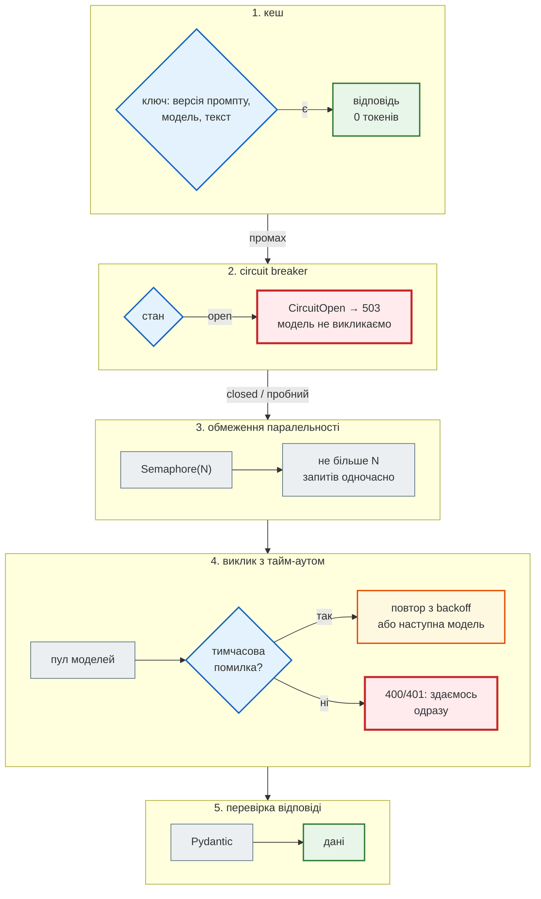
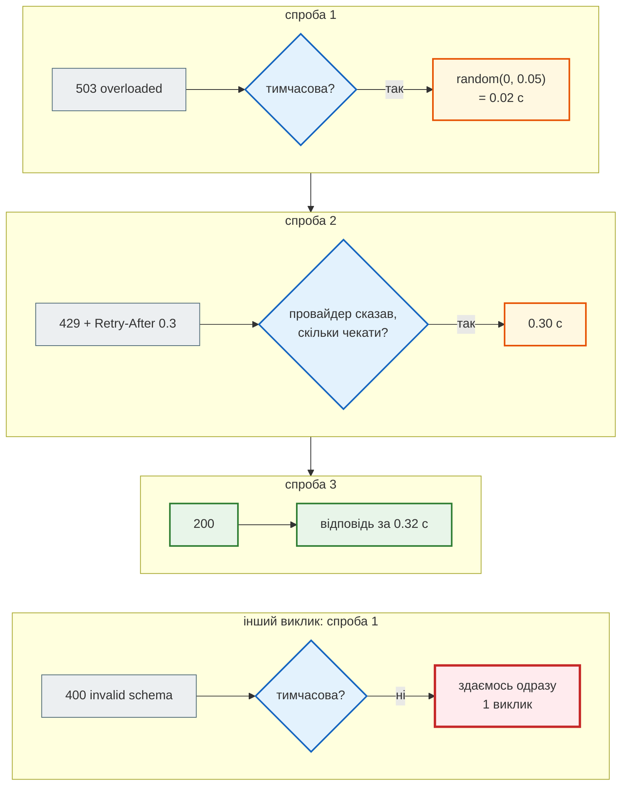
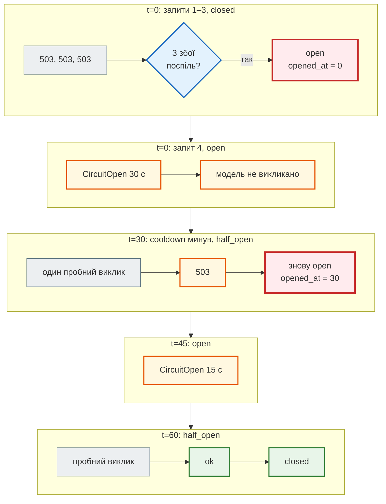

# Надійність LLM: тайм-аути, повтори, breaker, кеш, ін'єкції, тести

## Проблема { #problem }

Модель провайдера — зовнішня залежність, найгірша з тих, що бувають в API: повільна (секунди), платна (кожен токен), з квотами (`429`), з перевантаженнями (`503`, `529`) і з відповіддю, яку не можна передбачити. Якщо викликати її «в лоб»:

- один повільний виклик тримає запит користувача хвилинами (тайм-аут SDK за замовчуванням — 10 хвилин, див. нижче);
- провайдер упав — і кожен запит до API чекає свого тайм-ауту, а потім ще повторюється;
- тисяча клієнтів, що повторюють одночасно, добивають провайдера, який щойно піднявся;
- той самий заголовок аналізується й оплачується вдруге;
- текст новини каже моделі «ігноруй інструкції» — і вона слухається;
- тести або ходять у мережу й платять, або не перевіряють нічого.

[Крок 7](../tutorials/07_llm_api/index.md) розв'язує це для News Hub: пул моделей Gemini, breaker у Redis, кеш за хешем, мітки в промпті, `FakeLLM`. Ця сторінка — самі механізми, кожен окремо, і чим загальна версія відрізняється від тієї, що в News Hub.

## Ментальна модель { #mental-model }

Шари навколо одного виклику — від найдешевшого:



Код загальних версій — [`examples/integrations/llm_kit.py`](https://github.com/NikoriakViktor/news_hub/blob/main/examples/integrations/llm_kit.py), демо — [`llm_reliability_demo.py`](https://github.com/NikoriakViktor/news_hub/blob/main/examples/integrations/llm_reliability_demo.py), тести — [`test_llm_kit.py`](https://github.com/NikoriakViktor/news_hub/blob/main/examples/integrations/test_llm_kit.py). Модель скрізь — `FakeLLM` або SDK `anthropic` з `MockTransport`; мережі немає.

## Яка помилка — яка дія { #errors }

Перш ніж повторювати, треба знати, **що** повторювати. Повтор того самого запиту допомагає лише від тимчасових збоїв:

| Код / виняток | Що це | Повтор того самого запиту | Інша модель |
|---|---|---|---|
| `408`, тайм-аут, обрив з'єднання | мережа або повільна модель | так | так |
| `429` | квота: запитів чи токенів за хвилину | так, після `Retry-After` | так — у неї своя квота |
| `500`, `502`, `503`, `504`, `529` | збій чи перевантаження провайдера | так | так |
| `404` | моделі немає (прибрали, одруківка) | ні | так |
| `400`, `422` | наш запит невірний (схема, параметри) | ні | ні |
| `401`, `403` | ключ невірний чи без прав | ні | ні |

```python title="llm_kit.py (фрагмент)"
RETRYABLE = {408, 409, 429, 500, 502, 503, 504, 529}      # тимчасове: повтор може допомогти
# 400 (запит), 401/403 (ключ), 404 (немає моделі), 422 — повтор того самого запиту не допоможе


def is_retryable(error: BaseException) -> bool:
    if isinstance(error, ProviderError):
        return error.status in RETRYABLE
    return isinstance(error, (TimeoutError, ConnectionError))
```

Як News Hub розпізнає ці випадки за `APIError.code` Gemini і за винятками `aiohttp`/`httpx` — [крок 7](../tutorials/07_llm_api/gemini_pool.md#errors).

## Тайм-аут { #timeout }

Тайм-аут — це рішення «скільки цей виклик вартий чекати», а не налаштування SDK. Запит користувача — секунди; фонова задача — довше.

```python title="llm_kit.py (фрагмент)"
async def with_timeout(call: Awaitable[T], seconds: float) -> T:
    """asyncio.wait_for, а не asyncio.timeout: працює й на Python 3.10."""
    return await asyncio.wait_for(call, seconds)
```

```text
--- 1. тайм-аут: модель «думає» 2 с, ми чекаємо 0.2 с
   результат                                TimeoutError за 0.20 с
```

- **Тайм-аут SDK за замовчуванням великий.** SDK `anthropic` 2.8 у кожному запиті надсилає заголовок `x-stainless-timeout: 600`, а в його коді `DEFAULT_TIMEOUT = httpx2.Timeout(timeout=10 * 60, connect=5.0)` — 10 хвилин. Задай свій: `AsyncAnthropic(timeout=30)`; у Gemini — `HttpOptions(timeout=мілісекунди)`, як у `GeminiClient`.
- **Тайм-аут одного виклику × кількість спроб** — це скільки чекатиме користувач у найгіршому разі. Тому в повторів є ще й загальний `deadline`.
- **`asyncio.wait_for` скасовує корутину**, а не лише перестає чекати: HTTP-запит буде перервано. Але провайдер, можливо, вже згенерував відповідь — і виставить за неї рахунок.

## Повтори з backoff і jitter { #retry }

Повторювати одразу — погана ідея: провайдер, що перевантажений зараз, перевантажений і через мілісекунду. **Exponential backoff** — пауза росте вдвічі з кожною спробою; **jitter** — випадкова частина паузи, щоб тисяча клієнтів не повторили в ту саму мить.

```python title="llm_kit.py (фрагмент)"
@dataclass
class RetryPolicy:
    attempts: int = 3                 # усього спроб, разом з першою
    base: float = 0.5                 # секунд перед першим повтором
    cap: float = 8.0                  # стеля однієї паузи
    deadline: float = 30.0            # стеля всього виклику з усіма паузами
    rng: random.Random = field(default_factory=random.Random)

    def delay(self, retry: int, error: BaseException) -> float:
        """Retry-After від провайдера — закон; інакше експонента з «повним» jitter: random(0, base·2^n)."""
        if isinstance(error, ProviderError) and error.retry_after is not None:
            return min(error.retry_after, self.cap)
        return self.rng.uniform(0, min(self.cap, self.base * 2 ** retry))
```

```text
--- 2. повтори з backoff і jitter (паузи зменшено в 10 разів: base=0.05)
                                            спроба 1: ProviderError(503 overloaded) → чекаємо 0.02 с
                                            спроба 2: ProviderError(429 rate limit) → чекаємо 0.30 с
   відповідь                                {"ok": 1} після 3 викликів за 0.32 с
                                            спроба 1: ProviderError(400 invalid schema) → здаємось
   400: викликів                            1
   паузи без jitter і з «повним» jitter, base=0.5, cap=8 (5 клієнтів, повтор 3):
   без jitter — усі разом                   [4.0, 4.0, 4.0, 4.0, 4.0]
   з jitter — розподілені                   [0.54, 3.39, 3.06, 1.02, 1.98]
```

Покроково, ті самі дані:



- **`Retry-After` важливіший за власну формулу.** Провайдер знає, коли відновиться квота.
- **Неповторювані помилки — одразу назовні.** `400` повторений тричі — це втричі більше чекання й ті самі `400`.
- **Без jitter** п'ять клієнтів, що отримали `503` в ту саму секунду, повертаються через ті самі 4 секунди — і знову разом. **«Повний» jitter** (`random(0, межа)`) розносить їх по всьому інтервалу.
- **Повтор — лише для ідемпотентного.** Виклик моделі без побічних ефектів можна повторювати. Якщо ж після виклику твій код щось записує чи надсилає, повторюй виклик моделі, а не всю операцію.

### Повтори всередині SDK { #sdk-retries }

Офіційні SDK вже вміють повторювати. Перш ніж обгортати виклик своїм `retry`, з'ясуй, що робить SDK, — інакше 3 × 3 = 9 спроб:

```text
--- 3. повтори всередині SDK anthropic (MockTransport замість мережі)
   max_retries за замовчуванням             2
   відповіді «мережі»                       ['529 (x-stainless-retry-count=0)', '429 (x-stainless-retry-count=1)', '200 (x-stainless-retry-count=2)']
   результат                                ok
   400 → без повтору                        BadRequestError, запитів: 1
```

У коді SDK `anthropic` 2.8 (`_base_client.py`): повторює `408`, `409`, `429` і всі `5xx`, а також помилки з'єднання й тайм-аути; слухається заголовка `retry-after`; інакше пауза `0.5 × 2^n` секунд, не більше 8, помножена на випадкове від 0.75 до 1. Номер спроби видно в заголовку `x-stainless-retry-count` — зручно в журналі провайдера. У News Hub `AnthropicClient` покладається саме на це (`max_retries=2`), а `GeminiClient` замість повторів переходить на наступну модель пулу.

## Пул моделей { #model-pool }

У кожної моделі своя квота й своє навантаження. Коли перша вичерпала ліміт (`429`) чи її прибрали (`404`), наступна ще може відповісти:

```python title="llm_kit.py (фрагмент)"
NEXT_MODEL = {404, 429, 500, 502, 503, 504, 529}          # у іншої моделі — своя квота й навантаження


async def generate_with_pool(llm: LLMClient, models: list[str], prompt: str, *, system: str,
                             log: Callable[[str], None] = lambda _: None) -> LLMReply:
    failures: list[str] = []
    for model in models:
        try:
            return await llm.generate(prompt, system=system, model=model)
        except ProviderError as error:
            failures.append(f"{model}: {error.status}")
            log(f"{model} → {error.status}")
            if error.status not in NEXT_MODEL:       # 400/401/403 — помилка наша, інша модель не допоможе
                raise
    raise LLMError("усі моделі недоступні: " + ", ".join(failures))
```

```text
--- 4. пул моделей: інша модель — інша квота
                                            model-a → 429
                                            model-b → 404
   відповіла                                model-c
                                            model-a → 401
   401: перебір зупинено                    401 invalid api key, викликів: 1
   усі впали                                усі моделі недоступні: model-a: 503, model-b: 503, model-c: 503
```

- **`401` зупиняє перебір**: невірний ключ невірний для всіх моделей.
- **Порядок — від кращої до легшої.** Відповідь легшої моделі може бути гіршою; тому `LLMReply.model` каже, хто саме відповів, — це видно в журналі й у відповіді API.
- **«Усі впали» — один виняток з переліком причин**, а не остання помилка: у журналі видно, що сталося з кожною моделлю.

Пул Gemini в News Hub і сценарій «429 → 404 → відповідь» без мережі — [крок 7](../tutorials/07_llm_api/gemini_pool.md#result).

## Circuit breaker { #circuit-breaker }

Повтори допомагають від короткого збою. Якщо провайдер лежить хвилинами, повтори лише множать чекання: кожен запит користувача чекає свої тайм-аути × спроби, а потім однаково отримує помилку. **Circuit breaker** запам'ятовує серію збоїв і якийсь час не викликає провайдера взагалі — відповідає одразу.

| Стан | Що відбувається | Перехід |
|---|---|---|
| `closed` | виклики йдуть; рахуємо збої поспіль | `threshold` збоїв → `open` |
| `open` | `CircuitOpen` одразу, провайдера не викликаємо | минув `cooldown` → `half_open` |
| `half_open` | пропускаємо **один** пробний виклик, решта — як `open` | успіх → `closed`; збій → знову `open` |

```text
--- 5. circuit breaker: closed → open → half_open → closed (годинник підмінено)
   t=   0 запит 1 [closed]                  ProviderError 503 → closed; викликів моделі: 1
   t=   0 запит 2 [closed]                  ProviderError 503 → closed; викликів моделі: 2
   t=   0 запит 3 [closed]                  ProviderError 503 → open; викликів моделі: 3
   t=   0 запит 4 [open]                    CircuitOpen (30 с), модель не викликано → open; викликів моделі: 3
   t=  30 пробний [half_open]               ProviderError 503 → open; викликів моделі: 4
   t=  45 ще запит [open]                   CircuitOpen (15 с), модель не викликано → open; викликів моделі: 4
   t=  60 пробний [half_open]               ok → closed; викликів моделі: 5
   t=  60 наступний [closed]                ok → closed; викликів моделі: 6
```

Покроково:



Деталі, які легко пропустити:

- **Рахувати лише збої провайдера.** `400` — помилка нашого запиту, а не хвороба провайдера; якщо вона відкриває breaker, один зламаний промпт вимикає LLM для всіх. Тест `test_client_error_does_not_open_breaker`.
- **У `half_open` — рівно один пробний.** Інакше всі запити, що чекали, кинуться на провайдера, який ледь піднявся. Тест `test_half_open_lets_exactly_one_trial` запускає три одночасні виклики й перевіряє, що два з них отримали `CircuitOpen`.
- **Стан — спільний для всіх процесів.** Breaker у пам'яті одного воркера uvicorn не знає, що другий уже отримав п'ять `503`. News Hub тримає стан у Redis з атомарним `INCR` — [крок 7](../tutorials/07_llm_api/circuit_breaker.md#incr).
- **Помилка API для клієнта — `503` з `Retry-After`**, а не `500`: клієнт знає, що це тимчасово й коли спробувати.

Чим breaker News Hub відрізняється від цього: «відкрито» там — ключ Redis з TTL `cooldown`. Коли ключ зник, breaker одразу `closed`, окремого `half_open` немає: після паузи виклики йдуть усі, і якщо провайдер досі лежить, лічильник знову набирає `threshold`. Для News Hub з одним дорогим ендпоінтом і rate limit це прийнятне спрощення; для API з тисячами запитів на секунду потрібен саме пробний виклик.

## Обмеження паралельності { #concurrency }

Квота провайдера — часто ще й кількість одночасних запитів. 20 аналізів через `asyncio.gather` без обмеження — 20 одночасних запитів і, ймовірно, `429` для більшості:

```python title="llm_reliability_demo.py (фрагмент)"
llm, limit = FakeLLM(delay=0.05), asyncio.Semaphore(4)

async def one(i: int) -> None:
    async with limit:
        await llm.generate(f"<news>{i}</news>", system=SYSTEM)

await asyncio.gather(*(one(i) for i in range(20)))
```

```text
--- 7. 20 аналізів одночасно, а квота провайдера — 4 паралельні запити
   максимум одночасних                      4, усього 20 за 0.25 с
```

`Semaphore` — у межах процесу. Для кількох воркерів — лічильник у Redis, як [rate limit кроку 4](../tutorials/04_middleware_redis/index.md), або черга задач з обмеженою кількістю виконавців. Пакетний аналіз News Hub іде по одній новині й зупиняється на відкритому breaker — [крок 7](../tutorials/07_llm_api/endpoints_and_tests.md#job).

## Кеш { #cache }

Відповідь моделі на той самий вхід можна не купувати вдруге. Ключ кешу — хеш **усього, від чого залежить відповідь**:

```python title="llm_kit.py (фрагмент)"
def cache_key(model: str, system: str, text: str, version: int = PROMPT_VERSION) -> str:
    """У ключі все, від чого залежить відповідь: версія промпту, модель, інструкція, нормалізований текст."""
    raw = f"v{version}\x00{model}\x00{system}\x00{' '.join(text.split())}"
    return "llm:" + hashlib.sha256(raw.encode()).hexdigest()[:16]
```

```text
--- 6. кеш за хешем: версія промпту й модель — у ключі
   v1 'НБУ знизив ставку'                   llm:89146e4dd89c6c32
   v1 '  НБУ   знизив ставку '              llm:89146e4dd89c6c32
   v2 'НБУ знизив ставку'                   llm:48789b1b3bd47431
   влучань / промахів / викликів моделі     (1, 2, 2)
```

- **Нормалізація входу** (зайві пробіли) — більше влучань без ризику: відповідь від них не залежить.
- **Версія промпту в ключі.** Змінив системну інструкцію чи схему — збільш версію, і старі відповіді більше не читаються. Без цього кеш віддаватиме відповіді на старий промпт.
- **`\x00` між частинами** — щоб `("ab", "c")` і `("a", "bc")` не дали той самий рядок.
- **Кеш — прискорення, а не умова роботи.** Redis недоступний — промах, а не помилка API.
- **Не кешуй те, що залежить від користувача**, якщо ключ не містить користувача: інакше один побачить відповідь, згенеровану для іншого.

News Hub має три шари — рядок у базі, Redis за хешем заголовка, модель — і окремий rate limit на аналіз: [крок 7](../tutorials/07_llm_api/db_cache_cost.md#layers).

## Промпт-ін'єкція { #injection }

Модель виконує інструкції, хоч би де вони стояли — і в даних теж. Заголовок новини пише хтось інший:

```text
--- 8. промпт-ін'єкція в заголовку
   наївно: міток <news> / </news>           (3, 3)
   наївно: інструкція й дані                один рядок
   build_prompt: міток                      (1, 1)
   модель «послухалась» → схема             [('extra_forbidden', 'admin'), ('literal_error', 'sentiment')]
```

- **Наївний промпт** склеює інструкцію й заголовок в один рядок. Міток по три: одна пара — в тексті інструкції, одна — наша, одна — **принесена заголовком**: він «закрив» блок даних і дописав своє.
- **`build_prompt`** прибирає мітки з тексту, а інструкція йде окремим полем `system`. Блок даних один, закриває його наш код.
- **Модель однаково може послухатись.** Ін'єкцію неможливо надійно відфільтрувати: її пишуть іншими словами, іншою мовою, частинами. Тому головний шар — **обмеження виходу**: схема з переліками відкинула і `sentiment = «супер»`, і поле `admin`.

| Шар | Що дає | Чого не дає |
|---|---|---|
| `system` окремо від даних | правила не «дописати» даними | модель усе одно читає дані |
| мітки + прибирання міток з тексту | дані не «закриють» свій блок | інструкцію в межах блоку модель може виконати |
| схема з переліками, `extra="forbid"` | у найгіршому разі — неправильне значення з дозволених | правильність значення |
| застосунок нічого не виконує з відповіді | ін'єкція не стає діями: SQL, запитами, кодом | — |
| найменші права | модель без інструментів не може «надіслати лист» | — |

Останні два рядки — найважливіші. Якщо модель має інструменти (пошук, надсилання, запис у базу), ін'єкція в прочитаному тексті керує цими інструментами — [OWASP LLM01](https://genai.owasp.org/llmrisk/llm01-prompt-injection/). У News Hub модель інструментів не має (`automatic_function_calling` вимкнено), а відповідь — чотири поля через ORM. Розбір із тестами — [крок 7](../tutorials/07_llm_api/prompt_injection.md).

## Тести з `FakeLLM` { #fake-llm }

Тест коду з LLM не повинен ходити в мережу: він повільний, платний, і відповідь щоразу інша. Але й «мок, що повертає `"ok"`», перевіряє замало. `FakeLLM` — повноцінна реалізація того самого інтерфейсу, що відповідає **за сценарієм** і записує все, що отримала:

```python title="llm_kit.py (фрагмент)"
class FakeLLM:
    """FakeLLM(['{…}', ProviderError(503)]) — відповідає по черзі; `delay` — імітація повільної моделі."""

    name = "fake"

    async def generate(self, prompt: str, *, system: str, model: str | None = None) -> LLMReply:
        self.calls.append((model, prompt))
        self.systems.append(system)
        if self.delay:
            await asyncio.sleep(self.delay)
        reply = self.replies.popleft() if self.replies else self.default
        if isinstance(reply, Exception):
            raise reply
        return LLMReply(reply, model or "fake", len(prompt) // 4, len(reply) // 4)
```

Що з ним можна перевірити — і як не чекати справжніх пауз і справжнього часу:

```python title="test_llm_kit.py (фрагмент)"
class NoSleep:
    """Підмінений asyncio.sleep: тест не чекає, але бачить, скільки чекав би код."""

    def __init__(self) -> None:
        self.pauses: list[float] = []

    async def __call__(self, seconds: float) -> None:
        self.pauses.append(seconds)


@pytest.mark.asyncio
async def test_retry_honours_retry_after_and_stops_on_400() -> None:
    sleep = NoSleep()
    llm = FakeLLM([ProviderError(429, retry_after=7), ProviderError(400)])
    with pytest.raises(ProviderError) as error:
        await retry(lambda: llm.generate("p", system=SYSTEM), RetryPolicy(rng=random.Random(0)), sleep=sleep)
    assert error.value.status == 400
    assert sleep.pauses == [7]                                # Retry-After, а не власна експонента
    assert len(llm.calls) == 2


def test_default_fake_reply_passes_schema() -> None:
    """Фейк має відповідати так, як дозволяє схема, — інакше тести перевіряють неможливий світ."""
    NewsAnalysis.model_validate_json(FakeLLM().default)
```

| Що підмінено | Як | Що дає |
|---|---|---|
| модель | `FakeLLM` зі сценарієм | будь-яка послідовність відповідей і збоїв |
| сон | `sleep=NoSleep()` | тест повторів за мілісекунди, паузи видно в `pauses` |
| годинник | `CircuitBreaker(clock=lambda: now[0])` | `cooldown` 30 с «минає» присвоєнням |
| випадковість | `random.Random(0)` | jitter відтворюється |

`FakeLLM` у News Hub — ще й провайдер для розробки (`LLM_PROVIDER=fake`): фронтенд і бот працюють без ключа — [крок 7](../tutorials/07_llm_api/llm_client.md#fake-llm).

## Контрактні тести { #contract }

`FakeLLM` перевіряє **наш** код, але не те, що провайдер прийме **наш запит**. Дві половини контракту:

1. **Наш бік: що саме ми надсилаємо.** Справжній SDK, мережа — `MockTransport`. Тест перевіряє тіло HTTP-запиту, а не те, що ми передали в SDK:

    ```python title="test_llm_kit.py (фрагмент)"
    body = sent[0]
    assert body["system"] == SYSTEM and body["messages"][0]["role"] == "user"
    schema = body["output_config"]["format"]["schema"]
    assert schema["additionalProperties"] is False
    assert set(schema["required"]) == set(NewsAnalysis.model_fields)
    ```

    Так ловиться, наприклад, оновлення SDK, яке по-іншому перетворює схему.

2. **Бік провайдера: чи приймає він такий запит.** Лише проти справжнього API, окремою міткою (`pytest -m llm`), не в кожному прогоні. News Hub робить це без ключа: Google перевіряє структуру запиту раніше за ключ, тож правильний запит отримує `400 API key not valid`, а неправильний — `400` про схему ([крок 7](../tutorials/07_llm_api/endpoints_and_tests.md#contract)). Саме такий тест на мінімальних версіях залежностей знайшов `AttributeError` у `aiohttp` 3.10.0–3.10.9, до якого `FakeLLM` не доходив.

```text
$ pytest -q test_llm_kit.py
..........                                                               [100%]
10 passed in 1.68s
```

## У News Hub { #news-hub }

| Механізм | Загальна версія (ця сторінка) | News Hub | Розбір |
|---|---|---|---|
| тайм-аут | `asyncio.wait_for` | `LLM_TIMEOUT=30` у клієнті SDK | [крок 7](../tutorials/07_llm_api/gemini_pool.md) |
| повтори | `retry` з backoff, jitter, `Retry-After` | Anthropic — `max_retries=2` SDK; Gemini — без повторів, пул | [крок 7](../tutorials/07_llm_api/gemini_pool.md#anthropic) |
| пул моделей | `generate_with_pool` | `MODEL_POOL`, `GEMINI_MODELS`, `RETRY_NEXT_MODEL` | [крок 7](../tutorials/07_llm_api/gemini_pool.md#errors) |
| breaker | у пам'яті, з `half_open` | у Redis, `INCR` + TTL, без `half_open`, спільний для процесів | [крок 7](../tutorials/07_llm_api/circuit_breaker.md) |
| паралельність | `Semaphore` | пакетний аналіз по одній новині | [крок 7](../tutorials/07_llm_api/endpoints_and_tests.md#job) |
| кеш | словник, ключ з версією й моделлю | рядок у базі + Redis `llm:analysis:<хеш>` з `PROMPT_VERSION`, TTL 7 днів | [крок 7](../tutorials/07_llm_api/db_cache_cost.md) |
| ін'єкція | мітки, `system`, схема | `build_prompt`, `SYSTEM_PROMPT`, `NewsAnalysis` | [крок 7](../tutorials/07_llm_api/prompt_injection.md) |
| помилки → HTTP | — | `LLMUnavailable` → `502`, `CircuitOpen` → `503` + `Retry-After` | [крок 7](../tutorials/07_llm_api/endpoints_and_tests.md#errors) |
| тести | `FakeLLM`, `NoSleep`, підмінений годинник | `FakeLLM`, fakeredis, `tests/live` з міткою `llm` | [крок 7](../tutorials/07_llm_api/endpoints_and_tests.md#tests) |

Ключ кешу News Hub — версія промпту й заголовок, без назви моделі: відповіді різних моделей пулу вважаються взаємозамінними. Це свідоме рішення для класифікації; для задач, де якість моделі важлива, модель — частина ключа.

## Типові помилки { #mistakes }

| Помилка | Наслідок | Як правильно |
|---|---|---|
| тайм-аут SDK за замовчуванням | запит користувача висить до 10 хвилин | свій тайм-аут на виклик і `deadline` на всі спроби |
| свій `retry` поверх повторів SDK | 3 × 3 спроби, довге чекання | один рівень повторів |
| повтор `400`/`401` | утричі довше, той самий результат | лише тимчасові помилки |
| повтор без jitter | клієнти повертаються разом і знову валять провайдера | «повний» jitter |
| ігнорувати `Retry-After` | `429` знову і знову | чекати, скільки сказали |
| `400` відкриває breaker | один зламаний промпт вимикає LLM для всіх | рахувати лише збої провайдера |
| `half_open` пропускає всіх | лавина на провайдера, що ледь піднявся | один пробний виклик |
| breaker у пам'яті з кількома воркерами | кожен воркер відкриває свій окремо | стан у Redis |
| кеш без версії промпту | старі відповіді на новий промпт | версія в ключі |
| фільтр «ігноруй інструкції» регулярним виразом | обходиться перефразуванням | обмеження виходу й дій |
| мок, що повертає `"ok"` | тест не бачить ні схеми, ні збоїв | `FakeLLM` зі сценарієм, відповіді проходять схему |
| лише фейки, без контракту | оновлення SDK чи API ламає продакшн | тест тіла запиту + живий тест з міткою |

## Налагодження { #debugging }

- **Скільки спроб було насправді?** Журнал кожної спроби з кодом і паузою (як `log=` у `retry`); у SDK `anthropic` — заголовок `x-stainless-retry-count`.
- **Breaker відкрився — чому?** Журнал переходу `closed → open` з причинами останніх збоїв; у News Hub — `redis-cli TTL cb:llm:open` і `GET cb:llm:failures`.
- **Кеш не влучає?** Порівняй ключі двох «однакових» запитів: різниця майже завжди в нормалізації тексту або у версії.
- **Тест повторів повільний?** Підміни `sleep`, а не зменшуй паузи в коді.
- **Підозра на ін'єкцію?** Подивись, що саме пішло в модель: `FakeLLM.calls` і `systems` у тесті; у продакшні — промпт у журналі налагодження (без персональних даних).

## Безпека { #security }

- **Відповідь моделі — недовірені дані.** Схема, переліки, `extra="forbid"`; ніколи — `eval`, SQL рядком, перехід за посиланням з відповіді.
- **Найменші права.** Модель без інструментів не може зробити нічого, крім тексту. Кожен інструмент — це те, чим керуватиме ін'єкція.
- **Breaker і rate limit — це ще й захист гаманця.** Зациклений повтор чи бот, що смикає дорогий ендпоінт, — рахунок, а не лише навантаження.
- **Журнали.** Промпти й відповіді можуть містити персональні дані; ключ API — ніколи в журналі, навіть у тексті винятку.

## Питання { #questions }

1. Які помилки варто повторювати, а які — ні? Чому `404` — привід спробувати іншу модель, але не повторити ту саму?
2. Навіщо jitter, якщо є exponential backoff?
3. Що робить SDK `anthropic` з відповіддю `429` і заголовком `retry-after`? Скільки разів він повторить за замовчуванням?
4. Чим `half_open` відрізняється від `closed` і навіщо пропускати рівно один виклик?
5. Чому `400` не повинен відкривати breaker?
6. Що має бути в ключі кешу відповіді моделі і чому версія промпту?
7. Чому ін'єкцію не можна надійно відфільтрувати і що тоді є головним захистом?
8. Що перевіряє тест з `MockTransport`, чого не перевіряє `FakeLLM`? А чого не перевіряє жоден із них?
9. Як протестувати повтори з паузою 7 секунд, не чекаючи 7 секунд?

??? success "Відповіді"

    1. Тимчасові: тайм-аут, `408`, `429`, `5xx`, `529`. Не повторюють `400`, `401`, `403`, `422` — запит чи ключ невірні. `404` — моделі немає: та сама модель не з'явиться, а інша може бути.
    2. Без jitter клієнти, що отримали помилку одночасно, повторюють одночасно — і знову перевантажують провайдера. Jitter розносить повтори в часі.
    3. Повторює, чекаючи `retry-after` секунд; без заголовка — `0.5 × 2^n` (до 8 с) з випадковим множником. За замовчуванням `max_retries=2` — до трьох запитів.
    4. У `half_open` провайдер, можливо, ще лежить. Один пробний виклик перевіряє це без лавини запитів; успіх закриває breaker, збій — знову відкриває.
    5. Це помилка нашого запиту, а не провайдера; інакше один зламаний промпт вимикає LLM для всіх користувачів.
    6. Усе, від чого залежить відповідь: версія промпту (схеми), інструкція, модель (якщо відповіді моделей не взаємозамінні), нормалізований текст. Версія — щоб після зміни промпту не читати відповіді на старий.
    7. Інструкцію можна написати будь-якими словами й мовою. Головне — обмежити вихід (схема, переліки) і дії (модель без інструментів, застосунок нічого не виконує з відповіді).
    8. Справжнє тіло HTTP-запиту, яке збирає SDK (схема після `transform_schema`, `system`, ролі). Жоден не перевіряє, що провайдер такий запит прийме, — це живий контрактний тест.
    9. Передати в `retry` підмінений `sleep`, що записує паузи, і перевірити `pauses == [7]`.

## Що далі { #next }

[Telegram-бот: Bot API і aiogram](telegram_bots.md). На практиці — [крок 7](../tutorials/07_llm_api/index.md).

**Джерела:** [Martin Fowler — CircuitBreaker](https://martinfowler.com/bliki/CircuitBreaker.html); [AWS Architecture Blog — Exponential Backoff And Jitter](https://aws.amazon.com/blogs/architecture/exponential-backoff-and-jitter/); [RFC 9110 — Retry-After](https://www.rfc-editor.org/rfc/rfc9110#name-retry-after); Anthropic — [Errors](https://platform.claude.com/docs/en/api/errors), [Rate limits](https://platform.claude.com/docs/en/api/rate-limits), [anthropic-sdk-python](https://github.com/anthropics/anthropic-sdk-python); Gemini API — [Troubleshooting](https://ai.google.dev/gemini-api/docs/troubleshooting), [Rate limits](https://ai.google.dev/gemini-api/docs/rate-limits); [OWASP LLM01 Prompt Injection](https://genai.owasp.org/llmrisk/llm01-prompt-injection/), [OWASP Top 10 for LLM Applications](https://genai.owasp.org/llm-top-10/); Python — [`asyncio.wait_for`](https://docs.python.org/3/library/asyncio-task.html#asyncio.wait_for), [`asyncio.Semaphore`](https://docs.python.org/3/library/asyncio-sync.html#asyncio.Semaphore).
