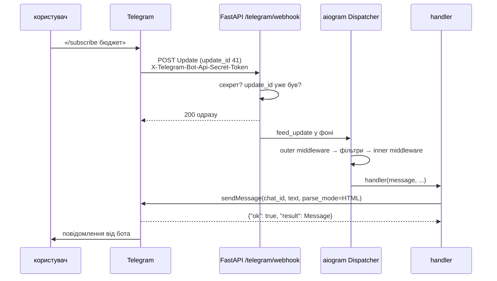
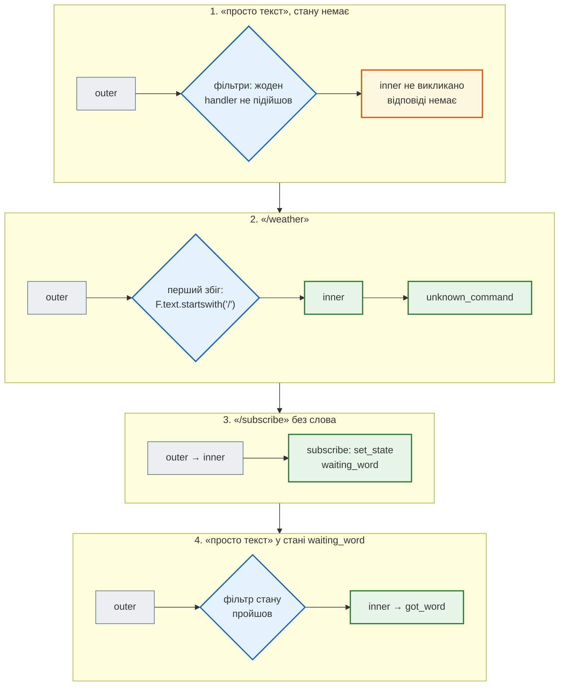

# Telegram-бот: Bot API і aiogram

## Проблема { #problem }

Telegram-бот — ще один клієнт твого застосунку, але з незвичною схемою. Не користувач приходить на твою адресу, а **Telegram** доставляє тобі події (повідомлення, натискання кнопок), і ти відповідаєш викликами **його** API. Звідси питання, яких немає у звичайного REST:

- як отримувати події: питати Telegram самому (polling) чи приймати його `POST` (webhook);
- як не обробити ту саму подію двічі, коли Telegram повторює доставку;
- як відповісти текстом з розміткою, якщо ім'я користувача містить `<` чи `&`;
- що робити з `429` («забагато повідомлень») і `403` («користувач заблокував бота»);
- як бути певним, що `POST` на твій webhook надіслав Telegram, а не будь-хто.

[Крок 9](../tutorials/09_telegram_bot/index.md) будує бота News Hub на aiogram 3 з двійником Bot API для тестів. Ця сторінка — Bot API і aiogram загалом: що звідки береться і де межа між Telegram, бібліотекою й твоїм кодом.

## Ментальна модель { #mental-model }



Три частини, три відповідальності:

| Частина | Що робить | Що від неї залежить |
|---|---|---|
| **Bot API** (`api.telegram.org/bot<TOKEN>/<метод>`) | приймає виклики бота, доставляє `Update` | формат, ліміти, коди помилок |
| **aiogram** | `Bot` — виклики методів; `Dispatcher` і `Router` — доставка `Update` у handler | фільтри, middleware, FSM, винятки |
| **твій код** | handlers, перевірка webhook, форматування, розсилка | бізнес-правила, безпека |

Приклади сторінки — [`examples/integrations/telegram_demo.py`](https://github.com/NikoriakViktor/news_hub/blob/main/examples/integrations/telegram_demo.py). Telegram там не викликається: `FakeTelegram` — сесія aiogram, яка замість HTTP-запиту записує виклик методу й повертає JSON у форматі Bot API. Перетворення цього JSON на результат чи виняток робить сам aiogram (`BaseSession.check_response`), тож поведінка бібліотеки справжня, а тексти помилок задає фейк.

```python title="telegram_demo.py (фрагмент)"
class FakeTelegram(BaseSession):
    async def make_request(self, bot: Bot, method: Any, timeout: int | None = None) -> Any:
        name = method.__api_method__
        # як справжня сесія: Default(parse_mode) → значення з DefaultBotProperties, None — не надсилається
        params = self.prepare_value(method.model_dump(warnings=False), bot=bot, files={}, _dumps_json=False)
        self.calls.append((name, params))
        if self.errors:
            body = {"ok": False, **self.errors.pop(0)}
            return self.check_response(bot, method, body["error_code"], json.dumps(body)).result
        ...
        return self.check_response(bot, method, 200, json.dumps({"ok": True, "result": result})).result
```

Локальний двійник Bot API як окремий HTTP-сервер (з правилами HTML і ліміту 4096) — у тестах News Hub, [крок 9](../tutorials/09_telegram_bot/bot_structure.md#twin).

## Bot API: виклики й події { #bot-api }

Кожен виклик — `POST https://api.telegram.org/bot<TOKEN>/<метод>`; відповідь — завжди JSON:

```text
{"ok": true, "result": …}
{"ok": false, "error_code": 429, "description": "Too Many Requests: retry after 3", "parameters": {"retry_after": 3}}
```

**`Update`** — подія для бота. У кожного є `update_id`, а з необов'язкових полів присутнє **рівно одне**: `message`, `edited_message`, `callback_query` тощо. `update_id` ростуть послідовно; документація прямо радить використовувати їх, щоб ігнорувати повторні доставки.

Токен бота — у шляху запиту. Тому адреса з токеном — секрет: вона не повинна потрапити в журнал доступу проксі чи в текст винятку.

## Polling і webhook { #polling-webhook }

| | Long polling (`getUpdates`) | Webhook (`setWebhook`) |
|---|---|---|
| хто починає | бот: «є нові?» | Telegram: `POST` на твою адресу |
| що потрібно | лише вихідний інтернет | публічна `https://`-адреса; порти 443, 80, 88 або 8443 |
| підтвердження | `offset` = останній `update_id` + 1 | відповідь `2xx` |
| якщо бот не відповів | update чекає наступного `getUpdates` | Telegram повторює запит і після кількох спроб здається |
| одночасно | ні: поки webhook встановлено, `getUpdates` не працює | |
| для чого | розробка; бот окремим процесом | бот — частина вебзастосунку |

Обидва способи зберігають непрочитані update на сервері Telegram **не довше 24 годин**.

**Як працює `offset`.** `getUpdates` повертає update, починаючи з найстарішого непідтвердженого. Update вважається підтвердженим, щойно `getUpdates` викликано з `offset`, більшим за його `update_id`. `timeout` — скільки секунд Telegram тримає запит, якщо нового немає (long polling); за замовчуванням `0` — звичайне опитування, лише для тестів. aiogram робить усе це сам: `dp.start_polling(bot)` (у 3.31 — `polling_timeout=10` секунд, повтори з backoff при збоях мережі).

**Webhook і повтори.** Telegram вважає доставку невдалою, якщо відповідь не `2xx` або не прийшла вчасно, — і надсилає той самий update ще раз. Звідси два правила: відповідай `200` **одразу**, а обробляй після відповіді; і не обробляй той самий `update_id` двічі.

`allowed_updates` (у `setWebhook` і `getUpdates`) — які типи update надсилати. Не вказав `callback_query` — натискання кнопок не дійдуть до бота, хоч handler і написано.

Як News Hub вибирає режим за змінними середовища і чому `delete_webhook()` — перше, що робить polling, — [крок 9](../tutorials/09_telegram_bot/polling_webhook.md#modes).

## aiogram: `Bot`, `Dispatcher`, `Router` { #aiogram }

| Об'єкт | Що це | Скільки |
|---|---|---|
| `Bot` | клієнт Bot API: токен, HTTP-сесія, типові налаштування (`parse_mode`) | один на токен |
| `Dispatcher` | приймає `Update`, проганяє через middleware, шукає handler; кореневий `Router` | один на процес (на застосунок) |
| `Router` | група handlers з фільтрами; підключається до диспетчера чи іншого роутера | скільки завгодно |

Handler — функція з фільтрами. aiogram перевіряє handlers **згори донизу** і викликає перший, чиї фільтри пройшли:

```python title="telegram_demo.py (фрагмент)"
def build_router() -> Router:
    """Новий Router на кожен виклик: один Router можна підключити лише до одного Dispatcher."""
    router = Router(name="demo")

    @router.message(CommandStart())
    async def start(message: Message) -> None: ...

    @router.message(Command("subscribe"))
    async def subscribe(message: Message, command: CommandObject, state: FSMContext) -> None: ...

    @router.message(Subscribe.waiting_word, F.text)
    async def got_word(message: Message, state: FSMContext) -> None: ...

    @router.callback_query(Unsubscribe.filter())
    async def unsubscribe(query: CallbackQuery, callback_data: Unsubscribe) -> None: ...

    @router.message(F.text.startswith("/"))
    async def unknown_command(message: Message) -> None: ...      # останнім: «будь-яка команда»

    return router
```

- **Фільтри** — `CommandStart()`, `Command("subscribe")`, стан FSM, «магічний» `F` (`F.text`, `F.text.startswith("/")`, `F.chat.type == "private"`).
- **Параметри handler** — не з позиції, а за назвою: `message`, `command` (аргументи команди), `state` (FSM), `callback_data` (розібраний `CallbackData`) і все, що middleware поклало в `data`. Те саме, що `Depends` у FastAPI, але за іменем.
- **«Будь-що» — останнім.** Handler `F.text` перед `Command(...)` перехопить і команди.

## Middleware: outer і inner { #middleware }

Middleware в aiogram — функція навколо handler, як у FastAPI. Різниця — **коли** вона спрацьовує:

```text
--- 2. порядок: outer middleware → фільтри → inner middleware → handler
   'просто текст'                     ['outer']
   '/weather'                         ['outer', 'inner', 'handler unknown_command']
   '/subscribe'                       ['outer', 'inner', 'handler subscribe']
   'просто текст'                     ['outer', 'inner', 'handler got_word']
```



| | `dp.message.outer_middleware(...)` | `dp.message.middleware(...)` |
|---|---|---|
| коли | для **кожного** повідомлення, до фільтрів | лише коли handler знайдено, перед ним |
| для чого | rate limit, журнал, відкинути все від заблокованих | сесія бази, залежності для handler |
| ціна | працює й для повідомлень, які ніхто не обробить | — |

Те саме повідомлення «просто текст» спершу не обробив ніхто (лише `outer`), а після `/subscribe` — обробив `got_word`: стан FSM змінив, які фільтри проходять. Як News Hub кладе в `data` свою сесію бази на кожен update і чому rate limit — саме `outer` — [крок 9](../tutorials/09_telegram_bot/bot_structure.md#middlewares).

## FSM: діалог у кілька кроків { #fsm }

Команда без аргументу («/subscribe» — а яке слово?) — це діалог: бот питає, наступне повідомлення — відповідь. Між двома update треба пам'ятати, на якому кроці користувач. Це **скінченний автомат** (FSM): стан на кожну пару «чат + користувач».

```python title="telegram_demo.py (фрагмент)"
class Subscribe(StatesGroup):
    waiting_word = State()


await state.set_state(Subscribe.waiting_word)       # у handler /subscribe
...
await state.clear()                                 # у got_word, після збереження
```

```text
--- 3. FSM: /subscribe без слова → стан → наступне повідомлення
   стан після /subscribe              Subscribe:waiting_word
   стан після «Бюджет»                None
   підписки 3003                      {'бюджет'}
   callback_data кнопки               unsub:бюджет
```

- **Сховище стану** — за замовчуванням `MemoryStorage`, у пам'яті процесу. Перезапуск — і всі діалоги забуто; два воркери — кожен зі своїм станом. На сервері — `RedisStorage` з `aiogram.fsm.storage.redis`.
- **Стан — на чат.** Тест `test_fsm_state_is_per_chat`: інший чат зі словом «ціни» не потрапляє в `got_word`.
- **Вихід з діалогу.** Користувач може передумати й надіслати `/news`. Без `state.clear()` на інших командах (або окремої `/cancel`) він застрягне.

У News Hub FSM немає: `/subscribe` приймає слово лише аргументом команди.

## Inline-кнопки і `callback_query` { #callbacks }

Кнопка під повідомленням не надсилає текст — натискання приходить окремим update `callback_query` з `callback_data`, яку задав бот. aiogram дає фабрику з префіксом і типізованими полями:

```python title="telegram_demo.py (фрагмент)"
class Unsubscribe(CallbackData, prefix="unsub"):
    word: str


InlineKeyboardButton(text="Відписатися", callback_data=Unsubscribe(word=word.casefold()).pack())

@router.callback_query(Unsubscribe.filter())
async def unsubscribe(query: CallbackQuery, callback_data: Unsubscribe) -> None:
    SUBSCRIPTIONS.get(query.from_user.id, set()).discard(callback_data.word)
    await query.answer(f"Відписано від «{callback_data.word}»")
```

```text
--- 4. натискання inline-кнопки → callback_query
   handler                            ['handler unsubscribe']
   виклик Bot API                     ('answerCallbackQuery', {'callback_query_id': 'cb8', 'text': 'Відписано від «бюджет»'})
   підписки 3003                      set()
   callback_data > 64 байтів          Resulted callback data is too long! len(…
```

- **`callback_data` — 1–64 байти.** Кирилиця — два байти на літеру в UTF-8: «unsub:» + 40 літер «б» — це 86 байтів, і `pack()` кидає `ValueError` ще до виклику Telegram. Довгі дані — в базу, у кнопку — їхній id.
- **`callback_data` приходить від клієнта** — це вхідні дані, як тіло запиту. Перевіряй, що чат, з якого натиснули, має право на цю дію: `query.from_user.id`, а не id з `callback_data`.
- **`answer()` обов'язковий.** Без `answerCallbackQuery` клієнт Telegram показує на кнопці годинник.
- `callback_query` має бути в `allowed_updates`.

## Текст: HTML, екранування, 4096 { #formatting }

`parse_mode=HTML` дозволяє лише теги з документації (`<b>`, `<i>`, `<a href>`, `<code>`, `<pre>`, `<blockquote>`…), а **всі** `<`, `>` і `&` поза тегом мають бути замінені на `&lt;`, `&gt;`, `&amp;`. Інакше Telegram відхиляє повідомлення з `400 can't parse entities` — і бот мовчить. Два способи:

```text
--- 1. ім'я з < і &: html.escape або aiogram.utils.formatting
   sendMessage                        'Привіт, <b>&lt;Олена &amp; Co&gt;</b>!' parse_mode=HTML
   sendMessage                        'Привіт, <Олена & Co>!' entities=[('bold', 8, 12)]
```

| | `html.escape` + `parse_mode=HTML` | `aiogram.utils.formatting` |
|---|---|---|
| як | `f"Привіт, <b>{html.escape(name, quote=False)}</b>!"` | `Text("Привіт, ", Bold(name), "!").as_kwargs()` |
| що йде в Telegram | розмітка в тексті | чистий текст + `entities` (зміщення й довжини) |
| ризик | забув `escape` в одному місці — `400` | розмітки в тексті немає, нічого екранувати |
| коли | шаблони, вже готовий HTML | текст, складений з чужих даних |

Обмеження тексту — **1–4096 символів після розбору розмітки**. Довгий список ріжуть на частини між рядками, а не кожні N символів: розріз посеред `<b>…</b>` чи `&amp;` дає дві невалідні частини. Як це зроблено в News Hub (`esc`, `link`, `split_message`) — [крок 9](../tutorials/09_telegram_bot/html_replies.md).

## Помилки Bot API: 429, 403, 400 { #errors }

aiogram перетворює відповідь `{"ok": false, …}` на виняток за кодом:

```text
--- 5. помилки Bot API → винятки aiogram
   429                                TelegramRetryAfter, retry_after=3
   403                                TelegramForbiddenError: Forbidden: bot was blocked by the user
   400                                TelegramBadRequest: Bad Request: can't parse entities
```

| Код | Виняток aiogram | Що означає | Дія |
|---|---|---|---|
| `429` | `TelegramRetryAfter` (`.retry_after`) | flood control | почекати `retry_after` секунд і повторити |
| `403` | `TelegramForbiddenError` | бот заблокований, вилучений з групи | більше не писати в цей чат: прибрати підписки |
| `400` | `TelegramBadRequest` | невірний запит: розмітка, довжина, чат | виправити код; повтор не допоможе |
| `401` | `TelegramUnauthorizedError` | невірний токен | зупинити бота, перевірити `BOT_TOKEN` |
| `409` | `TelegramConflictError` | `getUpdates` при встановленому webhook | `delete_webhook()` перед polling |
| `5xx` | `TelegramServerError` | збій Telegram | повтор з backoff |

`TelegramRetryAfter` перевіряється **першим**: aiogram дивиться на `parameters.retry_after` раніше за код. Ліміти, після яких приходить `429`, за [FAQ Telegram](https://core.telegram.org/bots/faq#my-bot-is-hitting-limits-how-do-i-avoid-this):

- в одному чаті — не частіше за одне повідомлення на секунду (короткі сплески можливі);
- у групі — не більше 20 повідомлень на хвилину;
- розсилка — не більше близько 30 повідомлень на секунду (більше — лише з платними розсилками).

Розсилка підписникам з паузою, `retry_after` і прибиранням чатів після `403` — [крок 9](../tutorials/09_telegram_bot/subscriptions_notify.md#notify).

## Webhook у FastAPI: секрет і повтори { #webhook }

Адреса webhook публічна: `POST` на неї може надіслати будь-хто. `setWebhook(secret_token=…)` змушує Telegram додавати заголовок `X-Telegram-Bot-Api-Secret-Token` у кожен запит (1–256 символів `A-Z a-z 0-9 _ -`). Перевірка — перше, що робить endpoint:

```python title="telegram_demo.py (фрагмент)"
@app.post("/telegram/webhook")
async def webhook(request: Request, background: BackgroundTasks) -> dict[str, bool]:
    got = request.headers.get("X-Telegram-Bot-Api-Secret-Token", "")
    if not hmac.compare_digest(got.encode(), SECRET.encode()):        # порівняння за сталий час
        raise HTTPException(401, "неправильний секрет")
    try:
        update = Update.model_validate(await request.json(), context={"bot": bot})
    except ValueError as error:
        raise HTTPException(400, "це не update") from error
    if update.update_id in SEEN:                                     # Telegram повторює доставку
        return {"ok": True}
    SEEN.add(update.update_id)
    background.add_task(dp.feed_update, bot, update)                 # 200 одразу, обробка — після
    return {"ok": True}
```

```text
--- 6. webhook: секрет, повтор того самого update, обробка після відповіді
   без секрету                        401 {'detail': 'неправильний секрет'}
   чужий секрет                       401 {'detail': 'неправильний секрет'}
   правильний                         200 {'ok': True}
   той самий update_id                200 {'ok': True}
   не update                          400 {'detail': 'це не update'}
   sendMessage у чат 4004             1
```

- **Порядок: секрет → розбір тіла.** Чужий запит не повинен навіть потрапити в парсер.
- **`hmac.compare_digest`**, а не `==`: час порівняння не підказує, скільки перших символів збіглося.
- **Повтор того самого `update_id` — `200`, а не помилка**: Telegram має перестати повторювати. Користувач отримав одну відповідь, а не дві.
- **`SEEN` у пам'яті — лише для прикладу.** З кількома воркерами чи після перезапуску — `SET NX` у Redis з TTL (update живуть на сервері Telegram до 24 годин).
- **`BackgroundTasks`** — обробка після відповіді. Якщо handler падає, Telegram про це не дізнається і не повторить — помилку видно лише в журналі.

Ця сама схема — секрет, `401`, `400`, обробка у фоні — у [кроці 9](../tutorials/09_telegram_bot/polling_webhook.md#webhook), а загальні правила для будь-якого webhook (підпис, захист від повтору, швидка відповідь) — у [Які бувають API: webhook](../01_http_and_rest/api_styles.md#webhook).

## Тести бота { #tests }

Update — це словник; відповідь бота — запис у `FakeTelegram.calls`. Тест проганяє update через справжній `Dispatcher`:

```python title="test_telegram.py (фрагмент)"
@pytest.mark.asyncio
async def test_user_name_is_escaped() -> None:
    bot, dp, session = build()
    await feed(dp, bot, message_update("/start", first_name="<script>"))
    assert session.calls[-1][1]["text"] == "Привіт, <b>&lt;script&gt;</b>!"


@pytest.mark.asyncio
async def test_forbidden_is_an_exception_not_a_silent_failure() -> None:
    bot, _, session = build()
    session.errors = [{"error_code": 403, "description": "Forbidden: bot was blocked by the user"}]
    with pytest.raises(TelegramForbiddenError):
        await bot.send_message(1, "x")
```

| Підхід | Що перевіряє | Чого не перевіряє |
|---|---|---|
| підмінена сесія (`FakeTelegram`) | handlers, фільтри, middleware, FSM, обробку винятків aiogram | HTTP-рівень: як aiogram кодує запит, тексти помилок Telegram |
| двійник Bot API як HTTP-сервер ([крок 9](../tutorials/09_telegram_bot/bot_structure.md#twin)) | ще й справжній HTTP aiogram, webhook наживо, правила HTML і 4096 | що Telegram поводиться так само, як двійник |
| справжній бот з тестовим токеном | усе | автоматично в CI — ні: мережа, ліміти, токен |

## У News Hub { #news-hub }

| Ідея сторінки | Де в коді | Розбір |
|---|---|---|
| `Bot`, `Dispatcher`, роутер з функції | `bot/factory.py`, `handlers.build_router()` | [крок 9](../tutorials/09_telegram_bot/bot_structure.md#parts) |
| outer — rate limit, inner — сесія бази | `bot/middlewares.py` | [крок 9](../tutorials/09_telegram_bot/bot_structure.md#middlewares) |
| адміни бота й ліміт `/scrape` | `security.py` (`AdminSettings.telegram_ids`), `handlers.cmd_scrape` (`LIMITS["scrape"]`) | [крок 9](../tutorials/09_telegram_bot/bot_structure.md#admin) |
| HTML: `esc`, `link`, розріз за рядками | `bot/formatting.py` | [крок 9](../tutorials/09_telegram_bot/html_replies.md) |
| `429` → `retry_after`, `403` → прибрати підписки | `notify.py` | [крок 9](../tutorials/09_telegram_bot/subscriptions_notify.md#notify) |
| polling для розробки, webhook у FastAPI | `bot/__main__.py`, `POST /api/telegram/webhook` | [крок 9](../tutorials/09_telegram_bot/polling_webhook.md) |
| секрет: 32–256 символів, `verify_secret_token` | `bot/settings.py`, `api.py` | [крок 9](../tutorials/09_telegram_bot/polling_webhook.md#settings) |
| двійник Bot API | `tests/telegram_twin.py` | [крок 9](../tutorials/09_telegram_bot/bot_structure.md#twin) |

Чого в News Hub немає і чому: FSM — `/subscribe` бере слово аргументом; inline-кнопки — завдання в [контрольній точці кроку 9](../tutorials/09_telegram_bot/checkpoint.md#unsubscribe-button); журналу `update_id` — повторна доставка `/subscribe` нічого не зламає (`on_conflict_do_nothing` на парі чат + слово), а повторна `/news` лише надішле стрічку ще раз; реєстрація webhook передає `allowed_updates=["message"]`.

## Типові помилки { #mistakes }

| Помилка | Наслідок | Як правильно |
|---|---|---|
| ім'я чи заголовок у HTML без екранування | `400 can't parse entities`, бот мовчить | `html.escape` або `aiogram.utils.formatting` |
| розріз довгого тексту кожні 4096 символів | невалідний HTML у частинах | різати між рядками |
| `getUpdates` при встановленому webhook | `409 Conflict` | `delete_webhook()` перед polling |
| довга обробка до відповіді webhook | Telegram повторює update | `200` одразу, обробка у фоні |
| той самий `update_id` обробляється двічі | дві відповіді, подвійна підписка | журнал `update_id` або ідемпотентні handlers |
| webhook без `secret_token` | будь-хто надсилає «update» | секрет + `hmac.compare_digest` |
| `except Exception` при розсилці | `403`-чати отримують спроби вічно, `429` губить повідомлення | `TelegramForbiddenError`, `TelegramRetryAfter` окремо |
| `F.text` вище за `Command(...)` | команди перехоплює «будь-який текст» | загальні handlers — останніми |
| `MemoryStorage` FSM на сервері з кількома воркерами | стан діалогу губиться | `RedisStorage` |
| `callback_data` з довгим текстом | `ValueError` при `pack()` | у кнопку — id, дані — в базу |
| забули `callback_query` в `allowed_updates` | кнопки «не працюють» | перелічити всі потрібні типи |
| один `Router` у двох `Dispatcher` | помилка aiogram при підключенні | роутер з функції |

## Налагодження { #debugging }

- **Бот мовчить?** У журналі шукай `TelegramBadRequest`: найчастіше — розмітка (`can't parse entities`) або текст понад 4096 символів.
- **Webhook не доходить?** `getWebhookInfo` показує адресу, кількість update, що чекають (`pending_update_count`), і останню помилку доставки (`last_error_message`).
- **Чи дійшов update до handler?** Outer middleware з журналом показує кожне повідомлення; якщо outer бачить, а handler — ні, не підійшов жоден фільтр (або спрацював інший, вищий).
- **Стан FSM?** `dp.fsm.get_context(bot, chat_id=…, user_id=…).get_state()`.
- **Локально без публічної адреси** — polling; для webhook — тунель або двійник ([крок 9](../tutorials/09_telegram_bot/polling_webhook.md#webhook-run)).

## Безпека { #security }

- **Токен бота — секрет.** Він у шляху кожного запиту: стеж, щоб URL з токеном не потрапив у журнал. Витік — перевипусти токен у @BotFather.
- **Webhook — вхідні дані з інтернету:** секрет у заголовку, `hmac.compare_digest`, розбір через модель.
- **Усе від користувача — недовірене:** текст, ім'я, `callback_data`. Екранування на виході, перевірка прав на кожну дію.
- **Бот — ще один вхід у застосунок.** Правила «хто може змінювати» з API діють і тут — і записані в одному місці. У News Hub `/scrape` дозволено лише id з `BOT_ADMIN_IDS`. Цей список — частина тих самих `AdminSettings`, що й адмін API (`telegram_ids` у `security.py`): без `JWT_SECRET` і `ADMIN_PASSWORD_HASH` адміна немає й у боті. `BOT_ADMIN_IDS`, заданий без них, або нечисловий id зупиняють старт з `RuntimeError` ([крок 9](../tutorials/09_telegram_bot/bot_structure.md#admin), [було → стало](../08_security/authorization.md#news-hub-two-entries)).
- **Rate limit на користувача** — бот, що на кожне повідомлення викликає LLM, — це рахунок, який хтось інший може збільшити. Дорогі дії обмежують так само, як в API, а не лише загальним лімітом повідомлень. У News Hub загальний outer-ліміт — 20 повідомлень на хвилину, а `/scrape` додатково бере межу збору з `LIMITS["scrape"]` — ту саму, що й `POST /api/scrape*`. Лічильник — `rate:scrape:tg<id>`, понад межу бот відповідає «Забагато зборів: N за W с; спробуй через T с.».

## Питання { #questions }

1. Чим long polling відрізняється від звичайного опитування? Що задає `timeout` у `getUpdates`?
2. Як Telegram дізнається, що update оброблено, у polling і у webhook?
3. Чому webhook має відповідати `200` до обробки і що буде, якщо handler упаде після відповіді?
4. Чим outer middleware відрізняється від inner? Куди поставити rate limit і чому?
5. Чому `F.text` над `Command("news")` ламає команди?
6. Де зберігається стан FSM за замовчуванням і чим це погано на сервері?
7. Чому `callback_data` не можна довіряти і скільки в неї вміщається?
8. У чому різниця між `html.escape` + `parse_mode=HTML` і `aiogram.utils.formatting`?
9. Що робити з `TelegramRetryAfter`, а що — з `TelegramForbiddenError` під час розсилки?
10. Навіщо `hmac.compare_digest` для секрету webhook?

??? success "Відповіді"

    1. Long polling тримає запит відкритим, доки не з'явиться update або не мине `timeout` секунд; звичайне опитування (`timeout=0`) відповідає одразу, і доводиться питати знову й знову.
    2. Polling — наступний `getUpdates` з `offset`, більшим за `update_id`. Webhook — відповідь `2xx`.
    3. Інакше Telegram вирішить, що доставка не вдалась, і повторить update. Падіння після відповіді Telegram не побачить і не повторить — помилку видно лише в журналі.
    4. Outer — для кожного update до фільтрів; inner — лише коли handler знайдено. Rate limit — в outer: рахувати треба й повідомлення, які ніхто не обробить.
    5. aiogram перевіряє handlers згори донизу; `/news` — теж текст, тож його перехопить перший handler.
    6. `MemoryStorage` — у пам'яті процесу: перезапуск усе забуває, кожен воркер має свій стан. На сервері — `RedisStorage`.
    7. Її надсилає клієнт — це вхідні дані, які можна підробити. 1–64 байти; кирилиця — два байти на літеру.
    8. Перше — розмітка в тексті, і кожне чуже значення треба екранувати. Друге — чистий текст і `entities` зі зміщеннями: екранувати нічого.
    9. `TelegramRetryAfter` — почекати `retry_after` секунд і повторити. `TelegramForbiddenError` — прибрати підписки чату й більше туди не писати.
    10. Звичайне `==` закінчується на першому розбіжному символі; за часом відповіді можна підбирати секрет посимвольно.

## Що далі { #next }

[WebSocket у FastAPI](websockets.md) — коли клієнт не Telegram, а браузер, і з'єднання тримається годинами. На практиці — [крок 9](../tutorials/09_telegram_bot/index.md).

**Джерела:** Telegram — [Bot API](https://core.telegram.org/bots/api) ([getUpdates](https://core.telegram.org/bots/api#getupdates), [setWebhook](https://core.telegram.org/bots/api#setwebhook), [Update](https://core.telegram.org/bots/api#update), [HTML style](https://core.telegram.org/bots/api#html-style), [Making requests](https://core.telegram.org/bots/api#making-requests)), [Bots FAQ](https://core.telegram.org/bots/faq), [Marvin's Marvellous Guide to All Things Webhook](https://core.telegram.org/bots/webhooks); aiogram 3 — [Dispatcher](https://docs.aiogram.dev/en/latest/dispatcher/dispatcher.html), [Router](https://docs.aiogram.dev/en/latest/dispatcher/router.html), [Middlewares](https://docs.aiogram.dev/en/latest/dispatcher/middlewares.html), [Finite State Machine](https://docs.aiogram.dev/en/latest/dispatcher/finite_state_machine/index.html), [Callback Data Factory](https://docs.aiogram.dev/en/latest/dispatcher/filters/callback_data.html), [Formatting](https://docs.aiogram.dev/en/latest/utils/formatting.html); Python — [`hmac.compare_digest`](https://docs.python.org/3/library/hmac.html#hmac.compare_digest).
