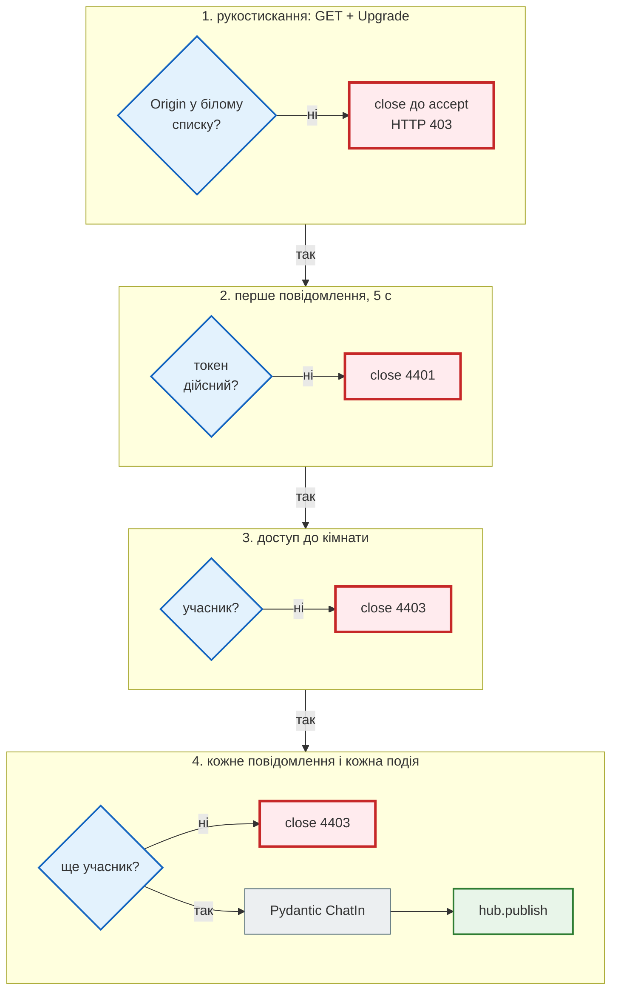
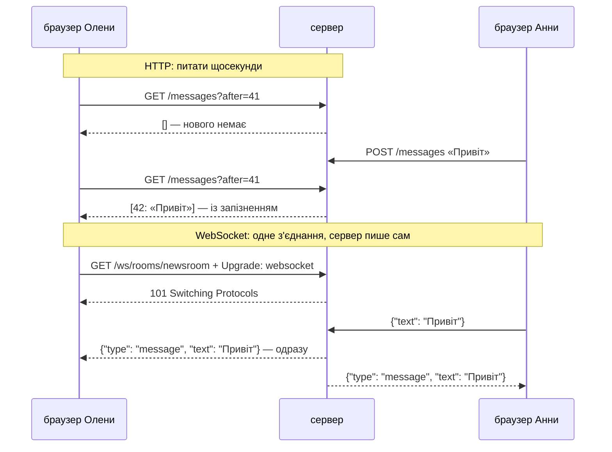

# WebSocket у FastAPI: автентифікація, Origin, розсилка, кілька воркерів

## Проблема { #problem }

Що таке WebSocket, чим він відрізняється від SSE і як виглядає найпростіший чат з `Depends` і `WebSocketException` — на сторінці [Які бувають API](../01_http_and_rest/api_styles.md#websocket). Там же — чому наївна розсилка падає на першому зниклому клієнті. Ця сторінка — про те, що ламається, коли чат іде в продакшн:

- з'єднання живе годинами, а права змінюються: учасника вилучили з кімнати, а його вкладка далі читає й пише;
- будь-який сайт, відкритий у браузері учасника, може під'єднатися до чату від його імені — cookie поїде разом із запитом;
- токен у URL потрапляє в журнали доступу;
- з двома воркерами uvicorn учасники на різних процесах одне одного не чують;
- один повільний клієнт гальмує розсилку всім;
- як усе це протестувати без браузера.

## Ментальна модель { #mental-model }

HTTP-запит перевіряється один раз. WebSocket — це **одне рукостискання і потім довге життя**, тож перевірки розкладаються в часі:



Код — [`examples/integrations/ws_app.py`](https://github.com/NikoriakViktor/news_hub/blob/main/examples/integrations/ws_app.py): чат кімнат на FastAPI. Демо [`ws_demo.py`](https://github.com/NikoriakViktor/news_hub/blob/main/examples/integrations/ws_demo.py) піднімає **справжні сервери uvicorn** на `127.0.0.1` і під'єднується клієнтом `websockets`; тести — [`test_ws.py`](https://github.com/NikoriakViktor/news_hub/blob/main/examples/integrations/test_ws.py).

## HTTP проти WebSocket { #http-vs-ws }



Опитування робить сотні порожніх запитів і однаково запізнюється. WebSocket тримає одне з'єднання на вкладку, і сервер пише, щойно є що сказати. Ціна — тисячі відкритих з'єднань: потік на кожне їх не витримає, потрібен цикл подій (ASGI, uvicorn). Якщо дані йдуть лише від сервера, SSE простіший — [порівняння](../01_http_and_rest/api_styles.md#sse).

## Рукостискання і `Origin` { #origin }

```python title="ws_app.py (фрагмент)"
ALLOWED_ORIGINS = frozenset({"https://news.example", "http://localhost:8000", "http://127.0.0.1:8000"})


@app.websocket("/ws/rooms/{room}")
async def room_ws(websocket: WebSocket, room: str) -> None:
    # 1. Звідки. Браузер завжди ставить Origin сторінки, і сторінка його не підробить.
    origin = websocket.headers.get("origin")
    if origin not in ALLOWED_ORIGINS:
        logger.warning("відхилено Origin %r", origin)
        await websocket.close(code=status.WS_1008_POLICY_VIOLATION)   # до accept → HTTP 403
        return
    await websocket.accept()
```

```text
--- 1. рукостискання: Upgrade → 101; чужий Origin → 403 ще до WebSocket
   https://news.example                 101 Switching Protocols, Upgrade: websocket
   перше повідомлення від сервера       {'type': 'hello', 'user': 'olena', 'room': 'newsroom'}
   https://evil.example                 HTTP 403
   https://news.example.evil.com        HTTP 403
```

**Навіщо.** WebSocket не підпадає під CORS: браузер дозволяє сторінці `evil.example` відкрити `new WebSocket("wss://news.example/ws/…")`, і cookie сесії поїде разом із рукостисканням. Якщо сервер автентифікує за cookie, чужий сайт читає чат від імені користувача — це **Cross-Site WebSocket Hijacking**. Заголовок `Origin` браузер ставить сам, і сторінка не може його підробити. Тож сервер має його перевірити.

- **Точний збіг з білим списком**, а не `startswith` чи `in`: `https://news.example.evil.com` починається з `https://news.example`. Та сама помилка, що `endswith` для доменів у [кроці 5](../tutorials/05_api_testing/index.md).
- **Без `Origin` — теж відмова** (тест з `None`). Браузер його надсилає завжди; відсутність означає не-браузерний клієнт.
- **`Origin` — захист браузера, а не автентифікація.** Скрипт на `websockets` надішле будь-який `Origin` (у демо так і зроблено). Він захищає користувача від чужої сторінки, а не сервер від атакувальника — від того захищає токен.
- **`close()` до `accept()`** — uvicorn відповідає на рукостискання `403`, з'єднання не відкривається. Браузер HTTP-коду не побачить: для `onclose` це `1006`, як обрив мережі.

## Автентифікація { #auth }

Браузерний `WebSocket` не вміє заголовок `Authorization`. Варіанти:

| Як | Плюси | Мінуси |
|---|---|---|
| cookie сесії | нічого не треба робити на клієнті | потрібна перевірка `Origin` (CSWSH) |
| токен у query (`?token=…`) | просто; приклад у [Які бувають API](../01_http_and_rest/api_styles.md#websocket) | URL пишеться в журнали доступу nginx і uvicorn |
| короткий одноразовий квиток у query | токен у журналі вже нічого не дає | окремий ендпоінт для видачі квитка |
| **перше повідомлення** | токен не в URL і не в журналі | з'єднання відкрито до перевірки — потрібен тайм-аут |

`ws_app.py` бере перше повідомлення з тайм-аутом:

```python title="ws_app.py (фрагмент)"
# 2. Хто. Токен — першим повідомленням, а не в URL: адреси пишуться в журнали доступу.
try:
    first = await asyncio.wait_for(websocket.receive_json(), AUTH_TIMEOUT)
    user = TOKENS[first["token"]]
except (asyncio.TimeoutError, KeyError, TypeError, ValueError):
    await websocket.close(code=CLOSE_UNAUTHORIZED, reason="unauthorized")
    return
# 3. Чи можна в цю кімнату.
if not is_member(room, user):
    await websocket.close(code=CLOSE_FORBIDDEN, reason="not a member")
    return
```

```text
   чужий токен                          закрито: 4401 unauthorized
   bob не в кімнаті                     закрито: 4403 not a member
```

**Коди закриття.** `1000`–`2999` визначає протокол (`1000` — нормальне, `1008` — порушення правил, `1006` — обрив без кадру Close); `4000`–`4999` — для застосунку ([RFC 6455, §7.4.2](https://www.rfc-editor.org/rfc/rfc6455#section-7.4.2)). Тут `4401` і `4403` повторюють HTTP-коди, щоб клієнт розрізняв «не той токен» і «немає доступу». Клієнт за ними вирішує, чи перепідключатися:

| Код | Що робити клієнту |
|---|---|
| `1000`, `1001` | нічого: закрито навмисно |
| `4000`–`4999` | **не** перепідключатися: застосунок відмовив; показати причину |
| `1006` та інші | перепідключитися з backoff і jitter, обмежити кількість спроб |

Без цього розрізнення клієнт, якому відмовили, перепідключається безкінечно — і кожна спроба проходить рукостискання, автентифікацію й відмову. Backoff і jitter — ті самі, що для повторів LLM ([Надійність LLM](llm_reliability.md#retry)).

## Права — на кожне повідомлення { #per-message }

Перевірка в момент підключення каже, що користувач **був** учасником. Через годину його можуть вилучити — а вкладка відкрита. Тому дві речі:

```python title="ws_app.py (фрагмент)"
async def pump() -> None:
    """Хаб → цей сокет. Подія «вилучено мене» закриває з'єднання, не чекаючи мого повідомлення."""
    async for event in events:
        if event["type"] == "member.removed" and event["user"] == user:
            await websocket.close(code=CLOSE_FORBIDDEN, reason="removed")
            return
        await websocket.send_json(event)

...
while True:
    raw = await websocket.receive_text()
    # 4. Права — на КОЖНЕ повідомлення: з'єднання живе годинами, а членство змінюється.
    if not is_member(room, user):
        await websocket.close(code=CLOSE_FORBIDDEN, reason="not a member")
        return
```

1. **Перевірка на кожне вхідне повідомлення** — вилучений не напише.
2. **Подія «вилучено» від того, хто змінив права** — вилучений перестане **читати** одразу, а не тоді, коли щось напише. HTTP-ендпоінт, що вилучає учасника, публікує подію в той самий хаб:

```python title="ws_app.py (фрагмент)"
@app.delete("/rooms/{room}/members/{user}", status_code=status.HTTP_204_NO_CONTENT)
async def remove_member(room: str, user: str) -> None:
    """HTTP змінює права — і відкриті WebSocket дізнаються про це одразу, через той самий хаб."""
    if not is_member(room, user):
        raise HTTPException(404, "немає такого учасника")
    app.state.members[room].discard(user)
    await hub.publish(room, {"type": "member.removed", "user": user})
```

Якщо права зберігаються в базі, подію публікують **після COMMIT**: інакше з'єднання, отримавши подію, може перечитати базу й побачити старе членство.

### Кожне повідомлення — через модель { #validation }

```python title="ws_app.py (фрагмент)"
class ChatIn(BaseModel):
    """Кожне вхідне повідомлення — через Pydantic, як тіло POST."""
    model_config = ConfigDict(extra="forbid")
    text: str = Field(min_length=1, max_length=500)
```

Невалідне повідомлення — відповідь `{"type": "error", …}` у той самий сокет, а не розрив з'єднання: одна помилка клієнта не повинна виганяти його з чату (тест `test_invalid_message_is_an_error_not_a_disconnect`). Розмір кадру обмежує й сервер: uvicorn приймає повідомлення до `--ws-max-size` байтів, за замовчуванням 16 МіБ — для чату це забагато, і `max_length` у моделі спрацьовує вже після того, як 16 МіБ прочитано в пам'ять.

## Розсилка: хаб { #hub }

Маршрут не повинен знати, як повідомлення доходять до інших з'єднань. Між ними — **хаб** з двома операціями:

```python title="ws_app.py (фрагмент)"
class Hub(Protocol):
    async def publish(self, room: str, event: dict[str, Any]) -> None: ...

    def subscribe(self, room: str) -> contextlib.AbstractAsyncContextManager[AsyncIterator[dict[str, Any]]]: ...


class MemoryHub:
    """Черга на кожне з'єднання — у пам'яті ОДНОГО процесу. Другий воркер про ці черги не знає."""

    async def publish(self, room: str, event: dict[str, Any]) -> None:
        for queue in list(self.rooms[room]):
            try:
                queue.put_nowait(event)
            except asyncio.QueueFull:                     # повільний клієнт не зупиняє розсилку решті
                logger.warning("кімната %s: черга клієнта повна, подію пропущено", room)
```

Чим це краще за `ConnectionManager` зі списком сокетів:

- **Розсилка не пише в сокети сама.** Кожне з'єднання має свою чергу й свою задачу `pump()`, що з неї читає. Зниклий клієнт не кидає виняток у розсилку іншим — проблема наївного `broadcast` з [Які бувають API](../01_http_and_rest/api_styles.md#websocket) зникає за побудовою.
- **Повільний клієнт не гальмує інших.** Черга обмежена (`maxsize=100`); повна — подію для цього клієнта пропущено, решта отримують (тест `test_full_queue_of_one_client_does_not_stop_broadcast`). Альтернатива — закрити такого клієнта: хай перепідключиться й дочитає історію з бази.
- **Відписка гарантована.** `subscribe` — менеджер контексту: черга зникає з кімнати в `finally`, хоч би як закінчилось з'єднання.

## Кілька воркерів: Redis Pub/Sub { #workers }

`uvicorn --workers 2` — два процеси, у кожного своя пам'ять і свій `MemoryHub`. Демо піднімає два сервери uvicorn на різних портах в одному процесі (спільний словник учасників грає роль бази), Олена — на воркері A, Анна — на B:

```text
--- 2. два воркери, MemoryHub у кожного свій
   olena (A) отримала                   {'type': 'message', 'user': 'olena', 'text': 'привіт з воркера A'}
   anna (B) отримала                    нічого за 1.5 с
   DELETE anna на воркері A             204
   з'єднання anna на воркері B          нічого за 1.5 с
   anna пише після вилучення            закрито: 4403 not a member
--- 3. два воркери, RedisHub (справжній Redis redis://127.0.0.1:16399/0)
   olena (A) отримала                   {'type': 'message', 'user': 'olena', 'text': 'привіт з воркера A'}
   anna (B) отримала                    {'type': 'message', 'user': 'olena', 'text': 'привіт з воркера A'}
   DELETE anna на воркері A             204
   з'єднання anna на воркері B          закрито: 4403 removed
   anna пише після вилучення            ConnectionClosedError
```

(Третій блок — запуск з `REDIS_URL` і Redis 7 у контейнері; без `REDIS_URL` демо бере fakeredis, і результат той самий.)

- **`MemoryHub`**: Анна не почула Олену, і подія «вилучено» до неї не дійшла. Зате спрацювала перевірка на кожне повідомлення: права в спільній «базі», тож написати Анна вже не змогла. Перевірка прав і доставка подій — **різні** механізми, і потрібні обидва.
- **`RedisHub`**: `PUBLISH chat:newsroom` бачать підписники в усіх процесах — повідомлення дійшло, з'єднання Анни закрито одразу після `DELETE` на іншому воркері.

```python title="ws_app.py (фрагмент)"
class RedisHub:
    """Redis Pub/Sub: PUBLISH chat:<room> бачать підписники в усіх процесах. Лише JSON — об'єкти Python не пройдуть."""

    async def publish(self, room: str, event: dict[str, Any]) -> None:
        await self.redis.publish(f"chat:{room}", json.dumps(event, ensure_ascii=False))

    @contextlib.asynccontextmanager
    async def subscribe(self, room: str) -> AsyncIterator[AsyncIterator[dict[str, Any]]]:
        pubsub = self.redis.pubsub()
        await pubsub.subscribe(f"chat:{room}")
        ...
```

Що варто знати про Pub/Sub:

| Властивість | Наслідок |
|---|---|
| «вистрілив і забув»: повідомлення отримують лише ті, хто підписаний **зараз** | клієнт, що перепідключався, пропустив повідомлення → історія — з бази за `id` останнього отриманого |
| порядок — у межах одного каналу | канал на кімнату, а не один на всіх |
| у каналі — лише байти | події — JSON; жодних об'єктів ORM (тест на `MemoryHub` цього не перевірить — запускай тести й з Redis) |
| підписка — окреме з'єднання з Redis на кожен `pubsub()` | тисяча WebSocket — тисяча підписок; для великої кількості — одна підписка на процес і розподіл по чергах усередині |

Потрібна гарантована доставка й «дочитати пропущене» — Redis Streams (`XADD`/`XREAD` з id) замість Pub/Sub.

## Тести WebSocket { #tests }

`TestClient.websocket_connect` проходить увесь стек FastAPI/Starlette без сервера й мережі:

```python title="test_ws.py (фрагмент)"
@pytest.mark.parametrize("origin", ["https://evil.example", "https://news.example.evil.com", None])
def test_foreign_origin_is_rejected_before_accept(client: TestClient, origin: str | None) -> None:
    headers = {"origin": origin} if origin else {}
    with pytest.raises(WebSocketDisconnect) as error:
        with client.websocket_connect("/ws/rooms/newsroom", headers=headers):
            pass
    assert error.value.code == 1008


def test_removed_member_is_disconnected_at_once(client: TestClient) -> None:
    olena, anna = join(client, "t-olena"), join(client, "t-anna")
    olena.receive_json()
    anna.receive_json()
    assert client.delete("/rooms/newsroom/members/anna").status_code == 204
    with pytest.raises(WebSocketDisconnect) as error:
        anna.receive_json()
    assert error.value.code == CLOSE_FORBIDDEN
    assert olena.receive_json() == {"type": "member.removed", "user": "anna"}     # решта дізнається, хто пішов
```

```text
test_ws.py::test_foreign_origin_is_rejected_before_accept[https://evil.example] PASSED [ 11%]
test_ws.py::test_foreign_origin_is_rejected_before_accept[https://news.example.evil.com] PASSED [ 22%]
test_ws.py::test_foreign_origin_is_rejected_before_accept[None] PASSED   [ 33%]
test_ws.py::test_bad_token_closes_with_4401 PASSED                       [ 44%]
test_ws.py::test_non_member_closes_with_4403 PASSED                      [ 55%]
test_ws.py::test_message_reaches_every_member PASSED                     [ 66%]
test_ws.py::test_invalid_message_is_an_error_not_a_disconnect PASSED     [ 77%]
test_ws.py::test_removed_member_is_disconnected_at_once PASSED           [ 88%]
test_ws.py::test_full_queue_of_one_client_does_not_stop_broadcast PASSED [100%]
============================== 9 passed in 0.31s ===============================
```

- **Кілька клієнтів в одному тесті** — два `websocket_connect` з одним `TestClient`.
- **Відмова до `accept`** у `TestClient` — `WebSocketDisconnect` з кодом із `close()` (`1008`); справжній uvicorn на ту саму відмову відповідає HTTP `403`, як у демо.
- **Чого `TestClient` не перевіряє:** кілька процесів, проксі, справжню мережу. Для цього — `ws_demo.py` з двома серверами uvicorn, а з Redis — `REDIS_URL`.
- **`receive_json()` без відповіді чекає вічно.** Перевірити «нічого не прийшло» в `TestClient` важко; у демо з `websockets` — `asyncio.wait_for(ws.recv(), timeout)`.

## У News Hub { #news-hub }

WebSocket у News Hub немає, і це свідоме рішення: новини з'являються раз на збір, а клієнту досить запитати стрічку ([Які бувають API: У News Hub](../01_http_and_rest/api_styles.md#news-hub)). Якби з'явилась «жива» стрічка, News Hub узяв би **SSE** — дані йдуть лише від сервера. Що з цієї сторінки знадобилося б і там:

| Ідея | У News Hub уже є | Для «живої» стрічки |
|---|---|---|
| подія після COMMIT | інвалідація кешу `news:version` після COMMIT ([крок 4](../tutorials/04_middleware_redis/index.md)) | `PUBLISH news` після збору |
| Redis між процесами | rate limit і breaker у Redis — спільні для воркерів | Pub/Sub для подій |
| сповіщення лише про нове | `RETURNING` вставлених рядків для розсилки в Telegram ([крок 9](../tutorials/09_telegram_bot/subscriptions_notify.md#when)) | ті самі рядки — подія в стрічку |
| перевірка `Origin` | CORS для браузерних запитів ([CORS](../06_middleware_cache_jobs/cors.md)) | `Origin` при підключенні |

## Типові помилки { #mistakes }

| Помилка | Наслідок | Як правильно |
|---|---|---|
| автентифікація cookie без перевірки `Origin` | чужий сайт читає чат від імені користувача | білий список `Origin`, точний збіг |
| `origin.startswith(ALLOWED)` | `news.example.evil.com` проходить | точний збіг з множиною |
| права лише в момент підключення | вилучений читає й пише годинами | перевірка на кожне повідомлення + подія «вилучено» |
| токен у query з довгим терміном | токен у журналах доступу | перше повідомлення або короткий квиток |
| чекати першого повідомлення без тайм-ауту | відкриті неавтентифіковані з'єднання тримають ресурси | `asyncio.wait_for(…, 5)` |
| розсилка пише в усі сокети в одному циклі | зниклий чи повільний клієнт зупиняє розсилку | черга на з'єднання, обмежений розмір |
| `MemoryHub` з `--workers 2` | клієнти різних процесів не чують одне одного | Redis Pub/Sub |
| подія про зміну прав до COMMIT | з'єднання бачить старі права в базі | публікувати після COMMIT |
| об'єкт ORM у події | працює з пам'яттю, ламається з Redis | лише JSON-сумісні значення |
| клієнт перепідключається на `4403` | безкінечні спроби | `4000`–`4999` — не перепідключатися |
| невалідне повідомлення → `close()` | одна помилка виганяє з чату | `{"type": "error"}` у той самий сокет |

## Налагодження { #debugging }

- **DevTools → Network → WS → Messages** — кадри в обидва боки й код закриття.
- **`403` на рукостисканні?** Дивись журнал сервера: `відхилено Origin '…'`. Локально сторінка з `http://localhost:5173` — це інший `Origin`, ніж `http://localhost:8000`.
- **`1006` у браузері** — з'єднання не відкрилось або обірвалось без кадру Close: відмова в рукостисканні, проксі без `Upgrade`, тайм-аут простою на проксі.
- **За nginx** — `proxy_set_header Upgrade $http_upgrade; proxy_set_header Connection "upgrade";` ([Які бувають API: налагодження](../01_http_and_rest/api_styles.md#debugging)) і `proxy_read_timeout` більший за інтервал ping (у uvicorn `--ws-ping-interval` за замовчуванням 20 с).
- **Повідомлення не доходять на інший воркер?** `redis-cli PUBSUB CHANNELS 'chat:*'` і `PUBSUB NUMSUB chat:newsroom` — скільки підписників бачить Redis; `redis-cli SUBSCRIBE chat:newsroom` — що публікується.

## Безпека { #security }

- **Порядок перевірок:** звідки (`Origin`) → хто (токен) → чи можна сюди (кімната) → чи ще можна (кожне повідомлення, подія вилучення) → що бачить інший клієнт (екранування на стороні браузера: `<b>` у тексті — текст, а не тег).
- **Обмеження ресурсів:** розмір повідомлення (`--ws-max-size`, `max_length`), кількість з'єднань на користувача, тайм-аут автентифікації, закриття неактивних.
- **Rate limit на повідомлення** — WebSocket обходить HTTP-middleware rate limit: після рукостискання запитів більше немає, лише кадри.
- **`wss://`** у продакшні: токен у першому повідомленні так само видно в мережі, як і в URL, якщо з'єднання без TLS.

## Питання { #questions }

1. Чому WebSocket з автентифікацією через cookie вразливий до чужого сайту і як це закриває перевірка `Origin`?
2. Чому `Origin` не замінює токен?
3. Що отримає клієнт, якщо сервер викликав `close()` до `accept()`: справжній uvicorn, `TestClient`, браузер?
4. Навіщо перевіряти права на кожне повідомлення, якщо їх перевірено при підключенні? І чому одного цього мало?
5. Чим погана розсилка, що в одному циклі пише в усі сокети, і що змінює черга на з'єднання?
6. Що побачать клієнти на двох воркерах з `MemoryHub` і з `RedisHub`?
7. Чому клієнт не повинен перепідключатися після коду `4403`, а після `1006` — повинен?
8. Що Pub/Sub не гарантує і як клієнт дочитує пропущене?

??? success "Відповіді"

    1. Браузер надсилає cookie на наш сайт з будь-якої сторінки, а CORS на WebSocket не діє — чужа сторінка відкриє з'єднання від імені користувача. `Origin` ставить браузер, сторінка його не підробить; сервер пускає лише свої адреси.
    2. Не-браузерний клієнт надсилає будь-який `Origin`. Це захист користувача від чужої сторінки, а не сервера від атакувальника.
    3. uvicorn — HTTP `403` на рукостискання; `TestClient` — `WebSocketDisconnect` з кодом із `close()` (`1008`); браузер — `onclose` з `1006`.
    4. З'єднання живе годинами, права змінюються. Але перевірка на повідомлення не зупиняє **читання** — для цього потрібна подія «вилучено», що закриває з'єднання.
    5. Зниклий клієнт кидає виняток і зупиняє розсилку решті, повільний — гальмує всіх. З чергою розсилка лише кладе подію в черги, а пише кожне з'єднання саме; повна черга — пропуск лише для цього клієнта.
    6. `MemoryHub` — лише клієнти свого процесу; подія «вилучено» не доходить на інший воркер. `RedisHub` — усі клієнти кімнати в усіх процесах.
    7. `4000`–`4999` — відмова застосунку: повтор дасть ту саму відмову. `1006` — обрив, мережа могла відновитись; повтор з backoff і jitter.
    8. Доставку тим, хто не підписаний у момент `PUBLISH`. Клієнт після перепідключення просить історію з бази після `id` останнього отриманого повідомлення (або Redis Streams).

## Що далі { #next }

[Частина IX. Інтеграції: AI, LLM, Telegram](README.md) — решта розділів частини. Далі в книзі — [Частина X. Docker, Compose і CI/CD](../10_docker_and_ci/README.md): як запустити кілька воркерів і Redis поруч.

**Джерела:** FastAPI — [WebSockets](https://fastapi.tiangolo.com/advanced/websockets/), [Testing WebSockets](https://fastapi.tiangolo.com/advanced/testing-websockets/); [Starlette — WebSockets](https://starlette.dev/websockets/); [uvicorn — Settings](https://uvicorn.dev/settings/); [websockets — asyncio client](https://websockets.readthedocs.io/en/stable/reference/asyncio/client.html); [RFC 6455 — The WebSocket Protocol](https://www.rfc-editor.org/rfc/rfc6455) (§10.2 Origin, §7.4 коди закриття); [OWASP WebSocket Security Cheat Sheet](https://cheatsheetseries.owasp.org/cheatsheets/WebSocket_Security_Cheat_Sheet.html); Redis — [Pub/Sub](https://redis.io/docs/latest/develop/interact/pubsub/), [Streams](https://redis.io/docs/latest/develop/data-types/streams/).
