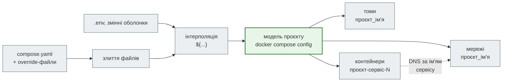
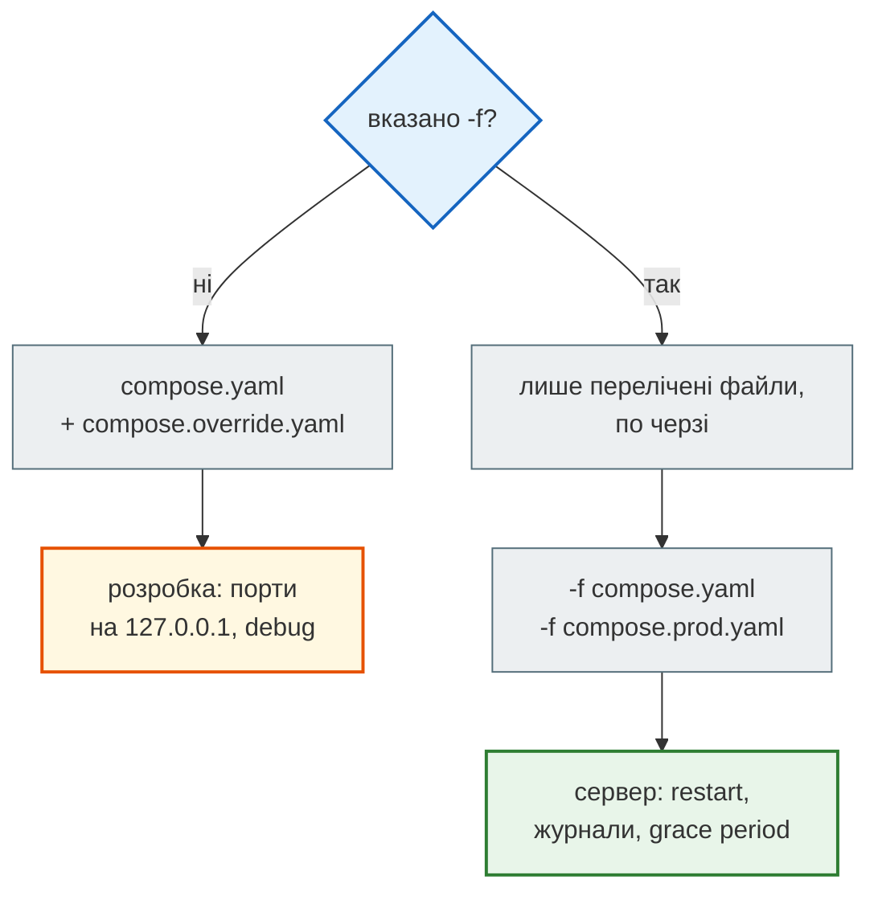

# Docker Compose: сервіси, мережі, томи

## Проблема { #problem }

Застосунку потрібні Redis і nginx. Три `docker run` з десятком прапорців кожен, мережа, том, правильний порядок старту, і все це однаково на ноутбуці, у CI й на сервері. Compose описує цю систему одним файлом. Але в ньому легко помилитися так, що помилка не буде видна: `.env`, який «не доходить» до контейнера, порт бази, відкритий у світ, `down -v`, що стирає дані, файл розробки, який непомітно підключився на сервері. На [кроці 11](../tutorials/11_compose_deploy/index.md) розібрано стек News Hub: порядок запуску з `condition`, `migrate`, YAML-якорі, `$` у `.env`, nginx, деплой. Ця сторінка про те, як Compose влаштований загалом: імена й мережі, три способи передати змінні, життя томів, профілі й злиття кількох файлів.

## Ментальна модель { #mental-model }



Compose спершу **зливає** файли, потім **підставляє** змінні, і лише після цього створює ресурси. Результат двох перших кроків показує `docker compose config`. Це перше, що варто подивитися при будь-якій незрозумілій поведінці.

Приклад сторінки — [`examples/docker_ci/compose/`](https://github.com/NikoriakViktor/news_hub/blob/main/examples/docker_ci/compose/compose.yaml): `api` (образ зі [сторінки про образ](docker_image.md)), Redis з томом, nginx з TLS, дві мережі, профіль `tools`. Docker Compose 2.40.

```text
$ docker compose up -d --build --wait
 Container part10-compose-redis-1  Healthy
 Container part10-compose-api-1  Healthy
 Container part10-compose-nginx-1  Healthy
real	0m26.440s

$ docker compose ps --format 'table {{.Service}}\t{{.Status}}\t{{.Ports}}'
SERVICE   STATUS                    PORTS
api       Up 22 seconds (healthy)   127.0.0.1:18111->8000/tcp
nginx     Up 16 seconds (healthy)   127.0.0.1:18112->443/tcp
redis     Up 28 seconds (healthy)   127.0.0.1:18113->6379/tcp
```

## Проєкт і імена { #project }

`name: part10-compose` у файлі — **ім'я проєкту**. Від нього походять імена всього, що створює Compose: контейнери `part10-compose-api-1`, мережі `part10-compose_edge`, томи `part10-compose_redisdata`. Без `name:` ім'ям стає назва папки. Тоді два різні проєкти в папках з однаковою назвою (`app/`, `deploy/`) ділять томи й заважають один одному, а `docker compose down` в одному зупиняє контейнери іншого. Ім'я перевизначають `-p` або змінна `COMPOSE_PROJECT_NAME`. Саме так CI піднімає кілька копій стеку на одній машині.

## Мережі: ім'я сервісу — це адреса { #networks }

У кожній мережі проєкту Compose запускає DNS: ім'я сервісу розв'язується в адресу його контейнера (або в кілька адрес, якщо копій кілька). Контейнер бачить лише ті сервіси, з якими має спільну мережу:

```yaml title="examples/docker_ci/compose/compose.yaml (фрагмент)"
services:
  api:   { networks: [backend, edge] }
  redis: { networks: [backend] }          # nginx до Redis не дістанеться
  nginx: { networks: { edge: { ipv4_address: 10.231.7.10 } } }
```

```text
$ docker compose exec nginx getent hosts api
10.231.7.2        api  api
nginx→api exit=0
$ docker compose exec nginx getent hosts redis
nginx→redis exit=2                         ← імені redis у мережі edge немає
$ docker compose exec api python -c "import socket; print('api→redis', socket.gethostbyname('redis'))"
api→redis 192.168.48.2
```

- **`localhost` у контейнері — це сам контейнер.** До Redis звертаються `redis://redis:6379`, а не `localhost` ([крок 10](../tutorials/10_docker/user_data_env.md#localhost)).
- **Дві мережі — межа доступу.** nginx, який дивиться в інтернет, не має маршруту до Redis і бази. Якщо його зламають, звідти до даних не дістатись.
- **Фіксована адреса (`ipv4_address`) потрібна рідко.** Тут вона потрібна, щоб uvicorn знав, кому вірити в `X-Forwarded-For` ([сервер у production](production_server.md#proxy-headers)). Для неї мережі потрібна власна `subnet`, і вона не повинна перетинатися з іншими мережами машини.

### `ports` і доступ ззовні { #ports }

Сервісам в одній мережі `ports` не потрібен: вони з'єднуються напряму, на будь-який порт. `ports` публікує порт **на машині**:

| Запис | Хто може під'єднатися |
|---|---|
| немає `ports` | лише контейнери тих самих мереж |
| `"127.0.0.1:18113:6379"` | лише процеси на самій машині |
| `"6379:6379"` | **будь-хто**, хто бачить машину, і в обхід `ufw` ([крок 11](../tutorials/11_compose_deploy/deploy.md#server)) |

`expose:` нічого не публікує. Це лише документація того, який порт слухає сервіс.

## Змінні: три різні механізми { #variables }

| Механізм | Хто читає | Куди потрапляє |
|---|---|---|
| `.env` поруч з `compose.yaml` | сам Compose | лише в **підстановку** `${...}` у файлі; у контейнер — ні |
| `env_file: app.env` | Compose | у середовище процесу в контейнері |
| `environment:` | Compose | у середовище процесу; перемагає `env_file` |

Перевірка: у `.env` — `GREETING=from-dotenv`, у `app.env` — `GREETING=from-env-file`, у `environment` — `FROM_INTERPOLATION: ${GREETING}`:

```text
$ docker compose run --rm show                     # env у контейнері
FROM_INTERPOLATION=from-dotenv                     ← ${GREETING} підставив Compose з .env
GREETING=from-env-file                             ← у контейнер прийшло з env_file
LITERAL_DOLLAR=$HOME                               ← $$HOME у файлі: $ лишився як є
ONLY_IN_ENV_FILE=yes

--- + environment: {GREETING: from-environment}
GREETING=from-environment                          ← environment перемагає env_file
```

`.env` не передає змінних у контейнер. Вони потрапляють туди, лише якщо файл явно вказано в `env_file:`, як у News Hub (`env_file: .env`), або змінну згадано в `environment:`.

### Інтерполяція { #interpolation }

```text
.env: TAG=1.27-alpine, EMPTY=
image: nginx:${TAG}                         nginx:1.27-alpine
${EMPTY:-fallback}                          fallback         ← :- порожнє = не задане
${EMPTY-fallback}                           ''               ← -  порожнє — це значення
${NOT_DEFINED:-fallback}                    fallback
TAG=1.29-alpine docker compose config       nginx:1.29-alpine  ← змінна оболонки перемагає .env
${HTTPS_PORT:?задай HTTPS_PORT у .env}      error while interpolating services.nginx.ports.[]:
                                            required variable HTTPS_PORT is missing a value: задай HTTPS_PORT у .env
```

- **`${VAR:?повідомлення}`** — обов'язкова змінна. Compose відмовиться запускатися з поясненням, а не підставить порожній пароль бази.
- **Змінна оболонки перемагає `.env`.** Забута `export TAG=…` у терміналі тихо змінює образ. При дивній поведінці дивись `docker compose config`.
- **`$` у значеннях.** Compose підставляє і `${VAR}`, і `$VAR`, тому хеш bcrypt `$2b$12$…` у `.env` без одинарних лапок обрізається. Pydantic-settings читає той самий файл за іншими правилами ([`$` у `.env`](../02_typing_and_pydantic/settings.md#dollar), [крок 11](../tutorials/11_compose_deploy/env_secrets.md#dollar)). У самому `compose.yaml` буквальний `$` пишуть як `$$`.

## Порядок старту: `depends_on` { #depends-on }

| Умова | Чекає, доки залежність… | Для чого |
|---|---|---|
| `service_started` (список `depends_on: [redis]`) | створено й запущено | майже ні для чого: «запущено» ≠ «готово» |
| `service_healthy` | пройшла healthcheck | база, Redis, API перед nginx |
| `service_completed_successfully` | завершилась з кодом 0 | міграції, разове завантаження даних |

Чому список недостатній і як це видно в хронології старту News Hub, показано на [кроці 11: порядок запуску](../tutorials/11_compose_deploy/startup_order.md#problem). Ще два ключі:

- **`restart: true`** — перезапустити сервіс, коли Compose перезапускає залежність:

    ```text
    $ docker compose restart redis
     Container part10-compose-redis-1  Restarting
     Container part10-compose-redis-1  Healthy
     Container part10-compose-api-1  Restarting      ← бо в api: depends_on: redis: restart: true
    ```

    Це спрацьовує лише для дій самого Compose (`restart`, `up` з новою версією). Якщо Redis упав сам, `api` ніхто не перезапустить. Застосунок має сам переживати розрив з'єднання.

- **`required: false`** — залежність необов'язкова: якщо вона не стартувала чи недоступна, Compose лише попереджає, а не зупиняє запуск.

`depends_on` діє **лише під час старту**. Якщо база перезапуститься посеред роботи, Compose цього не помітить. Обробляти помилки з'єднання і відповідати `503` на `/health/ready` має сам застосунок.

## Томи: що переживає `down` { #volumes }

```text
$ curl -sk https://localhost:18112/visits      # тричі
{"visits":1}{"visits":2}{"visits":3}
$ docker compose down                           # контейнери й мережі видалено
$ docker volume ls | grep part10
part10-compose_redisdata                        ← том лишився
$ docker compose up -d --wait && curl …/visits
{"visits":4}
$ docker compose down -v
 Volume part10-compose_redisdata  Removed
$ docker compose up -d --wait && curl …/visits
{"visits":1}                                    ← дані зникли
```

| Запис у `volumes:` | Що це | Коли |
|---|---|---|
| `redisdata:/data` | **іменований том**, ним керує Docker | дані сервісів: база, Redis |
| `./nginx.conf:/etc/nginx/conf.d/default.conf:ro` | **bind mount**, файл з машини | конфіги, код у розробці; `:ro` — лише читання |
| без `volumes:` | шар запису контейнера | зникає з `docker compose rm` і при кожному перестворенні |

`down -v` — найнебезпечніша команда Compose: вона видаляє бази даних разом з контейнерами. На сервері її не пишуть «за звичкою». Бекап — до будь-яких дій з томами ([крок 11: бекап і відновлення](../tutorials/11_compose_deploy/backup_restore.md)).

## Профілі: сервіси «на вимогу» { #profiles }

Сервіс з `profiles:` не стартує з `docker compose up`. Він запускається, лише коли профіль увімкнено:

```text
$ docker compose config --services
redis
api
nginx
$ docker compose --profile tools config --services
redis
api
nginx
redis-cli
$ docker compose --profile tools run --rm redis-cli      # command: redis-cli -h redis get visits
3
```

Профілі підходять для інструментів (консоль бази, разові скрипти), режимів роботи (бот у режимі polling замість webhook) і двійників зовнішніх сервісів для розробки.

## Кілька файлів: override і prod { #override }



`compose.override.yaml` поруч з `compose.yaml` Compose **підхоплює сам**, якщо `-f` не вказано. Туди кладуть зручності розробки ([`compose.override.yaml`](https://github.com/NikoriakViktor/news_hub/blob/main/examples/docker_ci/compose/compose.override.yaml)): порти API й Redis на `127.0.0.1`, `UVICORN_LOG_LEVEL: debug`. На сервері файли перелічують явно, і override не підключається:

```text
$ docker compose -f compose.yaml -f compose.prod.yaml ps --format 'table {{.Service}}\t{{.Ports}}'
SERVICE   PORTS
api       8000/tcp                       ← порту 18111 з override немає
nginx     127.0.0.1:18112->443/tcp
redis     6379/tcp
$ docker inspect -f 'log={{.HostConfig.LogConfig.Type}} {{.HostConfig.LogConfig.Config}} restart={{.HostConfig.RestartPolicy.Name}} stop_timeout={{.Config.StopTimeout}}' part10-compose-api-1
log=json-file map[max-file:3 max-size:10m] restart=unless-stopped stop_timeout=30
```

Як зливаються значення (перевірено `docker compose config`):

```text
compose.yaml                 command [nginx …]       ports [18120]          env {A: base, B: base}
+ add.yaml                   command [nginx-debug …] ports [18120, 18121]   env {A: base, B: override, C: override}
+ reset.yaml (!reset, !override)                     ports []               env {Z: only}
```

- **Скаляри й `command` замінюються**, словники (`environment`, `labels`) зливаються за ключем, а списки портів **додаються**. Порт з базового файлу з override не прибрати простим повтором ключа.
- **`!reset []`** очищає значення, **`!override`** замінює його повністю, без злиття.
- Помилка, яку часто не помічають: на сервері запустили просто `docker compose up`, і `compose.override.yaml` розробки відкрив порти. Тому в News Hub файл розробки названо `docker-compose.dev.yml`: він підключається лише явним `-f`.

## У News Hub { #news-hub }

[`steps/12_ci_cd/docker-compose.yml`](https://github.com/NikoriakViktor/news_hub/blob/main/steps/12_ci_cd/docker-compose.yml):

| Механізм | Як у News Hub | Де розібрано |
|---|---|---|
| ім'я проєкту | `name: news_hub` | — |
| мережі | `backend` (api, база, Redis, міграції, бот), `edge` (nginx ↔ api) з `subnet: 172.28.0.0/24` і фіксованою адресою nginx | [крок 11: nginx](../tutorials/11_compose_deploy/nginx_real_ip.md#change) |
| порти | лише nginx (`${HTTP_PORT:-80}:80`); база й Redis — без `ports` | [крок 11: деплой](../tutorials/11_compose_deploy/deploy.md#server) |
| змінні | `env_file: .env` для api/bot/migrate + `environment` з `DATABASE_URL`, зібраним з `${POSTGRES_*}`; `${POSTGRES_PASSWORD:?…}` | [крок 11: секрети](../tutorials/11_compose_deploy/env_secrets.md) |
| безпечне значення за замовчуванням | `DOCS_ENABLED: ${DOCS_ENABLED:-false}` в `api`: на сервері `/docs`, `/redoc` і `/openapi.json` вимкнено, якщо в `.env` явно не написано `true` (сам застосунок без змінної вмикає їх) | [сервер у production](production_server.md#news-hub) |
| `depends_on` | `postgres` healthy → `migrate` completed → `api` healthy → `nginx` | [крок 11: порядок запуску](../tutorials/11_compose_deploy/startup_order.md#change) |
| томи | `pgdata` для PostgreSQL; `nginx.conf` — bind mount `:ro` | [крок 11: бекап](../tutorials/11_compose_deploy/backup_restore.md) |
| профілі | `polling` (бот окремим процесом), `twin` (двійник Telegram) | [крок 11: зовнішні сервіси](../tutorials/11_compose_deploy/external_services.md#twin) |
| кілька файлів | `docker-compose.dev.yml` лише з `-f`: порти бази й Redis на `127.0.0.1` | [крок 11: деплой](../tutorials/11_compose_deploy/deploy.md#server) |

Чого в News Hub немає: `logging:` з `max-size` і `stop_grace_period`. Обидва мають значення на сервері ([сервер у production](production_server.md#logs)).

## Типові помилки { #mistakes }

| Помилка | Наслідок | Як правильно |
|---|---|---|
| чекати змінних з `.env` у контейнері | змінної немає | `env_file: .env` або `environment: X: ${X}` |
| `localhost:6379` у застосунку | `Connection refused` | ім'я сервісу: `redis:6379` |
| `ports: ["5432:5432"]` у бази | база відкрита в інтернет в обхід firewall | без `ports`; для розробки — `127.0.0.1:5432:5432` в окремому файлі |
| `depends_on: [db]` | API стартує раніше за базу | `condition: service_healthy` + healthcheck бази |
| `down -v` «щоб почати з чистого» | дані бази видалено | `down`; том видаляти свідомо, після бекапу |
| немає `name:` | проєкти з однаковою назвою папки ділять томи | `name:` у файлі або `-p` |
| `compose.override.yaml` з портами розробки | на сервері `up` без `-f` відкриває порти | на сервері завжди явні `-f`, або override з іншою назвою |
| ключ `ports` у override, щоб «прибрати» порт | порти додалися | `ports: !reset []` |
| `ipv4_address` без власної `subnet` | `invalid config for network …: no configured subnet contains IP address` | `ipam.config.subnet`, що не перетинається з іншими мережами машини |

## Налагодження { #debugging }

| Питання | Команда |
|---|---|
| що Compose насправді запустить | `docker compose config` (після злиття й підстановки) |
| які змінні бачить Compose для підстановки | `docker compose config --environment` (увага: друкує й секрети) |
| що прийшло в контейнер | `docker compose exec api env` |
| чому сервіс не стартує | `docker compose ps -a` (код виходу), `docker compose logs --tail 50 сервіс` |
| чому `unhealthy` | `docker inspect -f '{{json .State.Health}}' контейнер` |
| хто кого бачить у мережі | `docker compose exec сервіс getent hosts інший` |
| які порти відкриті назовні | `docker compose ps --format '{{.Service}} {{.Ports}}'` — шукай `0.0.0.0` |
| що з томами | `docker volume ls`, `docker volume inspect проєкт_том` |

## Безпека { #security }

- **Назовні — лише проксі.** Усе інше — без `ports` або на `127.0.0.1`. Docker публікує порти в обхід `ufw`.
- **Розділяй мережі.** Сервіс, що дивиться в інтернет, не повинен мати маршруту до бази.
- **Секрети — не у файлі.** `.env` у `.gitignore` і `.dockerignore`, у репозиторії — `.env.example`. `${VAR:?}` не дає стартувати без них.
- **Змінні середовища видно** в `docker inspect` і `/proc/1/environ`. Для критичних секретів Compose має `secrets:`: файл монтується в `/run/secrets/ім'я` і в `inspect` не з'являється.
- **`:ro` для bind mount конфігів.** Процес у контейнері не перепише конфіг nginx на машині.
- **Bind mount сокета Docker** (`/var/run/docker.sock`) дає контейнеру повний контроль над машиною. Не монтуй його в сервіси застосунку.

## Питання { #questions }

1. Звідки беруться імена `part10-compose-api-1` і `part10-compose_redisdata`?
2. Чому nginx не може розв'язати ім'я `redis`, а `api` може?
3. Чим `"127.0.0.1:5432:5432"` відрізняється від `"5432:5432"`?
4. Змінна є в `.env`, але `env` у контейнері її не показує. Чому?
5. Що переможе: `environment:`, `env_file:` чи змінна оболонки при `${VAR}`?
6. Чим `${X:-def}` відрізняється від `${X-def}`?
7. Що лишиться після `docker compose down`, а що після `down -v`?
8. Чому `compose.override.yaml` небезпечний на сервері?
9. Як прибрати порт, оголошений у базовому файлі, з override?

??? success "Відповіді"

    1. З імені проєкту (`name:` або назва папки) + ім'я сервісу + номер копії; для томів і мереж — проєкт + `_` + ім'я.
    2. nginx лише в мережі `edge`, а `redis` лише в `backend`. DNS Compose розв'язує імена лише в спільних мережах.
    3. Перший слухає лише на самій машині; другий — на всіх адресах, тобто доступний з мережі, і Docker відкриває його в обхід firewall.
    4. `.env` поруч з `compose.yaml` — лише для підстановки `${...}` у файлі; у контейнер змінні потрапляють через `env_file:` або `environment:`.
    5. У контейнері `environment:` перемагає `env_file:`. Для підстановки `${VAR}` змінна оболонки перемагає `.env`.
    6. `:-` підставляє значення за замовчуванням і для незаданої, і для порожньої змінної; `-` — лише для незаданої.
    7. Після `down` лишаються томи й образи; після `down -v` іменовані томи видаляються разом з даними.
    8. Compose підхоплює його сам, якщо `-f` не вказано: порти й налаштування розробки потраплять на сервер.
    9. `ports: !reset []` в override; простий повтор ключа `ports` додає порти, а не замінює.

## Що далі { #next }

[Сервер у production: воркери, проксі, TLS](production_server.md) — стек піднімається; тепер скільки процесів запускати, що змінюється за nginx і TLS і як зупинити сервер, не обірвавши запити.

**Джерела:** Docker Docs — [Compose file reference](https://docs.docker.com/reference/compose-file/) (розділи «services: depends_on», «networks», «volumes», «profiles»), [Merge Compose files](https://docs.docker.com/compose/how-tos/multiple-compose-files/merge/), [Interpolation](https://docs.docker.com/compose/how-tos/environment-variables/variable-interpolation/), [Environment variables precedence](https://docs.docker.com/compose/how-tos/environment-variables/envvars-precedence/), [Networking in Compose](https://docs.docker.com/compose/how-tos/networking/), [Specify a project name](https://docs.docker.com/compose/how-tos/project-name/), [Secrets in Compose](https://docs.docker.com/compose/how-tos/use-secrets/).
