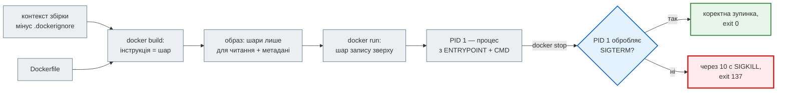
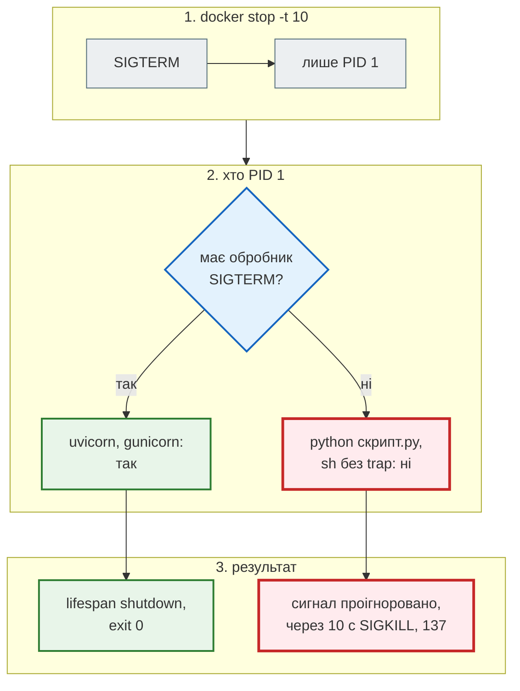

# Docker-образ: база, етапи, процес

## Проблема { #problem }

`Dockerfile` на п'ять рядків працює з першої спроби. Але образ важить 1,7 ГБ, процес працює від root, а `docker stop` щоразу чекає 10 секунд і вбиває застосунок посеред запиту. Кожну з цих проблем легко не помітити, бо контейнер «працює». На [кроці 10](../tutorials/10_docker/index.md) ми розібрали, що з цього стосується News Hub: що потрапляє в образ, порядок шарів, користувач, том, `HEALTHCHECK`, exec-форма `CMD`. Ця сторінка про те, що там лишилося за кадром: який базовий образ обрати, коли потрібна багатоетапна збірка, як `ENTRYPOINT` поєднується з `CMD` і чому сигнал `SIGTERM` іноді не доходить навіть до exec-форми.

## Ментальна модель { #mental-model }



Образ складається з шарів, контейнер — з тих самих шарів і тонкого шару запису над ними. Метадані `CMD`, `ENTRYPOINT`, `USER`, `HEALTHCHECK`, `ENV` шарів із файлами не створюють, але визначають, **який процес** стане PID 1 і від якого користувача він працюватиме.

Приклади сторінки лежать у [`examples/docker_ci/app/`](https://github.com/NikoriakViktor/news_hub/blob/main/examples/docker_ci/app/main.py): FastAPI-застосунок з `/health`, `/whoami`, `/io`, `/cpu` і п'ять `Dockerfile`, які відрізняються одним рішенням. Залежності: `fastapi`, `uvicorn[standard]`, `redis`, `gunicorn`, `uvicorn-worker`. Виміри зроблено на Docker 29.1 (Docker Desktop, WSL2).

## Шари: що займає місце { #layers }

`docker history` показує кожну інструкцію і скільки вона додала:

```text
$ docker history part10-slim --format 'table {{.CreatedBy}}\t{{.Size}}'
CREATED BY                                      SIZE
CMD ["uvicorn" "main:app" "--host" "0.0.0.0"…   0B
HEALTHCHECK &{["CMD" "python" "-c" "import u…   0B
EXPOSE [8000/tcp]                               0B
USER app                                        0B
COPY . . # buildkit                             20.5kB
RUN /bin/sh -c useradd --uid 10001 --no-crea…   49.2kB
RUN /bin/sh -c pip install --no-cache-dir -r…   53.3MB
COPY requirements.txt . # buildkit              12.3kB
WORKDIR /app                                    8.19kB
ENV PYTHONDONTWRITEBYTECODE=1 PYTHONUNBUFFER…   0B
CMD ["python3"]                                 0B
…                                               (шари python:3.12-slim)
RUN /bin/sh -c set -eux;   savedAptMark="$(a…   41.4MB
```

- **Код — 20 кБ, залежності — 53 МБ, решта — базовий образ.** Те, що ти пишеш, майже нічого не важить. Розмір визначає вибір бази й залежностей.
- **Видалення в наступному шарі місця не звільняє.** `RUN pip install …` і потім `RUN rm -rf /root/.cache` — кеш лишився в попередньому шарі. Прибирати треба в тому самому `RUN`. Найпростіше взагалі не створювати кеш: `pip install --no-cache-dir`, `apt-get install … && rm -rf /var/lib/apt/lists/*`.
- **Порядок шарів визначає кеш.** Чому `requirements.txt` копіюють до коду і що стається, коли порядок навпаки (128 с замість 0,1 с на кожну зміну коду), показано на [кроці 10: шари й кеш](../tutorials/10_docker/layers_cache.md#wrong-order).

## Базовий образ: повний, slim, Alpine { #base-image }

Той самий застосунок, ті самі залежності, різна база ([`Dockerfile.naive`](https://github.com/NikoriakViktor/news_hub/blob/main/examples/docker_ci/app/Dockerfile.naive), [`Dockerfile`](https://github.com/NikoriakViktor/news_hub/blob/main/examples/docker_ci/app/Dockerfile), [`Dockerfile.alpine`](https://github.com/NikoriakViktor/news_hub/blob/main/examples/docker_ci/app/Dockerfile.alpine)):

```text
$ docker image ls
IMAGE                    DISK USAGE   CONTENT SIZE
part10-naive:latest          1.71GB          444MB      ← FROM python:3.12
part10-slim:latest            246MB         58.2MB      ← FROM python:3.12-slim
part10-alpine:latest          138MB         33.3MB      ← FROM python:3.12-alpine
```

`CONTENT SIZE` — скільки завантажує сервер при `docker pull` (стиснені шари). `DISK USAGE` — скільки образ займає розпакованим.

| База | Що всередині | Коли |
|---|---|---|
| `python:3.12` | Debian з компіляторами, заголовками, git, curl | етап збірки, де щось компілюється; не для запуску |
| `python:3.12-slim` | Debian без інструментів збірки, glibc | типовий вибір для запуску Python |
| `python:3.12-alpine` | Alpine, **musl** замість glibc, busybox | коли важить кожен мегабайт і всі залежності мають колеса `musllinux` |

**Alpine для Python — не завжди виграш.** Колесо (wheel) — це вже зібраний пакет під конкретну платформу. Колеса `manylinux` зібрано під glibc, і в Alpine вони не підходять. Якщо колеса `musllinux` немає, `pip` збирає пакет із сирців. Тоді в образ потрібно поставити `gcc` і заголовки, збірка займає хвилини, а виграш у розмірі зникає. Для залежностей цього прикладу колеса є:

```text
Downloading httptools-0.9.0-cp312-cp312-musllinux_1_2_x86_64.whl (536 kB)
Downloading pydantic_core-2.50.4-cp312-cp312-musllinux_1_1_x86_64.whl (2.5 MB)
Downloading uvloop-0.23.0-cp312-cp312-musllinux_1_2_x86_64.whl.metadata (5.1 kB)
```

Тож Alpine вийшов на 108 МБ меншим. Перш ніж переходити, перевір кожну залежність: `pip download --only-binary=:all: --platform musllinux_1_2_x86_64 -r requirements.txt`. Окрім коліс, musl відрізняється від glibc поведінкою DNS-резолвера, локалей і швидкодією алокатора пам'яті. Зазвичай це не важливо, але якщо щось поводиться дивно лише в Alpine-образі, причина часто тут. Безпечний вибір за замовчуванням — `slim`.

## Багатоетапна збірка { #multi-stage }

**Задача.** Залежність не має колеса під твою платформу, і її треба компілювати. Для збірки потрібен `build-essential` (у цьому прикладі ≈ 440 МБ), а для роботи він не потрібен.

[`Dockerfile.multistage`](https://github.com/NikoriakViktor/news_hub/blob/main/examples/docker_ci/app/Dockerfile.multistage) імітує таку залежність: `--no-binary httptools` змушує `pip` зібрати `httptools` із сирців.

```dockerfile title="examples/docker_ci/app/Dockerfile.multistage (фрагмент)"
FROM python:${PYTHON}-slim AS builder
RUN apt-get update \
    && apt-get install -y --no-install-recommends build-essential \
    && rm -rf /var/lib/apt/lists/*
RUN python -m venv /opt/venv
ENV PATH=/opt/venv/bin:$PATH
COPY requirements.txt .
RUN pip install --no-cache-dir --no-binary "$NO_BINARY" -r requirements.txt

FROM python:${PYTHON}-slim AS runtime
ENV PATH=/opt/venv/bin:$PATH
RUN useradd --uid 10001 --no-create-home --shell /usr/sbin/nologin app
COPY --from=builder /opt/venv /opt/venv      # лише venv: ні gcc, ні заголовків
```

```text
#9 7.322   Building wheel for httptools (pyproject.toml): started
#9 13.72   Building wheel for httptools (pyproject.toml): finished with status 'done'

$ docker image ls
part10-builder:latest     700MB    171MB      ← --target builder: так виглядав би образ «усе в одному»
part10-multi:latest       263MB   62.1MB      ← фінальний етап
part10-slim:latest        246MB   58.2MB      ← без компіляції взагалі
```

- **Фінальний образ отримує лише те, що скопійовано через `COPY --from`.** Компілятор, заголовки й кеш apt лишились у `builder`. Без багатоетапної збірки образ важив би 700 МБ.
- **Віртуальне середовище — зручна одиниця копіювання.** Усе встановлене лежить в одній папці, і `PATH=/opt/venv/bin:$PATH` робить його активним. Python у `runtime` має бути **тієї самої версії й тієї самої бази**, що в `builder` (тому `ARG PYTHON` спільний): скомпільовані модулі прив'язані до версії Python і libc.
- **Якщо компілювати нічого, багатоетапність нічого не дає.** `part10-multi` на 17 МБ більший за `part10-slim`, бо у venv є власний `pip`. Її беруть, коли є що лишити позаду: компілятор, Node для збірки фронтенду, інструменти завантаження моделей.
- **`--target builder`** збирає лише проміжний етап. Так перевіряють, що він працює, або запускають у ньому тести.

## `ENTRYPOINT` і `CMD` { #entrypoint }

`CMD` — команда за замовчуванням, `ENTRYPOINT` — програма, якій передаються аргументи. Docker склеює їх так:

| `ENTRYPOINT` | `CMD` | Що запускається | `docker run образ alembic upgrade head` |
|---|---|---|---|
| — | `["uvicorn", "main:app"]` | `uvicorn main:app` | `alembic upgrade head` (CMD замінено) |
| `["/entrypoint.sh"]` | `["uvicorn", "main:app"]` | `/entrypoint.sh uvicorn main:app` | `/entrypoint.sh alembic upgrade head` |
| `/entrypoint.sh` (shell-форма) | будь-що | `/bin/sh -c /entrypoint.sh` — **CMD ігнорується** | так само, аргументи загублено |

`ENTRYPOINT`-скрипт потрібен, коли перед стартом треба щось підготувати: перевірити змінні, дочекатися файла, зібрати конфіг. Головне правило — останній рядок `exec "$@"` ([`entrypoint.sh`](https://github.com/NikoriakViktor/news_hub/blob/main/examples/docker_ci/app/entrypoint.sh)):

```sh title="examples/docker_ci/app/entrypoint.sh"
#!/bin/sh
set -e
echo "entrypoint: підготовка (тут могли б бути міграції чи перевірка змінних), далі: $*"
exec "$@"
```

`exec` **замінює** процес shell процесом з `CMD`. Без нього ([`entrypoint-noexec.sh`](https://github.com/NikoriakViktor/news_hub/blob/main/examples/docker_ci/app/entrypoint-noexec.sh)) shell лишається PID 1:

```text
--- exec "$@"
1 /usr/local/bin/python3.12 /usr/local/bin/uvicorn main:app --host 0.0.0.0 --port 8000
--- "$@" без exec
1 /bin/sh /entrypoint.sh uvicorn main:app --host 0.0.0.0 --port 8000
7 /usr/local/bin/python3.12 /usr/local/bin/uvicorn main:app --host 0.0.0.0 --port 8000

--- exec:    docker stop: 0.42 s   exit=0     INFO: app shutdown: connections closed
--- без exec: docker stop: 10.29 s  exit=137   (рядка про shutdown немає)
```

Це та сама пастка, що shell-форма `CMD` на [кроці 10](../tutorials/10_docker/health_shutdown.md#stop), тільки схована у скрипті: у `Dockerfile` все в exec-формі, а сигнал однаково не доходить до застосунку.

Аргументи `docker run` замінюють `CMD`, а скрипт лишається. `--entrypoint` замінює сам скрипт:

```text
$ docker run --rm part10-ep-exec python -c "import os; print('override CMD, uid', os.getuid())"
entrypoint: підготовка (тут могли б бути міграції чи перевірка змінних), далі: python -c import os; print('override CMD, uid', os.getuid())
override CMD, uid 10001
$ docker run --rm --entrypoint id part10-ep-exec
uid=10001(app) gid=10001(app) groups=10001(app)
```

## PID 1 і сигнали { #signals }

Навіть у exec-формі PID 1 у контейнері поводиться не так, як звичайний процес. Ядро **не застосовує дію за замовчуванням** до сигналів, які PID 1 не обробляє сам. Для звичайного процесу `SIGTERM` без обробника означає «завершитись». Для PID 1 він не означає нічого.



Перевірка: власний воркер `python -c "…time.sleep(600)"` без обробника сигналів, у exec-формі.

```text
без обробника SIGTERM (без --init): 12.98 s   exit=137
без обробника SIGTERM --init:        0.24 s   exit=143
```

- **`docker run --init`** (у Compose — `init: true`) робить PID 1 маленьку програму `docker-init` (tini). Вона пересилає сигнали дочірньому процесу і прибирає процеси-зомбі. Дочірній Python отримує `SIGTERM` як звичайний процес і завершується (143 = 128 + 15).
- **`--init` не лікує відсутній `exec`.** З `entrypoint-noexec.sh` і `--init` сигнал отримує shell. Shell завершується, контейнер зупиняється, а uvicorn гине разом з ним, так і не виконавши `lifespan`:

    ```text
    1 /sbin/docker-init -- /entrypoint.sh uvicorn main:app …
    7 /bin/sh /entrypoint.sh uvicorn main:app …
    8 /usr/local/bin/python3.12 /usr/local/bin/uvicorn main:app …
    docker stop: 0.40 s   exit=143      (рядка «app shutdown» немає)
    ```

- **Для власних воркерів** (черга, планувальник, бот) потрібен обробник: `signal.signal(signal.SIGTERM, …)` або `loop.add_signal_handler(...)`. aiogram, arq, Celery, uvicorn ставлять його самі.
- Скільки часу між `SIGTERM` і `SIGKILL`, задає `docker stop -t`, `--stop-timeout` або `stop_grace_period` у Compose. За замовчуванням 10 с, але налаштування Docker на машині можуть це змінити. Перевір: `docker inspect -f '{{.Config.StopTimeout}}' контейнер`. Що буде із запитом, який триває довше, — у розділі [сервер у production](production_server.md#graceful).

## `HEALTHCHECK` { #healthcheck }

`HEALTHCHECK` у `Dockerfile` — команда, яку Docker сам запускає всередині контейнера. Код виходу `0` означає `healthy`:

```text
$ docker ps --format '{{.Status}}'
Up 1 second (health: starting)
Up 8 seconds (healthy)
$ docker inspect -f '{{range .State.Health.Log}}{{.ExitCode}} {{.Start.Format "15:04:05"}}{{end}}' part10-health
0 03:57:04
```

- Команда виконується **в контейнері**: потрібна програма має бути в образі. У `slim` немає `curl`, тому перевірку пишуть на Python з `urllib`.
- `healthy` сам по собі нічого не перезапускає. Статус читають Compose (`depends_on: condition: service_healthy`, `up --wait`), Swarm і людина в `docker ps`. Kubernetes `HEALTHCHECK` з образу не використовує, у нього свої `livenessProbe` і `readinessProbe`.
- Що саме перевіряти (`/health` проти `/health/ready`) — [крок 10](../tutorials/10_docker/health_shutdown.md#ready).

## Сканування образу { #scan }

Базовий образ і залежності час від часу отримують CVE (публічно відомі вразливості). Сканер порівнює пакети в образі з базою вразливостей:

```bash
docker scout quickview part10-slim             # Docker Scout (у Docker Desktop)
trivy image --severity HIGH,CRITICAL part10-slim
```

!!! warning "Тут не запускалось"
    `docker scout` на машині автора вимагав входу в Docker Hub, а Trivy не встановлений. Виводу сканування на цій сторінці немає.

Що впливає на кількість знахідок, видно без сканера: у `part10-naive` у 7 разів більше вмісту, ніж у `part10-slim`, а отже, і пакетів, у яких можуть знайтися CVE. Менша база, оновлення бази (`docker build --pull`) і регулярне перезбирання образу дають більше, ніж будь-який сканер. У CI сканування ставлять окремим кроком після збірки ([CI/CD](ci_cd.md#image)). News Hub на кроці 12 сканує не весь образ, а Python-залежності з `requirements.lock` (`pip-audit`, [ланцюг постачання](ci_cd.md#supply-chain)). Пакети Debian з базового образу ця перевірка не бачить.

## У News Hub { #news-hub }

[`steps/12_ci_cd/Dockerfile`](https://github.com/NikoriakViktor/news_hub/blob/main/steps/12_ci_cd/Dockerfile) — одноетапний `python:3.12-slim`:

- **Залежності — з `requirements.lock` з хешами** (лише крок 12). Шар залежностей тепер будується не з `requirements.txt`, а з lock-файла:

    ```dockerfile title="steps/12_ci_cd/Dockerfile (фрагмент)"
    COPY requirements.lock .
    RUN pip install --no-cache-dir --require-hashes -r requirements.lock
    ```

    `requirements.txt` описує діапазони (`fastapi>=0.121`): з ними два перезбирання з різницею в тиждень можуть дати різні версії, і образ, перевірений у CI, не той, що потрапить на сервер. `requirements.lock` згенеровано з нього (`uv pip compile requirements.txt --universal --python-version 3.10 --generate-hashes -o requirements.lock`). Там точні версії всіх 70 пакетів, разом із залежностями залежностей, і `sha256` кожного файлу. `--require-hashes` не дасть встановити пакет, у якого немає хешу чи хеш не збігся: підмінений на PyPI чи по дорозі файл не встановиться. `requirements.txt` свої діапазони зберігає. Це те, що проєкт **підтримує**, і CI перевіряє нижні межі окремим job ([крок 12: мінімальні версії](../tutorials/12_ci_cd/what_to_check.md#min-versions)). Lock — це те, що проєкт **постачає**. Кеш шару тепер злітає, коли змінився lock. Чи відповідає lock файлу `requirements.txt` і чи немає в ньому відомих вразливостей, перевіряє CI ([ланцюг постачання](ci_cd.md#supply-chain)). На кроках 10–11 образ ще встановлює залежності з `requirements.txt`.
- **База — `slim`, без багатоетапної збірки.** Усі залежності (`asyncpg`, `uvloop`, `bcrypt`, `pydantic-core`) мають колеса `manylinux`, компілювати нічого. Другий етап лише додав би venv.
- **`CMD` в exec-формі, `ENTRYPOINT` немає.** Міграції виконуються не скриптом перед стартом, а окремим сервісом `migrate` у Compose. Так їх запускають один раз, а не в кожній копії API ([крок 11: випуск окремо від роботи](../tutorials/11_compose_deploy/startup_order.md#release)).
- **Інші процеси — з того самого образу заміною `CMD`:** `command: ["alembic", "upgrade", "head"]`, `command: ["python", "-m", "news_hub.bot"]`. `dp.start_polling` в aiogram 3 за замовчуванням сам ставить обробники `SIGTERM` і `SIGINT` (`handle_signals=True`), тож `--init` боту не потрібен.
- Користувач `app` з UID 10001, `HEALTHCHECK` на Python, `.dockerignore`, `WEB_CONCURRENCY` — [крок 10](../tutorials/10_docker/index.md).

## Типові помилки { #mistakes }

| Помилка | Наслідок | Як правильно |
|---|---|---|
| `FROM python:3.12` для запуску | 1,7 ГБ, компілятори в робочому образі | `python:3.12-slim`; повний — лише в етапі збірки |
| Alpine «бо менший», без перевірки коліс | збірка з сирців, хвилини, gcc в образі | `pip download --only-binary=:all: --platform musllinux_…` до переходу |
| `RUN rm -rf кеш` окремим шаром | розмір не змінився | прибирати в тому самому `RUN` або `--no-cache-dir` |
| `runtime` на іншій версії Python, ніж `builder` | `ImportError` скомпільованих модулів | спільний `ARG PYTHON` для обох `FROM` |
| `ENTRYPOINT`-скрипт без `exec "$@"` | PID 1 — shell, `docker stop` 10 с, exit 137 | `exec "$@"` останнім рядком |
| `ENTRYPOINT` у shell-формі | `CMD` і аргументи `docker run` ігноруються | `ENTRYPOINT ["/entrypoint.sh"]` |
| власний воркер без обробника `SIGTERM` | ігнорує `docker stop`, exit 137 | обробник сигналу або `init: true` |
| міграції в `ENTRYPOINT` API | виконуються в кожній копії одночасно | окремий разовий сервіс `migrate` |
| `pip install -r requirements.txt` з діапазонами | кожна збірка може взяти інші версії | lock з точними версіями й `--require-hashes` |

## Налагодження { #debugging }

| Симптом | Перевір |
|---|---|
| образ більший, ніж очікував | `docker history образ` — який шар; `docker image ls` — `CONTENT SIZE` |
| `docker stop` триває 10 с | хто PID 1: `docker top контейнер` або `cat /proc/1/cmdline` у контейнері |
| exit 137 | `docker inspect -f '{{.State.ExitCode}} {{.State.OOMKilled}}'`: SIGKILL від `stop` чи від браку пам'яті |
| `exec format error` при старті | у скрипті немає рядка `#!`; образ зібрано під іншу архітектуру (arm64/amd64) |
| `no such file or directory` для наявного `/entrypoint.sh` | рядки CRLF (файл з Windows): ядро шукає `/bin/sh\r` |
| `permission denied` на `/entrypoint.sh` | немає біта виконання: `COPY --chmod=755` |
| у контейнері не той код | кеш шару `COPY . .` або старий тег: `docker build --no-cache`, перевір `docker image ls` |
| `unhealthy` | `docker inspect -f '{{json .State.Health}}'` — вивід останніх перевірок |

## Безпека { #security }

- **Не root.** `USER app` з фіксованим UID, код належить root: зламаний процес не перепише код і не отримає root у контейнері. `touch /app/hack.py` від `app` → `Permission denied`.
- **У фінальному образі немає компілятора, git і curl.** Те, чого немає, атакувальник не використає. Це головна користь багатоетапної збірки для безпеки, а не лише для розміру.
- **Секрети не потрапляють ні в шари, ні в `ARG`.** `ARG` і `ENV` видно в `docker history` та `docker inspect`. Файл, скопійований і видалений пізніше, лишається в шарі. Секрет на час збірки передають через `RUN --mount=type=secret`, а на час роботи — змінними середовища ([крок 10](../tutorials/10_docker/user_data_env.md#env-file)).
- **Тег бази фіксує версію Python, але не патчі.** `python:3.12-slim` оновлюється, коли виходять виправлення. Регулярно перезбирай образ з `--pull`. Для повної відтворюваності тег фіксують за digest (`python:3.12-slim@sha256:…`), але тоді оновлювати його треба самому.
- **Точні версії з хешами.** Lock-файл і `pip install --require-hashes` гарантують, що в образі саме ті пакети, які перевіряли, а не підмінені.
- **Сканер не замінює оновлень**, він лише показує, що оновити.

## Питання { #questions }

1. Чому `RUN rm -rf /root/.cache/pip` окремою інструкцією не зменшує образ?
2. Коли Alpine-образ збирається довше і виходить більшим за `slim`?
3. Що потрапляє у фінальний образ багатоетапної збірки?
4. Чому `part10-multi` вийшов більшим за `part10-slim`?
5. Що станеться з `CMD`, якщо `ENTRYPOINT` записано в shell-формі?
6. Чому `ENTRYPOINT`-скрипт має закінчуватись `exec "$@"`?
7. Python-скрипт без обробника сигналів у exec-формі — чому `docker stop` однаково чекає 10 с?
8. Чи допоможе `--init`, якщо в entrypoint-скрипті немає `exec`?

??? success "Відповіді"

    1. Кожна інструкція — шар; файли попереднього шару лишаються в образі, видалення лише ховає їх у новому шарі. Прибирати треба в тому самому `RUN` або не створювати кеш (`--no-cache-dir`).
    2. Коли для залежності немає колеса `musllinux`: `pip` компілює з сирців, потрібні `gcc` і заголовки, збірка займає хвилини.
    3. Лише фінальний етап і те, що скопійовано через `COPY --from=…`; компілятори й кеш проміжних етапів — ні.
    4. Компілювати було нічого, а venv має власні `pip` і `setuptools`; багатоетапність корисна, коли є що лишити в `builder`.
    5. Ігнорується: запускається `/bin/sh -c скрипт`, ні `CMD`, ні аргументи `docker run` не передаються.
    6. `exec` замінює shell процесом застосунку: той стає PID 1 і сам отримує `SIGTERM`. Без `exec` сигнал отримує shell і не передає його.
    7. Ядро не застосовує дію за замовчуванням до сигналів PID 1 без обробника; `SIGTERM` ігнорується, через 10 с — `SIGKILL`, exit 137.
    8. Ні: tini передасть сигнал shell, shell завершиться, контейнер зупиниться, а застосунок буде вбито без `lifespan`.

## Що далі { #next }

[Docker Compose: сервіси, мережі, томи](compose.md) — образ готовий; тепер кілька контейнерів, які мають знайти одне одного, стартувати в правильному порядку і не загубити дані.

**Джерела:** Docker — [Dockerfile reference](https://docs.docker.com/reference/dockerfile/) (розділи «ENTRYPOINT», «Understand how CMD and ENTRYPOINT interact», «HEALTHCHECK»), [Multi-stage builds](https://docs.docker.com/build/building/multi-stage/), [Building best practices](https://docs.docker.com/build/building/best-practices/), [docker container run — `--init`](https://docs.docker.com/reference/cli/docker/container/run/#init), [Build secrets](https://docs.docker.com/build/building/secrets/); [Docker Official Images — python](https://hub.docker.com/_/python) (варіанти `slim`, `alpine`); Python Packaging — [Platform compatibility tags](https://packaging.python.org/en/latest/specifications/platform-compatibility-tags/) (manylinux, musllinux); [tini](https://github.com/krallin/tini).
