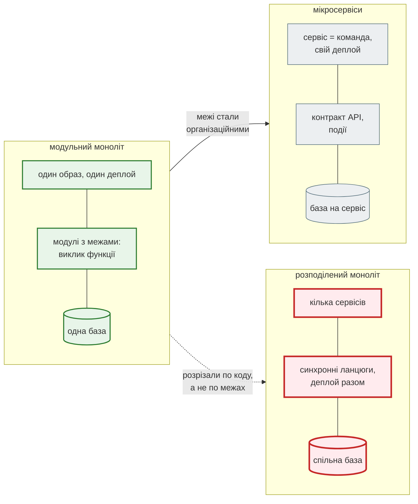
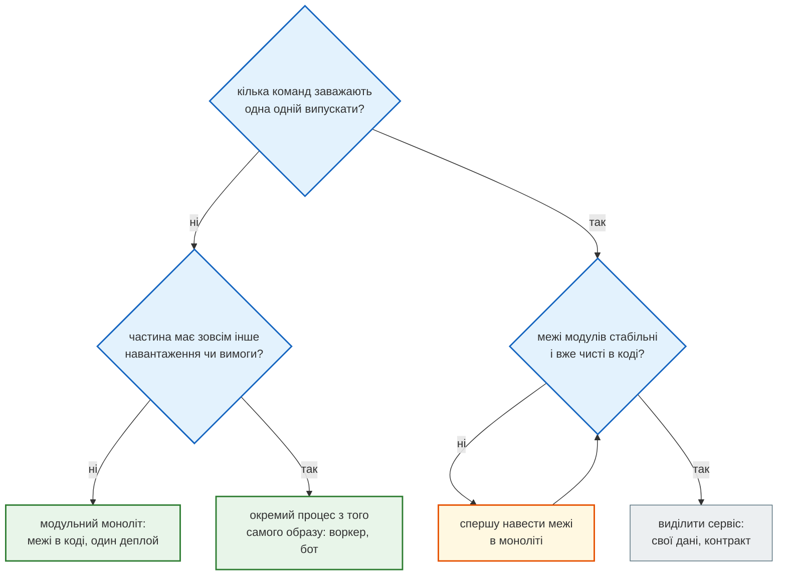
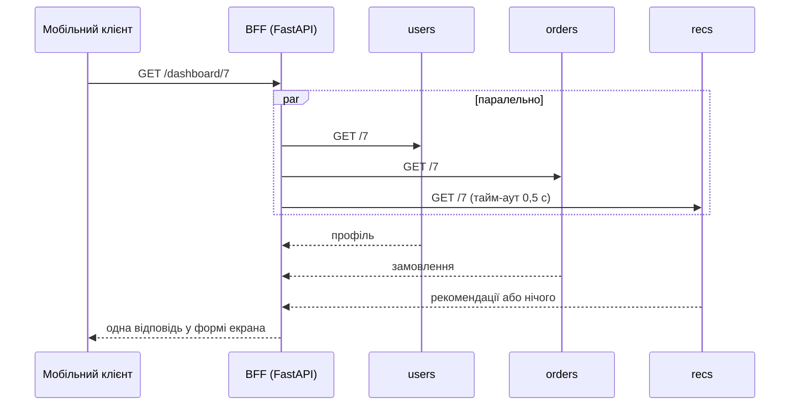

# Мікросервіси: коли варто

## Проблема { #problem }

Коли з'являються Docker і Compose, сервіси хочеться «розрізати»: окремо користувачі, окремо новини, окремо аналіз, кожен у своєму контейнері зі своєю базою. На схемі це виглядає охайно. На практиці виклик функції стає мережевим запитом, який може тривати 5 секунд або не дійти зовсім. Транзакція в одній базі стає узгодженням між трьома. Один деплой стає п'ятьма, які треба випускати в правильному порядку. Мікросервіси вирішують проблеми **організації й масштабу**, а платять за це складністю **розподіленої системи**. Ця сторінка про те, як розпізнати, коли ця ціна виправдана. А ще про BFF — патерн, який прибирає з клієнта кілька запитів до різних сервісів, і про те, чому News Hub лишається монолітом з кількома процесами.

## Ментальна модель { #mental-model }



Мікросервіс — це не «маленький застосунок у контейнері». Це **окремо деплоїться** частина системи з **власними даними**, яку змінює одна команда, не узгоджуючи випуск з іншими. Якщо сервіси ділять базу або завжди деплояться разом, вийшов **розподілений моноліт**: складність мікросервісів без їхніх переваг.

## Що дають і чим платиш { #tradeoffs }

| Дають | Платиш |
|---|---|
| незалежний деплой: команда випускає свій сервіс, коли готова | контракти API між сервісами, їхні версії й зворотна сумісність |
| незалежне масштабування: 10 копій пошуку, 1 копія адмінки | мережа: затримки, тайм-аути, повтори, часткові відмови |
| ізоляція збоїв: упав аналіз — стрічка працює | розподілені дані: немає `JOIN` і транзакції між сервісами |
| різні технології там, де це справді треба | спостережуваність: запит іде через 5 журналів, потрібне трасування |
| межі відповідальності команд | інфраструктура: N образів, N pipeline, N моніторингів, оркестратор |

Доступність теж множиться. Запит, що синхронно проходить через три сервіси з доступністю 99,9 % кожен, успішний з імовірністю 0,999³ ≈ 99,7 %. Це вже не 9, а 26 годин простою на рік, якщо нічого не робити з тайм-аутами й запасними відповідями.

## Коли моноліт, коли сервіси { #when }



- **Почни з моноліту** з чіткими модулями: `parser`, `repository`, `llm`, `bot` не лізуть у чужі таблиці й не імпортують чужі деталі. Межі, які виявились неправильними, у моноліті виправляє рефакторинг за день. Між сервісами це міграція даних і версії API.
- **Інше навантаження не означає інший сервіс.** Важкі обчислення, фонові задачі, бот виносять в **окремий процес з того самого образу** з іншою командою запуску. Він масштабується окремо, але код, тести й деплой спільні.
- **Сервіс виділяють тоді, коли межа вже стабільна** і є причина поза кодом: окрема команда, окремий цикл випусків, окремі вимоги до безпеки чи доступності (платежі, персональні дані).

## Мережевий виклик — не виклик функції { #network }

[`examples/docker_ci/bff/bff_demo.py`](https://github.com/NikoriakViktor/news_hub/blob/main/examples/docker_ci/bff/bff_demo.py): три «сервіси» (`users`, `orders`, `recs`) — окремі FastAPI-застосунки з затримками 0,30, 0,40 і 0,25 с. Вони працюють в одному процесі через `httpx.ASGITransport`, тож цифри показують лише затримки сервісів, без справжньої мережі.

```text
затримки сервісів: {'users': 0.3, 'orders': 0.4, 'recs': 0.25}
1. послідовно (сума затримок)                0.97 с
2. asyncio.gather (найповільніший)           0.40 с

сервіс recs «завис»: відповідає за 5 с
3. gather + тайм-аут 0.5 с для recs          0.50 с
   recs: {'recommended': [], 'degraded': True}
4. gather без тайм-ауту                      5.01 с
```

- **Послідовні виклики складаються**: 0,30 + 0,40 + 0,25 ≈ 0,97 с. Незалежні запити йдуть паралельно (`asyncio.gather`), і тоді вирішує найповільніший: 0,40 с.
- **Без тайм-ауту найповільніший сервіс задає час відповіді всім.** Один завислий `recs` перетворив 0,4 с на 5 с. А якби він не відповів зовсім, запит висів би, доки не спрацює тайм-аут nginx.
- **Обов'язкове і необов'язкове.** Без користувача сторінки немає, і помилка `users` — це помилка запиту. Рекомендації — прикраса: після 0,5 с їх замінює порожній список з позначкою `degraded`.
- Повтори, circuit breaker і обмеження паралельності для зовнішніх викликів — [надійні виклики LLM](../09_integrations/llm_reliability.md#circuit-breaker). Ті самі прийоми потрібні для кожного виклику між сервісами.

## BFF: Backend for Frontend { #bff }

**Задача.** Сторінка «Мій кабінет» у мобільному застосунку показує профіль, замовлення й рекомендації. Без BFF телефон робить три запити до трьох сервісів, через мобільну мережу, і сам збирає відповідь. А веб-сторінці потрібні інші поля в іншій формі.

**BFF** — окремий бекенд для **конкретного клієнта**: один запит від клієнта, паралельні запити до сервісів поруч з ними, відповідь саме в тій формі, яка потрібна екрану.

```python title="examples/docker_ci/bff/bff_demo.py (фрагмент)"
async def resilient(user_id: int) -> dict[str, Any]:
    users, orders, recs = await asyncio.gather(
        fetch("users", user_id),                                    # без користувача сторінки немає
        fetch("orders", user_id),
        with_fallback("recs", user_id, timeout=0.5, fallback={"recommended": []}),   # необов'язкове
    )
    return {"users": users, "orders": orders, "recs": recs}


bff = FastAPI(title="bff")


@bff.get("/dashboard/{user_id}")
async def dashboard(user_id: int) -> dict[str, Any]:
    return await resilient(user_id)
```

```text
BFF: GET /dashboard/7 (один запит клієнта)  0.41 с
   200 {'users': {'user_id': 7, 'name': 'Олена'}, 'orders': {'user_id': 7, 'orders': [101, 102]}, 'recs': {'user_id': 7, 'recommended': ['новини дня']}}
```



| | API Gateway | BFF |
|---|---|---|
| що робить | маршрутизує запити до сервісів, TLS, ліміти, автентифікація | збирає й перетворює дані для одного клієнта |
| логіка | інфраструктурна, без знання предметної області | знає, що потрібно екрану |
| скільки | зазвичай один | по одному на тип клієнта: web, mobile, партнерський API |
| приклади | nginx, Traefik, хмарний gateway | FastAPI-застосунок з `httpx` і `asyncio.gather` |

**BFF має сенс, коли сервісів уже кілька.** Над монолітом він не потрібен: моноліт може сам віддати ендпоінт `/dashboard` з одним SQL-запитом замість трьох мережевих.

## Синхронно чи подіями { #communication }

| | Синхронний запит (HTTP) | Подія (черга, брокер) |
|---|---|---|
| коли | потрібна відповідь зараз: «покажи профіль» | «щось сталося», відповідь не потрібна: «новину збережено» |
| зв'язність | викликач залежить від доступності сервісу | відправник не знає, хто слухає |
| збій одержувача | помилка в запиті | подія чекає в черзі |
| ціна | тайм-аути, повтори, ланцюги затримок | брокер (RabbitMQ, Kafka, Redis Streams), повтори, ідемпотентність, порядок |

Пастка подій: «зберегти в базу» і «надіслати подію» — дві операції. Якщо процес упаде між ними, подія загубиться. Патерн **outbox** записує подію в таблицю тієї самої транзакції, а окремий процес надсилає її в брокер. Повтори й ідемпотентність обробників — [фонові задачі](../06_middleware_cache_jobs/background_jobs.md#idempotency).

## У News Hub { #news-hub }

News Hub — **модульний моноліт з кількома процесами**. Один образ, один `requirements.txt`, один CI і різні команди запуску в [`docker-compose.yml`](https://github.com/NikoriakViktor/news_hub/blob/main/steps/12_ci_cd/docker-compose.yml):

| Процес | Команда | Навіщо окремо |
|---|---|---|
| `api` | `uvicorn news_hub.api:app` (CMD образу) | HTTP; масштабується `--scale api=N` |
| `migrate` | `alembic upgrade head` | один раз перед API, а не в кожній копії |
| `bot` (профіль `polling`) | `python -m news_hub.bot` | long polling Telegram — окремий цикл; з webhook бот працює всередині `api` |
| `twin` (профіль `twin`) | `python -m tests.telegram_twin` | двійник Telegram для розробки |

Поруч — `postgres`, `redis` і `nginx`. Межі між частинами проходять **у коді**: `parser.py` повертає `RawNews` і не знає про базу, `repository.py` містить увесь SQL, `llm.py` ховає провайдерів за `LLMClient`, бот — у пакеті `bot/`. Зовнішні системи, які справді живуть окремо (Gemini/Claude, Telegram, rbc.ua), викликаються з тайм-аутами, circuit breaker ([крок 7](../tutorials/07_llm_api/index.md)) і так, щоб їхній збій не зупиняв старт API ([крок 11](../tutorials/11_compose_deploy/external_services.md)). Це ті самі прийоми, що й для виклику між мікросервісами.

Розрізати News Hub на сервіси «новини», «аналіз», «бот» зараз не має сенсу. Команда одна, навантаження невелике, а аналіз і бот уже винесено туди, де вони не заважають: у фонові задачі й окремий процес. Першим кандидатом на окремий **процес** (не сервіс) був би збір і аналіз новин, якщо їх стане багато. Тоді `BackgroundTasks` замінює черга з окремими воркерами з того самого образу ([фонові задачі: черга](../06_middleware_cache_jobs/background_jobs.md#queue)).

## Типові помилки { #mistakes }

| Помилка | Наслідок | Як правильно |
|---|---|---|
| мікросервіси з першого дня | межі неправильні, а виправляти їх — міграції між сервісами | модульний моноліт; виділяти, коли межа стабільна |
| спільна база для «різних» сервісів | розподілений моноліт: зміна схеми ламає всіх | база (чи схема) на сервіс, доступ лише через API |
| ланцюг синхронних викликів A → B → C → D | затримки додаються, доступність множиться | паралельні виклики, події, кеш, менше ланцюгів |
| виклик без тайм-ауту | один завислий сервіс вішає всі запити | тайм-аут на кожен виклик, запасна відповідь для необов'язкового |
| повтори без ідемпотентності | подвійні замовлення, подвійні листи | ключ ідемпотентності, обробник, безпечний для повтору |
| «зберегти + надіслати подію» без outbox | подія губиться при падінні між кроками | outbox у тій самій транзакції |
| BFF з бізнес-логікою | дві копії правил у двох BFF | правила — у сервісах; BFF лише збирає й перетворює |

## Налагодження { #debugging }

- **Один ідентифікатор запиту через усі сервіси.** BFF приймає або створює `X-Request-ID` і передає його в кожен виклик, а кожен сервіс пише його в журнал. News Hub уже так робить на вході ([middleware](../06_middleware_cache_jobs/middleware.md#news-hub)).
- **Розподілене трасування** (OpenTelemetry) показує, скільки часу запит провів у кожному сервісі. Без нього «повільно» в системі з п'яти сервісів шукають навмання.
- **Для кожного виклику між сервісами в журналі — час і результат**: тайм-аут, помилка, запасна відповідь (`degraded`).
- **`/health/ready` не перевіряє інші сервіси.** Якщо готовність A залежить від B, то падіння B робить «неготовими» всіх, і оркестратор перезапускає здорові контейнери.

## Безпека { #security }

- **Мережа — не межа довіри.** Сервіси автентифікують одне одного: токен сервісу, підписані запити (як HMAC у webhook News Hub, [крок 8](../tutorials/08_security/index.md)), mTLS у великих системах.
- **Сегментація мереж**: зовнішній gateway бачить лише BFF і публічні сервіси; бази доступні лише своєму сервісу ([мережі Compose](compose.md#networks)).
- **BFF не довіряє клієнту**: перевіряє автентифікацію сам і передає далі ідентичність користувача, а не «я адмін» з заголовка клієнта.
- **Кожен сервіс — окрема поверхня атаки**: свої залежності, образ, CVE, секрети. Чим більше сервісів, тим більше того, що треба оновлювати.

## Питання { #questions }

1. Чим мікросервіс відрізняється від «застосунку в окремому контейнері»?
2. Що таке розподілений моноліт і за якими ознаками його впізнати?
3. Чому три сервіси з доступністю 99,9 % дають менше 99,9 % для запиту, що проходить через усі три?
4. Чому в демо `gather` без тайм-ауту тривав 5 с, а з тайм-аутом — 0,5 с?
5. Чим BFF відрізняється від API Gateway?
6. Чи потрібен BFF над монолітом?
7. Яку проблему розв'язує outbox?
8. Чому `bot` у News Hub — окремий процес, а не окремий сервіс?

??? success "Відповіді"

    1. Мікросервіс деплоїться незалежно, має власні дані й змінюється однією командою без узгодження випусків; контейнер — лише спосіб запуску.
    2. Кілька сервісів, які ділять базу, викликають одне одного синхронними ланцюгами і деплояться разом.
    3. Запит успішний, лише якщо успішні всі три: 0,999 × 0,999 × 0,999 ≈ 0,997.
    4. `gather` чекає найповільнішого; без тайм-ауту це завислий `recs` (5 с), з тайм-аутом його відповідь замінено запасною через 0,5 с.
    5. Gateway маршрутизує й захищає (TLS, ліміти) без знання предметної області; BFF збирає й перетворює дані для конкретного клієнта.
    6. Зазвичай ні: моноліт сам може віддати потрібний ендпоінт одним запитом до бази.
    7. Втрату події, коли процес падає між записом у базу і надсиланням у брокер: подія пишеться в ту саму транзакцію.
    8. Йому потрібен окремий цикл long polling, але код, образ, тести, база й деплой — спільні з API; окремий сервіс додав би контракти й деплої без вигоди.

## Що далі { #next }

Це остання сторінка Частини X. Короткий підсумок архітектури й чекліст перед деплоєм — [довідник: архітектура й production](../reference/architecture.md#checklist). Повний шлях News Hub від образу до CI/CD — [крок 10](../tutorials/10_docker/index.md), [крок 11](../tutorials/11_compose_deploy/index.md), [крок 12](../tutorials/12_ci_cd/index.md).

**Джерела:** Martin Fowler — [Microservices](https://martinfowler.com/articles/microservices.html), [MonolithFirst](https://martinfowler.com/bliki/MonolithFirst.html), [Microservice Prerequisites](https://martinfowler.com/bliki/MicroservicePrerequisites.html); Sam Newman — [Backends For Frontends](https://samnewman.io/patterns/architectural/bff/); Chris Richardson — [microservices.io](https://microservices.io/patterns/) (патерни «API Gateway / Backends for Frontends», «Database per service», «Transactional outbox»); HTTPX — [Transports: ASGI](https://www.python-httpx.org/advanced/transports/); [OpenTelemetry Python](https://opentelemetry.io/docs/languages/python/).
