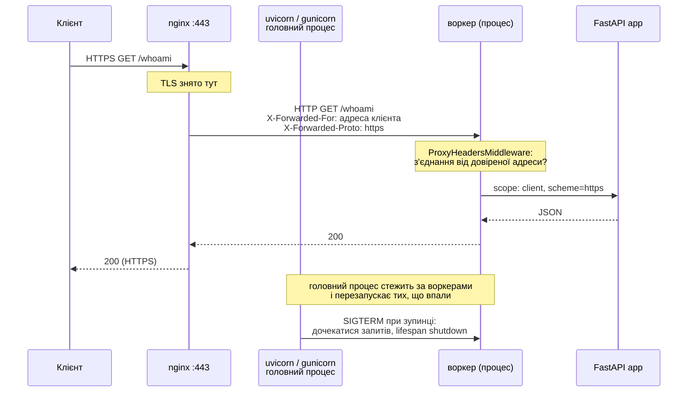
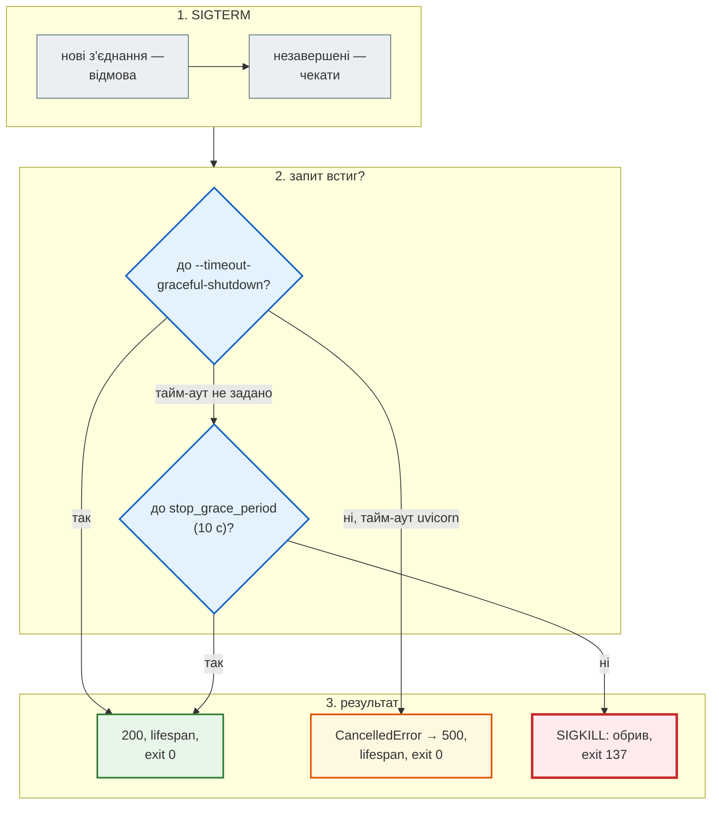

# Сервер у production: воркери, проксі, TLS

## Проблема { #problem }

`uvicorn main:app --reload` на ноутбуці й процес, який місяцями обслуговує користувачів, — різні речі. На сервері треба вирішити, скільки процесів запускати і хто їх перезапустить, коли один упаде. Запит приходить через nginx по HTTPS, тож застосунок має дізнатися справжню адресу клієнта й те, що з'єднання було захищеним. При оновленні треба зупинитися, не обірвавши запитів. Журнал не повинен з'їсти весь диск. На [кроці 11](../tutorials/11_compose_deploy/index.md) все це зроблено для News Hub: nginx перезаписує `X-Forwarded-For`, uvicorn вірить лише nginx, є HTTPS через certbot чи Caddy, а оновлення займає 7 секунд простою. Ця сторінка пояснює механізми загалом і вимірює те, що там лишилося осторонь: воркери під обмеженням CPU, менеджер процесів, зупинку з незавершеними запитами, схему й префікс за проксі.

## Ментальна модель { #mental-model }



Три шари: **проксі** (TLS, перший рубіж, статика, ліміти), **менеджер процесів** (скільки воркерів, перезапуск, сигнали), **ASGI-воркер** (цикл подій, запити, `lifespan`). Кожен налаштовується окремо, і помилка в одному не видна з іншого.

Приклади — [`examples/docker_ci/`](https://github.com/NikoriakViktor/news_hub/blob/main/examples/docker_ci/README.md): застосунок з `/io` (очікування) і `/cpu` (обчислення), [`scripts/load.py`](https://github.com/NikoriakViktor/news_hub/blob/main/examples/docker_ci/scripts/load.py), стек Compose з nginx і TLS. uvicorn 0.54, gunicorn 27.0, uvicorn-worker 0.4.

## Менеджер процесів: uvicorn чи gunicorn { #process-manager }

Обидва варіанти запускають головний процес і N воркерів, що слухають один сокет:

```bash
uvicorn main:app --host 0.0.0.0 --port 8000 --workers 2
gunicorn main:app -k uvicorn_worker.UvicornWorker -w 2 -b 0.0.0.0:8000
```

Перевірка: `kill -9` одного воркера в кожному контейнері.

```text
=== gunicorn після kill -9 одного воркера
[1] [ERROR] Worker (pid:7) was sent SIGKILL! Perhaps out of memory?
[79] [INFO] Booting worker with pid: 79
[79] [INFO] app startup: pid=79 uid=10001
=== uvicorn після kill -9 одного воркера
INFO:     Child process [8] died
INFO:     Started server process [52]
INFO:     app startup: pid=52 uid=10001
```

Обидва перезапустили воркер. Сучасний uvicorn сам стежить за дочірніми процесами, тож gunicorn для цього вже не обов'язковий. Відмінності лишились у деталях:

| | `uvicorn --workers N` | `gunicorn -k uvicorn_worker.UvicornWorker` |
|---|---|---|
| залежності | лише uvicorn | gunicorn + `uvicorn-worker` |
| перезапуск воркера, що впав | так | так |
| перезапуск після N запитів (проти витоків пам'яті) | `--limit-max-requests` (+ `-jitter`) | `--max-requests` (+ `--max-requests-jitter`) |
| завислий воркер | `--timeout-worker-healthcheck`: скільки чекати відповіді воркера на перевірку | `--timeout`: воркер, що мовчить довше, буде вбито |
| хуки, зміна кількості воркерів сигналами (`SIGTTIN`/`SIGTTOU`), `SIGHUP` | ні | так |
| кількість з `WEB_CONCURRENCY` | так | так |
| Windows | так | ні (лише Unix) |

!!! warning "gunicorn 27 і користувач без домашньої папки"
    У журналі gunicorn 27 з'явилось `[ERROR] Control server error: [Errno 13] Permission denied: '/home/app'`.
    Нова версія створює керуючий сокет у `~/.gunicorn/`, а в користувача `app` з `--no-create-home` домашньої
    папки немає. Сервер при цьому працює. Прибрати помилку можна прапорцем `--no-control-socket` або шляхом
    `--control-socket /tmp/gunicorn.ctl`. У gunicorn 27 є й власний клас `-k asgi`; тут він не перевірявся.

Старий шлях `-k uvicorn.workers.UvicornWorker` оголошено застарілим. Клас воркера тепер у пакеті `uvicorn-worker`.

## Скільки воркерів { #workers }

Контейнер з `--cpus 4`, 200 одночасних запитів до `/io?seconds=0.5` і 32 до `/cpu` (один запит — 0,42 с чистого Python):

```text
=== --cpus 4, --workers 1      44 MiB
200 запитів: 0.72 с, коди {200: 200}, процесів 1
32 запитів: 12.42 с, коди {200: 32}, процесів 1
32 запитів: 12.01 с, коди {200: 32}, процесів 1
=== --cpus 4, --workers 4      168 MiB
200 запитів: 0.64 с, коди {200: 200}, процесів 4
32 запитів: 8.86 с, коди {200: 32}, процесів 3
32 запитів: 7.38 с, коди {200: 32}, процесів 4
=== --cpus 4, --workers 8      302 MiB
200 запитів: 0.73 с, коди {200: 200}, процесів 8
32 запитів: 9.23 с, коди {200: 32}, процесів 8
32 запитів: 5.34 с, коди {200: 32}, процесів 8
```

- **Очікування не потребує процесів.** 200 запитів по 0,5 с один процес обробив за 0,72 с: поки запит чекає, цикл подій обслуговує інші. Чотири й вісім воркерів нічого не додали, лише пам'ять: 44 → 168 → 302 МіБ.
- **Обчислення потребує ядер, а не воркерів.** 4 воркери на 4 CPU в ідеалі дали б 12 / 4 = 3 с, а вийшло 7–9 с. З'єднання між процесами розподіляє ядро ОС, і розподіл нерівний: у першому запуску один з чотирьох воркерів не отримав жодного запиту. 8 воркерів на 4 CPU — від 5 до 9 с. Більше процесів, ніж ядер, лише додає пам'яті й перемикань. Чому розподіл нерівний, показано в [ASGI і WSGI: `--workers`](../04_async/asgi_vs_wsgi.md#workers).
- **Важкі обчислення в запиті — це проблема архітектури.** Їх виносять з циклу подій у пул процесів ([блокуючий код](../04_async/blocking_code.md#cpu)) або в чергу задач з окремими воркерами ([фонові задачі](../06_middleware_cache_jobs/background_jobs.md#queue)).

Формула «2 × ядра + 1» — рекомендація gunicorn для **синхронних** воркерів, які простоюють під час очікування. Для async-воркера вона не підходить. І ще одна пастка в контейнері: «кількість ядер» звідти виглядає не такою, як є насправді.

```text
$ docker run --rm --cpus 4 part10-slim sh -c 'nproc; python -c "import os; print(os.cpu_count(), len(os.sched_getaffinity(0)))"; cat /sys/fs/cgroup/cpu.max'
16
16 16
400000 100000                ← квота cgroup: 4 CPU
$ docker run --rm --cpuset-cpus 0-3 part10-slim …
4
16 4
```

`--cpus 4` (і `deploy.resources.limits.cpus` у Compose, і ліміти Kubernetes) обмежує **час**, а не набір ядер. `nproc` і `os.cpu_count()` бачать усі 16 ядер машини. Формула, порахована в контейнері, запустить 33 воркери на 4 CPU. Кількість воркерів задають явно (`WEB_CONCURRENCY`), а не обчислюють.

**Практичне правило для контейнерів:** один воркер на контейнер, масштаб — кількістю контейнерів ([крок 10: один процес на контейнер](../tutorials/10_docker/health_shutdown.md#workers), [крок 11: кілька копій API](../tutorials/11_compose_deploy/deploy.md#replicas)). Кілька воркерів в одному контейнері мають сенс, коли оркестратора немає, а ядер кілька. Кожен воркер має власний пул з'єднань з базою: N воркерів × `pool_size` з'єднань.

## Зупинка з незавершеними запитами { #graceful }

`docker stop` надсилає `SIGTERM`. uvicorn перестає приймати нові з'єднання і **чекає** вже прийняті запити, потім виконує `lifespan shutdown`. Перевірка: запит `/io?seconds=5`, через секунду `docker stop -t 10`.

```text
=== uvicorn (за замовчуванням)
запит /io?seconds=5: код 200 за 5.457158 с
docker stop: 4.50 s   exit=0
INFO:     Waiting for connections to close. (CTRL+C to force quit)
INFO:     172.17.0.1:37480 - "GET /io?seconds=5 HTTP/1.1" 200 OK
INFO:     app shutdown: connections closed

=== uvicorn --timeout-graceful-shutdown 1
запит /io?seconds=5: код 500 за 2.370746 с
docker stop: 1.53 s   exit=0
asyncio.exceptions.CancelledError: Task cancelled, timeout graceful shutdown exceeded

=== запит довший за час очікування: /io?seconds=30, docker stop -t 10
запит /io?seconds=30: код 000 за 12.089377 с      curl exit=52 (Empty reply from server)
docker stop -t 10: 13.16 s   exit=137
```



- **Два годинники.** `--timeout-graceful-shutdown` (uvicorn) і `stop_grace_period` (Docker, за замовчуванням 10 с). Тайм-аут uvicorn має бути **меншим** за Docker: тоді застосунок сам скасує запити, виконає `lifespan` і закриє з'єднання з базою. Інакше `SIGKILL` прийде посеред роботи, і `lifespan` не виконається зовсім.
- **Довгі запити — привід збільшити обидва**: `stop_grace_period: 30s` у Compose ([`compose.prod.yaml`](https://github.com/NikoriakViktor/news_hub/blob/main/examples/docker_ci/compose/compose.prod.yaml)) і `--timeout-graceful-shutdown 25`. У gunicorn те саме робить `--graceful-timeout`.
- **Фонові задачі `BackgroundTasks` чекають так само** (`Waiting for background tasks to complete.`) і так само обриваються `SIGKILL`. Розбір — [фонові задачі: що буде при перезапуску](../06_middleware_cache_jobs/background_jobs.md#restart).

## За проксі: адреса клієнта і схема { #proxy-headers }

nginx відкриває до застосунку **власне** з'єднання. Для uvicorn клієнтом стає nginx, а схемою — `http`, навіть якщо користувач прийшов по HTTPS. Справжні значення nginx передає заголовками `X-Forwarded-For` і `X-Forwarded-Proto`. uvicorn підставляє їх у `request.client` і `request.url.scheme` (`--proxy-headers` увімкнено за замовчуванням), але **лише** для з'єднань з адрес у `--forwarded-allow-ips` / `FORWARDED_ALLOW_IPS` (за замовчуванням `127.0.0.1,::1`).

[`compose.yaml`](https://github.com/NikoriakViktor/news_hub/blob/main/examples/docker_ci/compose/compose.yaml): nginx з фіксованою адресою `10.231.7.10` знімає TLS і проксує до `api`. `/whoami` показує, що бачить застосунок:

```text
--- FORWARDED_ALLOW_IPS не задано (127.0.0.1)
$ curl -sk https://localhost:18112/whoami
{"client":"10.231.7.10","scheme":"http","url_for":"http://localhost:18112/whoami", …}

--- FORWARDED_ALLOW_IPS=10.231.7.10
$ curl -sk https://localhost:18112/whoami
{"client":"10.231.7.1","scheme":"https","url_for":"https://localhost:18112/whoami", …}

--- напряму в api (порт з override), з підробленими заголовками
$ curl -s localhost:18111/whoami -H 'X-Forwarded-For: 6.6.6.6' -H 'X-Forwarded-Proto: https'
{"client":"192.168.48.1","scheme":"http","url_for":"http://localhost:18111/whoami", …}
```

- **Без довіри до проксі `url_for` дає `http://`**, хоча сторінку відкрито по HTTPS. Посилання в JSON, редиректи `RedirectResponse(request.url_for(...))`, `Location` після `201`, адреса callback для OAuth — усе це веде на `http://`. Браузер блокує змішаний вміст, а OAuth-провайдер відхиляє адресу.
- **Підроблені заголовки від недовіреної адреси ігноруються**: `6.6.6.6` не став клієнтом.
- **`10.231.7.1`, а не адреса твого комп'ютера.** У Docker Desktop опубліковані порти проходять через проксі Docker, і з мережі контейнерів клієнтом виглядає шлюз мережі. На Linux-сервері це зазвичай справжня адреса клієнта.
- **`FORWARDED_ALLOW_IPS='*'`** — довіряти всім. Безпечно лише тоді, коли до застосунку фізично ніхто, крім проксі, не може під'єднатися. Як підробка `X-Forwarded-For` обходить rate limit, показано на [кроці 11](../tutorials/11_compose_deploy/nginx_real_ip.md#trust-all) і в [rate limiting](../06_middleware_cache_jobs/rate_limiting.md#client-key).

### Префікс шляху: `root_path` { #root-path }

nginx публікує API під `/api/`, а застосунок про префікс не знає: `location /api/ { proxy_pass http://app/; }` зрізає `/api` (коса риска в кінці `proxy_pass`). Посилання застосунку тоді гублять префікс. `--root-path /api` (у прикладі — змінна `UVICORN_ROOT_PATH`, uvicorn читає будь-який параметр зі змінної `UVICORN_…`) повертає його:

```text
--- ROOT_PATH порожній
$ curl -sk https://localhost:18112/api/whoami
{"url_for":"https://localhost:18112/whoami","root_path":""}        ← без /api
$ curl -sk https://localhost:18112/api/docs | grep -o "url: '[^']*'"
url: '/openapi.json'
--- ROOT_PATH=/api
{"url_for":"https://localhost:18112/api/whoami","root_path":"/api"}
url: '/api/openapi.json'
/api/openapi.json → 200
```

Без `root_path` Swagger UI на `/api/docs` просить `/openapi.json` з кореня. У прикладі це випадково працює, бо `location /` теж веде на API. Якби nginx публікував лише `/api/`, документація була б порожньою.

## TLS { #tls }

TLS знімають на проксі. Застосунок отримує звичайний HTTP усередині приватної мережі, а сертифікати, протоколи й оновлення живуть в одному місці:

```nginx title="examples/docker_ci/compose/nginx.conf (фрагмент)"
server {
    listen 80;
    return 301 https://$host$request_uri;      # http → https
}

server {
    listen 443 ssl;
    ssl_certificate     /etc/nginx/certs/cert.pem;
    ssl_certificate_key /etc/nginx/certs/key.pem;
    ssl_protocols       TLSv1.2 TLSv1.3;
    location / {
        proxy_pass http://app;
        proxy_set_header Host              $http_host;
        proxy_set_header X-Forwarded-For   $remote_addr;
        proxy_set_header X-Forwarded-Proto $scheme;
    }
}
```

```text
$ curl -s -o /dev/null -w '%{http_code}' http://localhost:18112/
400                              ← звичайний HTTP на порт HTTPS
```

- Сертифікат у прикладі самопідписаний ([`make_cert.sh`](https://github.com/NikoriakViktor/news_hub/blob/main/examples/docker_ci/compose/make_cert.sh)), тому `curl -k`. На сервері його отримують від Let's Encrypt через certbot або Caddy, який отримує й оновлює сертифікати сам ([крок 11: HTTPS](../tutorials/11_compose_deploy/deploy.md#https)).
- Сертифікат Let's Encrypt діє 90 днів. Оновлення має бути автоматичним, а nginx після нього потрібно перезавантажити: `nginx -s reload`.
- **HSTS** (`add_header Strict-Transport-Security "max-age=31536000" always;`) каже браузеру ходити лише по HTTPS навіть за посиланням `http://`. Вмикай його, коли HTTPS уже працює стабільно: скасувати збережене браузером правило швидко не вийде.
- Ключ сертифіката — секрет: права `600`, у git не потрапляє (`certs/` у `.gitignore` прикладу).

## Журнали { #logs }

У контейнері журнал — це stdout і stderr процесу. Docker зберігає їх драйвером `json-file`, і **за замовчуванням без обмеження розміру**. Access log кожного запиту за місяці роботи заповнить диск сервера, і тоді впаде все, включно з базою. Обмеження задають у Compose або для всього Docker у `/etc/docker/daemon.json`:

```yaml title="examples/docker_ci/compose/compose.prod.yaml (фрагмент)"
x-logging: &logging
  driver: json-file
  options:
    max-size: "10m"
    max-file: "3"
```

```text
log=json-file map[max-file:3 max-size:10m] restart=unless-stopped stop_timeout=30
```

- `PYTHONUNBUFFERED=1` в образі — щоб рядки з'являлися в `docker logs` одразу, а не пачками.
- Читання: `docker compose logs -f --since 10m api`, `docker compose logs --tail 100 nginx`.
- Access log пишуть **в одному місці**: або nginx, або uvicorn (`--no-access-log`). Інакше кожен запит потрапляє в журнал двічі. Адресу клієнта правильно бачить лише той, хто стоїть першим.
- Коли серверів кілька, журнали збирають централізовано (Loki, ELK, хмарний сервіс) і пишуть у JSON, щоб їх можна було шукати за полями.

## Оновлення без простою { #zero-downtime }

`docker compose up -d` з новим образом зупиняє старий контейнер і запускає новий. Поки новий стає healthy, nginx відповідає `502`: на кроці 11 це ~7 секунд ([оновлення і простій](../tutorials/11_compose_deploy/deploy.md#update)). Способи прибрати цей проміжок:

| Спосіб | Як | Ціна |
|---|---|---|
| дві копії й перезапуск по черзі | `--scale api=2`, оновлювати по одній; nginx `proxy_next_upstream error timeout` перекидає запит на живу копію | весь спільний стан — у Redis чи базі; міграції сумісні зі старою версією |
| blue-green | новий стек поруч, перевірка, перемикання upstream nginx, `nginx -s reload` | удвічі більше ресурсів на час оновлення |
| оркестратор | Kubernetes, Swarm, PaaS роблять rolling update самі, за readiness-перевіркою | складніша інфраструктура |

Будь-який спосіб вимагає **зворотно сумісних міграцій**. Під час оновлення стара й нова версії працюють з тією самою схемою одночасно. Колонку спочатку додають, і лише в наступному випуску прибирають стару.

## У News Hub { #news-hub }

| Що | News Hub | Код |
|---|---|---|
| менеджер процесів | uvicorn, один процес; більше — `WEB_CONCURRENCY` | [`Dockerfile`](https://github.com/NikoriakViktor/news_hub/blob/main/steps/12_ci_cd/Dockerfile) |
| масштаб | `docker compose up -d --scale api=2`; ліміти й кеш у Redis | [крок 11: кілька копій](../tutorials/11_compose_deploy/deploy.md#replicas) |
| проксі | nginx перезаписує `X-Forwarded-For $remote_addr`; `FORWARDED_ALLOW_IPS: 172.28.0.10` | [`nginx.conf`](https://github.com/NikoriakViktor/news_hub/blob/main/steps/12_ci_cd/nginx/nginx.conf), [крок 11: nginx](../tutorials/11_compose_deploy/nginx_real_ip.md) |
| TLS | у `nginx.conf` немає; certbot або Caddy на сервері | [крок 11: HTTPS](../tutorials/11_compose_deploy/deploy.md#https) |
| тайм-аут проксі | `proxy_read_timeout 65s`: webhook Telegram чекає відповідь до 60 с | `nginx.conf` |
| зупинка | exec-форма `CMD`, `lifespan` закриває Redis, базу, бота | [крок 10: здоров'я і зупинка](../tutorials/10_docker/health_shutdown.md#stop) |
| журнали | stdout контейнерів; `logging:` у compose немає | — |
| версія nginx | `server_tokens off;`: у заголовку `Server` і на сторінках помилок лише `nginx`, без версії; smoke перевіряє `Server: nginx` | [`nginx.conf`](https://github.com/NikoriakViktor/news_hub/blob/main/steps/12_ci_cd/nginx/nginx.conf) |
| `/docs` на сервері | `DOCS_ENABLED: ${DOCS_ENABLED:-false}` у Compose: `/docs`, `/redoc`, `/openapi.json` → 404 (smoke перевіряє); локально без змінної — увімкнено | `api.py` (`docs_enabled()`), [`docker-compose.yml`](https://github.com/NikoriakViktor/news_hub/blob/main/steps/12_ci_cd/docker-compose.yml) |
| заголовки безпеки | ставить застосунок (`SecurityHeadersMiddleware`), nginx їх не дублює; HSTS — лише в майбутньому блоці `listen 443 ssl` | `middleware.py`, коментар у `nginx.conf` |
| оновлення | `git pull && docker compose up -d --build --wait`, ~7 с `502` | [крок 11: оновлення](../tutorials/11_compose_deploy/deploy.md#update) |

Зверни увагу: `proxy_read_timeout` у nginx — 65 с, а `stop_grace_period` у Compose не задано, тобто 10 с. Запит, що триває довше за 10 секунд, при оновленні `api` буде обірвано. Для сервера варто додати `stop_grace_period` і обмеження журналів, як у `compose.prod.yaml` прикладу.

## Типові помилки { #mistakes }

| Помилка | Наслідок | Як правильно |
|---|---|---|
| `--workers $(nproc)` або «2 × ядра + 1» у контейнері | `nproc` бачить ядра машини, а не квоту `--cpus`: десятки воркерів на 2 CPU | явне `WEB_CONCURRENCY`; у контейнері — 1 |
| багато воркерів для I/O-навантаження | пам'ять × N, швидкості не додалося | один async-воркер; масштаб — контейнерами |
| обчислення в `def`-ендпоінті «бо воркерів багато» | розподіл нерівний, черги на одному воркері | пул процесів або черга задач |
| `-k uvicorn.workers.UvicornWorker` | застарілий шлях | `pip install uvicorn-worker`, `-k uvicorn_worker.UvicornWorker` |
| `FORWARDED_ALLOW_IPS` не задано за nginx | `client` — адреса nginx, `url_for` — `http://` | адреса чи підмережа проксі |
| `FORWARDED_ALLOW_IPS='*'`, API доступний напряму | підробка адреси, обхід лімітів | лише адреса проксі; API без `ports` |
| API під `/api/` без `root_path` | посилання й `/docs` без префікса | `--root-path /api` |
| тайм-аут uvicorn ≥ `stop_grace_period` | `SIGKILL` посеред запитів, `lifespan` не виконано | тайм-аут uvicorn менший за Docker |
| `json-file` без `max-size` | диск сервера заповнено журналами | `logging.options.max-size`, `max-file` |

## Налагодження { #debugging }

| Симптом | Причина й перевірка |
|---|---|
| `502 Bad Gateway` | API не запущено чи не готове: `docker compose ps`, `logs api`; nginx запам'ятав стару адресу після перестворення — `nginx -s reload` |
| `504 Gateway Timeout` | запит довший за `proxy_read_timeout` (60 с за замовчуванням) |
| усі клієнти з однієї адреси | довіра до проксі: подивись `request.client` через `/whoami`-подібний ендпоінт, перевір `FORWARDED_ALLOW_IPS` |
| редирект на `http://` за HTTPS | немає `X-Forwarded-Proto` у nginx або довіри в uvicorn |
| `exit 137` при оновленні | запити довші за `stop_grace_period`; `docker inspect -f '{{.Config.StopTimeout}}'` |
| `Worker … was sent SIGKILL! Perhaps out of memory?` | `docker inspect -f '{{.State.OOMKilled}}'`, `docker stats`: воркерів забагато для ліміту пам'яті |
| воркери навантажені нерівно | так розподіляє ядро ОС; дивись PID у журналі чи відповіді |

## Безпека { #security }

- **Застосунок — лише за проксі.** У `api` немає `ports` на сервері, і `FORWARDED_ALLOW_IPS` містить лише адресу проксі.
- **Проксі перезаписує, а не дописує** `X-Forwarded-For` (`$remote_addr`, а не `$proxy_add_x_forwarded_for`), якщо перед ним немає ще одного довіреного проксі.
- **TLS 1.2+**, редирект з 80 на 443, HSTS після стабілізації. Ключ сертифіката — `600`, поза git.
- **`client_max_body_size`** у nginx: обмеження тіла запиту зупиняє великі запити ще до Python.
- **Не віддавай версії**: `server_tokens off;` у nginx (у News Hub є); `--no-server-header` в uvicorn, якщо заголовок `server: uvicorn` не потрібен.
- **Документація API на публічному сервері — карта всіх ендпоінтів для будь-кого.** Якщо вона не потрібна користувачам, її вимикають (`docs_url=None`, `openapi_url=None`), як `DOCS_ENABLED=false` у News Hub.
- **Журнали можуть містити секрети**: токени в URL, тіла запитів. Не пиши тіл в access log; секрети не передають у шляху.

## Питання { #questions }

1. Що зробили gunicorn і uvicorn, коли воркер отримав `kill -9`? Навіщо тоді gunicorn?
2. Чому 8 воркерів не прискорили 200 запитів до `/io`?
3. Чому 4 воркери на 4 CPU дали 7–9 с, а не 3 с?
4. Що покаже `nproc` у контейнері з `--cpus 4` на 16-ядерній машині?
5. Що станеться із запитом на 5 с при `docker stop`, а що із запитом на 30 с?
6. Навіщо тайм-аут uvicorn робити меншим за `stop_grace_period`?
7. Чому без `FORWARDED_ALLOW_IPS` `url_for` повертає `http://` за HTTPS-проксі?
8. Що дає `root_path`, коли nginx публікує API під `/api/`?
9. Що станеться з диском сервера через рік роботи з драйвером `json-file` за замовчуванням?

??? success "Відповіді"

    1. Обидва перезапустили воркер. gunicorn дає більше керування: `--max-requests`, `--timeout` для зависань, хуки, зміну кількості воркерів сигналами.
    2. Запити чекають (`await asyncio.sleep`), а не рахують; один цикл подій обслуговує їх паралельно. Додаткові процеси лише займають пам'ять.
    3. З'єднання між воркерами розподіляє ядро ОС, нерівномірно; воркер, що отримав більше, обробляє їх по черзі, бо обчислення тримають GIL.
    4. 16: `--cpus` обмежує час CPU через квоту cgroup, а не кількість видимих ядер.
    5. Запит на 5 с завершиться з `200`, далі `lifespan` і exit 0. Запит на 30 с обірве `SIGKILL` через 10 с: клієнт отримає порожню відповідь, exit 137.
    6. Тоді застосунок сам скасує завислі запити й виконає `lifespan` (закриє з'єднання), а не буде вбитий посеред роботи.
    7. uvicorn приймає `X-Forwarded-Proto` лише від довірених адрес (за замовчуванням `127.0.0.1`); з'єднання від nginx — звичайний HTTP.
    8. Застосунок знає свій префікс: `url_for` і адреса `openapi.json` у `/docs` містять `/api`.
    9. Журнали ростуть без обмеження й можуть заповнити диск; потрібні `max-size` і `max-file`.

## Що далі { #next }

[CI/CD на GitHub Actions](ci_cd.md) — сервер готовий приймати образ; тепер як перевіряти кожну зміну автоматично і публікувати образ, який можна деплоїти.

**Джерела:** Uvicorn — [Settings](https://uvicorn.dev/settings/) (`--workers`, `--proxy-headers`, `--forwarded-allow-ips`, `--root-path`, `--timeout-graceful-shutdown`), [Deployment](https://uvicorn.dev/deployment/); [uvicorn-worker](https://github.com/Kludex/uvicorn-worker); Gunicorn — [Settings](https://gunicorn.org/reference/settings/), [Design](https://gunicorn.org/design/) (розділ «How Many Workers?»); FastAPI — [Behind a Proxy](https://fastapi.tiangolo.com/advanced/behind-a-proxy/), [Server Workers](https://fastapi.tiangolo.com/deployment/server-workers/); nginx — [ngx_http_proxy_module](https://nginx.org/en/docs/http/ngx_http_proxy_module.html), [Configuring HTTPS servers](https://nginx.org/en/docs/http/configuring_https_servers.html); Docker — [JSON File logging driver](https://docs.docker.com/engine/logging/drivers/json-file/), [Resource constraints: CPU](https://docs.docker.com/engine/containers/resource_constraints/#cpu); [MDN — Strict-Transport-Security](https://developer.mozilla.org/en-US/docs/Web/HTTP/Reference/Headers/Strict-Transport-Security); [Let's Encrypt — FAQ](https://letsencrypt.org/docs/faq/).
