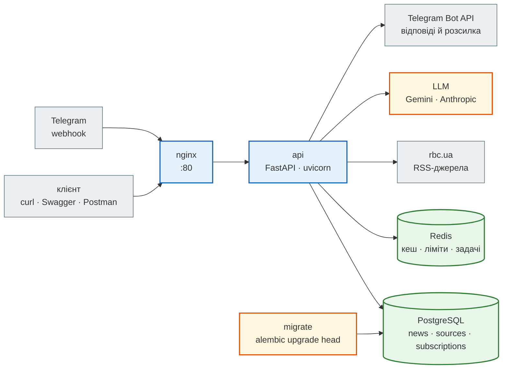

# News Hub Deep Dive

> Фінальна версія застосунку — [`steps/12_ci_cd`](https://github.com/NikoriakViktor/news_hub/tree/main/steps/12_ci_cd).
> Як ми до неї дійшли — [Zero to Hero](../tutorials/README.md), кроки 0–12. Теорія — частини I–X книги.

## Навіщо цей розділ { #why }

Кроки книги показують застосунок **зміна за зміною**: що додали, чому, що зламалось би без цього. Після дванадцятого
кроку в голові лишається історія, а не карта: де живе rate limit, хто відкриває сесію бази для фонової задачі,
куди дописати нове джерело новин, щоб не забути тест.

Deep Dive — та сама фінальна версія, але розібрана **як ціле**:

| Zero to Hero | Deep Dive |
|---|---|
| «що змінилось у кроці N» | «як воно влаштоване зараз» |
| порядок — за часом появи | порядок — від процесів до рядка коду |
| один модуль за раз | усі модулі разом: хто кого викликає |
| `git diff` між кроками | `файл:рядок` у фінальному коді |

Для кого: ти пройшов кроки й хочеш побачити систему цілком — або прийшов одразу до готового застосунку і хочеш
його розширити. Теорію тут не повторюємо: посилаємось на кроки й частини книги.

## Що в News Hub зараз { #inventory }

Числа — з фінального коду, а не з пам'яті:

| Що | Скільки | Звідки число |
|---|---|---|
| модулів Python у `news_hub/` | 26 | `mypy --strict news_hub` → `Success: no issues found in 26 source files` |
| ендпоінтів HTTP | 24: 14 лише для адміна, 10 публічних | `app.routes` + пошук `require_admin` у залежностях, як у `tests/integration/test_admin_api.py` |
| таблиць / міграцій | 3 (`news`, `sources`, `subscriptions`) / 4 (`0001`…`0004`) | `alembic history` |
| сервісів Compose | 5 + 2 у профілях (`bot`, `twin`) | `docker-compose.yml` |
| тестів | 371: 363 за замовчуванням + 6 `docker` + 2 `llm` | `pytest --collect-only` |
| jobs CI | 7 (з них `supply-chain` — залежності й секрети) | `.github/workflows/news_hub.yml` |

## Карта системи { #map }



Звідки береться кожна стрілка і які це процеси насправді — сторінка [Архітектура](architecture.md).

## Сторінки розділу { #pages }

| Сторінка | На яке питання відповідає |
|---|---|
| [Архітектура](architecture.md) | які процеси працюють, які шари в коді, хто кого імпортує (граф, отриманий з коду), **карта модулів** — за що відповідає кожен файл і з якого він кроку, які змінні середовища що вмикають |
| [Життєвий цикл запиту](request_lifecycle.md) | що відбувається з одним запитом від nginx до відповіді: middleware, rate limit, `Depends`, сесія, кеш, SQL, коди помилок — з журналом справжнього запуску |
| [Модель даних і Redis](data_model.md) | таблиці й стовпці, міграції `0001`–`0004`, індекси, SQLite проти PostgreSQL, усі ключі Redis з TTL |
| [Каталог патернів](patterns.md) | Repository, Unit of Work, DI, Strategy, Adapter, Decorator, Circuit breaker, Cache-aside, Fail-fast… — де кожен у коді (`файл:рядок`), навіщо і з якого кроку |
| [Карта тестів](test_map.md) | які тести є, що в них справжнє, а що підмінене, що ловить кожен файл, який модуль якими тестами покритий, **CI** — які jobs що запускають |
| [Як розширювати](extending.md) | нове джерело новин, ендпоінт, команда бота, міграція, змінна середовища — які файли й тести зачепити |

Порядок читання — згори донизу: кожна сторінка спирається на попередню. Якщо прийшов з конкретною задачею
(«додати ендпоінт»), іди одразу на [Як розширювати](extending.md): звідти посилання ведуть назад на потрібні місця.

## Запустити фінальну версію локально { #run }

Без Docker, PostgreSQL, Redis і ключа LLM:

```bash
cd steps/12_ci_cd
pip install -r requirements-dev.txt
python -m news_hub.security                # пароль → рядки ADMIN_PASSWORD_HASH='…' і JWT_SECRET='…'
export ADMIN_PASSWORD_HASH='$2b$12$…' JWT_SECRET='…'
export REDIS_URL=fakeredis:// LLM_PROVIDER=fake
alembic upgrade head                       # файл news_hub.db, міграції 0001 → 0004
uvicorn news_hub.api:app                   # http://127.0.0.1:8000/docs
```

`/docs` локально є, бо `DOCS_ENABLED` за замовчуванням `true`; у Compose — `false`, і `/docs`, `/redoc`,
`/openapi.json` відповідають `404` (перевірено запуском з `DOCS_ENABLED=false`: `docs 404`, `openapi 404`) ([Архітектура → конфігурація](architecture.md#config)).

Журнали на сторінках цього розділу зняті саме так: SQLite-файл, `LLM_PROVIDER=fake`, але Redis — справжній
(`redis:7-alpine` у контейнері), щоб показати ключі й TTL через `redis-cli`. З `fakeredis://` застосунок
відповідає так само, лише ключі живуть у пам'яті процесу.

Без `ADMIN_PASSWORD_HASH` і `JWT_SECRET` застосунок теж стартує, але все, що пише, відповідає `503`:

```text
05:18:08 INFO news_hub: 7eee880c GET /health/ready → 200 8.9 ms
05:18:08 INFO news_hub: e09c0d91 POST /api/scrape → 503 1.5 ms
```

```json
{"detail":"адмін-доступ не налаштовано: задай JWT_SECRET і ADMIN_PASSWORD_HASH"}
```

Чому так, а не падіння при старті, — [Архітектура → конфігурація](architecture.md#config). Уся система в Compose —
[крок 11](../tutorials/11_compose_deploy/index.md), той самий шлях у CI — [крок 12](../tutorials/12_ci_cd/index.md).
