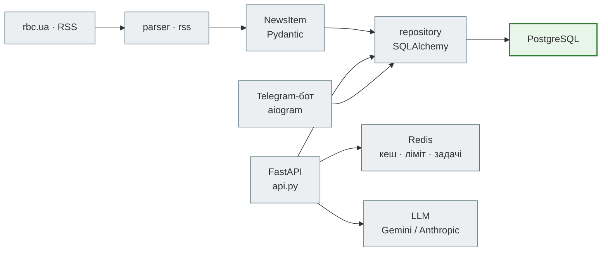

# News Hub Deep Dive

Розбір фінальної версії — [`steps/12_ci_cd`](https://github.com/NikoriakViktor/news_hub/tree/main/steps/12_ci_cd):
не «як ми сюди дійшли» (це Zero to Hero), а «як воно влаштоване зараз».

## Розділи (у роботі)

| Розділ | Що там |
|---|---|
| Архітектура | компоненти, залежності між модулями, правила (`CLAUDE.md` кроку 12) |
| Карта модулів | кожен файл `news_hub/` — за що відповідає, з якого кроку |
| Життєвий цикл запиту | nginx → middleware → залежності → ендпоінт → репозиторій → кеш → відповідь |
| Модель даних і міграції | таблиці `news`, `sources`, `subscriptions`; міграції 0001–0004 |
| Карта тестів | unit / integration / docker / live — що справжнє, що підмінене |
| CI | jobs `news_hub.yml` і чому саме такі |
