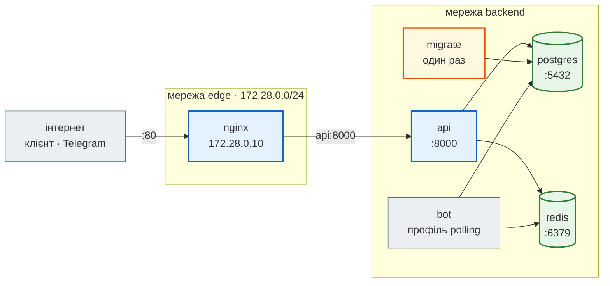
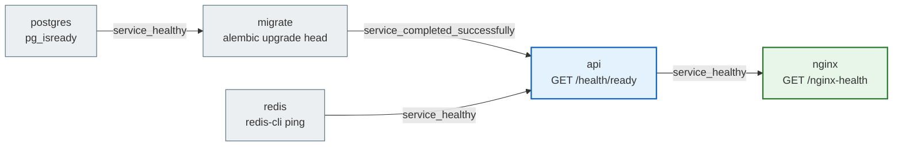
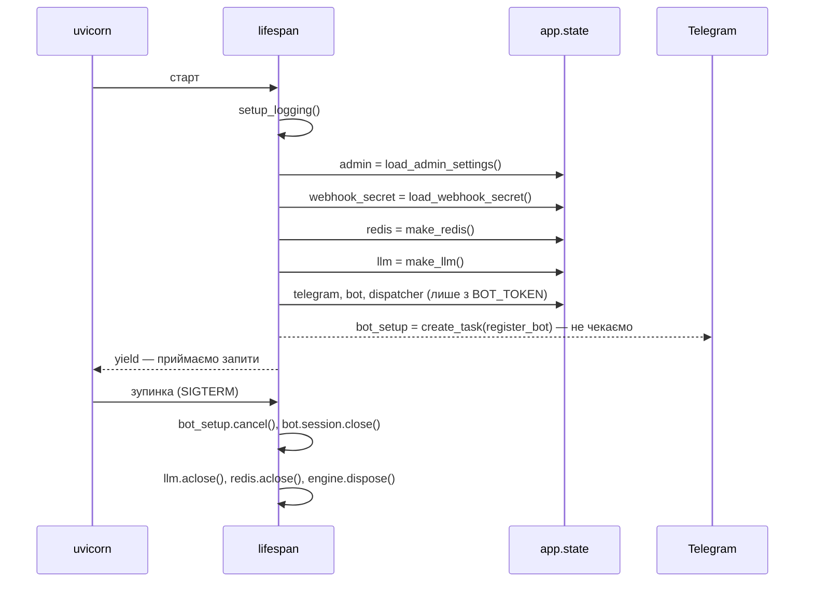
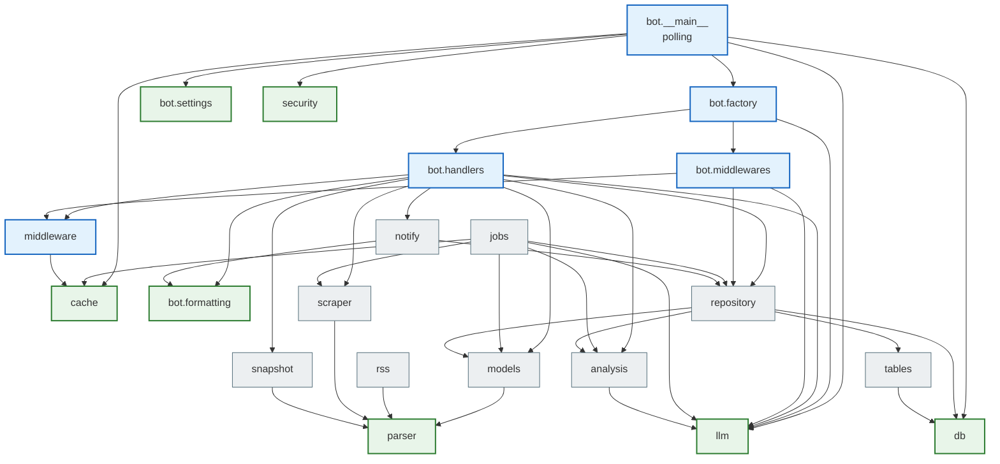

# Архітектура

> News Hub Deep Dive · сторінка 1 з 6. Код: [`steps/12_ci_cd`](https://github.com/NikoriakViktor/news_hub/tree/main/steps/12_ci_cd) —
> [`docker-compose.yml`](https://github.com/NikoriakViktor/news_hub/blob/main/steps/12_ci_cd/docker-compose.yml),
> [`news_hub/api.py`](https://github.com/NikoriakViktor/news_hub/blob/main/steps/12_ci_cd/news_hub/api.py),
> [`CLAUDE.md`](https://github.com/NikoriakViktor/news_hub/blob/main/steps/12_ci_cd/CLAUDE.md) кроку 12.

## Задача { #task }

Відповісти на три питання про фінальну версію — і кожну відповідь перевірити кодом, а не пам'яттю:

1. **Які процеси працюють** і як вони з'єднані (Compose, мережі, порти, порядок старту).
2. **Як поділено код**: шари, модулі, хто кого імпортує.
3. **Що вмикає конфігурація**: які змінні середовища є, що буде без них і з поганим значенням.

## Процеси і сервіси { #services }

`docker compose up -d --build --wait` ([крок 11](../tutorials/11_compose_deploy/index.md)) піднімає п'ять сервісів;
ще два — лише з профілем:

| Сервіс | Образ / команда | Що робить | Мережі | Порти назовні |
|---|---|---|---|---|
| `postgres` | `postgres:16-alpine` | база; дані — у томі `pgdata` | `backend` | немає |
| `redis` | `redis:7-alpine` | кеш, лічильники rate limit, статус задач, breaker | `backend` | немає |
| `migrate` | `news_hub:12`, `alembic upgrade head` | один раз застосовує міграції й завершується | `backend` | немає |
| `api` | `news_hub:12`, `uvicorn news_hub.api:app` (CMD образу) | увесь HTTP API, фонові задачі, бот у режимі webhook | `backend`, `edge` | немає |
| `nginx` | `nginx:1.27-alpine` + `nginx/nginx.conf` | єдиний вхід ззовні; перезаписує `X-Forwarded-For`; `server_tokens off` — без версії в `Server` | `edge` (адреса `172.28.0.10`) | `${HTTP_PORT:-80}:80` |
| `bot` (профіль `polling`) | `news_hub:12`, `python -m news_hub.bot` | бот у режимі polling — окремим процесом | `backend` | немає |
| `twin` (профіль `twin`) | `news_hub:12`, `python -m tests.telegram_twin` | двійник Telegram Bot API для локальної перевірки | `backend`, `edge` | `127.0.0.1:8081` |



`api` — єдиний сервіс у двох мережах: nginx бачить лише його, а база й Redis не бачать nginx. Портів бази й Redis
назовні немає зовсім — це перевіряє останній рядок `scripts/smoke.sh`
(`check "база й Redis без портів назовні"`). Для розробки їх відкриває `docker-compose.dev.yml` — лише на `127.0.0.1`.

Порядок старту задають `depends_on` з умовами — і це не «спершу запусти», а «спершу дочекайся стану»:



| Перевірка здоров'я | Де | Що питає | Чому саме так |
|---|---|---|---|
| `HEALTHCHECK` образу | `Dockerfile` | `GET /health` — процес живий | не торкається бази: падіння PostgreSQL не робить контейнер «unhealthy» ([крок 10](../tutorials/10_docker/health_shutdown.md)) |
| `healthcheck` сервісу `api` | `docker-compose.yml` | `GET /health/ready` — база й Redis відповідають | nginx стартує, коли API справді може відповідати ([крок 11](../tutorials/11_compose_deploy/startup_order.md)) |
| `migrate`, `bot`, `twin` | `docker-compose.yml` | `healthcheck: disable: true` | порт 8000 вони не слухають — HEALTHCHECK образу завжди був би «unhealthy» |

### Що живе всередині процесу `api` { #inside-api }

Окремого worker-процесу немає. Усе, що «у фоні», виконується в тому самому процесі uvicorn:

| Що | Де в коді | Коли виконується |
|---|---|---|
| ендпоінти HTTP | `news_hub/api.py` | на кожен запит |
| фоновий збір і аналіз | `jobs.py` — `run_scrape_job`, `run_analyze_job` через `BackgroundTasks` | **після** відповіді клієнту, у тому самому циклі подій |
| розсилка підписникам | `notify.py` — `Notifier` через `BackgroundTasks` | після відповіді (тобто після COMMIT) |
| бот (режим webhook) | `bot/factory.py` — `Dispatcher` у `app.state.dispatcher`, `dispatcher.feed_update` у фоні | після відповіді `{"ok": true}` Telegram |
| реєстрація бота в Telegram | `api.py:135` `register_bot` — `asyncio.create_task` | у фоні від старту, з повторами 1, 2, 5, 10, 30 с |

Наслідок, який варто знати: задача з `BackgroundTasks` живе лише в пам'яті процесу. Якщо контейнер `api`
перезапуститься посеред збору, статус `job:<id>` у Redis так і лишиться `running` — коду, що підбирає незавершені
задачі, немає; ключ зникне сам через добу (`JOB_TTL`, `jobs.py:32`). Для навчального агрегатора це свідомо простіше
за чергу задач; коли задач стане багато або вони стануть довгими — це перше місце для окремого worker.

`lifespan` (`api.py:99`) збирає все, що потрібне на весь час роботи процесу, і кладе в `app.state`:



Webhook бота при зупинці **не** видаляється (`api.py:111`): під час перезапуску його вже міг поставити новий
процес. Engine бази в `app.state` не лежить — це змінна модуля `db.py:39`, як і `SessionFactory` (`db.py:42`).

## Шари коду { #layers }

Код поділено за тим, **що він знає**. Вищий шар викликає нижчий, ніколи навпаки:

| Шар | Модулі | Знає | Не знає |
|---|---|---|---|
| **Вхід** — HTTP і Telegram | `api.py`, `middleware.py`, `security.py` (залежності), `bot/handlers.py`, `bot/middlewares.py`, `bot/factory.py`, `bot/__main__.py` | запит, заголовки, статуси, `Depends`, update Telegram | SQL, як влаштовані провайдери LLM |
| **Сценарії** — що робить застосунок | `api.collect`, `analysis.analyze_news`, `jobs.run_scrape_job` / `run_analyze_job`, `notify.notify_subscribers` / `Notifier` | порядок кроків: зібрати → перевірити → зберегти → сповістити | HTTP (жоден з них не імпортує FastAPI) |
| **Межа довіри** — перевірка даних | `models.py` (`NewsItem`, `validate_news`), `analysis.NewsAnalysis`, моделі запитів у `api.py`, `webhooks.verify_signature`, `safe_fetch.check_url` | правила: домени, довжини, схема, підпис | звідки прийшли дані |
| **Дані й стан** | `repository.py`, `cache.NewsCache`, `analysis.AnalysisCache`, `jobs.JobStore`, `llm.CircuitBreaker`, `middleware.RateLimiter`, `security.LoginGuard`, `webhooks.claim_delivery` | SQL, ключі Redis | хто і навіщо їх викликав |
| **Інфраструктура й джерела** | `db.py`, `tables.py`, `parser.py`, `rss.py`, `scraper.py`, `snapshot.py`, `safe_fetch.safe_fetch`, `llm.GeminiClient` / `AnthropicClient` / `FakeLLM`, `bot/formatting.py`, `bot/settings.py` | драйвери, SDK, HTML, RSS | бізнес-правила |

Перевірити поділ можна одним `grep`: хто імпортує фреймворки.

| Бібліотека | Модулі, що її імпортують |
|---|---|
| `fastapi` | `api.py`, `cache.py` (лише `Request` у `get_redis`), `middleware.py` (і `starlette.types` для чистого ASGI), `security.py` |
| `aiogram` | `api.py`, `notify.py`, `bot/factory.py`, `bot/handlers.py`, `bot/middlewares.py` |
| `sqlalchemy` | `api.py`, `db.py`, `jobs.py`, `notify.py`, `repository.py`, `tables.py`, `bot/factory.py`, `bot/middlewares.py` |
| `aiohttp` | `llm.py`, `safe_fetch.py`, `scraper.py` |

`analysis.py`, `jobs.py`, `models.py`, `repository.py` не знають FastAPI — тому ті самі `analyze_news` і
`NewsRepository` викликають і ендпоінт, і фонова задача, і команда бота `/digest`. Шари — домовленість: тесту,
який забороняв би, скажімо, `import fastapi` у `repository.py`, у проєкті немає (у Django-книзі такий є —
`tests_architecture.py`). Ідею можна перенести: див. [Як розширювати](extending.md#architecture-test).

## Хто кого імпортує { #imports }

Граф нижче отримано з коду, а не намальовано з пам'яті: скрипт розбирає кожен файл `news_hub/` модулем `ast` і
збирає внутрішні імпорти (`from .x import …`, `from news_hub.x import …`).

```python title="imports.py — граф імпортів news_hub"
"""Граф імпортів news_hub (лише внутрішні модулі)."""
import ast, sys
from pathlib import Path

root = Path(sys.argv[1])                      # steps/12_ci_cd


def modname(p: Path) -> str:
    parts = list(p.relative_to(root).with_suffix("").parts)
    return ".".join(parts[:-1] if parts[-1] == "__init__" else parts)


def internal(p: Path) -> list[str]:
    me = modname(p)
    pkg = me if p.name == "__init__.py" else me.rsplit(".", 1)[0]
    out = set()
    for node in ast.walk(ast.parse(p.read_text(encoding="utf-8"))):
        if isinstance(node, ast.ImportFrom):
            if node.level:                                         # from .x / from ..x
                base = pkg.split(".")[: len(pkg.split(".")) - (node.level - 1)]
                out.add(".".join(base + ([node.module] if node.module else [])))
            elif node.module and node.module.startswith("news_hub"):
                out.add(node.module)
    return sorted(o for o in out if o.startswith("news_hub") and o != me)


for p in sorted((root / "news_hub").rglob("*.py")):
    print(modname(p), "->", ", ".join(m.removeprefix("news_hub.") for m in internal(p)))
```

```text
$ python imports.py steps/12_ci_cd
news_hub.analysis -> llm
news_hub.api -> analysis, bot.factory, bot.settings, cache, db, jobs, llm, middleware, models, notify, repository, rss, safe_fetch, scraper, security, snapshot, tables, webhooks
news_hub.bot.__main__ -> bot.factory, bot.settings, cache, db, llm, security
news_hub.bot.factory -> bot.handlers, bot.middlewares, llm
news_hub.bot.formatting ->
news_hub.bot.handlers -> analysis, bot.formatting, llm, middleware, models, notify, repository, scraper, snapshot
news_hub.bot.middlewares -> llm, middleware, repository
news_hub.bot.settings ->
news_hub.cache ->
news_hub.db ->
news_hub.jobs -> analysis, cache, llm, models, repository, scraper
news_hub.llm ->
news_hub.middleware -> cache
news_hub.models -> parser
news_hub.notify -> bot.formatting, repository
news_hub.parser ->
news_hub.repository -> analysis, db, models, tables
news_hub.rss -> parser
news_hub.safe_fetch ->
news_hub.scraper -> parser
news_hub.security ->
news_hub.snapshot -> parser
news_hub.tables -> db
news_hub.webhooks ->
```

`api.py` імпортує 18 модулів з 25 — він точка збирання, тому на графі його немає (інакше кожен вузол мав би стрілку
від нього). Решта 40 стрілок — усі, що дав скрипт. Стрілка `A → B` означає «A імпортує B»:



Що видно з графа (і що легко пропустити, читаючи файли по одному):

| Спостереження | Чому це важливо |
|---|---|
| Циклів немає; `api.py` не імпортує ніхто | зміна в `api.py` не може зламати імпорт інших модулів; тести імпортують `app` звідти |
| 9 модулів без внутрішніх імпортів: `parser`, `db`, `cache`, `llm`, `safe_fetch`, `security`, `webhooks`, `bot.formatting`, `bot.settings` | це «листки» — їх тестують ізольовано (`tests/unit/`), без бази й Redis (Redis, де він потрібен, — `fakeredis`) |
| `safe_fetch`, `webhooks`, `rss` імпортує **лише** `api.py`; `security` — ще й `bot.__main__` | SSRF-захист, підпис webhook і RSS-джерела — лише HTTP-вхід. «Хто адмін» — одне місце для обох входів: `BOT_ADMIN_IDS` читає `load_admin_settings` (`AdminSettings.telegram_ids`), і `bot.__main__` бере список звідти ж, що й `api.start_bot` |
| `repository → analysis → llm` | репозиторій бере тип `NewsAnalysis` з `analysis.py`, а той — `LLMClient` з `llm.py`: імпорт `repository` тягне SDK google-genai і anthropic. Якщо колись знадобиться легкий імпорт репозиторію — `NewsAnalysis` переїжджає в окремий модуль моделей |
| `bot.middlewares → middleware`, `bot.handlers → middleware` | бот використовує той самий `RateLimiter`, що й HTTP rate limit (`middleware.py:105`) — один алгоритм, два входи; `/scrape` бере ще й той самий ліміт збору `LIMITS["scrape"]` (`middleware.py:50`) |
| `notify → bot.formatting`, хоча `notify.py` лежить поза `bot/` | розсилку викликає і API (після збору), і бот (`/scrape`) — тому вона не в `bot/`, але HTML для Telegram робить тими самими `esc` / `link` |
| `jobs → scraper` — лише тип `ScrapeOutcome`; `bot.handlers → scraper` — сам `scrape_all_async` | фонова задача отримує збирача ззовні (параметр `collect`, тести підміняють його через `get_scrapers`), а `/scrape` у боті викликає `scrape_all_async` напряму — тому `tests/integration/test_bot.py` перевіряє лише `/scrape snapshot` |

## Карта модулів { #modules }

Кожен файл `news_hub/`: за що відповідає і в якому кроці з'явився (крок — перша папка `steps/`, де файл є):

| Файл | Крок | Відповідальність | Головні імена | Хто викликає |
|---|---|---|---|---|
| `parser.py` | 1 | HTML rbc.ua → `list[RawNews]`, лише рядки, без перевірок | `RawNews`, `parse_rbc_news` | `scraper.py`, тести |
| `models.py` | 1 (змінено в 5, 6) | межа довіри: `RawNews` → `NewsItem`; домени | `NewsItem`, `validate_news`, `is_rbc_host`, `is_allowed_host` | `api.py`, `jobs.py`, `bot/handlers.py`, `repository.py` |
| `snapshot.py` | 1 | знімок стрічки: `data/rbc_news_snapshot.json` (168 новин) → `list[RawNews]` | `load_snapshot` | `api.collect`, `/scrape snapshot` у боті |
| `scraper.py` | 2 | сторінки rbc.ua через aiohttp, разом або по черзі | `scrape_all_async`, `scrape_sequential`, `PageResult`, `ScrapeOutcome` | `api.get_scrapers`, `bot/handlers.py` |
| `api.py` | 2 (росте до 12) | застосунок FastAPI: `lifespan`, middleware, залежності, 24 ендпоінти | `app`, `SessionDep`, `RepoDep`, `LLMDep`, … | uvicorn, тести |
| `db.py` | 3 | engine, `SessionFactory`, `Base`, сесія на запит | `make_engine`, `get_db` | `api.py`, `repository.py`, `migrations/env.py` |
| `tables.py` | 3 (7, 8, 9) | таблиці SQLAlchemy | `NewsRow`, `SourceRow`, `SubscriptionRow` | `repository.py`, Alembic |
| `repository.py` | 3 (7, 8, 9) | увесь SQL | `NewsRepository`, `SourceRepository`, `SubscriptionRepository`, `NewNews` | `api.py`, `jobs.py`, `notify.py`, бот |
| `cache.py` | 4 | клієнт Redis, кеш стрічки з версією | `make_redis`, `get_redis`, `NewsCache` | `api.py`, `middleware.py`, `jobs.py` |
| `middleware.py` | 4 (7, 8) | `X-Request-ID`, журнал, заголовки безпеки, rate limit, інвалідація кешу | `request_context`, `SecurityHeadersMiddleware`, `rate_limit`, `invalidate_cache`, `RateLimiter`, `LIMITS` | `api.py`, `bot/middlewares.py`, `bot/handlers.py` |
| `jobs.py` | 4 (7, 9) | фонові задачі й їхній статус у Redis | `JobStore`, `JobStatus`, `new_job_id`, `run_scrape_job`, `run_analyze_job` | `api.py` |
| `rss.py` | 6 | RSS «Української правди» → `list[RawNews]` (написав AI за тестами-специфікацією) | `parse_pravda_rss` | `api.fetch_source` |
| `llm.py` | 7 | спільний інтерфейс провайдерів, breaker | `LLMClient`, `GeminiClient`, `AnthropicClient`, `FakeLLM`, `CircuitBreaker`, `GuardedLLM`, `make_llm` | `api.py`, `analysis.py`, бот |
| `analysis.py` | 7 | промпт, перевірка відповіді, кеш за хешем тексту | `NewsAnalysis`, `analyze_news`, `AnalysisCache`, `PROMPT_VERSION` | `api.analyze`, `jobs.run_analyze_job`, `/digest` |
| `security.py` | 8 (9) | пароль адміна, JWT, `require_admin`, ліміт невдалих входів на ім'я, адміни Telegram | `AdminDep`, `load_admin_settings`, `authenticate`, `LoginGuard`, `create_access_token`, `telegram_admin_ids` | `api.py`, `bot/__main__.py`; `python -m news_hub.security` |
| `safe_fetch.py` | 8 | завантаження чужого URL без SSRF | `safe_fetch`, `check_url`, `FetchPolicy`, `PolicyResolver` | `api.create_source`, `api.fetch_source` |
| `webhooks.py` | 8 (9) | підпис HMAC (час + id доставки + тіло), захист від повтору за id доставки, секрет Telegram | `verify_signature`, `claim_delivery`, `sign`, `verify_secret_token` | `api.scrape_webhook`, `api.telegram_webhook` |
| `notify.py` | 9 | нові новини → підписникам | `notify_subscribers`, `Notifier`, `build_messages` | `api.py` (у фоні), `jobs.py`, `/scrape` |
| `bot/settings.py` | 9 | налаштування бота з env: токен, адреса Bot API, webhook (адміни — у `security.py`) | `BotSettings`, `load_bot_settings` | `api.start_bot`, `bot/__main__.py` |
| `bot/factory.py` | 9 | `Bot`, `Dispatcher`, middleware, меню | `create_bot`, `create_dispatcher`, `set_commands` | `api.start_bot`, `bot/__main__.py`, тести |
| `bot/handlers.py` | 9 | команди бота | `build_router`, `cmd_news`, `cmd_digest`, `cmd_subscribe`, … | `bot/factory.py` |
| `bot/middlewares.py` | 9 | rate limit бота, сесія бази на update | `RateLimitMiddleware`, `InjectMiddleware` | `bot/factory.py` |
| `bot/formatting.py` | 9 | HTML для Telegram, розбиття ≤ 4096, ключові слова | `esc`, `link`, `split_message`, `normalize_keyword`, `matches` | `bot/handlers.py`, `notify.py` |
| `bot/__main__.py` | 9 | polling: `python -m news_hub.bot` | `main` | сервіс `bot` (профіль `polling`) |

Поза `news_hub/`:

| Файл | Крок | Що це |
|---|---|---|
| `migrations/env.py`, `migrations/versions/0001…0004` | 3, 7, 8, 9 | Alembic; адреса бази — з `news_hub.db.DATABASE_URL` ([Модель даних](data_model.md#migrations)) |
| `Dockerfile`, `.dockerignore` | 10 (12) | образ: залежності окремим шаром — з `requirements.lock` з `--require-hashes`, користувач `app`, `HEALTHCHECK`, CMD в exec-формі |
| `requirements.txt`, `requirements.lock`, `requirements-dev.txt` | 1 → 12 | діапазони `>=`, які проєкт підтримує; точні версії всіх 70 пакетів з sha256 для образу (крок 12, `uv pip compile … --generate-hashes`); інструменти тестів |
| `docker-compose.yml`, `docker-compose.dev.yml`, `nginx/nginx.conf` | 3 → 11 | файл Compose з'явився в кроці 3 (лише база); уся система — з кроку 11 |
| `scripts/backup.sh`, `scripts/restore.sh` | 11 | `pg_dump` з контейнера і відновлення |
| `scripts/make_env.py`, `scripts/smoke.sh` | 12 | `.env` з випадковими секретами; smoke-тест стеку через nginx (зокрема `/docs` → 404, `nosniff`, `Server: nginx` без версії) |
| `.gitleaks.toml` (корінь репозиторію) | 12 | правила gitleaks за замовчуванням + винятки для чотирьох навчальних значень |
| `tests/` | 3 → 12 | [Карта тестів](test_map.md) |
| `CLAUDE.md`, `.claude/` | 6 | правила для AI-асистента, дозволи, hook `pytest -m unit`, skill `/add-news-source` |

## Конфігурація { #config }

Уся конфігурація — змінні середовища; файлів налаштувань у коді немає. Важливіше за перелік — **що буде без
змінної**: деякі вмикають частину застосунку (без них — `503`), деякі з поганим значенням не дають застосунку
стартувати.

| Змінна | Де читається | За замовчуванням | Немає | Погане значення |
|---|---|---|---|---|
| `DATABASE_URL` | `db.py:21` (під час імпорту) | `sqlite+aiosqlite:///news_hub.db`; в образі — `sqlite+aiosqlite:////data/news_hub.db` (`Dockerfile`) | SQLite-файл | помилка з'єднання → `/health/ready` = 503 |
| `REDIS_URL` | `cache.py:21` | `redis://localhost:6379/0`; `fakeredis://` — у пам'яті | — | `/health/ready` = 503 |
| `JWT_SECRET`, `ADMIN_PASSWORD_HASH` | `security.py:68` (`lifespan`) | — | обидві порожні → запис відповідає `503` | секрет < 32 символів чи не bcrypt-хеш → `RuntimeError`, старт зупиняється |
| `ADMIN_USERNAME`, `JWT_EXPIRE_MINUTES` | `security.py:86` | `admin`, `30` | — | — |
| `BOT_ADMIN_IDS` | `security.py:71` (`parse_telegram_ids`, у `load_admin_settings`) | порожньо | `/scrape` у боті — нікому | не числа через кому → `RuntimeError`; задано без `JWT_SECRET` і хешу → `RuntimeError` |
| `LOGIN_FAIL_LIMIT`, `LOGIN_FAIL_WINDOW` | `security.py:47` (імпорт) | `20`, `900` | — | не число → помилка імпорту |
| `WEBHOOK_SECRET` | `webhooks.py:47` (`lifespan`) | — | `POST /api/webhooks/scrape` → `503` | < 32 символів → `RuntimeError` |
| `LLM_PROVIDER` | `llm.py:293` (`lifespan`) | `gemini` | — | не `gemini`/`anthropic`/`fake` → `ValueError`, старт зупиняється |
| `GEMINI_API_KEY`, `GEMINI_MODELS` | `llm.py:297` | пул `MODEL_POOL` (`llm.py:42`) | `make_llm()` → `None`, аналіз → `503` | — |
| `ANTHROPIC_API_KEY`, `ANTHROPIC_MODEL` | `llm.py:302` | — | `None`, аналіз → `503` | — |
| `LLM_TIMEOUT`, `LLM_MAX_TOKENS` | `llm.py:44` (імпорт) | `30`, `2048` | — | не число → помилка імпорту |
| `RATE_LIMIT_REQUESTS`, `RATE_LIMIT_WINDOW` | `middleware.py:43` (імпорт) | `5`, `60` | — | не число → помилка імпорту |
| `ANALYZE_RATE_LIMIT` | `middleware.py:45` | `10` | — | те саме |
| `LOGIN_RATE_LIMIT`, `LOGIN_RATE_WINDOW` | `middleware.py:46` | `5`, `300` | — | те саме |
| `BOT_TOKEN` | `bot/settings.py:20` (`lifespan`) | — | бота немає, API працює як раніше | неправильний токен → у журналі `401`, API працює |
| `TELEGRAM_WEBHOOK_URL`, `TELEGRAM_WEBHOOK_SECRET` | `bot/settings.py:24` | — | бот лише через polling, `POST /api/telegram/webhook` → `503` | URL не `https://` (без `TELEGRAM_API_URL`) чи секрет не 32–256 символів `A-Z a-z 0-9 _ -` → `RuntimeError` |
| `TELEGRAM_API_URL` | `bot/settings.py:32` | api.telegram.org | — | — |
| `DOCS_ENABLED` | `api.py:158` (імпорт) | `true`; у Compose — `${DOCS_ENABLED:-false}` | — | `0` / `false` / `no` / `off` → `/docs`, `/redoc`, `/openapi.json` віддають `404` |
| `POSTGRES_DB`, `POSTGRES_USER`, `POSTGRES_PASSWORD` | `docker-compose.yml` | `news_hub`, `news`, — | `POSTGRES_PASSWORD` — `:?`, Compose не стартує | — |
| `HTTP_PORT` | `docker-compose.yml` | `80` | — | — |
| `FORWARDED_ALLOW_IPS` | uvicorn (задано в `docker-compose.yml`) | `172.28.0.10` — адреса nginx | — | — |

Дві стратегії — і обидві навмисні:

- **Необов'язкова частина вимкнена — решта працює.** Немає ключа LLM, токена бота, секрету webhook — застосунок
  стартує, а відповідний ендпоінт чесно каже `503` з поясненням. Так Compose не падає «по колу» через сервіс,
  який сьогодні не потрібен ([крок 11](../tutorials/11_compose_deploy/external_services.md)).
- **Задано, але погано — не стартуємо взагалі (fail-fast).** Короткий `JWT_SECRET` чи обрізаний хеш пароля
  (типова помилка `.env` без лапок, крок 11) — це не «вимкнено», а дірка або 500 на кожному вході. Краще
  `Application startup failed` у журналі одразу, ніж здогадуватись потім.

Деталі кожної перевірки — [Каталог патернів → Fail-fast](patterns.md#fail-fast).

## Правила архітектури і хто їх стереже { #rules }

`CLAUDE.md` кроку 12 перелічує правила проєкту. Частину з них перевіряє не людина, а тест або CI:

| Правило | Хто перевіряє |
|---|---|
| новий ендпоінт запису — з `dependencies=[AdminDep]`; публічні перелічено в `PUBLIC` | `tests/integration/test_admin_api.py::test_every_other_endpoint_requires_admin` — обходить усі маршрути |
| будь-яке джерело повертає `list[RawNews]`, перевіряє лише `NewsItem` | `tests/unit/test_pipeline.py`, `tests/unit/test_pravda.py::test_pipeline_rss_to_model` |
| домени — точний збіг або піддомен, ніколи `endswith(d)` | `tests/unit/test_models.py::test_is_rbc_host`, `tests/unit/test_pravda.py::test_allowed_hosts` |
| тести не ходять у мережу | `FakeLLM`, двійник Telegram, HTML-фікстури; `tests/unit/test_pravda.py::test_parser_does_not_touch_network` |
| чужі URL — лише через `safe_fetch` | `tests/integration/test_sources_ssrf.py` |
| усе ззовні в HTML бота — через `esc` / `link` | двійник Telegram відхиляє невалідний HTML, як справжній: `tests/unit/test_bot_formatting.py::test_twin_follows_html_rules`, `tests/integration/test_bot.py::test_start_escapes_user_name` |
| нижні межі в `requirements.txt` — справжні | job `min-versions` у CI (`uv --resolution lowest-direct`) |
| образ ставить точні версії з хешами; `requirements.lock` відповідає `requirements.txt`; у залежностях немає відомих вразливостей; в історії git немає секретів | `Dockerfile` (`pip install --require-hashes -r requirements.lock`) і job `supply-chain` у CI: перегенерувати lock і `git diff --exit-code`, `pip-audit`, `gitleaks` ([Карта тестів → CI](test_map.md#ci)) |
| кожна відповідь — із заголовками безпеки | `tests/integration/test_admin_api.py::test_security_headers_on_every_answer`; через nginx — `scripts/smoke.sh` |
| в образі немає dev-залежностей, `.env`, тестів | `tests/docker/test_image.py` |
| моделі збігаються з міграціями | `alembic check` у job `postgres` |

Решту правил (`PROMPT_VERSION` після зміни промпту, коментарі українською, `logging` замість `print`) тримає
рев'ю. Як писати код, щоб ці перевірки лишались зеленими, — [Як розширювати](extending.md).

## Що далі { #next }

[Життєвий цикл запиту](request_lifecycle.md) — той самий застосунок, але в русі: один запит від nginx до
відповіді, з журналом справжнього запуску.
