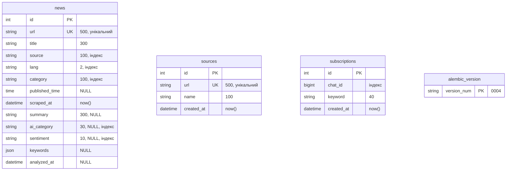
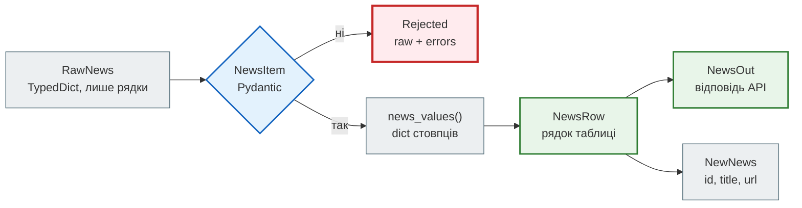

# Модель даних і Redis

> News Hub Deep Dive · сторінка 3 з 6. Код: [`news_hub/tables.py`](https://github.com/NikoriakViktor/news_hub/blob/main/steps/12_ci_cd/news_hub/tables.py),
> [`news_hub/repository.py`](https://github.com/NikoriakViktor/news_hub/blob/main/steps/12_ci_cd/news_hub/repository.py),
> [`migrations/versions/`](https://github.com/NikoriakViktor/news_hub/tree/main/steps/12_ci_cd/migrations/versions),
> [`news_hub/cache.py`](https://github.com/NikoriakViktor/news_hub/blob/main/steps/12_ci_cd/news_hub/cache.py).
> Теорія: [Частина V. Бази даних](../05_databases/README.md), [крок 3](../tutorials/03_sqlalchemy_alembic/index.md).

## Задача { #task }

Зібрати в одному місці **усе, що News Hub зберігає**: три таблиці в базі й близько десятка видів ключів у Redis.
Для кожного — хто пише, хто читає, скільки живе і з якого кроку з'явилось.

## Таблиці { #tables }



Зовнішніх ключів між таблицями **немає**, і це не недогляд:

- `sources` — лише адреси RSS, які додав адмін; новина з RSS не пам'ятає, з якого джерела прийшла (`news.source` —
  домен з URL, `rbc.ua`, `pravda.com.ua`);
- `subscriptions` прив'язані до чату Telegram, а не до новини: збіг «слово ↔ заголовок» рахується в Python
  (`bot/formatting.py:54` `matches`) щоразу після збору, а не зберігається.

| Таблиця | Модель | Міграція | Крок | Хто пише | Хто читає |
|---|---|---|---|---|---|
| `news` | `NewsRow` (`tables.py:20`) | `0001`, `0002` | 3, 7 | `NewsRepository.insert_new` (збір: API, фонова задача, RSS, `/scrape`), `create`, `PATCH`, `save_analysis`, `delete`, `clear` | `find`, `search`, `stats`, `count`, `latest` (бот), `find_unanalyzed` (задача аналізу) |
| `sources` | `SourceRow` (`tables.py:43`) | `0003` | 8 | `SourceRepository.create`, `delete` | `all`, `get` → `POST /api/sources/{id}/fetch` |
| `subscriptions` | `SubscriptionRow` (`tables.py:56`) | `0004` | 9 | `SubscriptionRepository.subscribe`, `unsubscribe`, `remove_chat` (чат заблокував бота) | `for_chat`, `by_chat` (розсилка) |

### Стовпці `news` { #news-columns }

| Стовпець | Тип | NULL | Звідки значення |
|---|---|---|---|
| `id` | `INTEGER` PK | ні | база; росте разом із часом збору — тому `latest` сортує за `id DESC` (`repository.py:85`) |
| `url` | `VARCHAR(500)`, `UNIQUE` | ні | `NewsItem.url`; унікальність — опора `ON CONFLICT (url) DO NOTHING` і `409` |
| `title` | `VARCHAR(300)` | ні | `NewsItem.title`, 10–300 символів |
| `source` | `VARCHAR(100)`, індекс | ні | домен з URL без `www.` (`models.py:66`) |
| `lang` | `VARCHAR(2)`, індекс | ні | `/ukr/` → `uk`, `/rus/` → `ru`; pravda.com.ua — завжди `uk` |
| `category` | `VARCHAR(100)`, індекс | ні | розділ у шляху URL (`CATEGORIES`, `models.py:22`) або з RSS `<category>`; змінює `PATCH` |
| `published_time` | `TIME` | так | «HH:MM» зі стрічки або час з ISO `<time datetime>` |
| `scraped_at` | `DATETIME(timezone=True)`, `server_default now()` | ні | база в момент INSERT |
| `summary`, `ai_category`, `sentiment`, `keywords`, `analyzed_at` | `VARCHAR(300)`, `VARCHAR(30)` індекс, `VARCHAR(10)` індекс, `JSON`, `DATETIME(tz)` | так | `save_analysis` (`repository.py:132`); `NULL` — ще не аналізували |

Аналіз LLM лежить у тому самому рядку, а не в окремій таблиці: одна новина — один аналіз, повторний аналіз
(`?force=true`) перезаписує попередній. Окрема таблиця знадобилась би для історії аналізів чи кількох моделей
на одну новину — зараз цього немає.

### Одна новина — чотири форми { #news-forms }



| Форма | Де | Навіщо окремо |
|---|---|---|
| `RawNews` | `parser.py:31` | так дані дає HTML чи RSS: рядки, ще не перевірені; будь-яке джерело повертає саме його |
| `NewsItem` | `models.py:48` | перевірена новина: або вона правильна, або її немає (`ValidationError` → `Rejected`) |
| `NewsRow` | `tables.py:20` | рядок таблиці: `id`, час збору, аналіз — того, чого в HTML немає |
| `NewsOut` | `api.py:280` | `NewsItem` + поля бази; `from_attributes=True` — будується прямо з `NewsRow` |
| `NewNews` | `repository.py:54` | лише те, що потрібно для сповіщення: результат `RETURNING id, title, url` |

Чому моделей кілька, а не одна на все, — [крок 3](../tutorials/03_sqlalchemy_alembic/engine_and_table.md).

## Міграції { #migrations }

```text
$ alembic history
0003 -> 0004 (head), subscriptions — підписки чатів Telegram на ключові слова (крок 9)
0002 -> 0003, sources — RSS-джерела, які додає адмін (крок 8)
0001 -> 0002, llm analysis — колонки аналізу LLM у таблиці news (крок 7)
<base> -> 0001, news table — таблиця новин агрегатора (крок 3)
```

| Міграція | Що робить | Ручні правки після `--autogenerate` |
|---|---|---|
| `0001_news_table.py` | таблиця `news` (8 стовпців), `UNIQUE (url)`, індекси `ix_news_category`, `ix_news_lang`, `ix_news_source` | `server_default=sa.text('now()')` (лише PostgreSQL) → `sa.func.now()` — кожна база отримує свій SQL |
| `0002_llm_analysis.py` | 5 стовпців аналізу, усі `nullable=True`; індекси `ix_news_ai_category`, `ix_news_sentiment` | наявні рядки не переписуються: лишаються з `NULL`; `batch_alter_table` — для SQLite |
| `0003_sources_table.py` | таблиця `sources`, `UNIQUE (url)` | `server_default` → `sa.func.now()` |
| `0004_subscriptions_table.py` | таблиця `subscriptions`, `UNIQUE (chat_id, keyword)` з іменем `uq_subscription_chat_keyword`, індекс `ix_subscriptions_chat_id` | `chat_id` — `BigInteger`: id груп Telegram (`-100…`) не вміщаються в 32 біти |

`migrations/env.py` бере адресу бази з `news_hub.db.DATABASE_URL`, а не з `alembic.ini`: застосунок і міграції
завжди дивляться в ту саму базу. Для SQLite вмикається `render_as_batch` — там немає `ALTER COLUMN`, і Alembic
перебудовує таблицю копіюванням.

Застосування на чистій SQLite-базі — справжній вивід:

```text
$ alembic upgrade head
INFO  [alembic.runtime.migration] Context impl SQLiteImpl.
INFO  [alembic.runtime.migration] Will assume non-transactional DDL.
INFO  [alembic.runtime.migration] Running upgrade  -> 0001, news table — таблиця новин агрегатора (крок 3)
INFO  [alembic.runtime.migration] Running upgrade 0001 -> 0002, llm analysis — колонки аналізу LLM у таблиці news (крок 7)
INFO  [alembic.runtime.migration] Running upgrade 0002 -> 0003, sources — RSS-джерела, які додає адмін (крок 8)
INFO  [alembic.runtime.migration] Running upgrade 0003 -> 0004, subscriptions — підписки чатів Telegram на ключові слова (крок 9)

$ alembic check
No new upgrade operations detected.
```

`alembic check` порівнює `tables.py` з базою після міграцій: «No new upgrade operations» — моделі й міграції
збігаються. Той самий результат — на PostgreSQL 16 (так це робить job `postgres` у CI).

Що в базі після міграцій (SQLite, `sqlite_master`):

```sql
CREATE TABLE news (
	id INTEGER NOT NULL,
	url VARCHAR(500) NOT NULL,
	title VARCHAR(300) NOT NULL,
	source VARCHAR(100) NOT NULL,
	lang VARCHAR(2) NOT NULL,
	category VARCHAR(100) NOT NULL,
	published_time TIME,
	scraped_at DATETIME DEFAULT CURRENT_TIMESTAMP NOT NULL, summary VARCHAR(300), ai_category VARCHAR(30), sentiment VARCHAR(10), keywords JSON, analyzed_at DATETIME,
	PRIMARY KEY (id),
	UNIQUE (url)
)
CREATE TABLE subscriptions (
	id INTEGER NOT NULL,
	chat_id BIGINT NOT NULL,
	keyword VARCHAR(40) NOT NULL,
	created_at DATETIME DEFAULT CURRENT_TIMESTAMP NOT NULL,
	PRIMARY KEY (id),
	CONSTRAINT uq_subscription_chat_keyword UNIQUE (chat_id, keyword)
)
```

Стовпці `0002` дописано в кінець рядка `scraped_at` — так виглядає `ALTER TABLE … ADD COLUMN` у SQLite.
`sa.func.now()` став `CURRENT_TIMESTAMP` — це і є «кожна база отримує свій SQL».

!!! warning "Тести не застосовують міграцій"
    Тестова база створюється з `Base.metadata.create_all` (`tests/integration/conftest.py`, `TestDatabase.create_tables`),
    а не `alembic upgrade head`. Тож зелений `pytest` нічого не каже про міграції. Їх перевіряють три інші
    місця: `alembic upgrade head` + `alembic check` у job `postgres`, тест образу
    `tests/docker/test_image.py::test_migrations_run_on_a_volume` і сервіс `migrate` у smoke-тесті Compose.
    Як додати міграцію і нічого з цього не пропустити — [Як розширювати](extending.md#migration).

## Індекси і запити, яким вони потрібні { #indexes }

| Індекс | Стовпці | Який запит його використовує |
|---|---|---|
| `UNIQUE (url)` у `news` | `url` | `INSERT … ON CONFLICT (url) DO NOTHING` (`repository.py:81`), `409` у `POST /api/news` |
| `ix_news_source`, `ix_news_lang`, `ix_news_category` | по одному | фільтри `GET /api/news?source=&lang=&category=` (`repository.py:94`) і `GROUP BY` у `/api/news/stats` |
| `ix_news_ai_category`, `ix_news_sentiment` | по одному | фільтри `?ai_category=&sentiment=` і статистика за аналізом |
| `UNIQUE (url)` у `sources` | `url` | `409` у `POST /api/sources` |
| `uq_subscription_chat_keyword` | `chat_id, keyword` | `ON CONFLICT (chat_id, keyword) DO NOTHING` — повторна підписка нічого не додає (`repository.py:165`) |
| `ix_subscriptions_chat_id` | `chat_id` | `for_chat`, `unsubscribe`, `remove_chat` |

Індексу на `title` немає: пошук `GET /api/news/search` — `lower(title) LIKE lower('%' || :q || '%')`
(`repository.py:114`), а `LIKE` з `%` спереду звичайний B-tree однаково не використовує. Для кількох тисяч
новин повний перегляд — мілісекунди; для мільйонів знадобився б повнотекстовий пошук PostgreSQL.

## SQLite і PostgreSQL — що відрізняється { #dialects }

Код один, бази дві: SQLite — локально, у тестах і в образі без `DATABASE_URL`; PostgreSQL — у Compose і в
job `postgres` CI. Різниця сховалась у чотирьох місцях:

| Що | Де | Чому |
|---|---|---|
| `insert(...).on_conflict_do_nothing()` | `repository.py:79–80`, `:162–163` | `ON CONFLICT` — діалектний синтаксис: `postgresql.insert` чи `sqlite.insert` за `dialect.name` |
| `lower()` з Unicode | `db.py:32` `_unicode_lower` | вбудований `lower()` SQLite знає лише латиницю: `lower('ЗЕЛЕНСЬК') == 'ЗЕЛЕНСЬК'` |
| пул з'єднань | `db.py:26` | `pool_size=10, max_overflow=20, pool_pre_ping=True` — лише для PostgreSQL |
| міграції | `migrations/env.py` | `render_as_batch` лише для SQLite |

Ще одна різниця видна у відповіді API. `DateTime(timezone=True)` у PostgreSQL — `timestamp with time zone`, а SQLite
пояса не зберігає. У запуску на SQLite свіжий аналіз повернув `"analyzed_at":"2026-11-12T05:01:56.513569Z"`
(значення з Python), а той самий аналіз, прочитаний з бази наступним запитом, — `"2026-11-12T05:01:56.513569"`,
без `Z`; `scraped_at` з SQLite теж без пояса. Клієнт, який порівнює час, має це враховувати — або працювати з
PostgreSQL, як у Compose.

## Redis: що там лежить { #redis }

Redis у News Hub — не одна функція, а шість: кеш стрічки, кеш аналізу, лічильники лімітів, статус задач, стан
breaker і пам'ять про доставки webhook. Ось що лежало в ньому після [запуску `t00`–`t22`](request_lifecycle.md#run) (`redis-cli --scan`, TTL — у секундах
на момент перегляду):

```text
job:81a551dffb11 type=hash ttl=86395
job:a8f5ae3c308f type=hash ttl=86396
llm:analysis:b5bf0e76fdebde35 type=string ttl=604794
login:fail:8c6976e5b5410415bde908bd4dee15df type=string ttl=897
news:v0:list:51d1e21f0187 type=string ttl=53
news:v1:list:51d1e21f0187 type=string ttl=53
news:v2:list:51d1e21f0187 type=string ttl=53
news:version type=string ttl=-1
rate:analyze:127.0.0.1 type=string ttl=52
rate:login:127.0.0.1 type=string ttl=291
rate:scrape:127.0.0.1 type=string ttl=51
webhook:delivery:dd0123456789abcd type=string ttl=593
```

| Ключ | Тип | TTL | Хто пише | Хто читає | Крок |
|---|---|---|---|---|---|
| `news:version` | рядок-число | немає | `NewsCache.invalidate` — `INCR` (`cache.py:61`) | `NewsCache.key` (`cache.py:50`) | 4 |
| `news:v<версія>:list:<sha1[:12]>` | рядок JSON | 60 (`NewsCache.TTL`) | `list_news` на промаху | `list_news` | 4 |
| `news:v<версія>:stats:<sha1[:12]>` | рядок JSON | 60 | `news_stats` на промаху | `news_stats` | 4 |
| `rate:scrape:<адреса>`, `rate:analyze:<адреса>` | лічильник | 60 (`RATE_LIMIT_WINDOW`) | `RateLimiter.hit` — `INCR` + `EXPIRE NX` в одній транзакції (`middleware.py:114`); ліміти — таблиця `LIMITS` (`middleware.py:50`) | те саме | 4, 7 |
| `rate:scrape:tg<user_id>` | лічильник | 60 | `/scrape` у боті — той самий `RateLimiter` і `LIMITS["scrape"]` (`bot/handlers.py:144`) | те саме | 9 |
| `rate:login:<адреса>` | лічильник | 300 (`LOGIN_RATE_WINDOW`) | те саме — **усі** спроби входу з адреси | те саме | 8 |
| `login:fail:<sha256(ім'я)[:32]>` | лічильник | 900 (`LOGIN_FAIL_WINDOW`), від першої невдачі | `LoginGuard.failed` — `INCR` + `EXPIRE NX` (`security.py:147`); успішний вхід — `DEL` | `LoginGuard.retry_after`: ≥ 20 (`LOGIN_FAIL_LIMIT`) → `429` | 8 |
| `rate:bot:tg<user_id>` | лічильник | 60 (`BOT_RATE_WINDOW`) | `RateLimitMiddleware` бота (`bot/middlewares.py:26`) | те саме | 9 |
| `job:<12 hex>` | hash | 86400 (`JOB_TTL`) | `JobStore` — `HSET` + `EXPIRE` у транзакції (`jobs.py:76`) | `GET /api/scrape/jobs/{id}`, `GET /api/analyze/jobs/{id}` | 4, 7 |
| `llm:analysis:<sha256[:16]>` | рядок JSON | 604800 (7 днів) | `AnalysisCache.set` (`analysis.py:93`) | `AnalysisCache.get` | 7 |
| `cb:llm:failures` | лічильник | 300 (`window`), лише новому ключу | `CircuitBreaker.record_failure` (`llm.py:249`) | те саме | 7 |
| `cb:llm:open` | `1` | 300 (`cooldown`) | `record_failure` після 5 збоїв | `retry_after` — `TTL` ключа = скільки ще чекати | 7 |
| `webhook:delivery:<id доставки>` | `job_id` | 600 (2 × 5 хв) | `claim_delivery` — `SET … NX EX` (`webhooks.py:79`) | те саме: ключ уже є → повтор, відповідь `200` з цим завданням | 8 |

`cb:llm:*`, `rate:bot:*` і `rate:scrape:tg*` у запуску не з'явились: збоїв провайдера не було, бот не працював.
Два значення з запуску: `webhook:delivery:dd0123456789abcd` = `a8f5ae3c308f` — `job_id` з `t19`, яке отримали
й повтори `t20`, `t21`; `login:fail:8c6976e5…` = `2` — дві невдалі спроби `t22`. Ім'я в ключі — хешем
(`sha256("admin")[:32]` = `8c6976e5b5410415bde908bd4dee15df`): у Redis не потрапляє довільний рядок від клієнта.

Раніше ключем повтору webhook був сам підпис (`webhook:seen:sha256=…`, значення `1`, повтор → `409`). Новий
підпис на той самий запит — і повтор проходив; новий ключ тримає id доставки і `job_id`, тому повтор
отримує відповідь першої доставки ([Життєвий цикл → повтор webhook](request_lifecycle.md#webhook-replay)).

### Версія кешу: від 0 до 7 { #cache-version }

Кеш стрічки не видаляється за шаблоном (`KEYS news:*` блокує Redis) — кожен запис просто збільшує
`news:version`, і старі ключі перестають читатися. У запуску версія дійшла до `7`, і кожне збільшення має автора:

| Запит | Хто збільшив | Чому |
|---|---|---|
| `t03` `POST /api/scrape` | middleware `invalidate_cache` | `path == "/api/scrape"`, статус 200 |
| `t06` `PATCH /api/news/1` | middleware | `path.startswith("/api/news")` |
| `t11` `POST /api/news/2/analyze` | middleware | те саме |
| `t12` те саме, `"source":"db"` | middleware | шлях і статус ті самі — хоча дані не змінились |
| `t13` `POST /api/scrape/jobs` | `run_scrape_job` (`jobs.py:96`) | middleware цей шлях не чіпає — фонова задача збільшує сама, після свого COMMIT |
| `t17` `POST /api/scrape` | middleware | — |
| `t19` `POST /api/webhooks/scrape` | `run_scrape_job` | те саме, що `t13` |

`401` (`t15`, `t16`, `t22`), `409` (`t10`) і `429` (`t18`) версію не змінили: `invalidate_cache` дивиться на
`status_code < 400`. Повтори webhook `t20` і `t21` (`200`) — теж: шлях `/api/webhooks/scrape` middleware не
чіпає, а другого збору, який збільшив би версію сам, не було. Рядок `t12` — дрібна неефективність: повторний `analyze`, який віддав збережений результат,
теж скидає кеш, бо middleware не знає, чи щось змінилось.

### Статус задачі — hash { #job-hash }

```text
$ redis-cli hgetall job:81a551dffb11
job_id        81a551dffb11
kind          scrape
status        done
source        snapshot
mode          async
news_found    168
news_saved    0
news_analyzed 0
news_failed   0
created_at    2026-11-12T05:01:56+00:00
finished_at   2026-11-12T05:01:56+00:00
```

Усі значення в Redis — рядки (`str(value)` у `jobs.py:79`); `JobStatus.model_validate` перетворює їх назад на
числа й `Literal`. `news_saved: 0` — бо ті самі 168 новин уже зберіг `t03`.

### Якщо Redis недоступний { #redis-down }

Не всі частини реагують однаково — і це видно з коду:

| Хто | Redis упав | Де |
|---|---|---|
| `/health/ready` | `503`, `"redis": "<назва винятку>"` | `api.py:385` |
| `AnalysisCache` | промах кешу; аналіз працює, лише дорожче | `analysis.py:86`, `:96` — `except RedisError` |
| `CircuitBreaker` | вважає себе закритим, LLM викликається | `llm.py:244` |
| `NewsCache`, `RateLimiter`, `JobStore`, `LoginGuard`, `claim_delivery` | виняток не перехоплюється → `500` | `cache.py`, `middleware.py`, `jobs.py`, `security.py`, `webhooks.py` |

Тобто кеш аналізу й breaker — «прискорення, а не умова роботи», а кеш стрічки й ліміти без Redis не
працюють. У Compose `api` стартує лише після `redis: service_healthy`; якщо Redis зникне вже під час роботи,
healthcheck `api` (той самий `/health/ready`) за кілька перевірок покаже `unhealthy` у `docker compose ps`. Сам
Compose трафік від такого контейнера не відводить — nginx і далі проксіює на `api:8000`.

## Що далі { #next }

[Каталог патернів](patterns.md) — назви для рішень, які ти щойно бачив: Repository, Unit of Work, Cache-aside…
і де кожне з них у коді.
