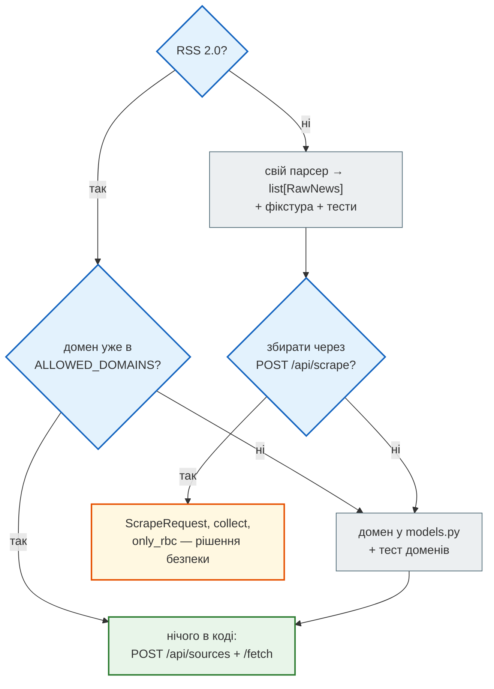

# Як розширювати

> News Hub Deep Dive · сторінка 6 з 6. Код: [`steps/12_ci_cd`](https://github.com/NikoriakViktor/news_hub/tree/main/steps/12_ci_cd),
> правила — [`CLAUDE.md`](https://github.com/NikoriakViktor/news_hub/blob/main/steps/12_ci_cd/CLAUDE.md),
> skill — [`.claude/skills/add-news-source/SKILL.md`](https://github.com/NikoriakViktor/news_hub/blob/main/steps/12_ci_cd/.claude/skills/add-news-source/SKILL.md).

## Задача { #task }

Типова зміна в News Hub зачіпає більше файлів, ніж здається: новий ендпоінт запису — це ще й список `PUBLIC`,
умова інвалідації кешу в middleware і, можливо, rate limit. Нижче — рецепти для п'яти найчастіших змін: що
змінити, у якому порядку і які тести зачеплять зміну (або мають її зачепити).

Порядок у кожному рецепті той самий, що й у кроках книги: **тест → зміна → результат → правило**.

## Нове джерело новин { #news-source }

Спершу вирішити, **яке** це джерело — від цього залежить обсяг роботи:



### Випадок 1. Ще одна стрічка RSS 2.0 { #rss }

Код для неї вже є: `POST /api/sources/{id}/fetch` завантажує будь-яку адресу через `safe_fetch` і розбирає
`parse_pravda_rss` (`api.py:732`) — це звичайний парсер RSS 2.0. Але новина з нового домену не пройде
`NewsItem`: перевірка `only_allowed` (`models.py:91`) відхилить її з причиною
`очікуємо новину з rbc.ua, pravda.com.ua або epravda.com.ua` — у звіті `rejected`.

| Що | Файл | Що зробити |
|---|---|---|
| зразок стрічки | `tests/fixtures/<джерело>_rss.xml` | зберегти справжню стрічку — тести в мережу не ходять |
| тест доменів | `tests/unit/test_pravda.py::test_allowed_hosts` або новий файл | додати `("<домен>", True)`, `("www.<домен>", True)`, `("fake<домен>", False)`, `("<домен>.evil.com", False)` |
| тест конвеєра | `tests/unit/test_<джерело>.py` | фікстура → `parse_pravda_rss` → `validate_news`: скільки валідних, які `source`, `lang`, `category` |
| домен | `models.py:30` `ALLOWED_DOMAINS` | додати; точний збіг або піддомен — це вже робить `_matches_domain` |
| мова й категорія | `models.py:58` `derive_from_url` | якщо в URL немає `/ukr/` / `/rus/`: зараз для не-rbc.ua мова — завжди `uk`, категорія — перший сегмент шляху |
| текст помилки | `models.py:93` | перелік доменів у повідомленні |

`POST /api/scrape` після цього **не** почне приймати новий домен: сторінки для нього перевіряє окрема функція
`is_rbc_host`, і це закріплено тестом `test_pravda.py::test_scrape_request_still_accepts_only_rbc_pages`.

### Випадок 2. Інший формат: HTML-сторінка чи свій API { #html-source }

Це рецепт skill `/add-news-source` (крок 6), розгорнутий:

1. **Зразок** — у `tests/fixtures/`. Немає зразка — зупинитись.
2. **Тести-специфікація** `tests/unit/test_<джерело>.py`: порядок і дублікати, чисті поля `RawNews`, час
   (місцевий київський, як `rss.py:34` `_kyiv_datetime`), конвеєр «парсер → `validate_news`», межові домени.
   Запустити — тести мають **впасти** (коду ще немає).
3. **Парсер** `news_hub/<джерело>.py`: `def parse_…(text: str) -> list[RawNews]`, нічого не перевіряє, бита
   розмітка — `ValueError` (як `rss.py:54`). Імпортує лише `.parser` (`RawNews`) — як `rss.py`.
4. **Домен** — як у випадку 1.
5. **Де викликати.** Тут починаються рішення, які не варто ухвалювати мовчки:

| Куди підключити | Що змінюється | Чому обережно |
|---|---|---|
| `POST /api/scrape` | `ScrapeRequest.source` (`api.py:317`) — новий `Literal`; `collect()` (`api.py:457`) — нова гілка; валідатор `only_rbc` (`api.py:321`) | `only_rbc` — захист від SSRF: сервер завантажує лише rbc.ua. Новий сайт тут — новий домен, куди сервер піде на прохання адміна; `test_scrape_request_still_accepts_only_rbc_pages` стане неправдою, а змінювати тести, щоб вони пройшли, правила проєкту забороняють — спершу пояснити рішення |
| фонова задача | нічого: `run_scrape_job` отримує `collect` ззовні | — |
| бот `/scrape` | `bot/handlers.py:137` `cmd_scrape` викликає `scrape_all_async` напряму | друге місце, яке легко забути |

6. `pytest`, `mypy --strict news_hub`, `git diff --stat`.

**Тести, які зачепить зміна:** `test_models.py`, `test_pravda.py::test_allowed_hosts`, новий `test_<джерело>.py`,
`test_pipeline.py` (якщо фікстура піде і туди); через API — `test_api.py`, `test_sources_ssrf.py`.

## Новий ендпоінт { #endpoint }

Приклад — уявний `POST /api/news/{news_id}/pin` (закріпити новину). Файли й місця, які він зачепить:

| # | Що | Де | Навіщо |
|---|---|---|---|
| 1 | тест | `tests/integration/test_<тема>.py` з фікстурою `client` (адмін) і `anon` | спершу червоний: `201` адміну, `401` аноніму, `404` неіснуючій новині |
| 2 | SQL | метод у `NewsRepository` (`repository.py:67`) | ендпоінт SQL не пише; `flush()` — так, `commit()` — ні (COMMIT робить `get_db`) |
| 3 | моделі | Pydantic-класи тіла й відповіді в `api.py` (як `NewsPatch`, `NewsOut`) | `422` — від FastAPI, без ручних `if` |
| 4 | ендпоінт | `api.py`: `@app.post(..., dependencies=[AdminDep], responses={404: …})`, параметри — `RowDep`, `RepoDep` | `AdminDep` — обов'язково для запису |
| 5 | порядок маршрутів | статичні шляхи (`/api/news/search`) — **до** `/api/news/{news_id}` (`api.py:434`) | інакше `search` потрапить у `news_id` і отримає `422` |
| 6 | кеш | `invalidate_cache` (`middleware.py:168–170`) | скидає кеш лише для шляхів `/api/news…`, `/api/scrape` і `/api/sources/…/fetch`; запис деінде (наприклад, `/api/pins`) кеш стрічки **не** скине |
| 7 | rate limit | `limited_action` (`middleware.py:122`) і таблиця `LIMITS` (`middleware.py:50`) | дорога дія (мережа, LLM) — нова дія в `limited_action` і її ліміт у `LIMITS`; якщо ту саму дію запускає й бот — він бере ліміт звідти ж, як `/scrape` |
| 8 | помилки LLM | нічого: `llm_error_handler` (`api.py:256`) спільний | — |
| 9 | заголовки безпеки | нічого: `SecurityHeadersMiddleware` дописує їх до **кожної** відповіді | ендпоінт, що віддає HTML-сторінку зі своїми скриптами, CSP `default-src 'none'` зламає — такий шлях треба додати до `DOCS_PATHS` (`middleware.py:60`), як `/docs` |
| 10 | Postman і smoke | `postman/news_hub.postman_collection.json`; `scripts/smoke.sh`, якщо це шлях користувача | `CLAUDE.md`: нова перевірка — і в CI, і в `smoke.sh` |

Ендпоінт **без** токена — свідоме рішення: додати `("POST", "/api/…")` у `PUBLIC`
(`tests/integration/test_admin_api.py`) з коментарем, чим він захищений замість JWT (як webhook — підписом).
Інакше `test_every_other_endpoint_requires_admin` буде червоним — і це правильно.

**Тести, які зачепить зміна:** новий файл; `test_admin_api.py` (автоматично); `test_api.py::test_openapi_lists_endpoints`,
якщо змінюється перелік у ньому; `test_redis.py`, якщо зачеплено кеш.

## Нова команда бота { #bot-command }

| # | Що | Де | Деталі |
|---|---|---|---|
| 1 | тест | `tests/integration/test_bot.py` з фікстурою `telegram` | `await telegram.say("/top")` → список відповідей; двійник відхилить невалідний HTML, як Telegram |
| 2 | handler | `bot/handlers.py`: `async def cmd_top(message: Message, news: NewsRepository) -> None` | параметри підставляє `InjectMiddleware` за **іменем**: `news`, `subscriptions`, `redis`, `llm`, `admin_ids` (`bot/middlewares.py:49–53`); aiogram — `bot`, `command` |
| 3 | реєстрація | `build_router()` (`bot/handlers.py:161`) — **перед** `router.message(F.text)(unknown)` (`bot/handlers.py:172`) | aiogram перевіряє handlers згори донизу; після «будь-якого тексту» команда не спрацює ніколи |
| 4 | текст | усе ззовні — через `esc` / `link` (`bot/formatting.py:17`, `:22`); довге — `answer_lines` (`bot/handlers.py:49`) | `split_message` ріже лише між рядками, ≤ 4096 |
| 5 | довідка | `HELP` (`bot/handlers.py:38`) | `<` і `>` у довідці — як `&lt;` `&gt;` |
| 6 | меню | `COMMANDS` (`bot/factory.py:27`) | меню (кнопка ☰) на обробку не впливає; зараз у ньому 5 команд з 8 — немає `/unsubscribe`, `/start`, `/scrape` |
| 7 | лише адміну | перевірка `admin_ids`, як у `cmd_scrape` (`bot/handlers.py:137`) | бот — ще один вхід у застосунок; правило «хто може змінювати» діє й тут. Список — `AdminSettings.telegram_ids` з `BOT_ADMIN_IDS` (`security.py:71`): адмінку API не налаштовано — у боті адміна теж немає |
| 8 | дорога команда | `RateLimiter` з `LIMITS[<дія>]`, ключ `tg<id>`, як `/scrape` (`bot/handlers.py:144`) | загальний ліміт бота (20 повідомлень за 60 с) — не ліміт дорогої дії; та сама дія через API і бот — один ліміт |
| 9 | LLM | `llm` уже загорнутий у `GuardedLLM` з breaker; `None` — LLM не налаштовано | як `/digest` (`bot/handlers.py:78`) |

COMMIT робить `InjectMiddleware` після handler (`bot/middlewares.py:55`) — у handler `commit()` не потрібен.

**Тести, які зачепить зміна:** `test_bot.py`; `test_bot_formatting.py`, якщо змінюється форматування;
`test_telegram_webhook.py` — ні (він перевіряє доставку update, а не команди).

## Нова міграція { #migration }

Приклад: стовпець `image_url` у `news`. Ось як рецепт пройшов на копії фінальної версії — усі виводи справжні.

**1. Змінити модель** — `tables.py`:

```python title="news_hub/tables.py (фрагмент)"
    analyzed_at: Mapped[datetime | None] = mapped_column(DateTime(timezone=True))
    image_url: Mapped[str | None] = mapped_column(String(500))
```

**2. Переконатися, що база відстає від моделі:**

```text
$ alembic check
FAILED: New upgrade operations detected: [('add_column', None, 'news', Column('image_url', String(length=500), table=<news>))]
```

**3. Згенерувати міграцію** — з номером у стилі проєкту (`--rev-id`), щоб не було випадкового хешу:

```text
$ alembic revision --autogenerate --rev-id 0005 -m "news image_url"
INFO  [alembic.autogenerate.compare.tables] Detected added column 'news.image_url'
Generating …/migrations/versions/0005_news_image_url.py ...  done
```

```python title="migrations/versions/0005_news_image_url.py (згенеровано)"
revision: str = '0005'
down_revision: Union[str, Sequence[str], None] = '0004'


def upgrade() -> None:
    """Upgrade schema."""
    # ### commands auto generated by Alembic - please adjust! ###
    with op.batch_alter_table('news', schema=None) as batch_op:
        batch_op.add_column(sa.Column('image_url', sa.String(length=500), nullable=True))

    # ### end Alembic commands ###
```

**4. Перечитати очима** (`CLAUDE.md`: «міграцію перечитати очима»). Що шукати — те, що вже виправляли в `0001`–`0004`:

| Що | Чому |
|---|---|
| `server_default=sa.text('now()')` чи `'(CURRENT_TIMESTAMP)'` | працює лише в одній базі → `sa.func.now()` |
| `nullable=False` у новому стовпці таблиці з даними | наявні рядки не мають значення — міграція впаде на PostgreSQL; або `nullable=True`, або `server_default` |
| `Integer` для id з Telegram | `BigInteger` (як `chat_id` у `0004`) |
| нові індекси | `index=True` у моделі ↔ `create_index` у міграції |
| `downgrade()` | має відкочувати саме `upgrade()` |

`batch_alter_table` тут — бо `env.py` вмикає `render_as_batch` для SQLite; у PostgreSQL це звичайний `ALTER TABLE`.

**5. Застосувати, відкотити, застосувати знову:**

```text
$ alembic upgrade head
INFO  [alembic.runtime.migration] Running upgrade 0004 -> 0005, news image_url
$ alembic check
No new upgrade operations detected.
$ alembic downgrade -1
INFO  [alembic.runtime.migration] Running downgrade 0005 -> 0004, news image_url
$ alembic upgrade head
INFO  [alembic.runtime.migration] Running upgrade 0004 -> 0005, news image_url
```

**6. Тести** — і тут пастка. Після зміни моделі й міграції `pytest` дав `363 passed, 8 deselected`: тестова база
створюється з `Base.metadata.create_all`, тож тести бачать **модель**, а не міграцію. Зелений `pytest` не
доводить, що міграція правильна. Доводять:

- `alembic upgrade head` + `alembic check` на **PostgreSQL** — job `postgres` у CI або локально
  ([Карта тестів](test_map.md#real-servers));
- `pytest -m docker` — `test_migrations_run_on_a_volume`;
- `scripts/smoke.sh` — сервіс `migrate` на чистій базі.

**7. Далі по шарах:** поле в `NewsOut` (`api.py:280`), якщо його має бачити клієнт; метод у репозиторії, якщо
його пишуть; тест в `test_crud.py`.

## Нова змінна середовища { #env-var }

| # | Що | Де |
|---|---|---|
| 1 | рішення: необов'язкова (немає → частина вимкнена, `503`) чи обов'язкова з перевіркою (погано → `RuntimeError` при старті) | [Каталог патернів → Fail-fast](patterns.md#fail-fast) |
| 2 | читання — у функції `load_…(env: Mapping[str, str] = os.environ)`, як `load_admin_settings` | тест передає словник, а не змінює `os.environ` (`test_security.py::test_settings_from_env`) |
| 3 | виклик — у `lifespan` (`api.py:99`), результат — у `app.state`, доступ — через залежність | так її підмінить тест |
| 4 | `.env.example` | обов'язково для Compose; значення з `$` — в одинарних лапках |
| 5 | `docker-compose.yml` | нічого, якщо змінна в `.env`: `env_file: .env` (якір `x-app`) передає її `api`, `migrate` і `bot`; адреси сервісів — за іменами (`postgres`, `redis`), не `localhost`. Інше значення за замовчуванням на сервері — в `environment:` сервісу, як `DOCS_ENABLED: ${DOCS_ENABLED:-false}` у `api` |
| 6 | `tests/integration/conftest.py` | явне тестове значення **до** імпорту `news_hub`, якщо змінна потрібна інтеграційним тестам |
| 7 | README кроку | таблиця змінних |

Константи, які читаються під час імпорту (`RATE_LIMIT_REQUESTS` у `middleware.py:43`, `LLM_TIMEOUT` у `llm.py:44`),
простіші, але тест їх уже не змінить без перезапуску інтерпретатора — для нових налаштувань краще `load_…`.

## Тест на шари { #architecture-test }

Шари в News Hub — домовленість ([Архітектура](architecture.md#layers)): тесту, який заборонив би, скажімо,
`import fastapi` у `repository.py`, у проєкті немає. Його можна додати — `ast`, без нових залежностей. Ось такий
тест, перевірений на копії фінальної версії:

```python title="tests/unit/test_architecture.py (пропозиція, у проєкті його немає)"
"""Шари — тестом, а не домовленістю: хто з модулів news_hub що не має права імпортувати."""
import ast
from pathlib import Path

import pytest

PACKAGE = Path(__file__).resolve().parents[2] / "news_hub"

# модуль → бібліотеки, яких у ньому бути не повинно
FORBIDDEN = {
    "parser.py": {"fastapi", "sqlalchemy", "redis", "aiogram"},
    "models.py": {"fastapi", "sqlalchemy", "redis", "aiogram"},
    "rss.py": {"fastapi", "sqlalchemy", "redis", "aiogram"},
    "repository.py": {"fastapi", "aiogram", "redis"},
    "analysis.py": {"fastapi", "sqlalchemy", "aiogram"},
    "jobs.py": {"fastapi", "aiogram"},
    "llm.py": {"fastapi", "sqlalchemy", "aiogram"},
}


def imported_roots(path: Path) -> set[str]:
    roots: set[str] = set()
    for node in ast.walk(ast.parse(path.read_text(encoding="utf-8"))):
        if isinstance(node, ast.Import):
            roots |= {alias.name.split(".")[0] for alias in node.names}
        elif isinstance(node, ast.ImportFrom) and node.module and node.level == 0:
            roots.add(node.module.split(".")[0])
    return roots


@pytest.mark.parametrize(("module", "forbidden"), sorted(FORBIDDEN.items()))
def test_layer_does_not_import(module: str, forbidden: set[str]) -> None:
    assert not imported_roots(PACKAGE / module) & forbidden


def test_nobody_imports_api() -> None:
    """api.py — точка збирання: якщо його імпортує інший модуль, шари переплутались."""
    for path in PACKAGE.rglob("*.py"):
        if path.name == "api.py":
            continue
        tree = ast.parse(path.read_text(encoding="utf-8"))
        names = {n.module for n in ast.walk(tree) if isinstance(n, ast.ImportFrom) and n.module}
        assert not names & {"api", "news_hub.api"}, path
```

```text
$ pytest -q tests/unit/test_architecture.py
8 passed in 0.04s
```

І перевірка, що тест справді ловить порушення: рядок `from fastapi import HTTPException` на початку
`repository.py` —

```text
FAILED tests/unit/test_architecture.py::test_layer_does_not_import[repository.py-forbidden5]
1 failed, 7 passed in 0.05s
```

Тест лежить у `tests/unit/`, тож маркер `unit` він отримує від папки, а hook `.claude/hooks/unit_tests.py`
запускатиме його після кожної правки.

## Перед комітом { #checklist }

| Що змінив | Що запустити |
|---|---|
| будь-що в `news_hub/` | `pytest -m unit` (секунди), `pytest`, `mypy --strict news_hub` |
| `tables.py`, міграції | `alembic upgrade head`, `alembic check`; бажано — на PostgreSQL з `TEST_DATABASE_URL` |
| `requirements.txt` | перегенерувати lock: `uv pip compile requirements.txt --universal --python-version 3.10 --generate-hashes -o requirements.lock` (інакше job `supply-chain` впаде на `git diff --exit-code`); `uvx pip-audit==2.10.1 -r requirements.lock --require-hashes --disable-pip`; `pytest -m docker` |
| `Dockerfile`, `.dockerignore`, `requirements.lock` | `pytest -m docker` — образ ставить залежності з `--require-hashes` |
| навчальне значення, схоже на секрет (токен у тесті, приклад `.env`) | gitleaks локально тією самою командою, що в CI; справді навчальне — точним рядком у `.gitleaks.toml`, а не папкою |
| `docker-compose.yml`, `nginx/`, `.env.example` | `docker compose config`, `ADMIN_PASSWORD=… ./scripts/smoke.sh` |
| нижню межу залежності | job `min-versions` у CI — або локально `uv pip install --resolution lowest-direct -r requirements-dev.txt` |
| промпт чи `NewsAnalysis` | `PROMPT_VERSION` + 1 (`analysis.py:30`); `pytest -m llm` — лише якщо про це попросили (витрачає квоту) |

Повний перелік jobs — [Карта тестів → CI](test_map.md#ci).

## Що далі { #next }

Це остання сторінка розділу. Повернутись до карти — [огляд Deep Dive](README.md); пройти шлях від початку —
[Zero to Hero](../tutorials/README.md).
