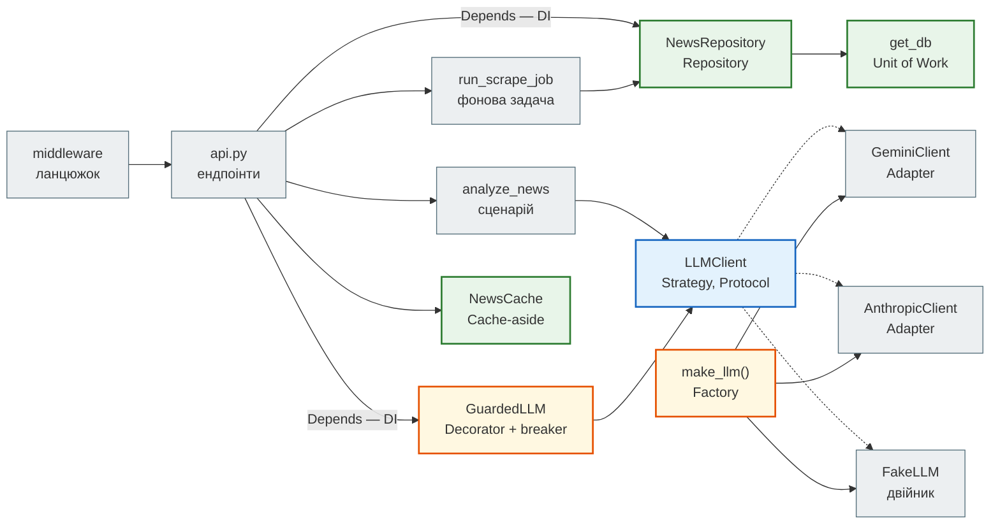
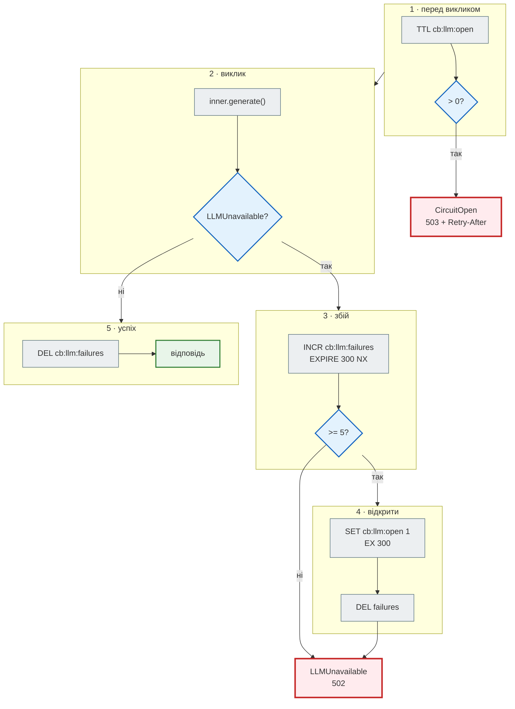
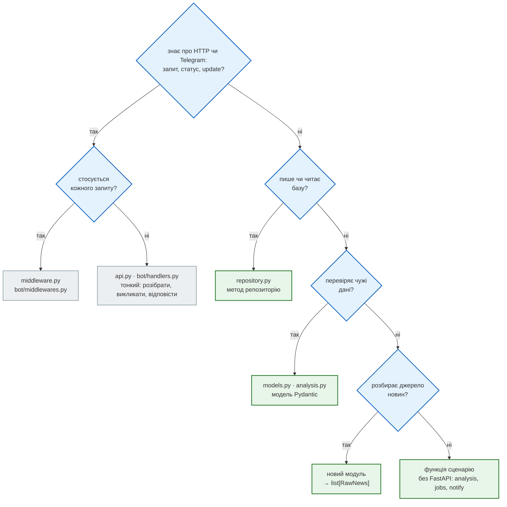

# Каталог патернів

> News Hub Deep Dive · сторінка 4 з 6. Код: [`steps/12_ci_cd/news_hub/`](https://github.com/NikoriakViktor/news_hub/tree/main/steps/12_ci_cd/news_hub).
> Ті самі ідеї в Django: [частина VI Django-книги](https://nikoriakviktor.github.io/notes_chat_app/06_application_architecture/).

## Задача { #task }

**Патерн** — назва для рішення, яке повторюється: «проблема такого типу розв'язується такою формою коду». Назва
не робить код кращим. Вона допомагає у двох речах: швидко пояснити рішення («тут декоратор над клієнтом») і
впізнати його в чужому коді.

Нових патернів на цій сторінці немає. Усі вони вже є в News Hub — з'являлись по одному, у тих кроках, де
розв'язували конкретну проблему. Тут ми їх лише називаємо й показуємо, де кожен стоїть.

## Каталог { #catalogue }

| Патерн | Яку проблему розв'язує | Де в News Hub | Крок |
|---|---|---|---|
| [Шари](#layers) | зміна в одному місці не ламає інших | `api.py` → `analysis.py` / `jobs.py` → `repository.py` → `tables.py` | 2–3 |
| [Repository](#repository) | увесь SQL в одному місці; ендпоінт не знає SQL | `repository.py:31` `BaseRepository`, `:67` `NewsRepository` | 3 |
| [Unit of Work — сесія на запит](#unit-of-work) | кілька змін — або всі, або жодної | `db.py:49` `get_db`, `api.py:201` `SessionDep` | 3 |
| [Dependency Injection](#di) | залежність приходить ззовні → її можна підмінити | `api.py:201–253`, `dependency_overrides` у тестах | 2, 3, 7, 8 |
| [Strategy через `Protocol`](#strategy) | кілька взаємозамінних реалізацій однієї ролі | `llm.py:79` `LLMClient` | 7 |
| [Adapter](#adapter) | чужий інтерфейс → наш | `llm.py:94` `GeminiClient`, `:153` `AnthropicClient` | 7 |
| [Decorator / Proxy](#decorator) | додати поведінку, не змінюючи об'єкт і його інтерфейс | `llm.py:269` `GuardedLLM` | 7 |
| [Circuit breaker](#circuit-breaker) | не добивати провайдера, який лежить | `llm.py:227` `CircuitBreaker` | 7 |
| [Factory](#factory) | вибір реалізації за конфігурацією — в одному місці | `llm.py:291` `make_llm`, `db.py:24`, `cache.py:24`, `bot/factory.py` | 3, 4, 7, 9 |
| [Cache-aside з версією](#cache-aside) | швидке читання без застарілих даних після запису | `cache.py:41` `NewsCache`, `middleware.py:159` | 4 |
| [Middleware — ланцюжок обробників](#middleware) | одне правило для всіх запитів | `api.py:189–192`, `middleware.py:50` `LIMITS`, `bot/factory.py:44–45` | 4, 9 |
| [Ліміт на ціль, а не лише на джерело](#login-guard) | підбір пароля з багатьох адрес | `security.py:122` `LoginGuard` | 8 |
| [Межа довіри](#trust-boundary) | чужі дані перевіряються один раз, на вході | `models.py:109` `validate_news`, `analysis.py:42` `NewsAnalysis` | 1, 7 |
| [Fail-fast і вимкнена частина](#fail-fast) | погана конфігурація — помилка при старті, відсутня — `503` | `security.py:68`, `webhooks.py:47`, `bot/settings.py:20`, `llm.py:291`, `api.py:158` | 8, 9, 11 |
| [Фонова задача зі статусом](#background-job) | довга дія не тримає HTTP-запит | `jobs.py:58` `JobStore`, `:84`, `:109` | 4, 7 |
| [Ідемпотентність](#idempotency) | повтор того самого запиту нічого не ламає | `repository.py:81`, `:165`, `webhooks.py:79` | 3, 8, 9 |
| [Повтор з паузою](#retry) | тимчасовий збій — не привід здаватись | `api.py:135` `register_bot`, `analysis.py:116`, `notify.py:51`, `llm.py:117` | 7, 9, 11 |
| [Liveness і readiness](#health) | «процес живий» ≠ «може відповідати» | `api.py:369` `/health`, `:374` `/health/ready` | 10 |
| [Тестові двійники](#test-doubles) | тест без мережі, ключа й справжнього Telegram | `FakeLLM` (`llm.py:196`), `tests/telegram_twin.py`, fakeredis | 5, 7, 9 |

Як вони пов'язані між собою — хто кого викликає і де який патерн стоїть:



## Шари { #layers }

**Де:** розподіл модулів — [Архітектура → шари](architecture.md#layers); граф імпортів — там само.

**Навіщо:** `analyze_news` (`analysis.py:104`) не знає HTTP — тому її викликають три різні входи: ендпоінт
`POST /api/news/{id}/analyze` (`api.py:566`), фонова задача `run_analyze_job` (`jobs.py:126`) і команда бота
`/digest` (`bot/handlers.py:78`). Те саме з `NewsRepository`: ендпоінти, задачі, бот і розсилка працюють з базою
однаково.

**Крок:** ядро — крок 2 (FastAPI поверх парсера), шар даних — крок 3, сценарії — кроки 4, 7, 9.

## Repository { #repository }

**Де:** `repository.py:31` `BaseRepository` — `get`, `add`, `delete`, `count` для будь-якої моделі;
`:67` `NewsRepository`, `:145` `SourceRepository`, `:156` `SubscriptionRepository`.

**Навіщо:** весь SQL — в одному файлі. Ендпоінт пише `await repo.find(lang="uk")`, а не `select(...)`. Коли
`insert_new` знадобилось повертати саме нові новини (крок 9, для сповіщень), змінився один метод — а викликачі
(API, задача, бот) отримали `RETURNING` безкоштовно.

```python title="news_hub/repository.py (фрагмент)"
async def insert_new(self, items: Iterable[NewsItem]) -> list[NewNews]:
    """Те саме, але повертає саме нові новини (RETURNING лише вставлених рядків) — для сповіщень."""
    rows = [news_values(item) for item in items]
    if not rows:
        return []
    dialect = self._session.get_bind().dialect.name
    stmt = (postgresql.insert(NewsRow) if dialect == "postgresql" else sqlite.insert(NewsRow)) \
        .values(rows).on_conflict_do_nothing(index_elements=["url"]) \
        .returning(NewsRow.id, NewsRow.title, NewsRow.url)
    return [NewNews(id=row.id, title=row.title, url=row.url) for row in await self._session.execute(stmt)]
```

**Чим відрізняється від «класичного» Repository:** абстрактного інтерфейсу (`AbstractNewsRepository`) і
`InMemoryNewsRepository` для тестів немає. Тести ходять у справжню базу — SQLite у пам'яті, а в CI ще й
PostgreSQL. Це дешевше за другу реалізацію: 363 тести проходять за ~20 с, і перевіряється справжній SQL —
`ON CONFLICT`, `lower()` з кирилицею, `GROUP BY`, які фейк у пам'яті не перевірив би. Ціна — тести інтеграційні,
а не модульні; де потрібна швидкість без бази, логіка винесена з репозиторію (`validate_news`, `analyze_news`).

**Крок:** 3, [Репозиторій](../tutorials/03_sqlalchemy_alembic/repository.md). Методи аналізу — крок 7,
`SourceRepository` — крок 8, `SubscriptionRepository` і `insert_new` — крок 9.

## Unit of Work — сесія на запит { #unit-of-work }

**Де:** `db.py:49` `get_db`; `api.py:201` `SessionDep = Annotated[AsyncSession, Depends(get_db, scope="function")]`.

```python title="news_hub/db.py (фрагмент)"
async def get_db() -> AsyncIterator[AsyncSession]:
    """FastAPI Depends: одна сесія (і одна транзакція) на HTTP-запит."""
    async with SessionFactory() as session:
        try:
            yield session
            await session.commit()
        except Exception:
            await session.rollback()
            raise
```

**Навіщо:** `AsyncSession` SQLAlchemy — це вже Unit of Work: вона збирає зміни й записує їх однією транзакцією.
`get_db` лише проводить межу: одна транзакція = один HTTP-запит. Репозиторій робить `flush()` (SQL зараз, щоб
отримати `id` і помилки обмежень), але ніколи `commit()` — COMMIT робить той, хто відкрив сесію. Тому
`POST /api/scrape` (вставка 168 новин + `count()`) — або все, або нічого.

Окремого класу `UnitOfWork` з `commit()` / `rollback()` поверх сесії немає — він дублював би `AsyncSession`.

**Та сама межа в інших входах** — і це місце, де найлегше помилитись:

| Вхід | Хто відкриває сесію | Де COMMIT |
|---|---|---|
| HTTP-запит | `get_db` (`db.py:49`) | після ендпоінта, до відповіді (`scope="function"`) |
| фоновий збір | `run_scrape_job` — `session_factory()` (`jobs.py:93`) | `jobs.py:95`, один на весь збір |
| фоновий аналіз | `run_analyze_job` (`jobs.py:120`) | `jobs.py:134` — **після кожної новини**: збій на 30-й не скасовує 29 оплачених аналізів |
| розсилка | `Notifier` (`notify.py:88`), свій `session_factory()` | `notify.py:96` — видалені підписки заблокованих чатів |
| update Telegram | `InjectMiddleware` (`bot/middlewares.py:48`) | `bot/middlewares.py:55` — після handler |

**Крок:** 3, [Сесія на запит](../tutorials/03_sqlalchemy_alembic/session_per_request.md); `scope="function"` —
там само, [#scope](../tutorials/03_sqlalchemy_alembic/session_per_request.md#scope).

## Dependency Injection { #di }

**Де:** `api.py:201–253` — `SessionDep`, `RepoDep`, `RedisDep`, `CacheDep`, `SessionFactoryDep`, `NotifierDep`,
`LLMDep`; `api.py:637` `get_fetch_policy`; `security.py:214` `AdminDep`. У боті — `InjectMiddleware`
(`bot/middlewares.py:42`): «Depends для aiogram», кладе `news`, `subscriptions`, `redis`, `llm`, `admin_ids` у
параметри handler.

**Навіщо:** ендпоінт не створює залежність, а **просить** її. Тому тест підміняє одну функцію, і весь ланцюжок
бере тестову версію:

```python title="tests/integration/conftest.py (фрагмент)"
def install(self) -> None:
    app.dependency_overrides[get_db] = self.get_db
    app.dependency_overrides[get_session_factory] = lambda: self.factory   # фонові задачі — теж у тестову базу
    app.dependency_overrides[get_scrapers] = lambda: {"async": fake_scraper, "sequential": fake_scraper}
```

| Що підмінюють тести | Залежність | Навіщо вона окремою функцією |
|---|---|---|
| базу | `get_db` | SQLite у пам'яті або `TEST_DATABASE_URL` |
| сесію фонових задач | `get_session_factory` (`api.py:220`) | задача відкриває свою сесію — і має відкрити її в тестовій базі |
| збирача сторінок | `get_scrapers` (`api.py:208`) | без мережі |
| клієнта LLM | `get_llm_client` (`api.py:238`) | `FakeLLM` зі сценарієм; `get_llm` (`api.py:248`) однаково загортає його в breaker |
| що можна завантажувати | `get_fetch_policy` (`api.py:637`) | локальний тестовий сервер дозволяється **явно**, а не змінною середовища |

Ресурси на весь час роботи (клієнт Redis, LLM, бот) створює `lifespan` і кладе в `app.state`, а залежності лише
дістають їх звідти (`get_redis`, `get_llm_client`). Різниця «на запит» і «на процес» —
[Залежності і lifespan](../03_fastapi_core/dependencies.md#lifespan).

**Крок:** 2 (`NewsStore` через `Depends`), далі — у кожному кроці, де з'являлась нова залежність.

## Strategy через `Protocol` { #strategy }

**Де:** `llm.py:79`.

```python title="news_hub/llm.py (фрагмент)"
class LLMClient(Protocol):
    """Будь-який провайдер: промпт + системна інструкція + схема відповіді → JSON-текст."""

    name: str

    async def generate(self, prompt: str, *, system: str, schema: type[BaseModel]) -> LLMReply: ...

    async def aclose(self) -> None:
        """Закрити HTTP-з'єднання клієнта (lifespan при зупинці застосунку)."""
```

**Навіщо:** `analyze_news` викликає `llm.generate(...)` і не знає, хто відповідає: Gemini, Anthropic чи
`FakeLLM`. `Protocol`, а не базовий клас: реалізації ні від чого не успадковуються, mypy перевіряє, що в них є
`name`, `generate` і `aclose` з правильними типами.

**Крок:** 7, [Спільний інтерфейс LLM](../tutorials/07_llm_api/llm_client.md#protocol).

## Adapter { #adapter }

**Де:** `GeminiClient` (`llm.py:94`), `AnthropicClient` (`llm.py:153`). У боті — `create_bot(token, api_url)`
(`bot/factory.py:36`): `TelegramAPIServer.from_base(api_url)` направляє той самий `Bot` на двійника.

**Навіщо:** у двох SDK різні виклики, різні помилки, різні поля токенів. Адаптер зводить їх до `LLMReply`
(`text`, `model`, `input_tokens`, `output_tokens`) і до двох наших винятків:

| SDK | Виклик | Помилка SDK → наша | Токени |
|---|---|---|---|
| google-genai | `client.aio.models.generate_content` | `APIError` з кодом поза `RETRY_NEXT_MODEL` (400, 401, 403…) → `LLMUnavailable` одразу; 404, 408, 429, 500, 502, 503, 504 і мережеві збої → наступна модель пулу | `prompt_token_count`; вихідні = `candidates_token_count + thoughts_token_count` |
| anthropic | `client.messages.create` | будь-яка `anthropic.APIError` → `LLMUnavailable` | `usage.input_tokens`, `usage.output_tokens` |

Решта застосунку бачить лише `LLMUnavailable` і `CircuitOpen` — і `llm_error_handler` (`api.py:256`) перетворює їх
на `502` і `503`.

**Крок:** 7, [Пул моделей Gemini](../tutorials/07_llm_api/gemini_pool.md), [JSON Schema](../tutorials/07_llm_api/json_schema.md).

## Decorator / Proxy { #decorator }

**Де:** `llm.py:269` `GuardedLLM`; збирається в `get_llm` (`api.py:248`) і в `InjectMiddleware`
(`bot/middlewares.py:52`).

**Навіщо:** breaker потрібен **будь-якому** провайдеру. `GuardedLLM` має той самий інтерфейс `LLMClient`, тож
код, що викликає, не змінюється, а поведінка додається обгорткою: перевірити breaker → викликати справжній
клієнт → записати успіх чи збій. Провайдер про breaker не знає.

**Крок:** 7, [Breaker як обгортка](../tutorials/07_llm_api/circuit_breaker.md#guarded).

## Circuit breaker { #circuit-breaker }

**Де:** `llm.py:227` `CircuitBreaker`: `threshold=5`, `window=300`, `cooldown=300`; ключі `cb:llm:failures`,
`cb:llm:open`.



**Навіщо:** Gemini упав — п'ятдесят запитів поспіль чекали б тайм-аут по 30 с і отримали б `502`. Після п'яти
збоїв breaker «відкривається»: п'ять хвилин провайдера не викликаємо зовсім, відповідь — одразу `503` з
`Retry-After`. Стан — у Redis, а не в пам'яті: спільний для всіх процесів `api` і переживає перезапуск. Redis
недоступний — breaker вважає себе закритим (`llm.py:244`): LLM через це не вимикаємо.

Фонова задача аналізу на `CircuitOpen` зупиняється цілком (`jobs.py:127`): решта новин однаково отримала б `503`.

**Крок:** 7, [Circuit breaker](../tutorials/07_llm_api/circuit_breaker.md).

## Factory { #factory }

**Де:**

| Фабрика | Що вибирає | За чим |
|---|---|---|
| `make_llm()` (`llm.py:291`) | `GeminiClient`, `AnthropicClient`, `FakeLLM` або `None` | `LLM_PROVIDER` і ключі |
| `make_engine()` (`db.py:24`) | пул PostgreSQL або SQLite з `_unicode_lower` | початок `DATABASE_URL` |
| `make_redis()` (`cache.py:24`) | `Redis.from_url` або `fakeredis.FakeAsyncRedis` | `REDIS_URL` (`fakeredis://`) |
| `create_bot()`, `create_dispatcher()` (`bot/factory.py:36`, `:41`) | бот на api.telegram.org чи на двійника; диспетчер з middleware і роутером | параметри, не глобальний `config` |
| `build_router()` (`bot/handlers.py:161`) | **новий** `Router` на кожен диспетчер | aiogram не дає підключити один `Router` до двох `Dispatcher` |

**Навіщо:** вибір реалізації — в одному місці. Код, що користується результатом, не має `if provider == …`.
Фабрики бота з параметрами (а не з глобальним `config`) збирають бота однаково для webhook у FastAPI, для polling
і для тестів.

**Крок:** 3 (`make_engine`), 4 (`make_redis`), 7 (`make_llm`), 9 (бот).

## Cache-aside з версією { #cache-aside }

**Де:** `cache.py:41` `NewsCache`; використання — `api.py:403` `list_news`, `api.py:443` `news_stats`; інвалідація —
`middleware.py:159` `invalidate_cache`, `jobs.py:96`, `jobs.py:144`. Другий кеш — `analysis.py:75`
`AnalysisCache`: аналіз за хешем `v{PROMPT_VERSION}:{заголовок}`, 7 днів.

**Навіщо:** читання стрічки — найчастіший запит; база потрібна лише на промаху. Інвалідація — не пошук ключів, а
нова версія: `INCR news:version` після COMMIT. Чому саме після COMMIT і саме в middleware — [крок 4](../tutorials/04_middleware_redis/cache.md#commit).
Трасу MISS → HIT → нова версія — [Життєвий цикл запиту → кеш](request_lifecycle.md#cache); усі ключі —
[Модель даних → Redis](data_model.md#redis).

`PROMPT_VERSION` (`analysis.py:30`) — та сама ідея для кешу аналізу: змінили промпт чи `NewsAnalysis` — нова
версія в хеші, старі відповіді більше не читаються (`test_analysis.py::test_cache_key_depends_on_prompt_version`).

**Крок:** 4 (стрічка), 7 (аналіз).

## Middleware — ланцюжок обробників { #middleware }

**Де:** HTTP — `api.py:189–192`: `request_context` → `SecurityHeadersMiddleware` → `rate_limit` →
`invalidate_cache`. Бот — `bot/factory.py:44–45`: `RateLimitMiddleware` (outer) → роутер → `InjectMiddleware`
(inner) → handler.

**Навіщо:** правила, що стосуються **всіх** запитів (журнал, заголовки безпеки, ліміт, кеш), не копіюються в
кожен ендпоінт. Кожен обробник або передає запит далі (`call_next` / `handler(event, data)`), або відповідає сам
— як `rate_limit` з `429`. Шар заголовків безпеки — інший вид middleware: чистий ASGI, який лише загортає `send`;
чому не ще одна функція з `call_next` — [Життєвий цикл → чистий ASGI](request_lifecycle.md#pure-asgi).

`RateLimiter` (`middleware.py:105`) спільний для обох входів, а ліміти — одна таблиця `LIMITS`
(`middleware.py:50`): дія → (запитів, секунд). HTTP рахує `rate:<дія>:<адреса>`; бот — загальний ліміт
повідомлень `rate:bot:tg<user_id>` і, для `/scrape`, той самий `LIMITS["scrape"]`, що й `POST /api/scrape*`, з
ключем `rate:scrape:tg<user_id>` (`bot/handlers.py:144`). Раніше `limits` був локальною змінною всередині
`rate_limit`, і `/scrape` у боті мав лише загальний ліміт повідомлень бота — той самий збір rbc.ua через бот
можна було запускати частіше, ніж через API (`test_bot.py::test_scrape_uses_the_same_rate_limit_as_api`).

**Крок:** 4, [Middleware](../tutorials/04_middleware_redis/middleware.md); бот — 9,
[Структура бота](../tutorials/09_telegram_bot/bot_structure.md).

## Ліміт на ціль, а не лише на джерело { #login-guard }

**Де:** `security.py:122` `LoginGuard`, виклик — в `admin_token` (`api.py:619–627`).

**Було → стало.** Вхід адміна мав один лічильник — `rate:login:<адреса>`, 5 спроб за 300 с. Він рахує **звідки**
прийшла спроба. Атака на єдиного адміна з тисячі адрес його не помічає: кожна адреса робить свої 5 спроб.
`LoginGuard` рахує **на що** спрямовані спроби: лише невдалі входи на одне ім'я, з усіх адрес разом.

| | `rate_limit` (middleware) | `LoginGuard` |
|---|---|---|
| ключ | `rate:login:<адреса>` | `login:fail:<sha256(ім'я.casefold())[:32]>` |
| що рахує | кожну спробу | лише невдалу |
| ліміт | 5 за 300 с (`LOGIN_RATE_*`) | 20 за 900 с (`LOGIN_FAIL_*`) |
| понад ліміт | `429` до ендпоінта | `429` з `Retry-After`, **bcrypt не запускається** |
| успішний вхід | нічого | `DEL` — лічильник з нуля |

**Ціна.** Атакувальник може на 15 хвилин закрити вхід і справжньому адміну — це свідомий обмін: для єдиного
адміна тимчасова блокада краща за необмежений підбір. Ім'я в ключі — хешем: у Redis не потрапляє довільний
рядок від клієнта, а для чужого імені відповідь та сама — ім'я так не вгадаєш.

Поруч — ще дві зміни того самого ендпоінта: bcrypt (~0,2 с) іде в `run_in_threadpool` (`api.py:624`) — інакше
кожна спроба входу зупиняла б цикл подій для всіх запитів; відповідь з токеном має `Cache-Control: no-store`.

**Тест:** `test_admin_api.py::test_login_lockout_counts_failures_per_name_from_any_address`,
`test_security.py::test_login_guard_counts_per_name_and_resets_on_success`.

**Крок:** 8.

## Межа довіри { #trust-boundary }

**Де:** `models.py:109` `validate_news` — будь-яке джерело (`parse_rbc_news`, `parse_pravda_rss`,
`load_snapshot`) повертає `list[RawNews]`, і лише `NewsItem` вирішує, що потрапить у базу; відхилене — у
`rejected`, з причиною. Відповідь LLM — те саме: `analysis.py:42` `NewsAnalysis` з `extra="forbid"`, одна повторна
спроба з текстом помилки (`analysis.py:116–129`), далі — `InvalidLLMOutput` → `502`.

**Навіщо:** перевірка в одному місці замість `if` по всьому коду. Парсер не перевіряє нічого — тому новий парсер
(RSS у кроці 6) не міг «забути» перевірку доменів. Дані, яким не віримо, — HTML чужого сайту, RSS, відповідь
моделі, тіло запиту, заголовок новини в промпті (між `<news>` і `</news>`, `analysis.py:65`).

**Крок:** 1, [Межа довіри](../tutorials/01_typing_pydantic/trust_boundary.md); LLM — 7,
[Промпт-ін'єкція](../tutorials/07_llm_api/prompt_injection.md).

## Fail-fast і вимкнена частина { #fail-fast }

**Де:**

| Функція | Нічого не задано | Задано погано |
|---|---|---|
| `load_admin_settings` (`security.py:68`) | `None` → запис `503` (`security.py:182`); `/scrape` у боті — нікому (`telegram_admin_ids`) | `JWT_SECRET` < 32 символів чи не bcrypt-хеш → `RuntimeError` при старті; `BOT_ADMIN_IDS` не числа або задано без адмінки → `RuntimeError` |
| `load_webhook_secret` (`webhooks.py:47`) | `None` → `503` (`api.py:748`) | < 32 символів → `RuntimeError` |
| `load_bot_settings` (`bot/settings.py:20`) | `None` → бота немає | webhook не `https://`, поганий секрет → `RuntimeError` |
| `make_llm` (`llm.py:291`) | `None` → аналіз `503` (`api.py:238`) | невідомий `LLM_PROVIDER` → `ValueError` |
| `docs_enabled` (`api.py:158`) | `true` — `/docs` є | `0` / `false` / `no` / `off` → `/docs`, `/redoc`, `/openapi.json` вимкнено (`404`); у Compose за замовчуванням `false` |

**Навіщо:** «не налаштовано» і «налаштовано погано» — різні ситуації. Перше — нормальний стан (ключа LLM немає —
решта працює). Друге — помилка, яку краще побачити одразу в журналі старту, ніж як `500` на кожному вході
посеред ночі. Друге правило — **одне місце для одного рішення**: «хто адмін» раніше вирішували двічі — бот читав
`BOT_ADMIN_IDS` сам і працював навіть без адмінки API. Тепер список — частина `AdminSettings`, і `BOT_ADMIN_IDS`
без `JWT_SECRET` і хешу — помилка старту (`test_security.py::test_bad_bot_admins_fail_at_start`). Найкращий приклад — регулярний вираз `BCRYPT_HASH` (`security.py:45`): Compose підставляв `$12` з
незакавиченого хешу, і обрізаний рядок `$2b$12` раніше проходив перевірку «починається з `$2`»
(`test_security.py::test_truncated_hash_fails_at_startup`).

Протилежний випадок — зовнішні сервіси: недоступний Telegram **не** зупиняє старт API (`register_bot` у фоні з
повторами, крок 11).

**Крок:** 8 (адмінка, webhook), 9 (бот), 11 (повна перевірка хешу, Telegram у фоні).

## Фонова задача зі статусом { #background-job }

**Де:** `jobs.py:58` `JobStore` — hash `job:<id>` з TTL доба; `run_scrape_job` (`jobs.py:84`), `run_analyze_job`
(`jobs.py:109`); ендпоінти `POST /api/scrape/jobs` → `202` + `job_id`, `GET /api/scrape/jobs/{id}`.

**Навіщо:** збір сайту чи аналіз двохсот новин не повинні тримати HTTP-запит. Відповідь — одразу `202 Accepted`
зі статусом `queued`; клієнт опитує статус. Помилка всередині задачі не губиться: `status: failed` і текст
помилки (`jobs.py:106`). Межа рішення — задача в пам'яті процесу ([Архітектура](architecture.md#inside-api)).

**Крок:** 4, [Фонові задачі](../tutorials/04_middleware_redis/background_jobs.md); аналіз — 7.

## Ідемпотентність { #idempotency }

**Де:**

| Що повторюється | Чому нічого не ламається | Де |
|---|---|---|
| збір тих самих новин | `INSERT … ON CONFLICT (url) DO NOTHING` — у журналі `t17`: `news_found: 168, news_saved: 0` | `repository.py:81` |
| підписка на те саме слово | `ON CONFLICT (chat_id, keyword) DO NOTHING` → «Підписка … уже є» | `repository.py:165` |
| та сама доставка webhook — і точний повтор, і переслана з новим часом і підписом | `SET webhook:delivery:<id> <job_id> NX EX 600` → повтор отримує `200` з **тим самим** завданням, збір не запускається вдруге | `webhooks.py:79`, `api.py:778` |
| повторний аналіз | `analyzed_at` уже є → `"source":"db"`, модель не викликається | `api.py:562` |
| update Telegram, надісланий повторно | відповідь одразу `{"ok": true}`, обробка — після, тож Telegram не має причини повторювати | `api.py:815` |

Webhook — найкращий приклад «було → стало». Раніше ключем повтору був підпис, а відповіддю — `409`. Але
відправник, який не дочекався відповіді, повторює доставку з **новим** часом — отже, з новим підписом, — і збір
запускався вдруге; а точний повтор отримував `409`, і відправник вважав доставку невдалою. Тепер відправник
надсилає id доставки (`X-Webhook-Delivery`, як `X-GitHub-Delivery`), id входить у підпис, а ключ повтору — id.
Ідемпотентна відповідь — **та сама** відповідь, а не помилка: `t20` і `t21` у
[запуску](request_lifecycle.md#webhook-replay) повернули `job_id` з `t19`. `409` лишився лише для гонки «друга
доставка прийшла, поки перша ще не створила завдання»
(`test_webhooks_api.py::test_resent_delivery_with_new_signature_does_not_scrape_twice`,
`test_webhooks_api.py::test_exact_replay_returns_same_job`).

**Крок:** 3 (`ON CONFLICT`), 8 (webhook), 9 (підписки).

## Повтор з паузою { #retry }

**Де:**

| Що | Скільки разів | Пауза | Де |
|---|---|---|---|
| реєстрація бота в Telegram | безкінечно, доки не відповість (крім `401`) | 1, 2, 5, 10, 30, далі 30 с | `api.py:132–155` |
| невалідна відповідь моделі | 1 повтор, з текстом помилки в промпті | — | `analysis.py:116–129` |
| Gemini: наступна модель пулу | до кінця пулу; лише для кодів `RETRY_NEXT_MODEL` і мережевих збоїв | — | `llm.py:117–143` |
| Anthropic | SDK сам: `max_retries=2` | SDK | `llm.py:161` |
| `429` від Telegram у розсилці | 1 повтор | `retry_after` з відповіді Telegram | `notify.py:51–56` |

**Навіщо:** тимчасовий збій (мережа, квота) — не привід віддавати помилку. Але повтор без межі — витрата грошей
(LLM) або гальмо (розсилка). Тому кожен повтор обмежений, а там, де він безкінечний (реєстрація бота), він у
фоні й не блокує API.

## Liveness і readiness { #health }

**Де:** `api.py:369` `GET /health` — `{"status": "ok"}` без бази; `api.py:374` `GET /health/ready` — `SELECT 1` і
`PING`, інакше `503`.

**Навіщо:** `HEALTHCHECK` образу питає `/health`: якщо PostgreSQL упав, перезапуск API не допоможе — тож
контейнер не має ставати «unhealthy». Compose (`depends_on: service_healthy`) питає `/health/ready`: nginx має
стартувати, коли API справді може відповідати. Назовні — лише `"ok"` чи назва винятку; адреса бази й текст
помилки — у журналі (`api.py:377`).

**Крок:** 10, [Здоров'я і зупинка](../tutorials/10_docker/health_shutdown.md).

## Тестові двійники { #test-doubles }

**Де:** `FakeLLM` (`llm.py:196`) — відповідає за сценарієм (`FakeLLM(['{…}', LLMUnavailable('…')])`) і
запам'ятовує промпти; `tests/telegram_twin.py` — двійник Telegram Bot API з правилами HTML, `403`, `429`;
fakeredis; `fake_scraper` (`tests/integration/conftest.py`); `FetchPolicy` з явним дозволом локального сервера.

**Навіщо:** 363 тести без мережі, ключа й справжнього Telegram. Двійник — не мок: він відхиляє невалідний HTML
так само, як Telegram (`can't parse entities`), тож тест ловить справжню помилку екранування. Детально —
[Карта тестів](test_map.md#doubles).

**Крок:** 5 (фейкові сервери), 7 (`FakeLLM`), 9 (двійник Telegram).

## Коли патерн — зайвий { #when-not }

Кожен патерн — ще один рівень, який треба прочитати, щоб зрозуміти код. Він окупається, коли розв'язує
**наявну** проблему. У News Hub кілька «класичних» рішень свідомо не застосовано:

| Чого немає | Чому |
|---|---|
| абстрактний `AbstractNewsRepository` + фейк у пам'яті | одна реалізація; тести на SQLite в пам'яті швидкі й перевіряють справжній SQL |
| окремий клас `UnitOfWork` | `AsyncSession` уже ним є; межу транзакції проводить `get_db` |
| сервісний шар `services/` для кожної дії | більшість ендпоінтів — «репозиторій + перевірка»; сценарій виноситься, коли в нього з'являється другий виклик (`analyze_news` — три входи) |
| черга задач (Celery, RQ, arq) | задачі короткі, процес один; `BackgroundTasks` + статус у Redis достатньо — межу описано в [Архітектура](architecture.md#inside-api) |
| інтерфейс «на майбутнє» з однією реалізацією | `LLMClient` виправданий: провайдерів справді два, а тестам потрібен третій — `FakeLLM` |

## Куди класти новий код { #where }



Конкретні рецепти з переліком файлів і тестів — [Як розширювати](extending.md).

## Що далі { #next }

[Карта тестів](test_map.md) — як кожен з цих патернів перевіряється і що в тестах справжнє.
