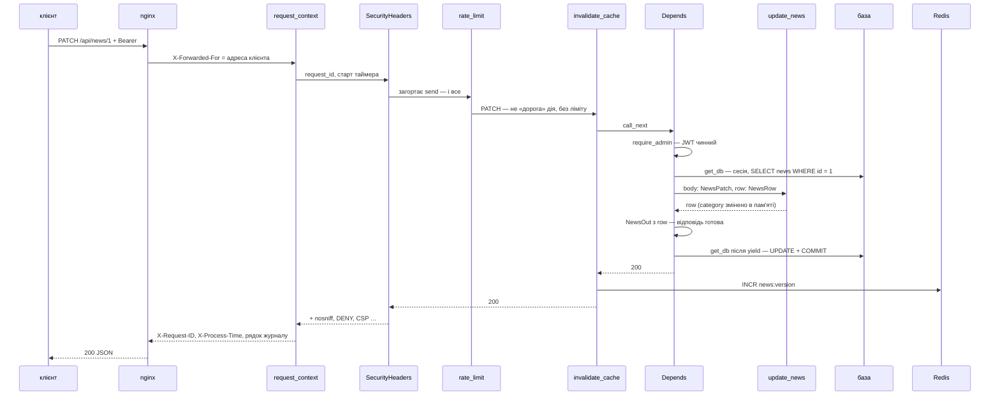
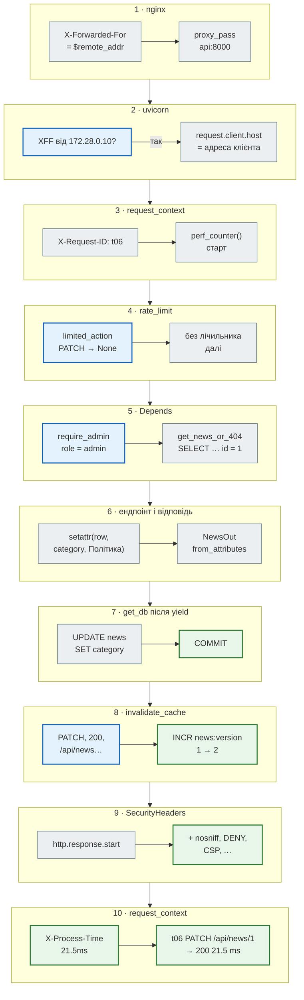
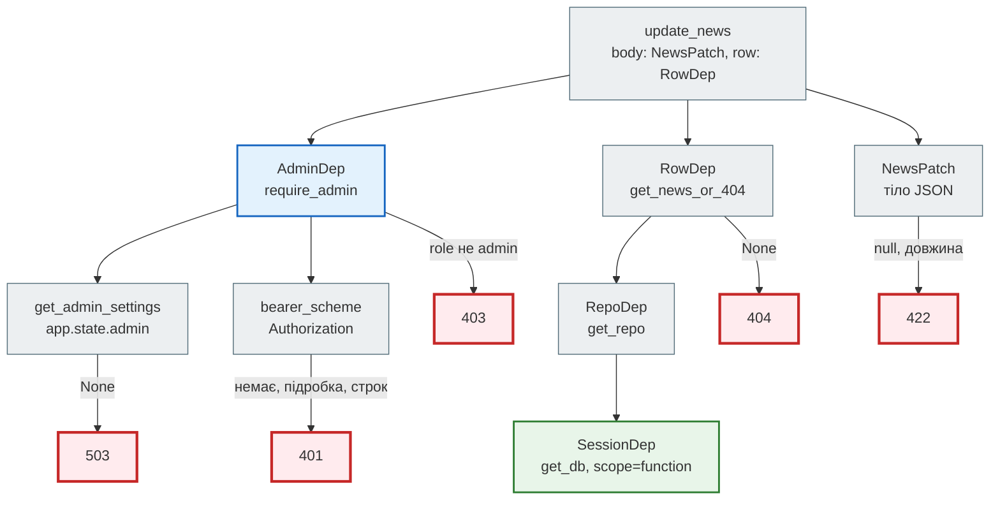
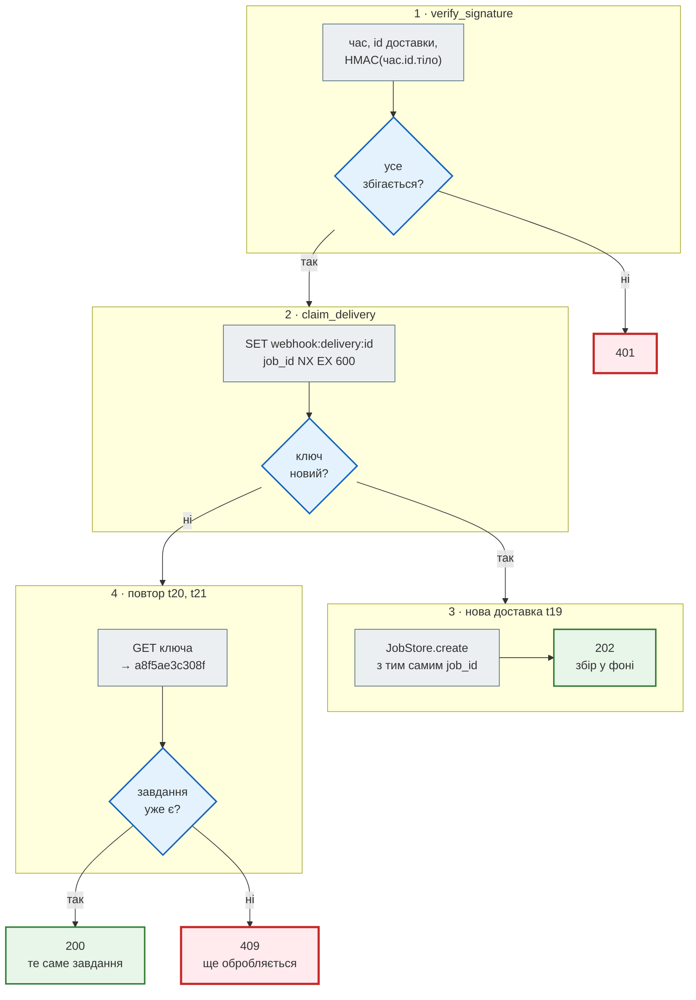
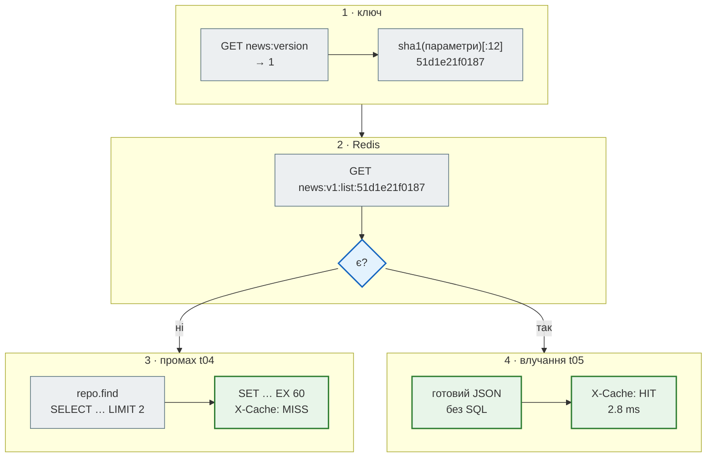
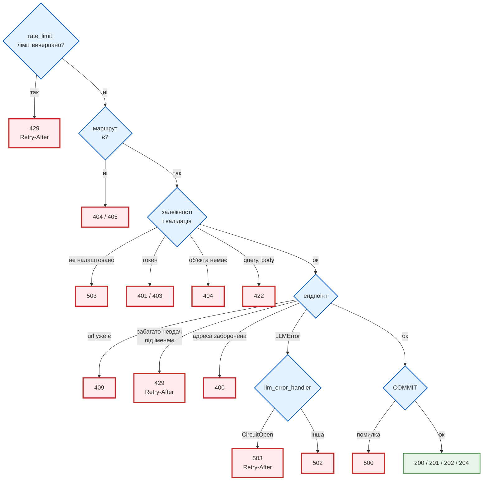
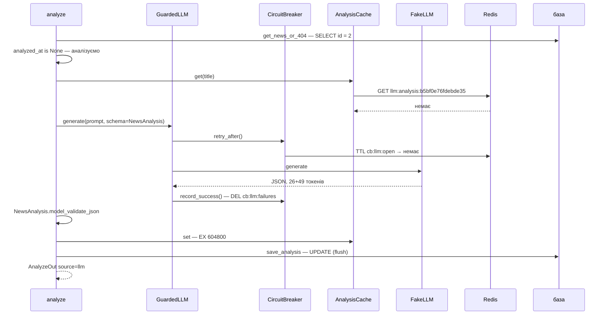

# Життєвий цикл запиту

> News Hub Deep Dive · сторінка 2 з 6. Код: [`news_hub/api.py`](https://github.com/NikoriakViktor/news_hub/blob/main/steps/12_ci_cd/news_hub/api.py),
> [`news_hub/middleware.py`](https://github.com/NikoriakViktor/news_hub/blob/main/steps/12_ci_cd/news_hub/middleware.py),
> [`news_hub/db.py`](https://github.com/NikoriakViktor/news_hub/blob/main/steps/12_ci_cd/news_hub/db.py),
> [`nginx/nginx.conf`](https://github.com/NikoriakViktor/news_hub/blob/main/steps/12_ci_cd/nginx/nginx.conf).
> Теорія: [Залежності і lifespan](../03_fastapi_core/dependencies.md), [Частина VI](../06_middleware_cache_jobs/README.md).

## Задача { #task }

Кожна частина шляху запиту з'являлась в окремому кроці: middleware — у кроці 4, сесія на запит — у кроці 3,
`AdminDep` — у кроці 8, nginx — у кроці 11. Тут — увесь шлях разом, для одного запиту, у тому порядку, у якому
його виконує фінальна версія. Кожен рядок журналу на цій сторінці — з одного справжнього запуску (як
запустити так само — [наприкінці](#reproduce)).

## Шлях одного запиту { #path }

Запит `PATCH /api/news/1` від адміна: змінити категорію новини. Він проходить **усе**: nginx, middleware,
перевірку токена, сесію бази, SQL, перевірку відповіді, COMMIT, інвалідацію кешу.



Справжній журнал цього запиту (у локальному запуску без nginx; SQL видно, бо в журналі увімкнено
`sqlalchemy.engine.Engine`):

```text
05:01:56 INFO sqlalchemy.engine.Engine: BEGIN (implicit)
05:01:56 INFO sqlalchemy.engine.Engine: SELECT news.id, news.url, news.title, news.source, news.lang, news.category, news.published_time, news.scraped_at, news.summary, news.ai_category, news.sentiment, news.keywords, news.analyzed_at
FROM news
WHERE news.id = ?
05:01:56 INFO sqlalchemy.engine.Engine: [generated in 0.00040s] (1,)
05:01:56 INFO sqlalchemy.engine.Engine: UPDATE news SET category=? WHERE news.id = ?
05:01:56 INFO sqlalchemy.engine.Engine: [generated in 0.00041s] ('Політика', 1)
05:01:56 INFO sqlalchemy.engine.Engine: COMMIT
05:01:56 INFO news_hub: t06 PATCH /api/news/1 → 200 21.5 ms
```

```text
HTTP/1.1 200 OK
x-content-type-options: nosniff
x-frame-options: DENY
referrer-policy: no-referrer
cross-origin-opener-policy: same-origin
content-security-policy: default-src 'none'; frame-ancestors 'none'
x-request-id: t06
x-process-time: 21.5ms
```

`X-Request-ID: t06` передав клієнт — і саме його видно в журналі й у відповіді. Без заголовка
`request_context` генерує 8 символів з `uuid4` (у цьому запуску — `724031e6`). П'ять заголовків безпеки
дописав `SecurityHeadersMiddleware` — вони є на **кожній** відповіді запуску, зокрема на `404`, `422` і `429`.

## Крок за кроком { #trace }

Той самий запит — з даними на кожному кроці:



| Крок | Код | Що відбувається | Якщо не так |
|---|---|---|---|
| 1 · nginx | `nginx/nginx.conf`, `location /` | `X-Forwarded-For` **перезаписується** `$remote_addr`, а не дописується | клієнт сам надіслав би `X-Forwarded-For: будь-що` і обійшов ліміт входу ([крок 11](../tutorials/11_compose_deploy/nginx_real_ip.md)) |
| 2 · uvicorn | `FORWARDED_ALLOW_IPS: 172.28.0.10` у `docker-compose.yml` | заголовку вірять лише від nginx; `request.client.host` — адреса клієнта | без nginx (локально) — адреса з'єднання: у запуску нижче ключі `rate:*:127.0.0.1` |
| 3 · `request_context` | `middleware.py:63` | найзовнішній middleware: бачить увесь час, зокрема інших middleware | — |
| — · `SecurityHeadersMiddleware` | `middleware.py:76` | до ендпоінта нічого не робить: лише загортає `send` | — |
| 4 · `rate_limit` | `middleware.py:136`, `limited_action` — `middleware.py:122` | лише `POST /api/admin/token`, `POST /api/scrape*`, `POST …/analyze`, `POST /api/analyze*`; решта — без лічильника | понад ліміт → `429` **без** виклику ендпоінта ([нижче](#rate-limit)) |
| — · `invalidate_cache` | `middleware.py:159` | до ендпоінта нічого не робить, лише `call_next` | — |
| 5 · `Depends` | `api.py:534` — `dependencies=[AdminDep]`, `RowDep` | залежності маршруту (`AdminDep`) — **першими**, потім параметри ендпоінта; `get_news_or_404` → `get_repo` → `get_db` відкриває сесію | немає токена → `401` ще до сесії бази; немає новини → `404` і `ROLLBACK` |
| 6 · ендпоінт | `api.py:536` `update_news` | `model_dump(exclude_unset=True)` — лише передані поля; FastAPI одразу будує `NewsOut` з об'єкта | `{"category": null}` → `422` від валідатора `not_null` (`api.py:306`) |
| 7 · COMMIT | `db.py:49` `get_db`, `api.py:201` `scope="function"` | вихід з `get_db` — **до** відправлення відповіді; `autoflush=False`, тож `UPDATE` іде саме тут, разом з COMMIT | COMMIT не вдався → `500`, а не `200` (`test_crud.py::test_failed_commit_is_500_not_200`) |
| 8 · `invalidate_cache` | `middleware.py:168` | метод запису, статус < 400, шлях `/api/news…` → нова версія кешу | `409`, `422`, `401` версію не чіпають — кеш лишається чинним |
| 9 · заголовки безпеки | `middleware.py:93` | у повідомленні `http.response.start` дописує `SECURITY_HEADERS` (`middleware.py:53`) і, крім `/docs` і `/redoc`, `Content-Security-Policy` | `setdefault`: заголовок, який поставив ендпоінт, не перезаписується |
| 10 · журнал | `middleware.py:71` | один рядок на запит: id, метод, шлях, статус, мс | — |

### Порядок middleware { #middleware-order }

`api.py:189–192` реєструє middleware знизу вгору: **останній зареєстрований — зовнішній**.

```python title="news_hub/api.py (фрагмент)"
app.middleware("http")(invalidate_cache)
app.middleware("http")(rate_limit)
app.add_middleware(SecurityHeadersMiddleware)
app.middleware("http")(request_context)
```

`app.middleware("http")` і `app.add_middleware` додають шари в один стек, тож правило «останній — зовнішній»
діє для обох. Запит іде `request_context → SecurityHeadersMiddleware → rate_limit → invalidate_cache → ендпоінт`,
відповідь — навпаки. Чому саме так:

- `request_context` зовні — у журнал потрапляє і `429` від `rate_limit` (у журналі нижче — `t18 … → 429 0.9 ms`);
- `SecurityHeadersMiddleware` зовні від `rate_limit` — заголовки безпеки отримує і `429`, якого ендпоінт не бачив
  (у запуску `t18` — з `x-content-type-options: nosniff`);
- `rate_limit` перед `invalidate_cache` — відхилений запит не дійде до ендпоінта і не скине кеш;
- `invalidate_cache` найближче до ендпоінта — він отримує відповідь, коли COMMIT уже відбувся.

Що буде, якщо переплутати, — [крок 4](../tutorials/04_middleware_redis/middleware.md#wrong-order).

### Чому заголовки безпеки — чистий ASGI { #pure-asgi }

Три інших шари — функції з `call_next`: Starlette загортає кожну в `BaseHTTPMiddleware`. Такий шар запускає
внутрішній застосунок в окремій задачі й передає відповідь назовні потоком, тож кожен ще один такий шар
змінює, **коли** закінчуються фонові задачі відносно моменту, коли клієнт отримав відповідь.

Заголовки безпеки спершу були четвертою такою функцією — і тести фонового аналізу (`POST /api/analyze/jobs`,
потім `GET` статусу) почали іноді падати з `KeyError: 'job_id'`. Виміряно під час виправлення — інтеграційні
тести кроку 8 (`pytest -m integration`), два заходи по 5–15 прогонів:

| Варіант | Падінь `pytest -m integration` (крок 8) |
|---|---|
| без шару заголовків | 0 з 8 |
| заголовки — ще один `@app.middleware("http")` | 3 з 20 (2 з 5, потім 1 з 15) |
| заголовки — чистий ASGI (`SecurityHeadersMiddleware`) | 0 з 25 (0 з 10, потім 0 з 15) |

Це гонка, і вона залежить від швидкості машини: повторний вимір для цієї сторінки — той самий варіант з
`@app.middleware("http")` у копії фінальної версії — дав 0 падінь з 6 повних запусків і 0 з 25 запусків
`test_analyze_api.py`, `test_redis.py`, `test_async_api.py`. Тобто «зелено в мене» не доводить, що гонки
немає, — і саме тому виправлення не в тестах, а в шарі.

`SecurityHeadersMiddleware` (`middleware.py:76`) не потребує ні тіла запиту, ні тіла відповіді: він підміняє
`send` і в першому повідомленні `http.response.start` дописує заголовки. Окремої задачі, потоку й копії
відповіді немає — порядок «відповідь → фонові задачі» лишається таким, яким його дають три інші шари.

Правило: middleware, якому досить заголовків, — чистий ASGI; `@app.middleware("http")` — коли потрібні
`Request` і `Response` цілком (як `rate_limit`, що повертає власний `429`).

### Порядок залежностей { #dependency-order }

Для `PATCH /api/news/{news_id}` FastAPI будує дерево залежностей і вирішує його згори донизу:



Залежність, яка трапляється в дереві кілька разів (наприклад, `SessionDep` у `get_repo` і `get_sources`),
виконується **один раз** на запит — тому в ендпоінті й у `get_news_or_404` той самий `AsyncSession`, і все
йде в одній транзакції. Тестам цього досить, щоб підмінити весь ланцюжок одним рядком:
`app.dependency_overrides[get_db] = …` ([Карта тестів](test_map.md#fixtures)).

## Інші запити того самого запуску { #run }

Двадцять чотири запити підряд (`t00`–`t22`, у `t22` — два) — по одному на кожну гілку, яку варто побачити. Колонка «SQL» — що з'явилось у
журналі SQLAlchemy:

| id | Запит | Статус | SQL | Що сталося |
|---|---|---|---|---|
| `t00` | `GET /health/ready` | 200 | `SELECT 1`, `COMMIT` | `{"status":"ok","checks":{"database":"ok","redis":"ok"}}` |
| `t01` | `GET /api/news?limit=2` | 200 | `SELECT … LIMIT ? OFFSET ?` | база порожня; `X-Cache: MISS` |
| `t02` | `POST /api/admin/token` | 200 | — | 220.6 ms — це bcrypt, 12 раундів; він іде в пулі потоків (`run_in_threadpool`, `api.py:624`), тож цикл подій тим часом обслуговує інші запити; `Cache-Control: no-store` |
| `t03` | `POST /api/scrape` (`snapshot`) | 200 | один `INSERT … VALUES (…) × 168 … ON CONFLICT (url) DO NOTHING RETURNING id, title, url`, `SELECT count(*)` | `news_saved: 168`; `X-RateLimit-Remaining: 4` |
| `t04` | `GET /api/news?limit=2` | 200 | `SELECT …` | `X-Cache: MISS`, 5.2 ms |
| `t05` | те саме | 200 | **немає** | `X-Cache: HIT`, 2.8 ms — база не потрібна |
| `t06` | `PATCH /api/news/1` | 200 | `SELECT`, `UPDATE`, `COMMIT` | [шлях вище](#path) |
| `t07` | `GET /api/news?limit=2` | 200 | `SELECT …` | `MISS`: версія кешу змінилась, `"category":"Політика"` |
| `t08` | `GET /api/news/99999` | 404 | `SELECT … WHERE news.id = ?`, **`ROLLBACK`** | виняток у залежності → `get_db` відкочує |
| `t09` | `GET /api/news?limit=0` | 422 | **немає** | `"loc":["query","limit"]`, `"ctx":{"ge":1}` — до бази не дійшло |
| `t10` | `POST /api/news` (той самий url) | 409 | `INSERT … RETURNING id, scraped_at`, **`ROLLBACK`** | унікальність `url` гарантує база, `IntegrityError` → 409 |
| `t11` | `POST /api/news/2/analyze` | 200 | `SELECT`, `UPDATE news SET summary=?, ai_category=?, …`, `COMMIT` | `"source":"llm","model":"fake"`; `X-RateLimit-Remaining: 9` |
| `t12` | те саме ще раз | 200 | `SELECT`, `COMMIT` | `"source":"db"` — модель не викликали |
| `t13` | `POST /api/scrape/jobs` | 202 | `INSERT … ON CONFLICT` — **після** рядка журналу запиту | задача — після відповіді |
| `t14` | `GET /api/scrape/jobs/81a551dffb11` | 200 | — | `"status":"done","news_found":168,"news_saved":0` |
| `t15` | `POST /api/scrape` без токена | 401 | — | `X-RateLimit-Remaining: 2` |
| `t16` | `POST /api/scrape`, `Bearer abc.def.ghi` | 401 | — | `"недійсний токен"`, `X-RateLimit-Remaining: 1` |
| `t17` | `POST /api/scrape` з токеном | 200 | `INSERT … ON CONFLICT`, `SELECT count(*)` | `news_saved: 0` — ті самі 168 новин; `Remaining: 0` |
| `t18` | `POST /api/scrape` | 429 | — | `Retry-After: 59`; ендпоінт не викликався |
| `t19` | `POST /api/webhooks/scrape`, підпис HMAC, `X-Webhook-Delivery: dd0123456789abcd` | 202 | `INSERT …` у фоні | без JWT: свій захист — підпис; `"job_id":"a8f5ae3c308f"` |
| `t20` | той самий запит удруге, байт у байт | 200 | — | `"job_id":"a8f5ae3c308f"`, `"status":"running"` — те саме завдання, другого збору немає |
| `t21` | та сама доставка через 3 с: новий час, **новий** підпис | 200 | — | `"job_id":"a8f5ae3c308f"`, `"status":"done"` — повтор впізнано за id доставки, а не за підписом |
| `t22` | `POST /api/admin/token`, неправильний пароль, двічі | 401, 401 | — | 220.8 і 211.2 ms — bcrypt іде й на невдалий вхід; лічильник `login:fail:…` = 2 |

Журнал `t11`–`t22` без SQL-рядків:

```text
05:01:56 INFO news_hub: t11 POST /api/news/2/analyze → 200 29.3 ms
05:01:56 INFO news_hub: t12 POST /api/news/2/analyze → 200 4.9 ms
05:01:56 INFO news_hub: t13 POST /api/scrape/jobs → 202 4.0 ms
05:01:57 INFO news_hub: t14 GET /api/scrape/jobs/81a551dffb11 → 200 1.8 ms
05:01:57 INFO news_hub: t15 POST /api/scrape → 401 1.8 ms
05:01:57 INFO news_hub: t16 POST /api/scrape → 401 1.8 ms
05:01:57 INFO news_hub: t17 POST /api/scrape → 200 17.2 ms
05:01:57 WARNING news_hub: rate limit scrape: 127.0.0.1 count=6
05:01:57 INFO news_hub: t18 POST /api/scrape → 429 0.9 ms
05:01:57 INFO news_hub: t19 POST /api/webhooks/scrape → 202 3.3 ms
05:01:57 INFO news_hub: t20 POST /api/webhooks/scrape → 200 7.2 ms
05:02:00 INFO news_hub: t21 POST /api/webhooks/scrape → 200 3.5 ms
05:02:00 INFO news_hub: t22-1 POST /api/admin/token → 401 220.8 ms
05:02:00 INFO news_hub: t22-2 POST /api/admin/token → 401 211.2 ms
```

### Повтор webhook: те саме завдання { #webhook-replay }

`t19`–`t21` — захист від повтору, як він працює у фінальній версії (`api.py:761`):



Ключ повтору — id доставки (`X-Webhook-Delivery`), а не підпис. Раніше ключем був підпис, і відправник, що
повторював доставку з новим часом (`t21`), отримував новий підпис — і запускав збір удруге. Тепер id входить у
підпис (`webhooks.py:57`), тож підробити його без секрету не можна, а повтор із будь-яким часом впізнається.
`200` замість `409`: відправник, що не дочекався першої відповіді, бачить успіх і не повторює по колу. `409`
лишився для рідкої гонки — друга доставка прийшла, поки перша ще не створила завдання
(`test_webhooks_api.py::test_resent_delivery_with_new_signature_does_not_scrape_twice`,
`test_webhooks.py::test_same_delivery_is_claimed_once`).

### Кеш: MISS, HIT, нова версія { #cache }

`list_news` (`api.py:403`) — cache-aside: спершу ключ, потім Redis, і лише на промаху — база.



Після `t06` версія стала `2`, і `t07` шукав уже `news:v2:list:51d1e21f0187` — тому `MISS`. Старі ключі ніхто не
видаляє: їх прибере TTL. Після всіх запитів у Redis лежали `news:v0:…`, `news:v1:…`, `news:v2:…` з тим самим
хешем параметрів, а `news:version` дорівнював `7` — що саме його збільшило, розібрано в
[Модель даних → Redis](data_model.md#redis).

### Rate limit рахує й невдалі спроби { #rate-limit }

`rate_limit` стоїть **перед** перевіркою токена: лічильник `rate:scrape:<адреса>` росте на кожен
`POST /api/scrape*` з адреси — і з токеном, і без. У запуску: `t03` (200) → 4, `t13` (202) → 3, `t15` (401) → 2,
`t16` (401) → 1, `t17` (200) → 0, `t18` → `429`.

Так задумано: ліміт захищає дорогу дію (завантаження сайту) і перебір, а не «чесних» користувачів. Ціна — анонім з
тієї самої адреси може витратити ліміт адміна. За nginx адреса — справжня адреса клієнта, тож «та сама адреса» —
це справді той самий клієнт. Чому вікно фіксоване і де його межа — [крок 4](../tutorials/04_middleware_redis/rate_limit.md#fixed-window).

Вхід адміна має **два** лічильники. `rate_limit` рахує спроби з однієї адреси (`rate:login:<адреса>`, 5 за
300 с) — атаку з тисячі адрес він не помічає. Тому в ендпоінті є ще `LoginGuard` (`security.py:122`): він
рахує лише **невдалі** входи на одне ім'я з усіх адрес разом (`login:fail:<sha256 імені>`, 20 за 900 с). Понад
ліміт — `429` з `Retry-After`, і bcrypt навіть не запускається; успішний вхід лічильник видаляє. Ціна —
атакувальник може на ці 15 хвилин закрити вхід і справжньому адміну; для єдиного адміна це краще, ніж
необмежений підбір (`test_admin_api.py::test_login_lockout_counts_failures_per_name_from_any_address`).
Ліміти дій — одна таблиця `LIMITS` (`middleware.py:50`); `/scrape` у боті бере звідти той самий ліміт збору,
з ключем `rate:scrape:tg<id>` ([Каталог патернів](patterns.md#middleware)).

### Фонові задачі — після відповіді { #background }

У `t13` рядок журналу запиту (`→ 202 4.0 ms`) стоїть **перед** `INSERT` фонової задачі:

```text
05:01:56 INFO news_hub: t13 POST /api/scrape/jobs → 202 4.0 ms
INFO:     127.0.0.1:59212 - "POST /api/scrape/jobs HTTP/1.1" 202 Accepted
05:01:56 INFO sqlalchemy.engine.Engine: BEGIN (implicit)
05:01:56 INFO sqlalchemy.engine.Engine: INSERT INTO news (url, title, source, lang, category, published_time) VALUES (?, ?, ?, ?, ?, ?), …
05:01:56 INFO sqlalchemy.engine.Engine: COMMIT
```

`BackgroundTasks` виконуються, коли відповідь уже відправлена. Тому `run_scrape_job` відкриває **власну** сесію
(`jobs.py:93`): сесія запиту на цей момент закрита. З тієї самої причини розсилка `Notifier` після
`POST /api/scrape` (`api.py:474`) гарантовано бачить закомічені новини. Коли саме фонові задачі закінчуються
відносно відповіді, залежить і від шарів middleware — [вище](#pure-asgi).

## Звідки береться кожен код відповіді { #status-codes }

Статус народжується на певному етапі шляху — і що раніше етап, то менше роботи виконано:



| Статус | Де народжується | Приклад |
|---|---|---|
| `400` | `api.py:676` `unsafe()` — `UnsafeURL` з `safe_fetch`; `api.py:814` — тіло не update Telegram | `POST /api/sources` з `http://169.254.169.254/` |
| `401` | `security.py:200–207` — немає токена, прострочений, недійсний; `api.py:626` — неправильний пароль; `WebhookRejected` (`webhooks.py:39`); `api.py:810` — секрет Telegram | `t15`, `t16` |
| `403` | `security.py:209` — підпис правильний, але `role` не `admin` | `test_admin_api.py::test_valid_token_without_admin_role_is_403` |
| `404` | `api.py:269` новина, `:499` задача збору, `:590` задача аналізу, `:683` джерело | `t08` |
| `409` | `api.py:525` — url новини вже є; `:703` — джерело вже є; `:781` — та сама доставка webhook ще обробляється | `t10` |
| `422` | FastAPI — query, path, body; `api.py:520` — `NewsItem` не прийняв новину з `POST /api/news`; `api.py:306` — `null` у `PATCH`; `api.py:775` — тіло webhook | `t09` |
| `429` | `middleware.py:148` — до ендпоінта; `api.py:622` — `LoginGuard`: забагато невдалих входів під іменем | `t18`; `test_login_lockout_counts_failures_per_name_from_any_address` |
| `500` | невдалий COMMIT (виняток з `get_db`) і будь-який неперехоплений виняток | `test_crud.py::test_failed_commit_is_500_not_200` |
| `502` | `api.py:263` — провайдер LLM не відповів (`LLMUnavailable`) або двічі невалідна відповідь (`InvalidLLMOutput`); `api.py:730`, `:734` — RSS-джерело недоступне чи не RSS | `test_analyze_api.py::test_provider_down_502` |
| `503` | `security.py:185` — адмінку не налаштовано; `api.py:242` — немає ключа LLM; `api.py:260` — breaker відкритий (з `Retry-After`); `api.py:751` — немає `WEBHOOK_SECRET`; `api.py:808` — бот вимкнений; `api.py:392` — `/health/ready` | [запуск без адмінки](README.md#run) |

Дві речі в цій таблиці — свідомі рішення, а не випадковість:

- **«LLM не налаштовано» — `503`, а збій провайдера — `502`.** `503` — «ми не можемо зараз» (і `Retry-After`,
  коли breaker відкритий), `502` — «нам погано відповів той, до кого ми ходили». Різні статуси — різні дії
  клієнта: чекати чи повідомляти ([крок 7](../tutorials/07_llm_api/circuit_breaker.md)).
- **Неправильне ім'я і неправильний пароль — одна відповідь `401`** з тим самим текстом
  (`test_admin_api.py::test_bad_login_is_one_answer`): відповідь не підказує, що саме вгадано.

Як статуси обирати взагалі — [Коди стану](../01_http_and_rest/status_codes.md).

## Аналіз LLM: що відбувається всередині `t11` { #analyze }

`POST /api/news/2/analyze` — найдовший шлях у застосунку:



Відповідь (скорочено):

```json
{"news_id":2,"source":"llm","model":"fake","input_tokens":26,"output_tokens":49,
 "analyzed_at":"2026-11-12T05:01:56.513569Z",
 "analysis":{"summary":"У Путіна заявили, що вихід на мирну угоду з Україною \"займе багато часу\"",
             "category":"Інше","sentiment":"нейтральна", …}}
```

Другий виклик (`t12`) до моделі не дійшов: `row.analyzed_at` уже є → `"source":"db"`. Третій шлях —
`"source":"cache"`: новину видалили й зібрали знову, рядок новий, а заголовок той самий — аналіз з Redis за
хешем тексту, без платного виклику (`test_analyze_api.py::test_same_title_after_rescrape_comes_from_cache`).

## Як відтворити { #reproduce }

Журнал SQL у застосунку вимкнено (`make_engine(..., echo=False)`). Щоб його побачити, не змінюючи код,
достатньо запустити uvicorn з Python і ввімкнути логер SQLAlchemy:

```python title="runner.py — uvicorn + журнал SQL (лише для трасування)"
import logging, os, sys

sys.path.insert(0, os.getcwd())          # запускати з steps/12_ci_cd
import uvicorn

handler = logging.StreamHandler(sys.stdout)
handler.setFormatter(logging.Formatter("%(asctime)s %(levelname)s %(name)s: %(message)s", "%H:%M:%S"))
sql = logging.getLogger("sqlalchemy.engine.Engine")
sql.addHandler(handler)
sql.setLevel(logging.INFO)
sql.propagate = False
uvicorn.run("news_hub.api:app", host="127.0.0.1", port=8763)
```

```bash
cd steps/12_ci_cd
export DATABASE_URL=sqlite+aiosqlite:///trace.db LLM_PROVIDER=fake REDIS_URL=fakeredis://
export ADMIN_PASSWORD_HASH='…' JWT_SECRET='…' WEBHOOK_SECRET='…'      # python -m news_hub.security
alembic upgrade head
python runner.py

# в іншому терміналі
curl -i "localhost:8763/api/news?limit=2" -H 'X-Request-ID: t04'
```

Шукати один запит у журналі — за `X-Request-ID`: усі рядки `news_hub` з ним — один запит. На сервері —
`docker compose logs api | grep t06`.

## Що далі { #next }

[Модель даних і Redis](data_model.md) — що саме лежить у таблицях і ключах, які цей запит читав і писав.
