# News Hub — книга про FastAPI

Новинний агрегатор на FastAPI, зібраний за 12 кроків: від парсера з анотаціями типів до стеку
nginx → API → PostgreSQL + Redis у Docker Compose і CI/CD на GitHub Actions.

```mermaid
flowchart LR
    classDef step     fill:#eceff1,stroke:#546e7a,stroke-width:1px;
    classDef success  fill:#e8f5e9,stroke:#2e7d32,stroke-width:2px;

    S1["1 · типи<br>і Pydantic"] --> S2["2 · FastAPI"] --> S3["3 · SQLAlchemy<br>і Alembic"] --> S4["4 · middleware<br>і Redis"]
    S4 --> S5["5 · тести"] --> S6["6 · AI-інструменти"] --> S7["7 · LLM API"] --> S8["8 · безпека"]
    S8 --> S9["9 · Telegram-бот"] --> S10["10 · Docker"] --> S11["11 · Compose<br>і деплой"] --> S12["12 · CI/CD"]

    class S1,S2,S3,S4,S5,S6,S7,S8,S9,S10,S11 step
    class S12 success
```

## Що ти збудуєш

- **Парсер і перевірку даних** — HTML rbc.ua та RSS → `NewsItem` (Pydantic); некоректне — у `rejected`.
- **REST API** — стрічка, статистика, повний CRUD, фоновий збір, документація `/docs`.
- **Базу й кеш** — SQLAlchemy 2 async, Alembic, Redis: кеш, rate limit, статус задач.
- **Аналіз LLM** — підсумок, тема, тональність від Gemini або Anthropic, з перевіркою відповіді й circuit breaker.
- **Безпеку** — JWT адміна, bcrypt, захист від SSRF, підписані webhook.
- **Telegram-бота** — команди, підписки на слова, сповіщення.
- **Production** — образ Docker, Compose з nginx, бекап, CI на кожен PR, образ у ghcr.io.

## З чого почати

| Хто ти | Маршрут |
|---|---|
| Ніколи не писав API | [Крок 0. Що таке API](tutorials/00_first_api/index.md): клієнт і сервер, перший API на 13 рядків, перевірка знань |
| Починаєш FastAPI | [Як користуватися](00_getting_started/README.md) → [Zero to Hero](tutorials/README.md), крок за кроком; теорію — з частин книги, на які посилається крок |
| Знаєш Django | [Частина III. Ядро FastAPI](03_fastapi_core/README.md) → [Zero to Hero](tutorials/README.md) з кроку 2 |
| Шукаєш конкретну тему | [Книга FastAPI](01_http_and_rest/README.md) — частини I–X |
| Потрібна довідка | [Довідник](reference/README.md) |
| Викладаєш | [Викладачу](TEACHING_GUIDE.md) |

## Структура

| Розділ | Що там |
|---|---|
| [Як користуватися](00_getting_started/README.md) | передумови, налаштування, структура репозиторію |
| Книга FastAPI | знання: HTTP і REST → типи → FastAPI → async → бази → middleware і кеш → тести → безпека → інтеграції → Docker і CI |
| [Zero to Hero](tutorials/README.md) | 12 кроків — по одному на папку `steps/NN` |
| [News Hub Deep Dive](deep_dive/README.md) | фінальна версія: архітектура, модулі, запит від початку до кінця |
| [Практика](labs/README.md) | лабораторні до кроків і фінальна лаба |
| [Довідник](reference/README.md) | FastAPI-довідник, «Від Django до FastAPI», Claude Code |

Код — у репозиторії [NikoriakViktor/news_hub](https://github.com/NikoriakViktor/news_hub).
Django-версія тієї самої ідеї — книга [Notes Chat App](https://nikoriakviktor.github.io/notes_chat_app/).
