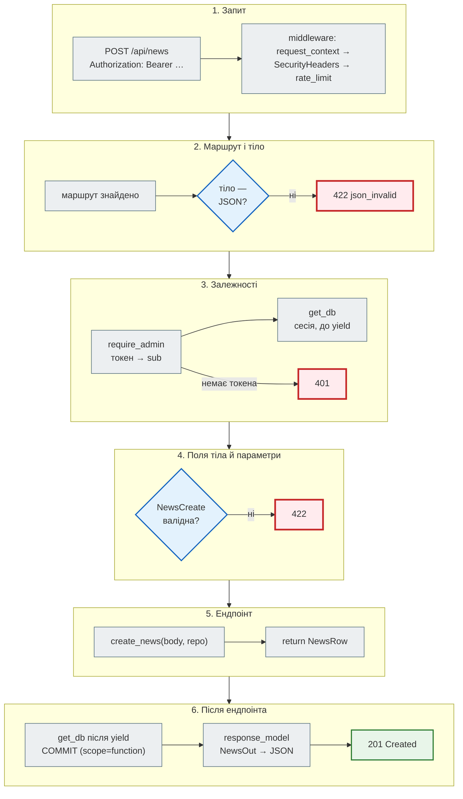
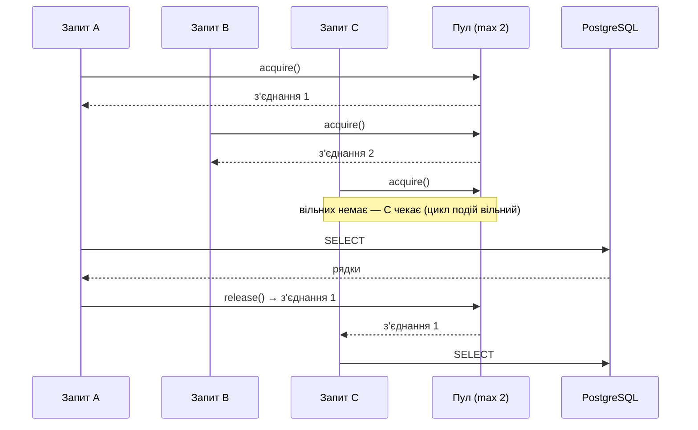

# Архітектура й production: коротко

Стисло про те, як FastAPI-сервіс поводиться під навантаженням і як його складати з шарів. Повні розділи —
[Частина IV. Async](../04_async/README.md), [Частина V. Бази даних](../05_databases/README.md),
[Частина X. Docker і CI](../10_docker_and_ci/README.md). Виміри нижче зроблено на FastAPI 0.162, uvicorn 0.54,
PostgreSQL 16 (asyncpg 0.32).

## Що таке FastAPI { #fastapi }

| Складова | Роль |
|---|---|
| **Starlette** | ASGI-інструментарій: маршрутизація, middleware, WebSocket, `TestClient` |
| **Pydantic** | перевірка вхідних даних, серіалізація відповіді, JSON Schema для `/docs` |
| **uvicorn** | ASGI-сервер: приймає з'єднання і викликає застосунок |

Анотації типів у сигнатурі — це і перевірка (`422` до входу в код), і документація (`/docs`, `/redoc`,
`/openapi.json`). Докладно — [Що таке FastAPI](../03_fastapi_core/what_is_fastapi.md).

## ASGI і WSGI { #asgi-wsgi }

| | WSGI (Django без async, Flask; Gunicorn) | ASGI (FastAPI; uvicorn) |
|---|---|---|
| одиниця обробки | воркер (процес або потік) на один запит одночасно | корутина в циклі подій |
| скільки запитів одночасно | воркери × потоки | тисячі, поки вони **чекають** I/O |
| ціна одного очікувального запиту | потік зі своїм стеком (на Linux резервується 8 МБ віртуальної пам'яті) | об'єкт корутини, кілобайти |
| WebSocket, SSE | потрібен окремий ASGI-сервер | вбудовано |
| CPU-важка робота | паралельно в процесах | блокує цикл подій → у процес (`ProcessPoolExecutor`) |

Порівняння на тому самому API — [FastAPI, Flask і Django](../03_fastapi_core/fastapi_flask_django.md#async), у
Django-книзі — [WSGI vs ASGI](https://nikoriakviktor.github.io/notes_chat_app/02_django_core/wsgi_vs_asgi/).

## Три типи ендпоінтів { #endpoint-types }

```python
@app.get("/type1")
async def type1():
    await asyncio.sleep(0.5); return {"type": 1}      # цикл подій вільний

@app.get("/type2")
async def type2():
    time.sleep(0.5); return {"type": 2}               # цикл подій стоїть

@app.get("/type3")
def type3():
    time.sleep(0.5); return {"type": 3}               # пул потоків
```

Одночасні запити (`httpx.AsyncClient` + `asyncio.gather`) до uvicorn з одним процесом:

```text
limiter {'tokens': 40}
/type1 100 запитів по 0.5 с → 0.60 с
/type2 10 запитів по 0.5 с → 5.01 с
/type3 100 запитів по 0.5 с → 1.55 с
```

| Тип | Що відбувається | Результат |
|---|---|---|
| `async def` + `await` | 100 корутин чекають одночасно | ≈ час одного запиту |
| `async def` + блокуючий виклик | запити йдуть строго по черзі, решта сервера (і `/health`) теж чекає | 10 × 0,5 с = 5 с |
| `def` | AnyIO-пул на 40 потоків: 100 запитів — три хвилі | 3 × 0,5 с ≈ 1,5 с |

`def` — безпечно, але з межею 40 одночасних; `async def` з блокуючим кодом — ніколи. Виміри на News Hub —
[крок 2](../tutorials/02_fastapi_basics/async_measurements.md).

## Блокуючий код і заміни { #blocking }

Один блокуючий виклик в `async def` зупиняє **всі** запити процесу, не лише свій.

| Блокує в `async def` | Замість цього | У News Hub |
|---|---|---|
| `time.sleep(n)` | `await asyncio.sleep(n)` | паузи між повторами реєстрації бота |
| `requests.get(url)` | `httpx.AsyncClient` або `aiohttp.ClientSession` | `aiohttp` у `scraper.py`, `safe_fetch.py`, `llm.py`; `httpx` у `llm.py` |
| `psycopg2` | `asyncpg` (через SQLAlchemy async) | `postgresql+asyncpg://…` |
| `redis.Redis` | `redis.asyncio.Redis` | `cache.py` |
| `subprocess.run(cmd)` | `await asyncio.create_subprocess_exec(...)` | — |
| бібліотека без async-версії | `def`-ендпоінт або `await run_in_threadpool(fn, …)` (`starlette.concurrency`) | bcrypt при вході: `await run_in_threadpool(authenticate, …)` в `admin_token` (раніше — прямо в event loop, ~0,2 с на спробу) |
| CPU-важкий цикл | `await loop.run_in_executor(process_pool, fn, …)` | — |

## Dependency Injection { #di }



Залежності виконуються **раніше**, ніж FastAPI повідомляє про помилки полів: `POST /api/news` без токена з
неправильним тілом дає `401`, а не `422`. Лише тіло, що взагалі не JSON, відхиляється до залежностей:

```text
без токена, погане тіло → 401 {"detail":"потрібен токен: Authorization: Bearer <access_token>"}
без токена, не JSON → 422 {"detail":[{"type":"json_invalid","loc":["body",0],"msg":"JSON decode error",…
```

| Правило | Чому |
|---|---|
| ресурс на весь процес (пул, клієнт) — у `lifespan`, з'єднання на запит — у залежності | пул на кожен запит знищує сенс пулу |
| параметри залежності — як у маршруту: `pool` без маркера стане **query-параметром** | беріть пул з `request.app.state`, а не з параметра |
| прибирання — `try/finally` або `async with` навколо `yield` | інакше при винятку ресурс не закриється |
| `COMMIT` після `yield` — лише з `scope="function"` | за замовчуванням код після `yield` іде **після** відповіді |

Докладно — [Залежності](../03_fastapi_core/dependencies.md).

## Пул з'єднань { #pool }

```text
нове з'єднання: 21.3 мс | з пулу: 1.58 мс
```

(локальний PostgreSQL у Docker; через мережу різниця більша). У PostgreSQL за замовчуванням
`max_connections = 100`: кожен процес застосунку зі своїм пулом забирає частину.



| Де | Налаштування |
|---|---|
| News Hub, PostgreSQL | `create_async_engine(url, pool_size=10, max_overflow=20, pool_pre_ping=True)` — `news_hub/db.py` |
| міграції Alembic | `poolclass=pool.NullPool` — одне з'єднання на запуск (`migrations/env.py`) |
| зупинка | `await engine.dispose()` у `lifespan` |
| asyncpg напряму | `await asyncpg.create_pool(dsn, min_size=…, max_size=…, command_timeout=…)` у `lifespan`, `async with pool.acquire() as conn:` у залежності |

## Repository { #repository }

Ендпоінт не знає SQL: він кличе `repo.find(...)`, `repo.create(item)`. Репозиторій — єдине місце з запитами до
таблиці.

| | Без репозиторію | З репозиторієм |
|---|---|---|
| SQL | розкиданий по ендпоінтах | в одному класі |
| тест бізнес-логіки | потрібна база | підміна репозиторію або тестова база |
| інша база | зміни в ендпоінтах | інша реалізація того самого контракту |

У News Hub — `BaseRepository[ModelT]` (`get`, `add`, `delete`, `count`) і `NewsRepository`, `SourceRepository`,
`SubscriptionRepository` у `news_hub/repository.py`; підключення — `RepoDep = Annotated[NewsRepository,
Depends(get_repo)]`. Тести News Hub не підміняють репозиторій фейком у пам'яті, а дають справжній на SQLite у
пам'яті (і PostgreSQL у CI): так перевіряється і SQL. Докладно — [крок 3](../tutorials/03_sqlalchemy_alembic/repository.md).

## Unit of Work { #uow }

Кілька змін — одна транзакція: або всі (`COMMIT`), або жодної (`ROLLBACK`).

```python
class UnitOfWork:
    """ROLLBACK — лише якщо не було COMMIT."""
    def __init__(self, pool): self._pool = pool
    async def __aenter__(self):
        self.conn = await self._pool.acquire()
        self._tx = self.conn.transaction()
        await self._tx.start()
        self._committed = False
        return self
    async def commit(self):
        await self._tx.commit(); self._committed = True
    async def __aexit__(self, exc_type, exc, tb):
        try:
            if not self._committed:
                await self._tx.rollback()
        finally:
            await self._pool.release(self.conn)


async def transfer(uow, amount):
    async with uow:
        await uow.conn.execute("UPDATE accounts SET balance = balance - $1 WHERE id = 1", amount)
        if amount > 100:
            raise ValueError("ліміт переказу")
        await uow.conn.execute("UPDATE accounts SET balance = balance + $1 WHERE id = 2", amount)
        await uow.commit()
```

Рахунки `(1, 500), (2, 100)`, перекази `50` і `200` (другий падає посередині):

```text
переказ 200: ліміт переказу
баланси: [(1, 450), (2, 150)]
вільних з'єднань у пулі: 2 з 2
```

Перше списання другого переказу відкочено, з'єднання повернулися в пул.

!!! warning "`rollback()` у `__aexit__` без умови"
    Поширена схема «`__aexit__` завжди викликає `rollback()`, після `commit()` він нічого не зробить» з asyncpg
    не працює: `InterfaceError: cannot rollback; the transaction is already committed`. Відкочувати — лише
    незакомічену транзакцію, або просто `async with conn.transaction():`.

У News Hub Unit of Work — це сесія SQLAlchemy на запит: `get_db` робить `COMMIT`, якщо ендпоінт завершився без
винятку, і `ROLLBACK` — якщо з винятком; `scope="function"` — щоб клієнт дізнався про збій `COMMIT`
(`500`, а не `201`). Докладно — [Сесія на запит](../tutorials/03_sqlalchemy_alembic/session_per_request.md).

## Мікросервіси { #microservices }

| Елемент | Роль |
|---|---|
| API Gateway (nginx, Traefik) | TLS, маршрутизація до сервісів, ліміти |
| сервіс | свій код, своя база, свій деплой |
| BFF (Backend for Frontend) | збирає дані кількох сервісів для одного клієнта: `await asyncio.gather(...)` |
| черга повідомлень (RabbitMQ, Kafka) | події між сервісами без очікування відповіді |

Ціна — мережа між частинами (затримки, збої, повтори), окремі деплої й журнали. News Hub — один сервіс за nginx
з PostgreSQL і Redis; бот — у тому самому процесі (webhook) або окремим контейнером (polling). Коли варто
розділяти — [Частина X](../10_docker_and_ci/README.md).

## Production { #production }

```text
клієнт → nginx (TLS, X-Forwarded-For, client_max_body_size) → uvicorn → FastAPI → пул SQLAlchemy → PostgreSQL
                                                                                → Redis
```

| Питання | Як у News Hub | Крок |
|---|---|---|
| скільки процесів | 1 процес uvicorn на контейнер (`WEB_CONCURRENCY` за замовчуванням 1); масштаб — кількістю контейнерів | [10](../tutorials/10_docker/index.md), [11](../tutorials/11_compose_deploy/deploy.md) |
| порядок старту | `postgres` (healthy) → `migrate` (код 0) → `api` (healthy) → `nginx` | [11](../tutorials/11_compose_deploy/startup_order.md) |
| здоров'я | `/health` — процес живий; `/health/ready` — база й Redis | [10](../tutorials/10_docker/health_shutdown.md) |
| зупинка | exec-форма `CMD`: `SIGTERM` отримує uvicorn | [10](../tutorials/10_docker/health_shutdown.md) |
| справжній IP клієнта | `FORWARDED_ALLOW_IPS` = адреса nginx | [11](../tutorials/11_compose_deploy/nginx_real_ip.md) |
| секрети | `.env` поза git і образом; `$` — в одинарних лапках | [11](../tutorials/11_compose_deploy/env_secrets.md) |
| заголовки й документація | `SecurityHeadersMiddleware` (чистий ASGI) на кожній відповіді; `DOCS_ENABLED=false` у Compose — `/docs` і `/openapi.json` → `404`; nginx `server_tokens off` | [Секрети і заголовки](../08_security/secrets_and_headers.md#news-hub-fixes) |
| перевірка перед злиттям | pytest ×2 Python, мінімальні версії, PostgreSQL, `alembic check`, mypy, образ + smoke; «залежності й секрети»: lock відповідає `requirements.txt`, `pip-audit`, gitleaks | [12](../tutorials/12_ci_cd/what_to_check.md) |

Порада «(2 × ядра) + 1 воркерів» — з документації Gunicorn для синхронних воркерів. Async-воркер uvicorn
тримає багато запитів сам, тож процесів зазвичай не більше, ніж ядер; у контейнерах — один процес і кілька
копій контейнера. `uvicorn news_hub.api:app --workers 4` — кілька процесів в одному контейнері, кожен зі своїм
пулом з'єднань.

## Чекліст перед деплоєм { #checklist }

- [ ] У `async def` немає блокуючих викликів (`time.sleep`, `requests`, синхронні драйвери бази).
- [ ] Пул з'єднань і клієнти створюються в `lifespan` і закриваються там само.
- [ ] Залежності з `yield` прибирають у `finally`; `COMMIT` — з `scope="function"`.
- [ ] CPU-важке — у пул процесів або окремий воркер.
- [ ] SQL — у репозиторіях; транзакція — одна на запит.
- [ ] `response_model` на кожному ендпоінті: службові поля не течуть назовні.
- [ ] Міграції застосовуються окремим кроком до старту API; `alembic check` у CI.
- [ ] Секрети — зі змінних середовища, не з коду й не з образу; сканер секретів по історії git у CI.
- [ ] Залежності образу — з lock-файлу з хешами (`pip install --require-hashes`), lock перевірено `pip-audit`.
- [ ] Заголовки безпеки на кожній відповіді; `/docs` на публічному сервері вимкнено, якщо API не публічний.
- [ ] `/health` і `/health/ready` розділені; healthcheck у Compose — на готовність.
- [ ] Кількість процесів × розмір пулу < `max_connections` PostgreSQL.
