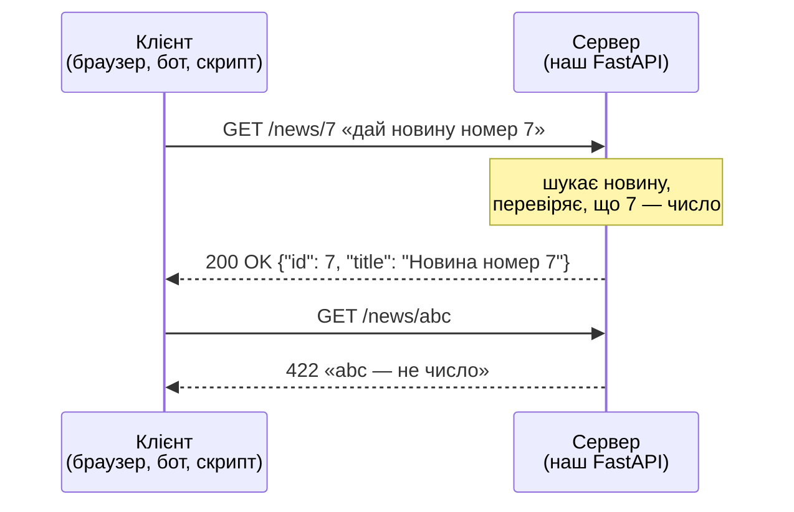
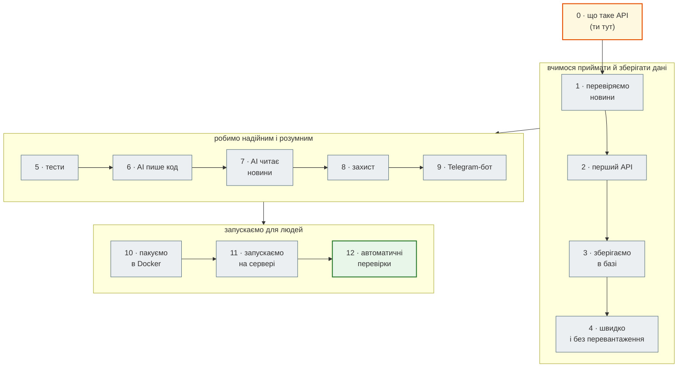

# Крок 0. Що таке API і що ми будуватимемо

> **Код кроку:** [`examples/first_api`](https://github.com/NikoriakViktor/news_hub/tree/main/examples/first_api) — один файл на 13 рядків.
>
> **Передумови:** жодних. Якщо FastAPI вже знайомий — переходь до [перевірки знань](readiness.md), а потім одразу до [кроку 1](../01_typing_pydantic/index.md).

## Задача { #task }

Перш ніж писати агрегатор новин на 12 кроків, треба розуміти три слова, які трапляються на кожній сторінці: **клієнт**, **сервер**, **API**. І один раз побачити все це наживо: запустити сервер, відкрити його в браузері, отримати відповідь і отримати помилку.

## Клієнт, сервер, API { #client-server }

Коли відкриваєш сайт новин, відбувається розмова двох програм:

- **клієнт** — програма, яка **просить**: браузер, застосунок на телефоні, Telegram-бот, Postman, твій скрипт на Python;
- **сервер** — програма, яка **постійно працює** на якомусь комп'ютері, **чекає** запитів і **відповідає** на них.

Розмова завжди однакова: клієнт надсилає **запит**, сервер повертає **відповідь**. Одна відповідь на один запит.



**Запит** складається з:

| Частина | Приклад | Що означає |
|---|---|---|
| метод | `GET` | що зробити: `GET` — прочитати, `POST` — створити, `DELETE` — видалити |
| адреса (шлях) | `/news/7` | з чим: з новиною номер 7 |
| параметри | `?lang=en` | уточнення: англійською |
| тіло | `{"title": "..."}` | дані, які клієнт надсилає (у `POST`) |

**Відповідь** — це **код** (число, що коротко каже, як усе пройшло) і **тіло**:

| Код | Означає | Хто винен |
|---|---|---|
| `200` | усе гаразд | — |
| `404` | такої адреси немає | клієнт: помилився адресою |
| `422` | дані неправильні, наприклад, текст замість числа | клієнт: надіслав не те |
| `500` | сервер зламався | сервер: помилка в нашому коді |

**API** (Application Programming Interface) — це **домовленість**: які адреси є в сервера, що на них надсилати й що він поверне. Сайт віддає HTML, щоб його побачила людина. API віддає **JSON**, щоб його прочитала інша програма:

```json
{"id": 7, "lang": "uk", "title": "Новина номер 7"}
```

JSON — текст, схожий на словник Python: ключі в **подвійних** лапках, значення — рядки, числа, `true`/`false`, `null`, списки `[...]` і вкладені об'єкти `{...}`.

**FastAPI** — бібліотека Python, яка перетворює звичайні функції на такий сервер. Ти пишеш функцію, а FastAPI:

- слухає запити й викликає потрібну функцію;
- перевіряє дані з запиту (тому `abc` замість числа дає `422`, а не падіння);
- перетворює результат функції на JSON;
- сам пише документацію API на сторінці `/docs`.

## Що ми будуватимемо: News Hub { #news-hub }

**News Hub** — агрегатор новин. Він сам збирає новини з українських сайтів (rbc.ua, «Українська правда»), зберігає їх у базі, просить штучний інтелект коротко переказати кожну, віддає їх через API і надсилає в Telegram тим, хто підписався на потрібні слова.

Ми не пишемо все одразу. Кожен крок додає **одну** нову здатність до робочого проєкту з попереднього кроку:



| Крок | Простими словами | Після кроку News Hub уміє |
|---|---|---|
| [1](../01_typing_pydantic/index.md) | новини з сайту бувають кривими — вчимося їх перевіряти | відрізнити правильну новину від браку і пояснити, що не так |
| [2](../02_fastapi_basics/index.md) | те, що ти зробиш на цьому кроці, тільки для новин | віддавати новини за запитом і збирати свіжі по команді |
| [3](../03_sqlalchemy_alembic/index.md) | після перезапуску сервера все зникало — додаємо базу даних | пам'ятати новини назавжди, змінювати й видаляти їх |
| [4](../04_middleware_redis/index.md) | сотня однакових запитів — сотня походів у базу; виправляємо | відповідати з кешу, обмежувати надто частих клієнтів, збирати новини у фоні |
| [5](../05_api_testing/index.md) | як переконатися, що нова зміна нічого не зламала | перевіряти себе сотнями автоматичних тестів без інтернету |
| [6](../06_ai_dev_tools/index.md) | AI-асистент пише код — але як йому довіряти | читати друге джерело новин, код якого написав AI, а перевірили тести |
| [7](../07_llm_api/index.md) | новин забагато, щоб читати всі | давати кожній новині короткий переказ, тему й настрій від LLM |
| [8](../08_security/index.md) | будь-хто може видалити новини — закриваємо | пускати до змін лише адміна і не дати себе обдурити адресами |
| [9](../09_telegram_bot/index.md) | API зручний програмам, людям зручніший Telegram | надсилати новини в Telegram і сповіщати про підписані слова |
| [10](../10_docker/index.md) | «на моєму комп'ютері працює» — пакуємо все в коробку | запускатися однаково на будь-якому комп'ютері |
| [11](../11_compose_deploy/index.md) | сервер, база, кеш, бот — запускаємо разом | працювати на справжньому сервері в інтернеті |
| [12](../12_ci_cd/index.md) | перевіряти все руками перед кожною зміною — довго | перевіряти й публікувати себе автоматично після кожної зміни |

Поруч із кроками є **Книга FastAPI** — розділи з теорією (HTTP, Pydantic, async, бази, безпека). Кроки на них посилаються, коли потрібно копнути глибше.

## Порядок читання { #reading-order }

1. Ця сторінка — слова й карта.
2. [Перший API на 13 рядків](first_app.md) — запуск, браузер, `/docs`, помилка `422`.
3. [Перевір себе перед кроком 1](readiness.md) — що треба знати, щоб далі не загубитися.

## Що далі { #next }

[Перший API на 13 рядків](first_app.md).
