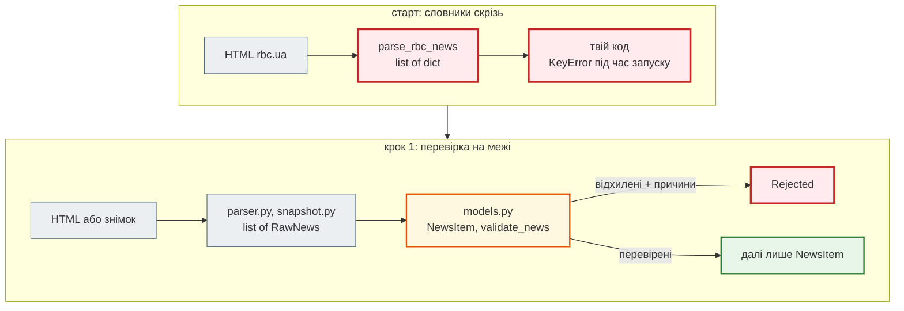

# Крок 1. Типи і Pydantic

> **Код кроку:** [`steps/01_typing_pydantic`](https://github.com/NikoriakViktor/news_hub/tree/main/steps/01_typing_pydantic).
>
> **Передумови:** функції, словники, класи й `@classmethod`, винятки, pytest; що таке клієнт, сервер і API — [Крок 0](../00_first_api/index.md). Код News Hub починається тут.

## Де ми зараз { #where }

Книга будує **новинний агрегатор** News Hub: парсер стрічки новин, який крок за кроком обростає API, базою, кешем, підсумками від LLM, Telegram-ботом і Docker. Кожен наступний крок — рефакторинг попереднього.

Починаємо не з нуля. Є робочий стартовий парсер rbc.ua — функція `parse_rbc_news(html) -> list[dict]` без жодної анотації типу — і 168 новин, які вона зібрала (`data/rbc_news_snapshot.json`). Парсер шукає на сторінці контейнери новин, а якщо їх немає — посилання `/news/` з текстом «14:19 Заголовок». Кожна новина — словник з п'ятьма рядками: `title`, `url`, `category`, `description`, `datetime`.

!!! note "Звідки дані"
    Сайт `www.rbc.ua` доступний не з кожної мережі, тому агрегатор працює на **знімку** — 168 новинах, які `parse_rbc_news` зібрала раніше. Код парсера той самий; як запустити його на свіжій сторінці — у розділі [Запуск](#run).

## Проблема { #problem }

Парсер повертає `list[dict]`, а словник нічого не гарантує:

- ключ може бути з одруківкою: `item["titel"]` — це `KeyError`, і дізнаєшся ти про нього лише тоді, коли рядок виконається, тобто в найгірший момент: у роботі, на справжніх даних;
- значення — порожнім рядком: у знімку `category` і `description` порожні **в усіх** 168 новин;
- «дата» — це лише `"14:19"` або `""`;
- URL — з чужого домену чи піддомену, і код, що «ріже» його рядком, тихо помиляється.

Потрібні дві речі: щоб помилки в **коді** знаходились до запуску і щоб помилки в **даних** не проходили далі парсера.

## Що додаємо { #what }

Два рефакторинги стартового коду: **анотації типів** (їх перевіряє `mypy` до запуску) і **Pydantic-модель** `NewsItem` (вона перевіряє дані під час роботи). Pydantic — фундамент FastAPI: у кроці 2 ця сама модель стане відповіддю API.

| Що | Де | Розділ |
|---|---|---|
| анотації всіх функцій парсера, `list[dict]` → `list[RawNews]` (`TypedDict`), `mypy` | `news_hub/parser.py`, `examples/` | [Анотації типів і `TypedDict`](type_hints_typeddict.md) |
| модель `NewsItem`: `Field`, `HttpUrl`, `Literal`, валідатори, `frozen`, JSON і JSON Schema | `news_hub/models.py` | [Pydantic: модель `NewsItem`](newsitem_model.md) |
| `validate_news` і `Rejected`: перевірені окремо, відхилені з причинами; знімок через `TypeAdapter` | `news_hub/models.py`, `news_hub/snapshot.py` | [Межа довіри](trust_boundary.md) |

## Архітектура: було → стало { #architecture }



- **Межа довіри.** Усе, що прийшло ззовні (HTML, файл, згодом — тіло HTTP-запиту), — «сире»: `RawNews`, лише рядки. Перевірка відбувається **один раз** — у `NewsItem`. Далі код працює з гарантіями.
- **Два інструменти — два моменти.** `mypy` ловить помилки в *коді* до запуску; Pydantic — помилки в *даних* під час роботи.
- **Нічого не губиться мовчки.** `validate_news` повертає не лише перевірені новини, а й відхилені з причинами.

## Файли кроку { #files }

| Файл | Що в ньому | Новий? |
|---|---|---|
| [`news_hub/parser.py`](https://github.com/NikoriakViktor/news_hub/blob/main/steps/01_typing_pydantic/news_hub/parser.py) | стартовий `parse_rbc_news` з анотаціями, `RawNews` (`TypedDict`), дві стратегії розбору окремими функціями | стартовий, змінений |
| [`news_hub/models.py`](https://github.com/NikoriakViktor/news_hub/blob/main/steps/01_typing_pydantic/news_hub/models.py) | `NewsItem`, `Rejected`, `validate_news`, словники `CATEGORIES` і `LANGS` | новий |
| [`news_hub/snapshot.py`](https://github.com/NikoriakViktor/news_hub/blob/main/steps/01_typing_pydantic/news_hub/snapshot.py) | `load_snapshot` — знімок через `TypeAdapter(list[RawNews])` | новий |
| [`data/rbc_news_snapshot.json`](https://github.com/NikoriakViktor/news_hub/blob/main/steps/01_typing_pydantic/data/rbc_news_snapshot.json) | 168 новин, зібраних `parse_rbc_news` | стартовий |
| [`examples/before_dict.py`](https://github.com/NikoriakViktor/news_hub/blob/main/steps/01_typing_pydantic/examples/before_dict.py), [`after_typed.py`](https://github.com/NikoriakViktor/news_hub/blob/main/steps/01_typing_pydantic/examples/after_typed.py) | ті самі помилки з `dict` і з типами — що бачить `mypy` | новий |
| [`tests/test_models.py`](https://github.com/NikoriakViktor/news_hub/blob/main/steps/01_typing_pydantic/tests/test_models.py) | 10 тестів: поля з URL, піддомен, `None`, неправильні значення, `frozen`, `validate_news`, знімок | новий |
| [`tests/test_parser.py`](https://github.com/NikoriakViktor/news_hub/blob/main/steps/01_typing_pydantic/tests/test_parser.py) | 2 тести: обидві стратегії парсера | новий |
| [`requirements.txt`](https://github.com/NikoriakViktor/news_hub/blob/main/steps/01_typing_pydantic/requirements.txt), [`pytest.ini`](https://github.com/NikoriakViktor/news_hub/blob/main/steps/01_typing_pydantic/pytest.ini) | `pydantic`, `beautifulsoup4`, `pytest`, `mypy`, `typing-extensions`; `pythonpath = .` | новий |

## Порядок читання { #reading-order }

1. [Анотації типів і `TypedDict`](type_hints_typeddict.md) — що є в даних, `RawNews`, що бачить `mypy`, а що ні.
2. [Pydantic: модель `NewsItem`](newsitem_model.md) — поля, обмеження, валідатори, `ValidationError`, JSON Schema.
3. [Межа довіри](trust_boundary.md) — `validate_news`, `Rejected`, знімок через `TypeAdapter`, тести.
4. [Контрольна точка](checkpoint.md) — перевірка, практика, самоперевірка.

Теорія до кроку — [Частина II. Типи і Pydantic](../../02_typing_and_pydantic/README.md).

## Запуск { #run }

З папки кроку `steps/01_typing_pydantic`:

```bash
pip install -r requirements.txt
pytest -q                   # 12 passed
mypy --strict news_hub      # Success: no issues found in 4 source files
python -c "from news_hub.snapshot import load_snapshot; from news_hub.models import validate_news; print([len(x) for x in validate_news(load_snapshot())])"
```

Остання команда друкує `[168, 0]`: 168 перевірених новин, 0 відхилених.

Свіжа стрічка — коли `www.rbc.ua` доступний з твоєї мережі. Вивід тут не наводимо: він залежить від того, що сьогодні на сайті.

```python
import requests
from news_hub.parser import parse_rbc_news
from news_hub.models import validate_news

html = requests.get("https://www.rbc.ua/ukr/news/", headers={"User-Agent": "EduScraper/1.0"}, timeout=15).text
valid, rejected = validate_news(parse_rbc_news(html))
```

`requests` не входить у `requirements.txt` кроку: встанови його окремо (`pip install requests`), якщо хочеш спробувати.

## Що далі { #next }

[Крок 2. Перший API на FastAPI](../02_fastapi_basics/index.md): агрегатор поки що — бібліотека, доступна лише з Python. Крок 2 віддасть перевірені `NewsItem` по HTTP: `GET /api/news`, `POST /api/scrape`, опис API в `/docs` з тієї самої JSON Schema.
