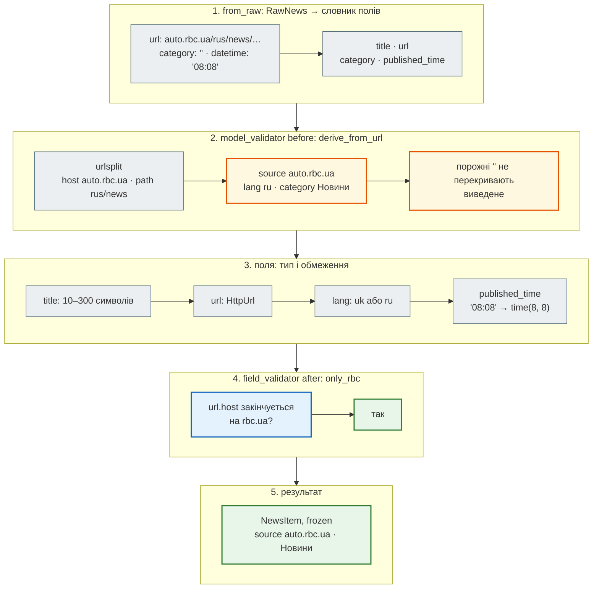

# Pydantic: модель `NewsItem`

> Крок 1 · розділ 2 з 3. Код: [`news_hub/models.py`](https://github.com/NikoriakViktor/news_hub/blob/main/steps/01_typing_pydantic/news_hub/models.py).
> Теорія: [Моделі Pydantic 2](../../02_typing_and_pydantic/pydantic_models.md), [Валідатори](../../02_typing_and_pydantic/validators.md), [URL і дати](../../02_typing_and_pydantic/special_types.md), [`ConfigDict`](../../02_typing_and_pydantic/config_dict.md).

## Задача { #task }

`RawNews` описує форму новини для `mypy`, але під час роботи це звичайний словник: `{"title": 42, "url": None}` пройде без жодного слова. Потрібен об'єкт, який **або перевірений, або не створений**:

- `title` — від 10 до 300 символів, без пробілів по краях;
- `url` — справжній URL і саме з rbc.ua;
- `source`, `lang`, `category` — заповнені, хоча в HTML їх немає (у знімку `category` порожня в усіх 168 новинах);
- `published_time` — справжній час або `None`, а не рядок `"14:19"` чи `""`;
- після перевірки об'єкт не можна випадково зіпсувати.

## Зміна: модель `NewsItem` { #change }

**Pydantic** — бібліотека, яка перетворює анотації типів на **перевірку**: клас-модель описує поля й типи, а створення об'єкта або перевіряє й приводить дані, або кидає `ValidationError` з поясненням за полями.

```python title="news_hub/models.py — NewsItem"
# Розділ сайту в URL → назва категорії
CATEGORIES: dict[str, str] = {
    "news": "Новини", "economic": "Економіка", "economics": "Економіка",
    "politics": "Політика", "society": "Суспільство", "sport": "Спорт",
    "world": "Світ", "technology": "Технології",
}
LANGS: dict[str, Literal["uk", "ru"]] = {"ukr": "uk", "rus": "ru"}


class NewsItem(BaseModel):
    model_config = ConfigDict(str_strip_whitespace=True, frozen=True)

    title: str = Field(min_length=10, max_length=300)
    url: HttpUrl
    source: str                      # домен без www: rbc.ua, auto.rbc.ua
    lang: Literal["uk", "ru"]        # з першої частини шляху: /ukr/ або /rus/
    category: str                    # з розділу в шляху: /ukr/news/ → «Новини»
    published_time: time | None = None

    @model_validator(mode="before")
    @classmethod
    def derive_from_url(cls, data: Any) -> Any:
        """source, lang і category, яких немає в HTML, беремо з URL — розбираючи його, а не рядком."""
        if not isinstance(data, dict) or not isinstance(data.get("url"), str):
            return data
        parts = urlsplit(data["url"])
        path = [segment for segment in parts.path.split("/") if segment]
        derived: dict[str, Any] = {"source": (parts.hostname or "").removeprefix("www.")}
        if path and path[0] in LANGS:
            derived["lang"] = LANGS[path[0]]
        if len(path) > 1:
            derived["category"] = CATEGORIES.get(path[1], path[1].capitalize())
        return derived | {key: value for key, value in data.items() if value not in (None, "")}

    @field_validator("url")
    @classmethod
    def only_rbc(cls, url: HttpUrl) -> HttpUrl:
        if not (url.host or "").endswith("rbc.ua"):
            raise ValueError("очікуємо новину з rbc.ua")
        return url

    @classmethod
    def from_raw(cls, raw: RawNews) -> "NewsItem":
        """Сирий рядок парсера → модель. Поле datetime зі стрічки — це лише «HH:MM»."""
        return cls.model_validate({"title": raw["title"], "url": raw["url"],
                                   "category": raw["category"], "published_time": raw["datetime"]})
```

| Інструмент | Що робить у `NewsItem` |
|---|---|
| анотація поля | тип і приведення: `"14:19"` → `time(14, 19)`, рядок → `HttpUrl` |
| `Field(min_length=10, max_length=300)` | обмеження значення |
| `Literal["uk", "ru"]` | лише дозволені значення |
| `field_validator("url")` | власне правило для одного поля — **після** перевірки типу: `url` уже `HttpUrl`, тож є `url.host` |
| `model_validator(mode="before")` | обробка **сирих** даних до перевірки полів: виводимо `source`, `lang`, `category` з URL |
| `str_strip_whitespace=True` | обрізати пробіли в усіх рядках |
| `frozen=True` | модель не можна змінити після створення |
| `@classmethod from_raw` | «альтернативний конструктор»: перейменовує `datetime` → `published_time`, відкидає `description` |

Три деталі, які легко пропустити:

- **`mode="before"`, а не `"after"`.** На етапі перевірки полів `source`, `lang` і `category` ще немає. Після перевірки (`mode="after"`) модель без обов'язкових полів просто не створилася б — отже, виводити їх треба раніше.
- **`derived | {…непорожні…}`.** Значення, що прийшли непорожніми, мають пріоритет над виведеними з URL. А порожній рядок `""` відкидається: `category=""` з HTML не перекриває «Новини», а `published_time=""` не потрапляє в модель — і поле отримує значення за замовчуванням `None`.
- **`CATEGORIES.get(path[1], path[1].capitalize())`.** Відомий розділ — українська назва, невідомий — сам розділ з великої літери: `/ukr/kyiv/…` → `Kyiv`. Словник категорій узято з першого прототипу агрегатора.

Як це працює покроково — на справжній новині зі знімка, тій самій з піддомену `auto.rbc.ua`:



```python
from news_hub.models import NewsItem
from news_hub.snapshot import load_snapshot

raw = [r for r in load_snapshot() if "auto." in r["url"]][0]
print(raw)
print(repr(NewsItem.from_raw(raw)))
```

```text
{'title': 'Спека VS авто: як високі температури ламають вашу машину', 'url': 'https://auto.rbc.ua/rus/news/speka-pislya-holodiv-ryatuemo-vid-rizikiv-1778085857.html', 'category': '', 'description': '', 'datetime': '08:08'}
NewsItem(title='Спека VS авто: як високі температури ламають вашу машину', url=HttpUrl('https://auto.rbc.ua/rus/news/speka-pislya-holodiv-ryatuemo-vid-rizikiv-1778085857.html'), source='auto.rbc.ua', lang='ru', category='Новини', published_time=datetime.time(8, 8))
```

Будь-яка помилка на кроках 3–4 додається до однієї `ValidationError`; модель створюється, лише якщо помилок немає.

## Результат: справжня новина і зіпсовані дані { #result }

Перевіримо на справжній новині зі знімка, на зіпсованих даних і на спробі змінити перевірений об'єкт:

```python
from pydantic import ValidationError

from news_hub.models import NewsItem
from news_hub.snapshot import load_snapshot

raw_news = load_snapshot()
item = NewsItem.from_raw(raw_news[1])
print(repr(item))
print(item.model_dump_json())

broken = {"title": "Коротко", "url": "https://example.com/ukr/news/x.html",
          "category": "", "description": "", "datetime": "25:99"}
try:
    NewsItem.from_raw(broken)
except ValidationError as error:
    print(error.error_count(), "помилки:")
    for e in error.errors():
        print("  ", e["loc"][0], "→", e["msg"])

try:
    item.title = "Інший заголовок новини"
except ValidationError as error:
    print("frozen →", error.errors()[0]["msg"])
```

```text
NewsItem(title='У Путіна заявили, що вихід на мирну угоду з Україною "займе багато часу"', url=HttpUrl('https://www.rbc.ua/rus/news/putina-zayavili-shcho-vihid-mirnu-ugodu-ukrayinoyu-1778325455.html'), source='rbc.ua', lang='ru', category='Новини', published_time=datetime.time(14, 19))
{"title":"У Путіна заявили, що вихід на мирну угоду з Україною \"займе багато часу\"","url":"https://www.rbc.ua/rus/news/putina-zayavili-shcho-vihid-mirnu-ugodu-ukrayinoyu-1778325455.html","source":"rbc.ua","lang":"ru","category":"Новини","published_time":"14:19:00"}
3 помилки:
   title → String should have at least 10 characters
   url → Value error, очікуємо новину з rbc.ua
   published_time → Input should be in a valid time format, hour value is outside expected range of 0-23
frozen → Instance is frozen
```

- `published_time` — справжній `datetime.time`, у JSON — `"14:19:00"`; `source`, `lang` і `category` Pydantic вивів з URL;
- одна `ValidationError` зібрала **всі** три помилки, а не лише першу — для клієнта API це список того, що виправити;
- помилка з `only_rbc` має префікс `Value error, …`: так Pydantic позначає `ValueError` з власного валідатора;
- `frozen=True`: перевірений об'єкт уже не зіпсуєш випадковим присвоєнням.

Як читати `ValidationError` і показати її людині — [у теорії](../../02_typing_and_pydantic/validation_error.md#structure).

## `str_strip_whitespace` і `model_dump` { #dump }

Заголовок у HTML часто з пробілами й переносами по краях. `str_strip_whitespace=True` обрізає їх у **всіх** рядкових полях до перевірки довжини:

```python
item = NewsItem.model_validate({"title": "   Уряд затвердив новий бюджет   ",
                                "url": "https://www.rbc.ua/ukr/news/budget-1.html", "published_time": "14:19"})
print(repr(item.title))
print(item.model_dump())
print(item.model_dump(mode="json"))
```

```text
'Уряд затвердив новий бюджет'
{'title': 'Уряд затвердив новий бюджет', 'url': HttpUrl('https://www.rbc.ua/ukr/news/budget-1.html'), 'source': 'rbc.ua', 'lang': 'uk', 'category': 'Новини', 'published_time': datetime.time(14, 19)}
{'title': 'Уряд затвердив новий бюджет', 'url': 'https://www.rbc.ua/ukr/news/budget-1.html', 'source': 'rbc.ua', 'lang': 'uk', 'category': 'Новини', 'published_time': '14:19:00'}
```

| Метод | Що повертає |
|---|---|
| `model_dump()` | словник з Python-об'єктами: `HttpUrl`, `datetime.time` |
| `model_dump(mode="json")` | словник лише з JSON-типами: рядки замість `HttpUrl` і `time` |
| `model_dump_json()` | одразу рядок JSON |

`model_dump()` без `mode="json"` не можна просто передати в `json.dumps`: `json.dumps(item.model_dump())` падає з `TypeError: Object of type HttpUrl is not JSON serializable`. Докладніше — [у теорії](../../02_typing_and_pydantic/pydantic_models.md#dump).

## JSON Schema: опис моделі для інших програм { #json-schema }

З моделі Pydantic будує **JSON Schema** — машинний опис полів і обмежень. FastAPI вставить його у `/docs` і OpenAPI-схему ([крок 2](../02_fastapi_basics/index.md)), клієнт іншою мовою згенерує з нього свої класи:

```python
schema = NewsItem.model_json_schema()
print(schema["required"])
print(schema["properties"]["title"])
print(schema["properties"]["lang"])
print(schema["properties"]["published_time"])
```

```text
['title', 'url', 'source', 'lang', 'category']
{'maxLength': 300, 'minLength': 10, 'title': 'Title', 'type': 'string'}
{'enum': ['uk', 'ru'], 'title': 'Lang', 'type': 'string'}
{'anyOf': [{'format': 'time', 'type': 'string'}, {'type': 'null'}], 'default': None, 'title': 'Published Time'}
```

Схема знає про `Field`, `Literal` і `| None`, але **не знає** про `derive_from_url` і `only_rbc`: власні валідатори — код, а не опис. Тому в схемі `source`, `lang`, `category` — обов'язкові, хоча `from_raw` їх не передає, а обмеження «лише rbc.ua» в ній немає.

!!! tip "Поглиблено"
    Pydantic: [Models](https://docs.pydantic.dev/latest/concepts/models/), [Fields](https://docs.pydantic.dev/latest/concepts/fields/), [Validators](https://docs.pydantic.dev/latest/concepts/validators/), [JSON Schema](https://docs.pydantic.dev/latest/concepts/json_schema/). Pydantic-схеми в Django — глава книги [Django Ninja](https://nikoriakviktor.github.io/notes_chat_app/06_application_architecture/django_ninja_templates_full/).

## Правило { #rule }

!!! tip "Правило"
    Опиши правила даних у моделі — типами, `Field`, валідаторами, — а не `if`-ами там, де дані використовують. Тоді `NewsItem` або створюється перевіреним, або не створюється взагалі, а `ValidationError` одразу каже про **всі** порушення.

**Далі:** [Межа довіри](trust_boundary.md) — що робити з новинами, які перевірку не пройшли.
