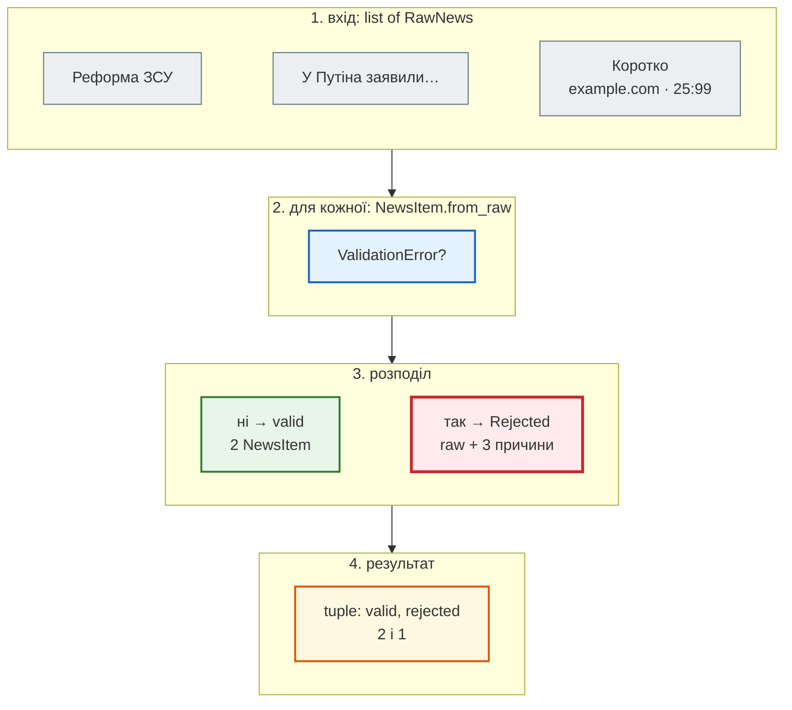
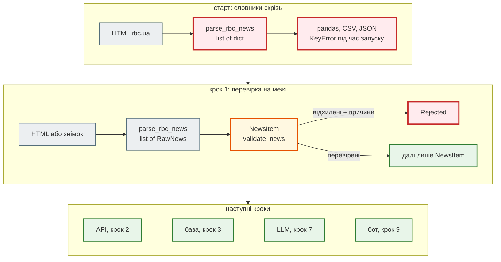

# Межа довіри

> Крок 1 · розділ 3 з 3. Код: [`news_hub/models.py`](https://github.com/NikoriakViktor/news_hub/blob/main/steps/01_typing_pydantic/news_hub/models.py), [`news_hub/snapshot.py`](https://github.com/NikoriakViktor/news_hub/blob/main/steps/01_typing_pydantic/news_hub/snapshot.py), [`tests/`](https://github.com/NikoriakViktor/news_hub/tree/main/steps/01_typing_pydantic/tests).
> Теорія: [`ValidationError`: структура і як показати людині](../../02_typing_and_pydantic/validation_error.md), [Валідатори](../../02_typing_and_pydantic/validators.md).

## Задача { #task }

`NewsItem` уміє перевірити **одну** новину. Але парсер повертає їх десятки, і серед них можуть бути погані. Що з ними робити?

- Пропустити мовчки (`try: … except: continue`) — і ніхто не дізнається, що парсер зламався, коли сайт змінив розмітку.
- Впасти на першій поганій — і втратити всі добрі.

Потрібно третє: перевірені — окремо, відхилені — окремо **з причинами**. Відхилене можна показати, записати в журнал чи порахувати. І так само перевіряти будь-яке джерело «сирих» новин, зокрема файл знімка.

## Зміна 1: `validate_news` і `Rejected` { #validate-news }

Парсер відсіює лише посилання, що точно не новини (текст коротший за 10 символів — пункти меню на кшталт «Новини»). Усе інше перевіряє `NewsItem`, а `validate_news` розділяє результат:

```python title="news_hub/models.py — Rejected і validate_news"
class Rejected(BaseModel):
    """Новина, яку не пропустила перевірка, і чому."""
    raw: RawNews
    errors: list[str]


def validate_news(raw_items: list[RawNews]) -> tuple[list[NewsItem], list[Rejected]]:
    """Розділяє сирі новини на перевірені й відхилені — нічого не губиться мовчки."""
    valid: list[NewsItem] = []
    rejected: list[Rejected] = []
    for raw in raw_items:
        try:
            valid.append(NewsItem.from_raw(raw))
        except ValidationError as error:
            messages = [f"{'.'.join(map(str, e['loc'])) or 'item'}: {e['msg']}" for e in error.errors()]
            rejected.append(Rejected(raw=raw, errors=messages))
    return valid, rejected
```

| Запис | Що означає |
|---|---|
| `-> tuple[list[NewsItem], list[Rejected]]` | функція завжди повертає дві частини; mypy не дасть забути про другу |
| `except ValidationError` | ловимо **лише** помилки перевірки; інший виняток (баг у коді) не маскується |
| `'.'.join(map(str, e['loc']))` | шлях до поля: `title`, а для вкладених — `raw.url`; порожній `loc` (помилка всієї моделі) → `item` |
| `Rejected(raw=raw, …)` | сирі дані зберігаються як є — видно, *що саме* прийшло |
| `raw: RawNews` у Pydantic-моделі | `TypedDict` може бути полем моделі: Pydantic перевірить і його ключі |

Покроково — на двох справжніх новинах зі знімка і одній зіпсованій:



## Результат: увесь знімок і зіпсовані дані { #result }

```python
from collections import Counter

from news_hub.models import validate_news
from news_hub.snapshot import load_snapshot

raw_news = load_snapshot()
valid, rejected = validate_news(raw_news)
print("перевірених:", len(valid), "| відхилених:", len(rejected))
print(Counter((n.source, n.lang, n.category) for n in valid))
print("без часу публікації:", sum(n.published_time is None for n in valid))

broken = {"title": "Коротко", "url": "https://example.com/ukr/news/x.html",
          "category": "", "description": "", "datetime": "25:99"}
valid, rejected = validate_news(raw_news[:2] + [broken])
print(len(valid), "перевірених;", rejected[0].errors)
```

```text
перевірених: 168 | відхилених: 0
Counter({('rbc.ua', 'ru', 'Новини'): 137, ('rbc.ua', 'uk', 'Новини'): 30, ('auto.rbc.ua', 'ru', 'Новини'): 1})
без часу публікації: 31
2 перевірених; ['title: String should have at least 10 characters', 'url: Value error, очікуємо новину з rbc.ua', 'published_time: Input should be in a valid time format, hour value is outside expected range of 0-23']
```

Увесь знімок пройшов перевірку — стартовий парсер збирав коректні новини. Але тепер це **доведено** кодом і тестом `test_snapshot_is_valid`, а не припущено. А 31 новина без часу — та сама 31 з порожнім `datetime` з [розділу 1](type_hints_typeddict.md#task): тепер це `None`, і `mypy` змушує його обробити.

`Rejected` — теж модель, тож її можна віддати як JSON:

```python
_, rejected = validate_news([{"title": "Коротко", "url": "https://www.rbc.ua/ukr/news/x.html",
                              "category": "", "description": "", "datetime": ""}])
print(rejected[0].model_dump())
```

```text
{'raw': {'title': 'Коротко', 'url': 'https://www.rbc.ua/ukr/news/x.html', 'category': '', 'description': '', 'datetime': ''}, 'errors': ['title: String should have at least 10 characters']}
```

## Зміна 2: знімок теж перевіряється — `TypeAdapter` { #type-adapter }

Знімок — це теж дані ззовні: файл можна відредагувати руками чи зберегти іншою версією парсера. `TypedDict` Pydantic уміє перевірити без моделі — через `TypeAdapter`. Так `snapshot.py` перевіряє структуру файлу, перш ніж віддати його далі:

```python title="news_hub/snapshot.py"
SNAPSHOT = Path(__file__).resolve().parent.parent / "data" / "rbc_news_snapshot.json"
_RAW_LIST = TypeAdapter(list[RawNews])       # TypedDict теж можна перевірити Pydantic-ом


def load_snapshot(path: Path = SNAPSHOT) -> list[RawNews]:
    """JSON-файл → список RawNews; неправильна структура файлу — ValidationError."""
    return _RAW_LIST.validate_python(json.loads(path.read_text(encoding="utf-8")))
```

- `TypeAdapter(list[RawNews])` створюється **один раз** на рівні модуля: побудова схеми перевірки — дорожча за саму перевірку.
- `SNAPSHOT` рахується від файлу `snapshot.py`, а не від поточної папки: `load_snapshot()` працює, звідки б не запустили код.

Файл без ключа `description` і з числом замість рядка в `datetime`:

```python
import json, tempfile
from pathlib import Path

from pydantic import ValidationError

from news_hub.snapshot import load_snapshot

bad = Path(tempfile.mkdtemp()) / "bad.json"
bad.write_text(json.dumps([{"title": "Заголовок новини", "url": "https://www.rbc.ua/ukr/news/a.html",
                            "category": "", "datetime": 1419}]), encoding="utf-8")
try:
    load_snapshot(bad)
except ValidationError as error:
    print(error.error_count(), "помилки")
    for e in error.errors():
        print("  ", e["loc"], "→", e["msg"])
```

```text
2 помилки
   (0, 'description') → Field required
   (0, 'datetime') → Input should be a valid string
```

`loc` тепер починається з індексу в списку: `(0, 'description')` — нульовий запис, ключ `description`. Для `RawNews` перевіряються лише **форма** й типи (усі — рядки); правила новини (довжина заголовка, домен) — справа `NewsItem`.

## Архітектура: межа довіри { #architecture }



- **Межа довіри.** Усе, що прийшло ззовні (HTML, файл, тіло запиту), — «сире» (`RawNews`, лише рядки). Перевірка відбувається **один раз** — у `NewsItem`. Далі код працює з гарантіями: `url` — справжній URL з rbc.ua, `lang` — `"uk"` або `"ru"`, `published_time` — `time` або `None`.
- **Два інструменти — два моменти.** `mypy` ловить помилки в *коді* до запуску; Pydantic — помилки в *даних* під час роботи. Одне не замінює інше.
- **Модель — контракт.** API ([крок 2](../02_fastapi_basics/index.md)), база ([крок 3](../03_sqlalchemy_alembic/index.md)), LLM ([крок 7](../07_llm_api/index.md)) і бот ([крок 9](../09_telegram_bot/index.md)) отримуватимуть `NewsItem`, а не словник: змінимо модель — mypy і тести покажуть усі місця, які це зачепило.

## Межа ще не ідеальна { #not-yet }

Перевірка `only_rbc` — `url.host.endswith("rbc.ua")`. Вона пропускає піддомени (`auto.rbc.ua` — так і треба), але й чужий домен, що просто закінчується на ці літери:

```python
NewsItem.model_validate({"title": "Заголовок для перевірки", "url": "https://fakerbc.ua/ukr/news/x.html"})
```

Новина створюється без помилки: `fakerbc.ua` закінчується на `rbc.ua`. Поки дані приходять лише з нашого парсера, це не біда. Коли адреси почне надсилати клієнт API, це стане діркою — її знайде покриття гілок тестами в [кроці 5](../05_api_testing/index.md).

## Тести і mypy { #tests }

| Тест | Що закріплює |
|---|---|
| `test_fields_derived_from_url` | `source`, `lang`, `category` з URL; `"14:19"` → `time` |
| `test_subdomain_is_parsed_not_replaced` | `auto.rbc.ua` → `source="auto.rbc.ua"`, а не зіпсована категорія |
| `test_empty_time_is_none` | `datetime=""` → `published_time is None` |
| `test_invalid_values` (4 випадки) | короткий заголовок, чужий домен, не URL, `25:99` — помилка саме в потрібному полі |
| `test_model_is_frozen` | присвоєння → `ValidationError` |
| `test_validate_news_keeps_rejected` | одна перевірена, одна відхилена з причиною `title:` |
| `test_snapshot_is_valid` | увесь знімок: `(168, 0)` |
| `test_containers_strategy`, `test_links_strategy_splits_time` | обидві стратегії парсера на демо-розмітці |

```text
$ pytest -q -p no:cacheprovider
............                                                             [100%]
12 passed in 0.13s
$ mypy --strict news_hub
Success: no issues found in 4 source files
```

Час виконання залежить від машини.

## Правило { #rule }

!!! tip "Правило"
    Дані ззовні — «сирі». Перевіряй їх **один раз** на вході, далі передавай лише моделі. А те, що перевірку не пройшло, не викидай мовчки: поверни разом з причинами, щоб це можна було побачити й виправити.

**Далі:** [Контрольна точка](checkpoint.md) — тести, практика, самоперевірка.
