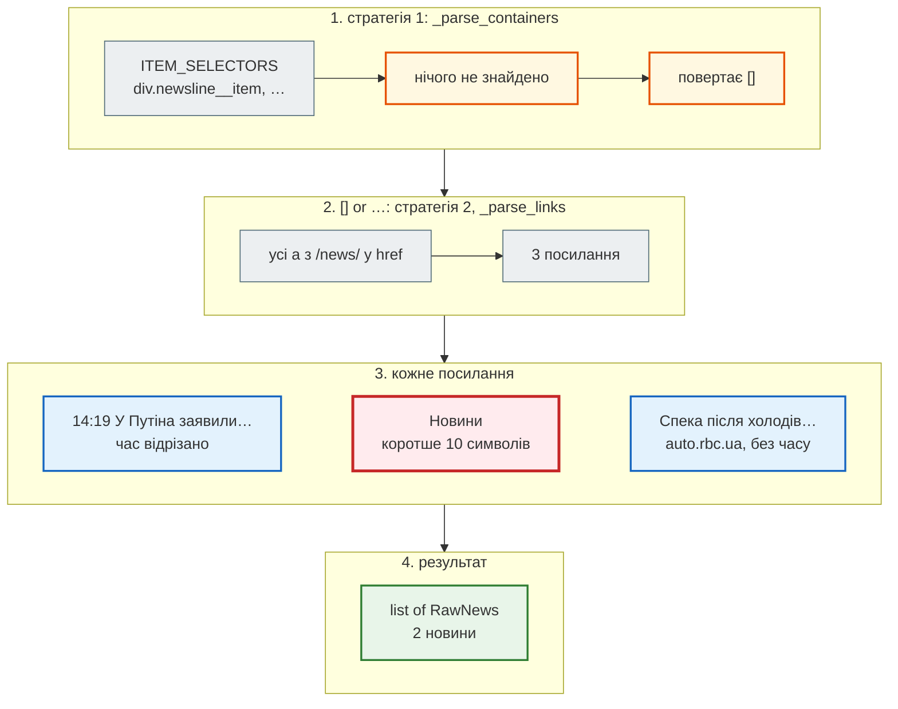

# Анотації типів і `TypedDict`

> Крок 1 · розділ 1 з 3. Код: [`news_hub/parser.py`](https://github.com/NikoriakViktor/news_hub/blob/main/steps/01_typing_pydantic/news_hub/parser.py), [`examples/`](https://github.com/NikoriakViktor/news_hub/tree/main/steps/01_typing_pydantic/examples).
> Теорія: [Анотації типів: що читає FastAPI, а що лише mypy](../../02_typing_and_pydantic/type_hints.md).

## Задача { #task }

Перш ніж щось типізувати, подивимось, що стартовий парсер **насправді** зібрав. У Python-консолі з папки `steps/01_typing_pydantic`:

```python
import json
from collections import Counter
from urllib.parse import urlsplit

news = json.loads(open("data/rbc_news_snapshot.json", encoding="utf-8").read())
print("новин:", len(news), "| ключі:", list(news[0]))
print("перша:", news[1])
print("порожніх category:", sum(not n["category"] for n in news),
      "| description:", sum(not n["description"] for n in news),
      "| datetime:", sum(not n["datetime"] for n in news))
print("формати datetime:", Counter(len(n["datetime"]) for n in news))
print("домени:", Counter(urlsplit(n["url"]).hostname for n in news))
print("шляхи:", Counter("/".join(urlsplit(n["url"]).path.split("/")[1:3]) for n in news))
```

```text
новин: 168 | ключі: ['title', 'url', 'category', 'description', 'datetime']
перша: {'title': 'У Путіна заявили, що вихід на мирну угоду з Україною "займе багато часу"', 'url': 'https://www.rbc.ua/rus/news/putina-zayavili-shcho-vihid-mirnu-ugodu-ukrayinoyu-1778325455.html', 'category': '', 'description': '', 'datetime': '14:19'}
порожніх category: 168 | description: 168 | datetime: 31
формати datetime: Counter({5: 137, 0: 31})
домени: Counter({'www.rbc.ua': 167, 'auto.rbc.ua': 1})
шляхи: Counter({'rus/news': 138, 'ukr/news': 30})
```

Висновки з реальних даних:

- `category` і `description` **порожні завжди** — стрічка їх не містить; категорію й мову доведеться виводити з URL (`/rus/news/…`);
- `datetime` — або `""` (31 новина), або лише час `"HH:MM"` без дати (137);
- одна новина — з піддомену `auto.rbc.ua`: код, що «ріже» URL рядком, на ній помилиться (див. [«Знайди помилку»](checkpoint.md#find-bug)).

Із `list[dict]` усе це з'ясовується лише під час запуску. Задача розділу — описати форму новини так, щоб помилки в коді, який з нею працює, знаходились **до** запуску.

## Зміна 1: анотації типів { #annotations }

**Анотація типу** — підказка в коді, якого типу змінна, параметр чи результат: `def headline(item: RawNews) -> str`. Python її **не перевіряє** під час роботи; перевіряє окрема програма — **mypy** — до запуску, як лінтер.

| Запис | Що означає | Приклад з агрегатора |
|---|---|---|
| `str`, `int`, `bool` | простий тип | `title: str` |
| `list[str]` | список рядків | `ITEM_SELECTORS: list[tuple[str, str]]` |
| `dict[str, str]` | словник: ключ → значення | `CATEGORIES: dict[str, str]` |
| `set[str]` | множина | `seen_urls: set[str]` |
| <code>X &#124; None</code> | або `X`, або `None` | <code>published_time: time &#124; None</code>, <code>_find_tag(...) -&gt; Tag &#124; None</code> |
| `Literal["uk", "ru"]` | лише ці значення | `lang` |
| `TypedDict` | словник з **відомими** ключами й типами | `RawNews` |
| `Callable[[Tag], bool]` | функція: аргументи → результат | фільтр тегів у `_find_tag` |

## Зміна 2: `RawNews` замість `dict` { #rawnews }

Новина з парсера лишається словником — але тепер з **описаними** ключами:

```diff title="news_hub/parser.py (фрагмент)"
+class RawNews(TypedDict):
+    """Одна новина так, як її дає HTML: лише рядки, ще не перевірені."""
+    title: str
+    url: str
+    category: str
+    description: str
+    datetime: str
+
+
-def parse_rbc_news(html: str) -> list[dict]:
+def parse_rbc_news(html: str) -> list[RawNews]:
     """HTML сторінки rbc.ua → список сирих новин."""
     soup = BeautifulSoup(html, "html.parser")
-    news_list = []
-    seen_urls = set()
+    seen_urls: set[str] = set()
+    # Стратегія 2 — якщо контейнерів немає або вони нічого не дали
+    return _parse_containers(soup, seen_urls) or _parse_links(soup, seen_urls)
```

Що змінилося в `parser.py`, крім `RawNews`:

| Зміна | Навіщо |
|---|---|
| анотації всіх функцій і констант (`ITEM_SELECTORS: list[tuple[str, str]]`, `seen_urls: set[str]`) | `mypy --strict` перевіряє весь модуль |
| дві стратегії — окремі функції `_parse_containers` і `_parse_links` | кожну легше читати й тестувати; `parse_rbc_news` лише вибирає |
| пошук тегів — у <code>_find_tag(item, match) -&gt; Tag &#124; None</code> | `find()` у BeautifulSoup може повернути не `Tag`; `isinstance` один раз, а не в кожному місці |
| логіку розбору **не змінено** | рефакторинг підписів, а не поведінки: 168 новин знімка — ті самі |

Як працює вибір стратегії — на HTML з трьома посиланнями без контейнерів новин:



```python
from news_hub.parser import parse_rbc_news

html = ('<a href="/rus/news/putina-1778325455.html">14:19 У Путіна заявили про мирну угоду</a>'
        '<a href="/ukr/news/">Новини</a>'
        '<a href="https://auto.rbc.ua/rus/news/speka-1.html">Спека після холодів: як уберегтися</a>')
for n in parse_rbc_news(html):
    print(n)
```

```text
{'title': 'У Путіна заявили про мирну угоду', 'url': 'https://www.rbc.ua/rus/news/putina-1778325455.html', 'category': '', 'description': '', 'datetime': '14:19'}
{'title': 'Спека після холодів: як уберегтися', 'url': 'https://auto.rbc.ua/rus/news/speka-1.html', 'category': '', 'description': '', 'datetime': ''}
```

Парсер відсіює лише те, що точно не новина: текст коротший за 10 символів (пункт меню «Новини»). Решту перевіряє `NewsItem` — [наступний розділ](newsitem_model.md).

!!! warning "`TypedDict` і Pydantic на Python 3.10–3.11"
    `RawNews` імпортується з `typing_extensions`, а не з `typing`. Pydantic перевіряє `TypedDict` з `typing` лише на Python 3.12+. На Python 3.10 той самий клас з `from typing import TypedDict` у `TypeAdapter(list[RawNews])` дає:

    ```text
    pydantic.errors.PydanticUserError: Please use `typing_extensions.TypedDict` instead of `typing.TypedDict` on Python < 3.12.
    ```

    `typing_extensions` встановлюється разом із Pydantic і є в `requirements.txt` кроку. З ним усі 12 тестів проходять і на 3.10, і на 3.12.

## Результат: що бачить `mypy` { #mypy }

Логіка розбору не змінилася — змінилися підписи. Два приклади в `examples/` показують, що це дає. «Було» — функції, що працюють зі звичайним `dict`:

```python title="examples/before_dict.py"
def parse() -> list[dict]:
    return [{"title": "Реформа ЗСУ", "url": "https://www.rbc.ua/rus/news/reforma-zsu", "datetime": ""}]


def headline(item: dict) -> str:
    return item["titel"].upper()          # одруківка в ключі


def hour(item: dict) -> int:
    return int(item["datetime"][:2])      # "" → ValueError, але mypy мовчить
```

«Стало» — ті самі помилки з типами `RawNews` і `NewsItem`:

```python title="examples/after_typed.py"
from news_hub.models import NewsItem
from news_hub.parser import RawNews


def headline(item: RawNews) -> str:
    return item["titel"].upper()          # та сама одруківка


def hour(item: NewsItem) -> int:
    return item.published_time.hour       # у 31 новини часу немає (None)
```

```text
$ mypy examples/before_dict.py
Success: no issues found in 1 source file
$ mypy examples/after_typed.py
examples/after_typed.py:7: error: TypedDict "RawNews" has no key "titel"  [typeddict-item]
examples/after_typed.py:7: note: Did you mean "title"?
examples/after_typed.py:11: error: Item "None" of "time | None" has no attribute "hour"  [union-attr]
Found 2 errors in 1 file (checked 1 source file)
```

- для `dict` будь-який ключ «правильний» — mypy мовчить, помилка чекає на запуск;
- з `TypedDict` mypy знає ключі й навіть підказує `Did you mean "title"?`;
- `time | None` змушує обробити `None` — саме той випадок, який у реальних даних трапляється 31 раз.

Весь пакет перевіряється в найсуворішому режимі:

```text
$ mypy --strict news_hub
Success: no issues found in 4 source files
```

`--strict` вмикає найсуворіші перевірки: кожна функція має анотації, жодного неявного `Any`. Той самий `before_dict.py` під `--strict` уже не «чистий»: mypy вимагає аргументів у `dict` (`Missing type arguments for generic type "dict"  [type-arg]`) і помічає `Returning Any from function declared to return "str"  [no-any-return]` — тобто прямо каже, що `dict` без параметрів нічого не гарантує.

## Анотації — не перевірка під час роботи { #runtime }

Анотації — лише підказки. Під час роботи Python їх не перевіряє:

```python
from news_hub.parser import RawNews

item: RawNews = {"title": 42, "url": None, "category": "", "description": "", "datetime": ""}  # type: ignore
print(type(item), item["title"], item["url"])
```

```text
<class 'dict'> 42 None
```

`RawNews` під час роботи — звичайний `dict`. Дані з інтернету не читали нашого коду й анотацій — їх треба **перевіряти під час роботи**. Це робить Pydantic. Докладніше, що з анотацій бачить рантайм, а що лише mypy, — [у теорії](../../02_typing_and_pydantic/type_hints.md#runtime).

!!! tip "Поглиблено"
    [typing — Support for type hints](https://docs.python.org/3/library/typing.html), [mypy: Type hints cheat sheet](https://mypy.readthedocs.io/en/stable/cheat_sheet_py3.html), [TypedDict](https://docs.python.org/3/library/typing.html#typing.TypedDict), [PEP 604 (`X | None`)](https://peps.python.org/pep-0604/), [FastAPI: Python Types Intro](https://fastapi.tiangolo.com/python-types/) — навіщо FastAPI анотації.

## Правило { #rule }

!!! tip "Правило"
    Опиши форму даних типом (`TypedDict`, `X | None`, `Literal`), а не тримай її в голові. Тоді одруківку в ключі чи забутий `None` знайде `mypy` до запуску, а не `KeyError` у роботі. Але пам'ятай: анотації перевіряють **код**, а не **дані**.

**Далі:** [Pydantic: модель `NewsItem`](newsitem_model.md) — перевірка даних під час роботи.
