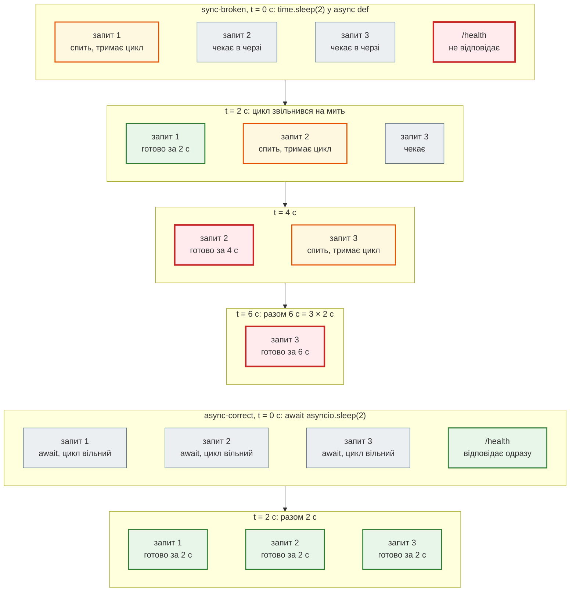

# Async чи blocking: виміри

> Крок 2 · розділ 5 з 5. Код: [`examples/fastapi_demo`](https://github.com/NikoriakViktor/news_hub/tree/main/examples/fastapi_demo).
> Теорія: [Частина IV. Async і конкурентність](../../04_async/README.md).

## Задача { #task }

Усі ендпоінти агрегатора — `async def`, а скрапер — на `aiohttp`, а не на звичному `requests`. Чому? Що станеться, якщо в `async def` викликати щось блокуюче? Це не тема для суперечки, а питання, на яке можна відповісти вимірами.

## Два способи виконати ендпоінт { #two-ways }

FastAPI приймає і `async def`, і звичайний `def`. Різниця — у тому, **хто** виконує функцію:

| Ендпоінт | Хто виконує | Що можна всередині |
|---|---|---|
| `async def` | **цикл подій** — один потік на всі запити | лише `await` чогось асинхронного; поки корутина чекає, цикл обслуговує інші запити |
| `def` | **пул потоків** (за замовчуванням 40) | блокуючий код: він займає свій потік, а не цикл подій |

Небезпечне поєднання — `async def` + блокуючий виклик (`time.sleep`, `requests.get`, синхронний драйвер бази). Функція займає цикл подій, і **весь сервер** чекає.

Покроково — три одночасні запити до ендпоінта, що «чекає 2 секунди», у двох варіантах:



## Дослід: `fastapi_demo` { #demo }

[`examples/fastapi_demo`](https://github.com/NikoriakViktor/news_hub/tree/main/examples/fastapi_demo) — окремий маленький застосунок: шість ендпоінтів, які роблять одне й те саме (чекають або рахують), але по-різному:

| Ендпоінт | Як написаний | Що з сервером |
|---|---|---|
| `/sync-broken` | `async def` + `time.sleep(2)` | цикл подій стоїть — запити йдуть по одному |
| `/sync-safe` | `def` + `time.sleep(2)` | FastAPI виконує в пулі потоків |
| `/async-correct` | `async def` + `await asyncio.sleep(2)` | усі запити чекають одночасно |
| `/cpu-broken` | `async def` + цикл обчислень | цикл подій стоїть на час обчислення |
| `/cpu-fixed` | `run_in_executor(ProcessPoolExecutor)` | обчислення в іншому процесі |
| `/db-sync-broken/{id}`, `/db-async-correct/{id}` | «синхронний драйвер бази» (1.5 с) без / з `run_in_executor` | те саме на прикладі бази |

```python title="examples/fastapi_demo/app/main.py (фрагменти)"
@app.get("/sync-broken")
async def sync_broken(request: Request):
    time.sleep(2)                     # займає цикл подій на 2 с


@app.get("/sync-safe")
def sync_safe(request: Request):
    time.sleep(2)                     # займає один потік з пулу, цикл вільний


@app.get("/async-correct")
async def async_correct(request: Request):
    await asyncio.sleep(2)            # віддає керування циклу на 2 с


@app.get("/db-async-correct/{user_id}")
async def db_async_correct(user_id: int):
    loop = asyncio.get_event_loop()
    user = await loop.run_in_executor(None, _sync_db_query, user_id)   # блокуючий виклик — у потік
```

Запуск з папки `examples/fastapi_demo`:

```bash
pip install -r app/requirements.txt aiohttp   # aiohttp — клієнт load_test.py
uvicorn app.main:app --port 8001
python load_test.py                           # в іншому терміналі: 5 тестів, Enter між ними
```

## Результат { #results }

Виміри з машини, де збирався курс (4 ядра, один процес uvicorn). На іншій машині числа будуть трохи інші, співвідношення — ті самі:

| Ендпоінт | Як написаний | Одночасних запитів | Загальний час |
|---|---|---:|---:|
| `/sync-broken` | `async def` + `time.sleep(2)` | 10 | 20.57 с |
| `/sync-broken` | те саме | 20 | 40.03 с |
| `/sync-safe` | `def` + `time.sleep(2)` | 20 | 2.03 с |
| `/async-correct` | `async def` + `await asyncio.sleep(2)` | 20 | 2.01 с |
| `/async-correct` | те саме | 500 | 2.21 с |
| `/db-sync-broken/1` | `async def` + синхронний «драйвер бази» (1.5 с) | 8 | 12.01 с |
| `/db-async-correct/1` | те саме через `run_in_executor` | 8 | 1.51 с |

Повторний вимір для книги (2026-11-11, WSL2, клієнт — aiohttp без ліміту з'єднань):

| Ендпоінт | Запитів | Час | Очікування |
|---|---:|---:|---|
| `/sync-broken` | 5 | 10.01 с | 5 × 2 с |
| `/sync-safe` | 20 | 2.04 с | ≈ 2 с |
| `/async-correct` | 20 | 2.01 с | ≈ 2 с |
| `/async-correct` | 500 | 2.13 с | ≈ 2 с |
| `/db-sync-broken/1` | 4 | 6.01 с | 4 × 1.5 с |
| `/db-async-correct/1` | 8 | 1.52 с | ≈ 1.5 с |

Поки йшли 10 запитів до `/sync-broken`, тест щосекунди питав `/health` — і шість разів поспіль не дочекався відповіді за 2 с. Сервер не відповідав **нікому**.

!!! warning "Спершу виміряй вимірювач"
    Клієнт навантажувального тесту — теж частина досліду. `httpx.AsyncClient` на сотнях одночасних з'єднань сам стає вузьким місцем: 500 запитів до миттєвого `/health` через httpx тривають 5.66 с, через aiohttp — 0.22 с. І тайм-аут клієнта має бути більшим за тривалість тесту (20 × 2 = 40 с). Інакше клієнт обриває запити, а сервер їх усе одно виконує й гальмує наступний вимір. Тому `load_test.py` написано на aiohttp без ліміту з'єднань, з тайм-аутом 60 с.

    Правило: коли вимір дивує, перевір, що ти вимірюєш. Клієнт, мережа й тайм-аути — теж частина досліду.

## Що це означає для агрегатора { #news-hub }

| У `news_hub` | Чому так |
|---|---|
| `scraper.py` — `aiohttp` з `await` | сторінки чекаються одночасно, цикл подій вільний; 7 сторінок — 0.4 с замість 1.6 с ([розділ 3](scrape_endpoint.md#live)) |
| ендпоінти `async def` без блокуючих викликів | `NewsStore` — словник у пам'яті, звертання миттєві |
| крок 3: драйвери `asyncpg` і `aiosqlite` | база теж має чекатися через `await`, інакше — `/db-sync-broken` |

Для CPU-задач (`/cpu-broken` → `/cpu-fixed` через `ProcessPoolExecutor`) і пулу з'єднань з базою — [Частина IV. Async](../../04_async/README.md).

## Правило { #rule }

!!! tip "Правило"
    У `async def` — лише `await` асинхронних бібліотек. Блокуючий код (`requests`, `time.sleep`, синхронний драйвер, важкі обчислення) — у `def`-ендпоінт, `run_in_executor` або окремий процес. Сумніваєшся — виміряй: 10 одночасних запитів одразу покажуть, чи сервер працює паралельно.

**Далі:** [Контрольна точка](checkpoint.md).
