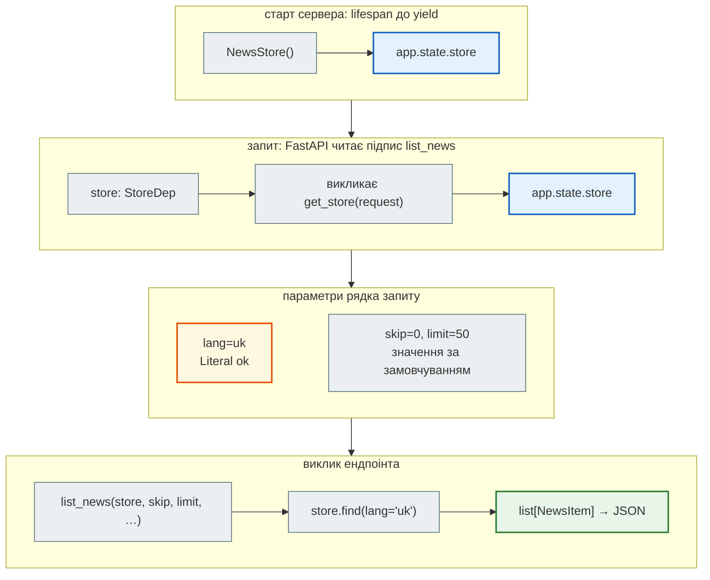

# Сховище через `Depends` і `lifespan`

> Крок 2 · розділ 2 з 5. Код: [`news_hub/store.py`](https://github.com/NikoriakViktor/news_hub/blob/main/steps/02_fastapi_basics/news_hub/store.py), [`news_hub/api.py`](https://github.com/NikoriakViktor/news_hub/blob/main/steps/02_fastapi_basics/news_hub/api.py).
> Теорія: [Залежності: `Depends` і `lifespan`](../../03_fastapi_core/dependencies.md).

## Задача { #task }

Ендпоінтам потрібне місце, де лежать новини. У прототипі кожен ендпоінт сам діставав базу: `db = get_db()` → `db.news.find(query)`. Такий ендпоінт знає про MongoDB, і протестувати його без MongoDB неможливо.

Треба, щоб ендпоінт **не знав**, де лежать новини, а лише користувався ними. Тоді в тестах можна підставити інше сховище, а в кроці 3 — базу, не чіпаючи ендпоінтів.

## Зміна 1: клас з контрактом { #store }

«Де лежать новини» виносимо в клас. Його методи — це все, що ендпоінтам треба від сховища:

```python title="news_hub/store.py"
class NewsStore:
    def __init__(self) -> None:
        self._items: dict[str, NewsItem] = {}      # url → новина: той самий url двічі не збережеться

    def add_many(self, items: Iterable[NewsItem]) -> int:
        """Додає лише нові (як `$setOnInsert` + `upsert` у Mongo); повертає, скільки додано."""
        saved = 0
        for item in items:
            key = str(item.url)
            if key not in self._items:
                self._items[key] = item
                saved += 1
        return saved

    def find(self, *, skip: int = 0, limit: int = 50, category: str = "", source: str = "",
             lang: str = "") -> list[NewsItem]:
        found = [item for item in self._items.values()
                 if (not category or item.category == category)
                 and (not source or item.source == source)
                 and (not lang or item.lang == lang)]
        return found[skip:skip + limit]

    def count(self) -> int: ...
    def stats(self) -> dict[str, dict[str, int]]: ...
    def clear(self) -> int: ...
```

Ключ словника — `url`. Тому повторний збір тих самих новин нічого не дублює: `add_many` повертає, скільки справді нових.

```diff title="GET /api/news: прототип → крок 2"
 @app.get("/api/news", response_model=list[NewsItem])
-async def list_news(skip: int = Query(default=0, ge=0), limit: int = ..., category: str = ..., ...):
-    db = get_db()
-    query: dict = {}
-    if category:
-        query["category"] = category
-    ...
-    cursor = db.news.find(query).sort("scraped_at", -1).skip(skip).limit(limit)
-    docs = await cursor.to_list(length=limit)
-    return [_doc_to_item(d) for d in docs]
+async def list_news(store: StoreDep, skip: int = Query(0, ge=0), limit: int = ..., ...) -> list[NewsItem]:
+    return store.find(skip=skip, limit=limit, category=category, source=source, lang=lang or "")
```

## Зміна 2: `lifespan` створює, `Depends` віддає { #depends }

```python title="news_hub/api.py (фрагмент)"
@asynccontextmanager
async def lifespan(app: FastAPI) -> AsyncIterator[None]:
    app.state.store = NewsStore()        # до першого запиту
    yield                                # тут сервер працює
    app.state.store.clear()              # після зупинки


def get_store(request: Request) -> NewsStore:
    store: NewsStore = request.app.state.store
    return store


StoreDep = Annotated[NewsStore, Depends(get_store)]
```

| Запис | Що означає |
|---|---|
| `lifespan` | код до `yield` виконується один раз при старті сервера, після `yield` — при зупинці. Старий `@app.on_event("startup")` у FastAPI застарів; `lifespan` тримає старт і зупинку поруч |
| `app.state` | «кишеня» застосунку: тут живуть ресурси на весь час роботи сервера |
| `Depends(get_store)` | «перед викликом ендпоінта виклич `get_store` і передай результат». Ендпоінт оголошує, *що* йому потрібно, а не *звідки* це взяти |
| `Annotated[NewsStore, Depends(...)]` | тип для mypy і `/docs` плюс інструкція для FastAPI в одному записі |
| `StoreDep` | псевдонім, щоб не повторювати `Annotated[...]` у кожному ендпоінті |

Шлях одного запиту `GET /api/news?lang=uk`:



## Результат: підміна в тестах { #tests }

Живий скрапінг ходить у мережу, а тестам мережа не потрібна. `app.dependency_overrides` підміняє залежність на час тесту:

```python title="tests/test_api.py (фрагмент)"
async def fake_scraper(pages: list[str] | None) -> ScrapeOutcome:
    page = PageResult(url=(pages or ["https://www.rbc.ua/ukr/news/"])[0], start=0.0, end=0.1, count=2)
    return ScrapeOutcome(pages=[page], news=FAKE_NEWS, total_time=0.1)


@pytest.fixture
def client() -> Iterator[TestClient]:
    app.dependency_overrides[get_scrapers] = lambda: {"async": fake_scraper, "sequential": fake_scraper}
    with TestClient(app) as c:          # with → спрацює lifespan: нове порожнє сховище
        yield c
    app.dependency_overrides.clear()
```

- Ключ `dependency_overrides` — сама функція-залежність (`get_scrapers`), значення — чим її замінити.
- `TestClient` надсилає запити прямо в застосунок, без uvicorn і мережі.
- `with TestClient(app)` запускає `lifespan`. Без `with` сховища в `app.state` просто немає:

```python
c = TestClient(app)          # без with
c.get("/api/news")
```

```text
AttributeError: 'State' object has no attribute 'store'
```

Тестування API повністю — [крок 5](../05_api_testing/index.md).

## Чому не глобальна змінна { #why-not-global }

Здавалося б, простіше написати `store = NewsStore()` на рівні модуля й користуватися ним напряму. Але тоді:

| Глобальна змінна | `Depends` + `lifespan` |
|---|---|
| ендпоінт жорстко зв'язаний з `NewsStore` | ендпоінт знає лише тип; реалізацію підставляє FastAPI |
| сховище живе між тестами: один тест бачить новини іншого | кожен `with TestClient(app)` — нове порожнє сховище |
| підмінити можна лише `monkeypatch` | `dependency_overrides[get_store] = ...` |
| створюється при імпорті, навіть якщо сервер не стартує | створюється при старті, закривається при зупинці |

У кроці 3 `get_store` поступиться сесії бази, а ендпоінти лишаться тими самими: вони й далі отримують «щось із методами `find`, `add_many`, `count`…».

## Правило { #rule }

!!! tip "Правило"
    Ресурс, який живе довше за запит (сховище, пул з'єднань, HTTP-клієнт), створюй у `lifespan` і віддавай ендпоінтам через `Depends`. Ендпоінт просить ресурс, а не створює його. Тоді тест підмінює ресурс одним рядком.

**Далі:** [Збір через API](scrape_endpoint.md) — `POST /api/scrape` і тіло запиту.
