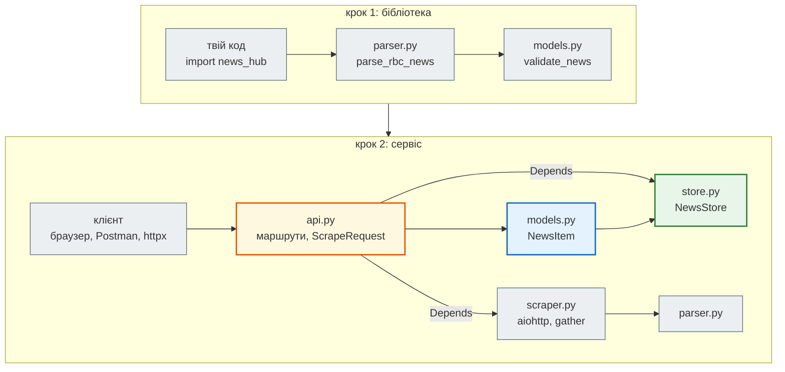

# Крок 2. Перший API на FastAPI

> **Код кроку:** [`steps/02_fastapi_basics`](https://github.com/NikoriakViktor/news_hub/tree/main/steps/02_fastapi_basics).
>
> **Передумови:** [Крок 1. Типи і Pydantic](../01_typing_pydantic/index.md) — є `parse_rbc_news` і модель `NewsItem`.

## Де ми зараз { #where }

Після кроку 1 агрегатор уміє **перевіряти** новини: `parse_rbc_news` перетворює HTML стрічки rbc.ua на сирі словники `RawNews`, а `validate_news` пропускає через модель `NewsItem` лише правильні, решту складає в `rejected` з причинами.

Але все це живе всередині Python-процесу. Скористатися агрегатором може лише той, хто імпортує модуль `news_hub`. Браузер, Postman, інша програма чи Telegram-бот (крок 9) до нього не дістануться.

## Проблема { #problem }

Потрібен **сервіс**: програма, яка постійно працює, приймає HTTP-запити й відповідає JSON. І цей сервіс має:

- перевіряти все, що приходить ззовні, як `NewsItem` перевіряє дані з парсера;
- описувати себе: які адреси, які параметри, що повертає, — інакше клієнтам доведеться читати код;
- не зупинятися, поки завантажує сторінки rbc.ua.

## Що додаємо { #what }

| Що | Де | Розділ |
|---|---|---|
| FastAPI-застосунок: `GET /api/news` з фільтрами, `/count`, `/stats`, `DELETE`, `/health` | `news_hub/api.py` | [FastAPI над `NewsItem`](fastapi_app.md) |
| сховище `NewsStore` і залежності `Depends`, `lifespan` | `news_hub/store.py`, `api.py` | [Сховище через `Depends`](depends_and_lifespan.md) |
| `POST /api/scrape` — збір новин за HTTP-запитом | `news_hub/api.py`, `scraper.py` | [Збір через API](scrape_endpoint.md) |
| опис API `/docs`, `/openapi.json`, колекція Postman | `postman/` | [OpenAPI і Postman](openapi_and_postman.md) |
| виміри: `async def` проти блокуючого коду | `examples/fastapi_demo` | [Async чи blocking](async_measurements.md) |

## Архітектура: було → стало { #architecture }



- **Шари.** `api.py` знає HTTP (маршрути, коди, моделі запитів), `scraper.py` — мережу, `parser.py` — HTML, `models.py` — правила даних, `store.py` — зберігання. Крок 3 замінить лише `store.py`.
- **Залежності через `Depends`.** Ендпоінт не створює сховище і не вибирає скрапер, а отримує їх. Тому тест підмінює скрапер одним рядком.
- **Одна модель.** `NewsItem` перевіряє дані з парсера, описує відповідь API і схему в `/docs`.

## Файли кроку { #files }

| Файл | Що в ньому | Новий? |
|---|---|---|
| [`news_hub/api.py`](https://github.com/NikoriakViktor/news_hub/blob/main/steps/02_fastapi_basics/news_hub/api.py) | застосунок, залежності, `ScrapeRequest`, `ScrapeReport`, 6 ендпоінтів | новий |
| [`news_hub/store.py`](https://github.com/NikoriakViktor/news_hub/blob/main/steps/02_fastapi_basics/news_hub/store.py) | `NewsStore` — новини в пам'яті, ключ — `url` | новий |
| [`news_hub/scraper.py`](https://github.com/NikoriakViktor/news_hub/blob/main/steps/02_fastapi_basics/news_hub/scraper.py) | `scrape_all_async`, `scrape_sequential` на aiohttp | новий |
| [`postman/news_hub.postman_collection.json`](https://github.com/NikoriakViktor/news_hub/blob/main/steps/02_fastapi_basics/postman/news_hub.postman_collection.json) | 7 запитів з перевірками | новий |
| [`tests/test_api.py`](https://github.com/NikoriakViktor/news_hub/blob/main/steps/02_fastapi_basics/tests/test_api.py) | 11 тестів API через `TestClient` | новий |
| `news_hub/models.py`, `parser.py`, `snapshot.py` | з кроку 1 | без змін |

## Порядок читання { #reading-order }

1. [FastAPI над `NewsItem`](fastapi_app.md) — перший застосунок, запуск, `422`.
2. [Сховище через `Depends` і `lifespan`](depends_and_lifespan.md) — звідки ендпоінт бере ресурси.
3. [Збір через API](scrape_endpoint.md) — тіло запиту, валідатор, живий збір.
4. [OpenAPI, `/docs` і Postman](openapi_and_postman.md) — опис API і перевірки запитів.
5. [Async чи blocking: виміри](async_measurements.md) — що блокує сервер і як це довести.
6. [Контрольна точка](checkpoint.md) — тести, практика, самоперевірка.

Теорія до кроку — [Частина III. Ядро FastAPI](../../03_fastapi_core/README.md) і [Частина IV. Async](../../04_async/README.md).

## Запуск { #run }

З папки кроку `steps/02_fastapi_basics`:

```bash
pip install -r requirements.txt
pytest -q                           # 23 passed
mypy --strict news_hub              # Success: no issues found in 7 source files
uvicorn news_hub.api:app --reload   # → http://127.0.0.1:8000/docs
```

## Порівняння з кроком 1 { #diff }

```bash
git diff --no-index --stat steps/01_typing_pydantic steps/02_fastapi_basics
git diff --no-index steps/01_typing_pydantic/news_hub steps/02_fastapi_basics/news_hub
```

## Що далі { #next }

[Крок 3. База даних: SQLAlchemy і Alembic](../03_sqlalchemy_alembic/index.md): `NewsStore` у пам'яті зникає з кожним перезапуском сервера. Крок 3 замінить його на базу **з тими самими методами**, тож ендпоінти не зміняться.
