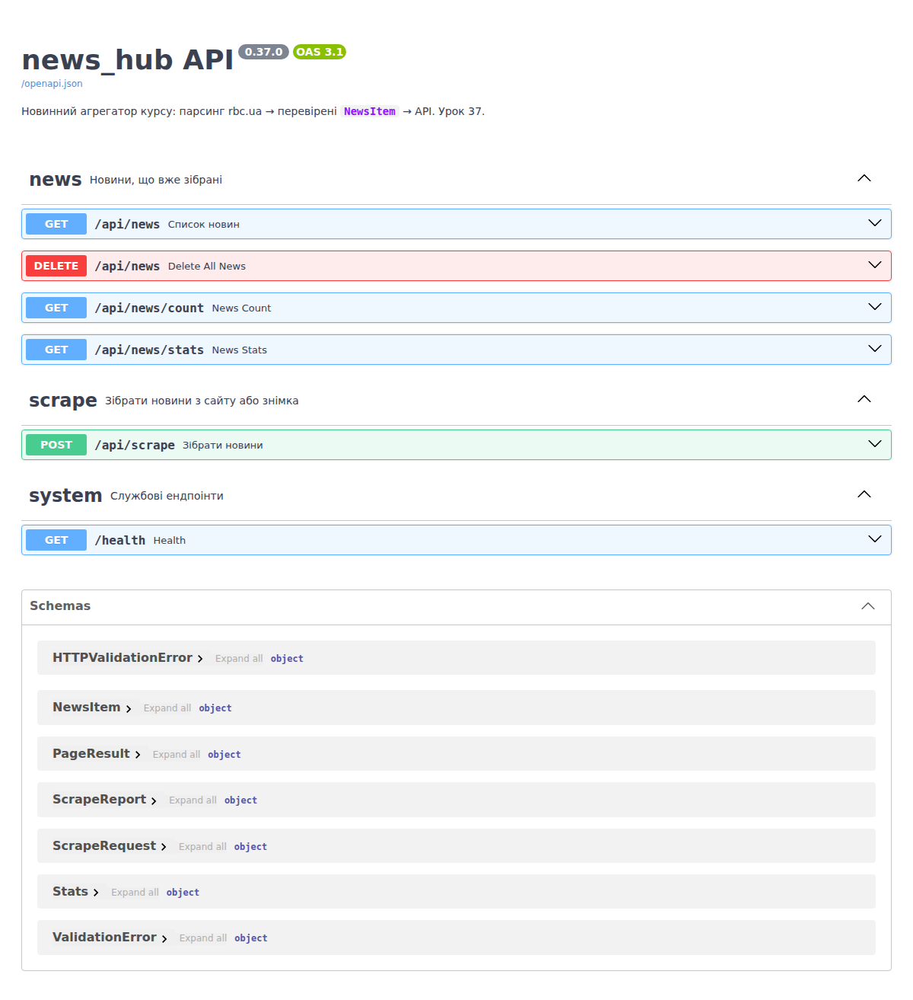
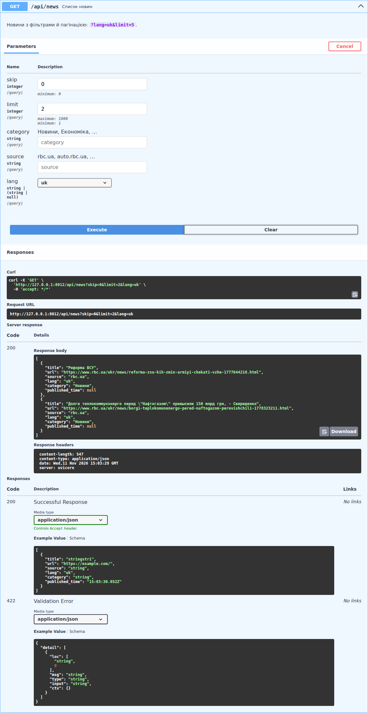
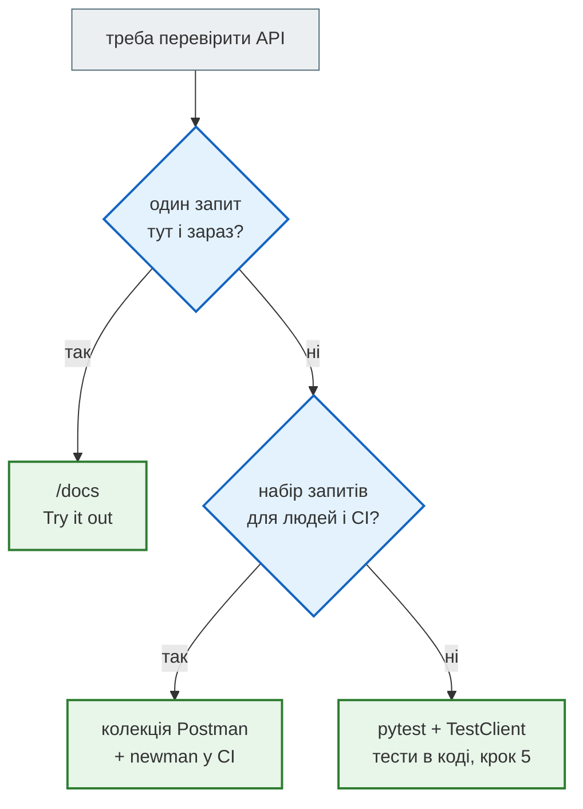

# OpenAPI, `/docs` і Postman

> Крок 2 · розділ 4 з 5. Код: [`postman/news_hub.postman_collection.json`](https://github.com/NikoriakViktor/news_hub/blob/main/steps/02_fastapi_basics/postman/news_hub.postman_collection.json).
> Теорія: [OpenAPI: опис API з коду](../../03_fastapi_core/openapi.md).

## Задача { #task }

Клієнтам API (фронтенду, боту, колезі) треба знати, які є адреси, що вони приймають і що повертають. А тобі — швидко перевіряти, що після змін усе ще працює. Читати код чи писати запити щоразу заново — не варіант.

## Опис API: FastAPI робить його сам { #openapi }

FastAPI описує API за стандартом **OpenAPI** з того, що вже є в коді: маршрутів, типів параметрів, моделей, `tags`, `summary` і docstring-ів.

```python
schema = api.get("/openapi.json").json()
print(schema["openapi"], "|", schema["info"]["title"], schema["info"]["version"])
for path, methods in schema["paths"].items():
    for method, operation in methods.items():
        print(f"{method.upper():6} {path:18} {operation['tags']} {operation['summary']}")
print(sorted(schema["components"]["schemas"]))
```

```text
3.1.0 | news_hub API 0.37.0
GET    /health            ['system'] Health
GET    /api/news          ['news'] Список новин
DELETE /api/news          ['news'] Delete All News
GET    /api/news/count    ['news'] News Count
GET    /api/news/stats    ['news'] News Stats
POST   /api/scrape        ['scrape'] Зібрати новини
['HTTPValidationError', 'NewsItem', 'PageResult', 'ScrapeReport', 'ScrapeRequest', 'Stats', 'ValidationError']
```

- Де `summary` задано (`"Список новин"`), там він і є; де ні — FastAPI робить його з назви функції: `delete_all_news` → `Delete All News`.
- `components.schemas` — моделі: наші (`NewsItem`, `ScrapeRequest`…) і дві службові для `422` (`HTTPValidationError`, `ValidationError`).

Три адреси, які з'являються самі:

| Адреса | Що там |
|---|---|
| `http://127.0.0.1:8000/docs` | **Swagger UI**: інтерактивна документація — можна надіслати запит прямо з браузера |
| `http://127.0.0.1:8000/redoc` | ReDoc: той самий опис для читання |
| `http://127.0.0.1:8000/openapi.json` | сам опис: з нього генерують клієнтів, його імпортує Postman |



**Try it out** → параметри → **Execute**: Swagger UI надсилає справжній запит і показує команду `curl`, URL, відповідь і заголовки. Під ними — схема відповідей `200` і `422`:



Опис моделі `NewsItem` у розділі **Schemas** — та сама JSON Schema, яку в кроці 1 повертав `NewsItem.model_json_schema()`.

## Postman: колекція запитів з перевірками { #postman }

`/docs` зручний, щоб спробувати один запит. **Postman** — щоб зберегти набір запитів, передати його команді й перевіряти відповіді автоматично.

У кроці є колекція [`postman/news_hub.postman_collection.json`](https://github.com/NikoriakViktor/news_hub/blob/main/steps/02_fastapi_basics/postman/news_hub.postman_collection.json): 7 запитів, у кожного — вкладка **Tests** з перевірками на JavaScript, разом 12 перевірок.

```javascript
// 2. зібрати знімок — POST {{baseUrl}}/api/scrape, тіло {"source": "snapshot"}
const report = pm.response.json();
pm.test("200", () => pm.response.to.have.status(200));
pm.test("усі 168 новин зі знімка перевірені", () => pm.expect(report.news_valid).to.eql(168));
pm.collectionVariables.set("total", report.news_total);   // запам'ятали для запитів 4 і 7
```

| Запис | Що робить |
|---|---|
| `{{baseUrl}}` | змінна колекції (`http://127.0.0.1:8000`): змінив раз — змінилося в усіх запитах |
| `pm.test(назва, функція)` | одна перевірка; у звіті — ✓ або ✗ з назвою |
| `pm.collectionVariables.set` | передати значення з одного запиту в інший |

**Як працювати:** Postman → **Import** → файл колекції → **Run collection**. Або **Import** → `http://127.0.0.1:8000/openapi.json`: Postman сам створить запит на кожен ендпоінт, але без перевірок.

## newman: та сама колекція з консолі { #newman }

**newman** запускає колекцію без Postman — з термінала чи в CI. Приклад виводу (сервер запущено на порту 8000; час запитів залежить від машини):

```text
$ npx newman run postman/news_hub.postman_collection.json
newman

news_hub — урок 37

→ 1. health
  GET http://127.0.0.1:8000/health [200 OK, 140B, 24ms]
  ✓  200 і status ok

→ 2. зібрати знімок
  POST http://127.0.0.1:8000/api/scrape [200 OK, 270B, 14ms]
  ✓  200
  ✓  усі 168 новин зі знімка перевірені

→ 3. українські новини
  GET http://127.0.0.1:8000/api/news?lang=uk&limit=5 [200 OK, 1.69kB, 4ms]
  ✓  200
  ✓  не більше limit
  ✓  усі lang = uk

→ 4. статистика
  GET http://127.0.0.1:8000/api/news/stats [200 OK, 237B, 6ms]
  ✓  total = кількості після збору
  ✓  є мови uk і ru

→ 5. помилка: lang=en
  GET http://127.0.0.1:8000/api/news?lang=en [422 Unprocessable Content, 289B, 3ms]
  ✓  422 — FastAPI перевірив параметр
  ✓  помилка в полі lang

→ 6. помилка: чужий сайт
  POST http://127.0.0.1:8000/api/scrape [422 Unprocessable Content, 364B, 3ms]
  ✓  422 — сервер не завантажує чужі URL

→ 7. очистити
  DELETE http://127.0.0.1:8000/api/news [200 OK, 140B, 3ms]
  ✓  видалено стільки, скільки було

┌─────────────────────────┬─────────────────┬─────────────────┐
│                         │        executed │          failed │
├─────────────────────────┼─────────────────┼─────────────────┤
│              iterations │               1 │               0 │
├─────────────────────────┼─────────────────┼─────────────────┤
│                requests │               7 │               0 │
├─────────────────────────┼─────────────────┼─────────────────┤
│            test-scripts │               7 │               0 │
├─────────────────────────┼─────────────────┼─────────────────┤
│      prerequest-scripts │               0 │               0 │
├─────────────────────────┼─────────────────┼─────────────────┤
│              assertions │              12 │               0 │
├─────────────────────────┴─────────────────┴─────────────────┤
│ total run duration: 187ms                                   │
├─────────────────────────────────────────────────────────────┤
│ total data received: 2.22kB (approx)                        │
├─────────────────────────────────────────────────────────────┤
│ average response time: 8ms [min: 3ms, max: 24ms, s.d.: 7ms] │
└─────────────────────────────────────────────────────────────┘
```

Ім'я колекції — «news_hub — урок 37»: так її назвали в курсі, а тут вона без змін.

## Як обрати { #how-to-choose }



## Правило { #rule }

!!! tip "Правило"
    Опис API — побічний продукт коду, а не окремий документ. Пиши `summary`, `description`, docstring, `tags` і `Field(description=...)` там, де оголошуєш маршрут і модель, і `/docs` завжди збігатиметься з тим, що сервер справді робить.

**Далі:** [Async чи blocking: виміри](async_measurements.md).
