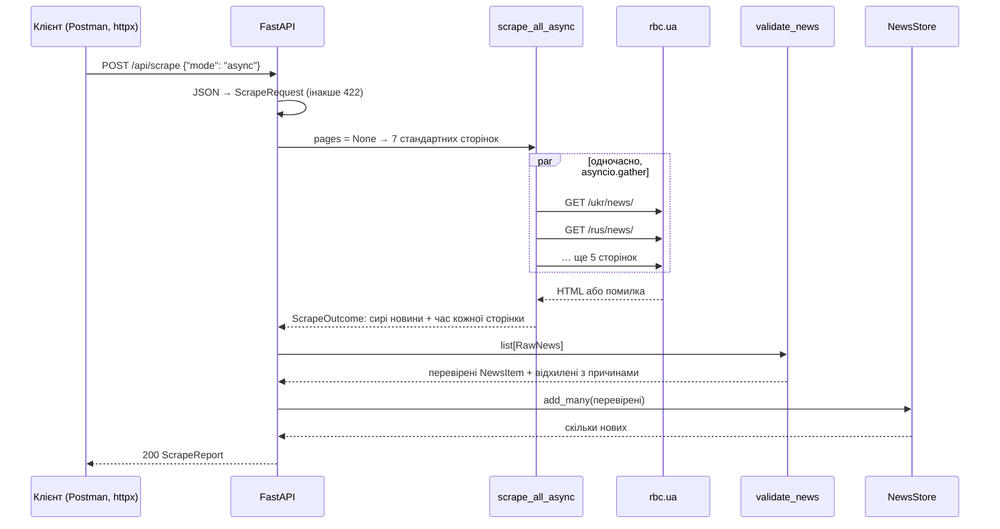

# Збір через API: `POST /api/scrape`

> Крок 2 · розділ 3 з 5. Код: [`news_hub/api.py`](https://github.com/NikoriakViktor/news_hub/blob/main/steps/02_fastapi_basics/news_hub/api.py), [`news_hub/scraper.py`](https://github.com/NikoriakViktor/news_hub/blob/main/steps/02_fastapi_basics/news_hub/scraper.py).
> Теорія: [Маршрути, параметри і валідація → як перевіряється тіло](../../03_fastapi_core/routes_and_validation.md#inside).

## Задача { #task }

Агрегатор має збирати новини **за HTTP-запитом**: з живого сайту або зі збереженого знімка, сторінки одночасно або по черзі, стандартний список сторінок або свій. І звітувати, що вийшло: скільки знайдено, скільки пройшло перевірку, скільки нових, чому щось відхилено.

## Зміна: тіло запиту — Pydantic-модель { #change }

```python title="news_hub/api.py (фрагмент)"
class ScrapeRequest(BaseModel):
    source: Literal["live", "snapshot"] = Field("live", description="live — сайт; snapshot — збережений знімок")
    mode: Literal["async", "sequential"] = Field("async", description="сторінки одночасно чи по черзі")
    pages: list[HttpUrl] | None = Field(None, max_length=20, description="порожньо — стандартний список сторінок")

    @field_validator("pages")
    @classmethod
    def only_rbc(cls, pages: list[HttpUrl] | None) -> list[HttpUrl] | None:
        for url in pages or []:
            if not (url.host or "").endswith("rbc.ua"):
                raise ValueError(f"сервер завантажує лише сторінки rbc.ua, а не {url.host}")
        return pages


class ScrapeReport(BaseModel):
    source: str
    mode: str
    total_time: float
    pages: list[PageResult]
    news_found: int = Field(description="усього новин на сторінках (без дублікатів)")
    news_valid: int = Field(description="пройшли перевірку NewsItem")
    news_saved: int = Field(description="нових у сховищі")
    news_total: int = Field(description="у сховищі після збору")
    rejected: list[str] = Field(description="перші 5 причин відхилення")


@app.post("/api/scrape", response_model=ScrapeReport, tags=["scrape"], summary="Зібрати новини")
async def scrape(
    request: ScrapeRequest,
    store: StoreDep,
    scrapers: Annotated[dict[str, Scraper], Depends(get_scrapers)],
) -> ScrapeReport:
    """Завантажує сторінки (або знімок), перевіряє кожну новину моделлю `NewsItem`, зберігає нові."""
    if request.source == "snapshot":
        outcome = ScrapeOutcome(pages=[], news=load_snapshot(), total_time=0.0)
    else:
        pages = [str(url) for url in request.pages] if request.pages else None
        outcome = await scrapers[request.mode](pages)

    valid, rejected = validate_news(outcome.news)       # крок 1: нічого не губиться мовчки
    saved = store.add_many(valid)
    return ScrapeReport(
        source=request.source, mode=request.mode, total_time=outcome.total_time, pages=outcome.pages,
        news_found=len(outcome.news), news_valid=len(valid), news_saved=saved, news_total=store.count(),
        rejected=[f"{r.raw['url']}: {'; '.join(r.errors)}" for r in rejected[:5]],
    )
```

Як FastAPI розрізняє, звідки брати кожен параметр функції `scrape`:

| Параметр | Тип | Звідки |
|---|---|---|
| `request: ScrapeRequest` | Pydantic-модель | з **тіла** запиту (JSON) |
| `store: StoreDep` | `Annotated[..., Depends(...)]` | із залежності |
| `scrapers: Annotated[..., Depends(get_scrapers)]` | залежність | із залежності — тому тест її підміняє |
| `limit: int` у `list_news` | простий тип | з **рядка запиту** `?limit=5` |

Скрапер — теж залежність (`get_scrapers`), а не прямий виклик `scrape_all_async`. Саме тому тест з [попереднього розділу](depends_and_lifespan.md#tests) підміняє його й не ходить у мережу.

## Що відбувається під час запиту { #flow }



## Результат: знімок, повторний збір, чужий сайт { #result }

```python
api.post("/api/scrape", json={"source": "snapshot"})                 # перший збір: 168 нових
again = api.post("/api/scrape", json={"source": "snapshot"}).json()
print("вдруге:", {key: again[key] for key in ("news_found", "news_saved", "news_total")})

response = api.post("/api/scrape", json={"pages": ["https://example.com/admin"]})
print(response.status_code, response.json()["detail"][0]["msg"])

response = api.post("/api/scrape", json={"mode": "fast"})
print(response.status_code, response.json()["detail"][0]["loc"], response.json()["detail"][0]["msg"])
```

```text
вдруге: {'news_found': 168, 'news_saved': 0, 'news_total': 168}
422 Value error, сервер завантажує лише сторінки rbc.ua, а не example.com
422 ['body', 'mode'] Input should be 'async' or 'sequential'
```

- Повторний збір не дублює новин (`news_saved: 0`): ключ сховища — `url`.
- Помилка валідатора `only_rbc` приходить у тому самому форматі `422`, що й помилки типів; `msg` починається з `Value error, …`.
- `loc` тепер `["body", "mode"]`: помилка в тілі запиту, а не в рядку запиту.

## Живий збір { #live }

`scraper.py` завантажує сторінки через `aiohttp`: `scrape_all_async` — усі одночасно через `asyncio.gather`, `scrape_sequential` — по черзі, для порівняння. Для кожної сторінки записує, коли почали й закінчили (секунди від старту), скільки новин і чи була помилка:

```python
report = api.post("/api/scrape", json={"pages": ["https://www.rbc.ua/ukr/news/"]}).json()
for page in report["pages"]:
    print(page["url"], "→ новин:", page["count"], "| помилка:", page["error"])
```

```text
https://www.rbc.ua/ukr/news/ → новин: 32 | помилка: None
```

Усі 7 стандартних сторінок, разом і по черзі (запуск 2026-11-11; час залежить від мережі):

| Режим | `total_time` | Як ідуть сторінки |
|---|---:|---|
| `{"mode": "async"}` | 0.405 с | усі стартують у 0.0 с, найдовша закінчується в 0.405 с |
| `{"mode": "sequential"}` | 1.582 с | кожна стартує, коли закінчилась попередня: 0.0 → 0.167 → 0.375 → … → 1.582 |

Разом — це час **найповільнішої** сторінки, по черзі — **сума** всіх. Чому так і де межа — [Частина IV. Async](../../04_async/README.md).

Сторінка з кодом помилки (`403`, `503`) — це помилка, а не «0 новин»: `fetch_one` викликає `resp.raise_for_status()`. У прототипі статус не перевірявся, і сторінку «403 Forbidden» він розбирав як стрічку без новин. З перевіркою причину видно у звіті. Так він виглядав у середовищі, де rbc.ua відповідав `403`:

```text
https://www.rbc.ua/ukr/news/ → новин: 0 | помилка: ClientResponseError: 403, message='Forbidden', url='https://www.rbc.ua/ukr/news/'
```

## Безпека: чому лише rbc.ua { #ssrf }

Обмеження `pages` сайтом rbc.ua — не формальність. Старий `ScrapeRequest` приймав будь-які URL: хто завгодно міг змусити сервер завантажити довільну адресу, зокрема внутрішню, недоступну ззовні (`http://localhost:…`, службові адреси хмари). Це **SSRF** (Server-Side Request Forgery).

!!! warning "Перевірка тут ще неповна"
    `host.endswith("rbc.ua")` пропускає й чужий домен `fakerbc.ua`:

    ```python
    >>> ScrapeRequest(pages=["https://fakerbc.ua/x"]).pages
    [HttpUrl('https://fakerbc.ua/x')]
    ```

    Цю діру знайдуть тести в [кроці 5](../05_api_testing/index.md), а повний захист від SSRF з'явиться в [кроці 8](../08_security/index.md). Спробуй до того часу сам сформулювати правильну перевірку.

## Правило { #rule }

!!! tip "Правило"
    Дані для дії — у тілі запиту як Pydantic-модель з `Literal`, обмеженнями й валідаторами. Ресурси й зовнішні сервіси (сховище, скрапер) — залежностями. Відповідь — модель-звіт: клієнт бачить, що зроблено і що відхилено.

**Далі:** [OpenAPI, `/docs` і Postman](openapi_and_postman.md).
