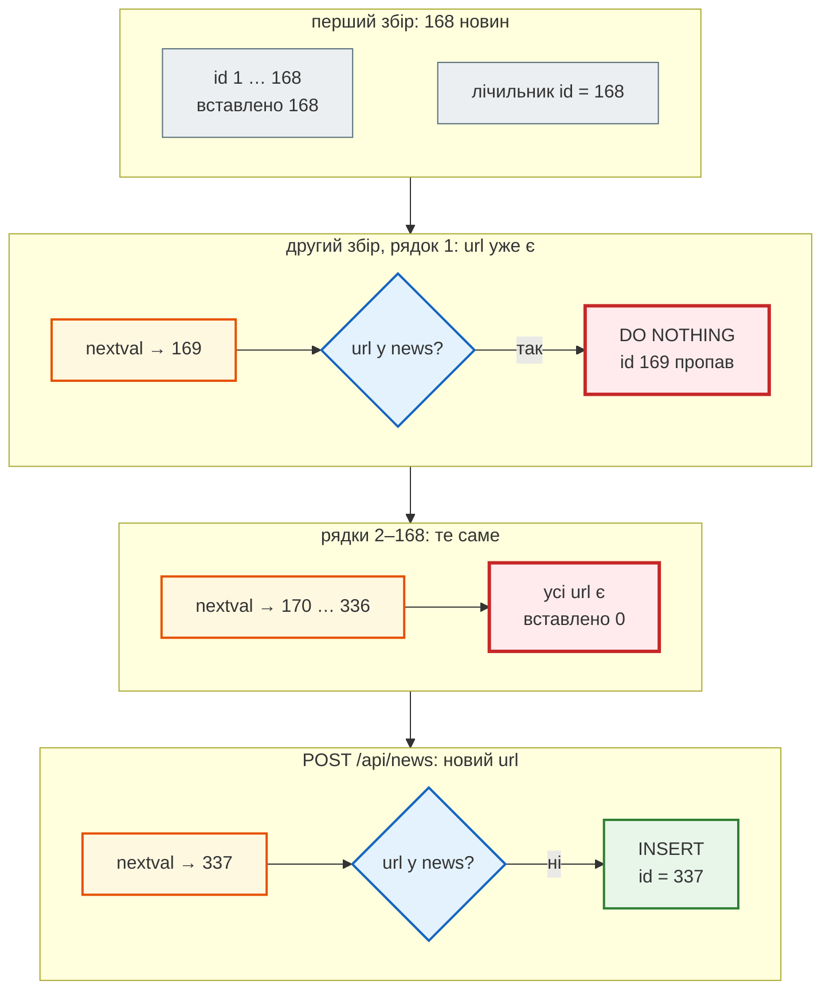

# Репозиторій замість `NewsStore`

> Крок 3 · розділ 2 з 5. Код: [`news_hub/repository.py`](https://github.com/NikoriakViktor/news_hub/blob/main/steps/03_sqlalchemy_alembic/news_hub/repository.py), [`news_hub/api.py`](https://github.com/NikoriakViktor/news_hub/blob/main/steps/03_sqlalchemy_alembic/news_hub/api.py).
> Теорія: [Частина V. Бази даних → патерн Repository](../../05_databases/README.md).

## Задача { #task }

У кроці 2 ендпоінти працювали зі сховищем через методи `add_many`, `find`, `count`, `stats`, `clear` і не знали, що всередині словник. Тепер усередині має бути база. Треба замінити реалізацію, **не переписуючи ендпоінтів**, і тримати весь SQL в одному місці.

## Зміна 1: той самий контракт, інша реалізація { #contract }

`repository.py` має два класи. `BaseRepository` — загальний CRUD для будь-якої таблиці; `NewsRepository` додає методи новин:

```python title="news_hub/repository.py (фрагмент)"
ModelT = TypeVar("ModelT", bound=Base)


class BaseRepository(Generic[ModelT]):
    model: type[ModelT]

    def __init__(self, session: AsyncSession) -> None:
        self._session = session

    async def get(self, obj_id: int) -> ModelT | None:
        return await self._session.get(self.model, obj_id)

    async def add(self, obj: ModelT) -> ModelT:
        self._session.add(obj)
        await self._session.flush()      # INSERT зараз, щоб отримати id і помилки обмежень; COMMIT — у get_db
        return obj

    async def delete(self, obj: ModelT) -> None: ...
    async def count(self) -> int:
        return (await self._session.execute(select(func.count()).select_from(self.model))).scalar_one()


class NewsRepository(BaseRepository[NewsRow]):
    model = NewsRow

    async def find(self, *, skip: int = 0, limit: int = 50, category: str = "", source: str = "",
                   lang: str = "") -> list[NewsRow]:
        stmt = select(NewsRow).order_by(NewsRow.id).offset(skip).limit(limit)
        if category:
            stmt = stmt.where(NewsRow.category == category)
        if source:
            stmt = stmt.where(NewsRow.source == source)
        if lang:
            stmt = stmt.where(NewsRow.lang == lang)
        return list((await self._session.scalars(stmt)).all())

    async def stats(self) -> dict[str, dict[str, int]]:
        result: dict[str, dict[str, int]] = {}
        for field in ("category", "lang", "source"):
            column = getattr(NewsRow, field)
            rows = await self._session.execute(
                select(column, func.count()).group_by(column).order_by(func.count().desc(), column))
            result[field] = {value: count for value, count in rows}
        return result
```

| `NewsStore` (крок 2) | `NewsRepository` (крок 3) |
|---|---|
| створюється раз у `lifespan`, живе весь час роботи сервера | створюється **на кожен запит** із сесією цього запиту |
| методи звичайні (`def`) | методи `async def`: чекають базу через `await` |
| `find` — list comprehension по словнику | `find` — `SELECT … WHERE … ORDER BY id LIMIT … OFFSET …` |
| `stats` — `Counter` у Python | `stats` — `GROUP BY` у базі |
| повертає `NewsItem` | повертає `NewsRow`; у JSON перетворює `NewsOut` |

Ендпоінт змінився на три слова — тип залежності, `await` і модель відповіді:

```diff title="news_hub/api.py: крок 2 → крок 3"
-StoreDep = Annotated[NewsStore, Depends(get_store)]
+SessionDep = Annotated[AsyncSession, Depends(get_db, scope="function")]
+
+def get_repo(session: SessionDep) -> NewsRepository:
+    return NewsRepository(session)
+
+RepoDep = Annotated[NewsRepository, Depends(get_repo)]

-@app.get("/api/news", response_model=list[NewsItem], ...)
-async def list_news(store: StoreDep, ...) -> list[NewsItem]:
-    return store.find(skip=skip, limit=limit, category=category, source=source, lang=lang or "")
+@app.get("/api/news", response_model=list[NewsOut], ...)
+async def list_news(repo: RepoDep, ...) -> list[NewsRow]:
+    return await repo.find(skip=skip, limit=limit, category=category, source=source, lang=lang or "")
```

Залежності стали ланцюжком: `RepoDep` → `get_repo` → `SessionDep` → `get_db`. Ендпоінт просить репозиторій, репозиторій — сесію, сесію відкриває `get_db` ([розділ 3](session_per_request.md)). Саме заради такої заміни в кроці 2 сховище й отримували через `Depends`, а не глобальною змінною.

## Результат: який SQL будує SQLAlchemy { #sql }

```python
from sqlalchemy import func, select
from sqlalchemy.dialects import postgresql

from news_hub.tables import NewsRow

pg = postgresql.dialect()

find = select(NewsRow).where(NewsRow.lang == "uk").order_by(NewsRow.id).offset(0).limit(5)
print(find.compile(dialect=pg), "\n")

stats = select(NewsRow.lang, func.count()).group_by(NewsRow.lang).order_by(func.count().desc(), NewsRow.lang)
print(stats.compile(dialect=pg), "\n")

add_many = (postgresql.insert(NewsRow)
            .values(url="https://www.rbc.ua/ukr/news/x.html", title="Заголовок новини", source="rbc.ua",
                    lang="uk", category="Новини", published_time=None)
            .on_conflict_do_nothing(index_elements=["url"]).returning(NewsRow.id))
print(add_many.compile(dialect=pg))
```

```text
SELECT news.id, news.url, news.title, news.source, news.lang, news.category, news.published_time, news.scraped_at
FROM news
WHERE news.lang = %(lang_1)s::VARCHAR ORDER BY news.id
 LIMIT %(param_1)s::INTEGER OFFSET %(param_2)s::INTEGER

SELECT news.lang, count(*) AS count_1
FROM news GROUP BY news.lang ORDER BY count(*) DESC, news.lang

INSERT INTO news (url, title, source, lang, category, published_time) VALUES (%(url)s::VARCHAR, %(title)s::VARCHAR, %(source)s::VARCHAR, %(lang)s::VARCHAR, %(category)s::VARCHAR, %(published_time)s::TIME WITHOUT TIME ZONE) ON CONFLICT (url) DO NOTHING RETURNING news.id
```

- `%(lang_1)s`, `%(param_1)s` — **параметри**: значення йдуть до бази окремо від тексту SQL. Через фільтр `?lang=` чи `?category=` SQL-ін'єкцію не зробиш — рядок користувача ніколи не стає частиною запиту.
- `stats` рахує в базі (`GROUP BY`), а не тягне всі рядки в Python.
- `ORDER BY news.id` — без нього база може віддавати рядки в будь-якому порядку, і `skip`/`limit` «гуляли б» між запитами.

## Зміна 2: `add_many` — дублікати відсіює база { #add-many }

```python title="news_hub/repository.py (фрагмент)"
def news_values(item: NewsItem) -> dict[str, Any]:
    """Перевірений NewsItem → значення стовпців таблиці."""
    return {"url": str(item.url), "title": item.title, "source": item.source, "lang": item.lang,
            "category": item.category, "published_time": item.published_time}


async def add_many(self, items: Iterable[NewsItem]) -> int:
    """INSERT … ON CONFLICT (url) DO NOTHING: дублікати відсіює база; повертає, скільки додано."""
    rows = [news_values(item) for item in items]
    if not rows:
        return 0
    dialect = self._session.get_bind().dialect.name
    stmt = (postgresql.insert(NewsRow) if dialect == "postgresql" else sqlite.insert(NewsRow)) \
        .values(rows).on_conflict_do_nothing(index_elements=["url"]).returning(NewsRow.id)
    return len((await self._session.execute(stmt)).all())
```

- **Один `INSERT` на весь збір**, а не 168 окремих.
- **`ON CONFLICT (url) DO NOTHING`** — рядок, чий `url` уже є, база мовчки пропускає. Перевіряє `UNIQUE` сама база, атомарно.
- **`RETURNING news.id`** повертає `id` лише вставлених рядків, тож `len(...)` — «скільки справді нових». Це `news_saved` у звіті `POST /api/scrape`.
- `ON CONFLICT` — розширення SQL, яке є і в PostgreSQL, і в SQLite, але SQLAlchemy будує його через модуль діалекту. Тому `add_many` вибирає `postgresql.insert` або `sqlite.insert` за діалектом сесії.

Чому не «перевір, чи є такий `url`, і лише тоді встав» — розбираємо в [контрольній точці](checkpoint.md#find-bug-race): під двома одночасними зборами такий код падає.

### Покроково: повторний збір і дірки в `id` { #id-gaps }

Той самий знімок збираємо вдруге. PostgreSQL для кожного рядка бере наступне значення лічильника `id` (`nextval`) **до** перевірки `UNIQUE`:



Перевіримо на справжньому сервері з PostgreSQL 16, таблиця порожня (`alembic upgrade head` на новій базі):

```python
import httpx

api = httpx.Client(base_url="http://127.0.0.1:8000")
for attempt in (1, 2):
    report = api.post("/api/scrape", json={"source": "snapshot"}).json()
    print(f"збір {attempt}:", {key: report[key] for key in ("news_found", "news_saved", "news_total")})

created = api.post("/api/news", json={"title": "Гривня зміцнилася до долара на міжбанку",
                                      "url": "https://www.rbc.ua/ukr/news/hryvnia-777.html"}).json()
print("нова новина: id =", created["id"])
```

```text
збір 1: {'news_found': 168, 'news_saved': 168, 'news_total': 168}
збір 2: {'news_found': 168, 'news_saved': 0, 'news_total': 168}
нова новина: id = 337
```

Той самий код на SQLite (без `DATABASE_URL`):

```text
збір 1: {'news_found': 168, 'news_saved': 168, 'news_total': 168}
збір 2: {'news_found': 168, 'news_saved': 0, 'news_total': 168}
нова новина: id = 169
```

У SQLite `INTEGER PRIMARY KEY` бере найбільший `id` + 1, і пропущені рядки номерів не забирають. Одна програма — різні `id` на різних базах.

Дірки в `id` — нормальні: **`id` — ідентифікатор, а не лічильник новин**. Скільки новин — питай `count(*)` (`/api/news/count`), а не найбільший `id`.

## Правило { #rule }

!!! tip "Правило"
    Увесь SQL — у репозиторії, ендпоінт лише викликає його методи. Коли правило даних може перевірити база (`UNIQUE`, `ON CONFLICT`), віддай його базі одним оператором, а не перевіряй у Python.

**Далі:** [Сесія на запит і COMMIT до відповіді](session_per_request.md) — звідки репозиторій бере сесію і коли зміни стають остаточними.
