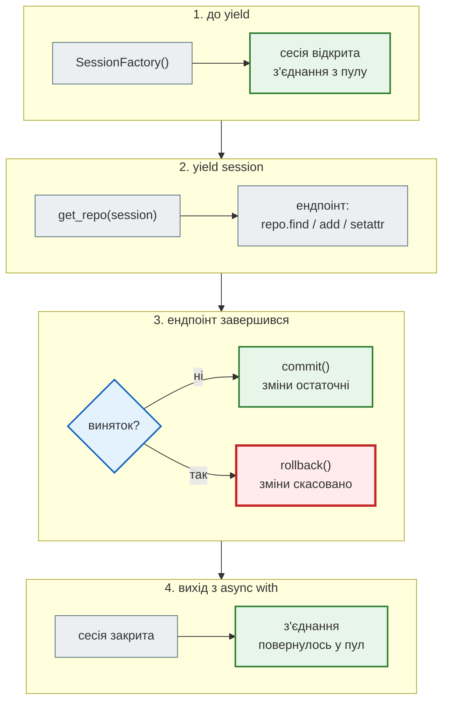
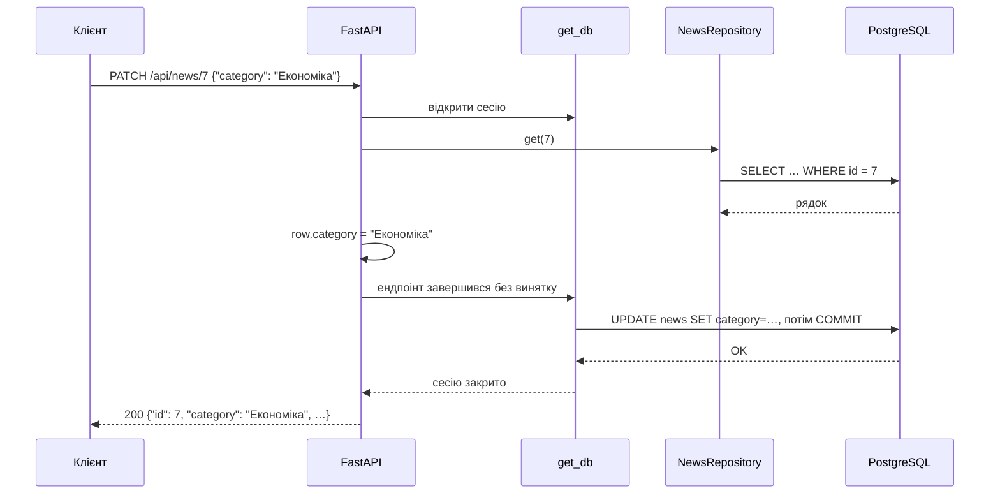

# Сесія на запит і COMMIT до відповіді

> Крок 3 · розділ 3 з 5. Код: [`news_hub/db.py`](https://github.com/NikoriakViktor/news_hub/blob/main/steps/03_sqlalchemy_alembic/news_hub/db.py), [`news_hub/api.py`](https://github.com/NikoriakViktor/news_hub/blob/main/steps/03_sqlalchemy_alembic/news_hub/api.py), [`tests/test_crud.py`](https://github.com/NikoriakViktor/news_hub/blob/main/steps/03_sqlalchemy_alembic/tests/test_crud.py).
> Теорія: [Залежності: коли виконується код після `yield`](../../03_fastapi_core/dependencies.md#yield-timing).

## Задача { #task }

Кожен HTTP-запит змінює базу: збір додає новини, `PATCH` міняє категорію, `DELETE` видаляє. Треба, щоб:

- усі зміни одного запиту пройшли **разом або ніяк** — без половини збереженого;
- помилка в ендпоінті скасовувала все, що він устиг змінити;
- клієнт отримував `200`/`201` лише тоді, коли дані **справді збережено**.

## Зміна 1: `get_db` — сесія й транзакція на запит { #get-db }

```python title="news_hub/db.py"
async def get_db() -> AsyncIterator[AsyncSession]:
    """FastAPI Depends: одна сесія (і одна транзакція) на HTTP-запит.

    Ендпоінт відпрацював без винятку → COMMIT; виняток → ROLLBACK; у будь-якому разі сесія закривається.
    """
    async with SessionFactory() as session:
        try:
            yield session                # тут виконується ендпоінт
            await session.commit()       # ендпоінт без винятку → COMMIT
        except Exception:
            await session.rollback()     # виняток → ROLLBACK
            raise
```

`get_db` — **генератор**, а не звичайна функція: тому анотація `AsyncIterator[AsyncSession]`, а не `AsyncSession`. FastAPI виконує код до `yield`, передає сесію в ендпоінт, а коли ендпоінт завершився — продовжує генератор з місця після `yield`.

Покроково, що відбувається з запитом:



**Одна сесія на запит.** Якщо ендпоінт отримує і `RepoDep`, і `RowDep` (як `DELETE /api/news/{news_id}`), FastAPI викличе `get_db` **один раз** на запит і дасть обом ту саму сесію: результат залежності кешується в межах запиту. Тому «знайти рядок» і «видалити рядок» — одна транзакція.

Шлях `PATCH /api/news/7` з тілом `{"category": "Економіка"}` у часі:



Ендпоінт `update_news` не викликає ні `UPDATE`, ні `commit()`: він лише змінює атрибут об'єкта. Сесія **відстежує** завантажені об'єкти, і `commit()` сам відправляє `UPDATE` для змінених.

## Зміна 2: `flush` — SQL зараз, COMMIT потім { #flush }

`SessionFactory` створено з `autoflush=False`, а `BaseRepository.add` викликає `flush()` явно:

```python title="news_hub/repository.py (фрагмент)"
async def add(self, obj: ModelT) -> ModelT:
    self._session.add(obj)
    await self._session.flush()      # INSERT зараз, щоб отримати id і помилки обмежень; COMMIT — у get_db
    return obj
```

| Операція | Що робить |
|---|---|
| `session.add(obj)` | лише запам'ятовує об'єкт у сесії; SQL ще немає |
| `await session.flush()` | відправляє `INSERT` у базу **в межах відкритої транзакції**: база дає `id`, `scraped_at` і перевіряє `UNIQUE` |
| `await session.commit()` | робить транзакцію остаточною |

Навіщо `flush`, якщо COMMIT однаково буде в `get_db`? Дві причини:

1. **Помилку `UNIQUE` видно в ендпоінті.** `create_news` ловить `IntegrityError` і повертає `409` ([розділ 4](crud.md#create)). Без `flush` ендпоінт її не побачив би: `INSERT` пішов би в базу лише під час COMMIT у `get_db`, коли `try/except` в ендпоінті вже позаду.
2. **У відповіді потрібні `id` і `scraped_at`.** Їх дає база, тобто лише після `INSERT`. Перевірили: прибрали `flush()` з `add` у копії кроку — `POST /api/news` став `500` уже на першій новині:

    ```text
    fastapi.exceptions.ResponseValidationError: 2 validation errors:
      {'type': 'int_type', 'loc': ('response', 'id'), 'msg': 'Input should be a valid integer', 'input': None}
      {'type': 'datetime_type', 'loc': ('response', 'scraped_at'), 'msg': 'Input should be a valid datetime', 'input': None}
    ```

    ```text
    5 failed, 27 passed
    ```

    Упали 5 тестів CRUD — усі, що створюють новину через `POST /api/news`.

## Зміна 3: `scope="function"` — COMMIT до відповіді { #scope }

```python title="news_hub/api.py (фрагмент)"
# scope="function": COMMIT у get_db виконується ДО відправлення відповіді. Без цього (FastAPI ≥ 0.118)
# код після yield іде вже після відповіді — клієнт отримав би 200, навіть якщо COMMIT не вдався.
SessionDep = Annotated[AsyncSession, Depends(get_db, scope="function")]
```

!!! danger "З FastAPI 0.118 код після `yield` за замовчуванням іде вже після відповіді"
    До FastAPI 0.118 код після `yield` виконувався **до** відповіді. З 0.118 за замовчуванням — **після**: клієнт отримує `200`/`201` ще до COMMIT. Якщо COMMIT не вдасться (обрив з'єднання, обмеження, що перевіряється при COMMIT), клієнт уже почув «збережено», а даних немає.

    `Depends(get_db, scope="function")` (є з FastAPI 0.121, тому `fastapi>=0.121` у `requirements.txt`) завершує залежність **до** відправлення відповіді.

Тест закріплює це правило. Він підміняє `get_db` версією, де замість COMMIT — виняток:

```python title="tests/test_crud.py (фрагмент)"
def test_failed_commit_is_500_not_200(client: TestClient) -> None:
    """COMMIT у get_db має статися ДО відповіді: якщо він падає — клієнт бачить помилку, а не «201 Created»."""
    working_db = app.dependency_overrides[get_db]

    async def broken_commit_db() -> AsyncIterator[AsyncSession]:
        async for session in working_db():
            yield session
            raise RuntimeError("COMMIT не вдався")    # як обрив з'єднання з базою під час COMMIT

    app.dependency_overrides[get_db] = broken_commit_db
    quiet = TestClient(app, raise_server_exceptions=False)
    assert quiet.post("/api/news", json=NEW).status_code == 500
    app.dependency_overrides[get_db] = working_db
```

## Результат: що буде без `scope="function"` { #result }

У копії кроку замінили `Depends(get_db, scope="function")` на `Depends(get_db)` і запустили тести (FastAPI 0.162.4):

```text
>       assert quiet.post("/api/news", json=NEW).status_code == 500
E       AssertionError: assert 201 == 500
E        +  where 201 = <Response [201 Created]>.status_code

FAILED tests/test_crud.py::test_failed_commit_is_500_not_200 - AssertionError...
1 failed, 31 passed
```

Клієнт отримав `201 Created`, хоча «COMMIT не вдався». Решта 31 тест пройшла: у звичайній роботі COMMIT вдається, і різниці не видно. Саме тому таку помилку потрібно закріплювати окремим тестом.

### Тестова база: та сама залежність, інша база { #test-db }

`tests/conftest.py` підміняє `get_db` так само, як у кроці 2 підмінявся скрапер:

```python title="tests/conftest.py (фрагмент)"
TEST_DATABASE_URL = os.getenv("TEST_DATABASE_URL", "sqlite+aiosqlite://")


@pytest.fixture
def client() -> Iterator[TestClient]:
    # SQLite у пам'яті живе, поки відкрите з'єднання → StaticPool: одне з'єднання на весь тест
    extra = {"poolclass": StaticPool} if TEST_DATABASE_URL.startswith("sqlite") else {}
    engine = make_engine(TEST_DATABASE_URL, **extra)
    factory = async_sessionmaker(engine, expire_on_commit=False, autoflush=False)

    async def create_tables() -> None:
        async with engine.begin() as conn:
            await conn.run_sync(Base.metadata.drop_all)
            await conn.run_sync(Base.metadata.create_all)

    async def test_db() -> AsyncIterator[AsyncSession]:       # той самий контракт, що get_db
        ...

    app.dependency_overrides[get_db] = test_db
    app.dependency_overrides[get_scrapers] = lambda: {"async": fake_scraper, "sequential": fake_scraper}
    with TestClient(app) as c:
        c.portal.call(create_tables)            # у циклі подій застосунку, де працюватиме engine
        yield c
        c.portal.call(engine.dispose)
    app.dependency_overrides.clear()
```

- **Окремий engine і порожні таблиці на кожен тест** — тести не бачать даних один одного.
- **Таблиці — з `Base.metadata.create_all`**, без Alembic: швидко, і схема та сама, що в `tables.py`.
- **`StaticPool`** — SQLite у пам'яті існує, поки відкрите його з'єднання. Пул з одним з'єднанням тримає базу живою на весь тест.
- **`c.portal.call(...)`** — async engine прив'язаний до циклу подій. `TestClient` запускає застосунок у своєму циклі, тому таблиці створюємо там само.
- **Ключ підміни — `get_db`**, хоча ендпоінти просять `SessionDep` з `scope="function"`: `dependency_overrides` шукає саму функцію-залежність.

## Правило { #rule }

!!! tip "Правило"
    Одна сесія — одна транзакція — один запит. Відкривай і закривай її в залежності з `yield`, COMMIT роби до відповіді (`scope="function"`), а `flush()` — там, де ендпоінту потрібні `id` чи помилки обмежень бази вже зараз.

**Далі:** [Повний CRUD](crud.md) — окрема новина: створити, прочитати, змінити, видалити.
