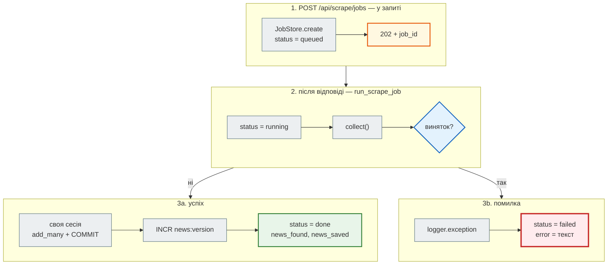
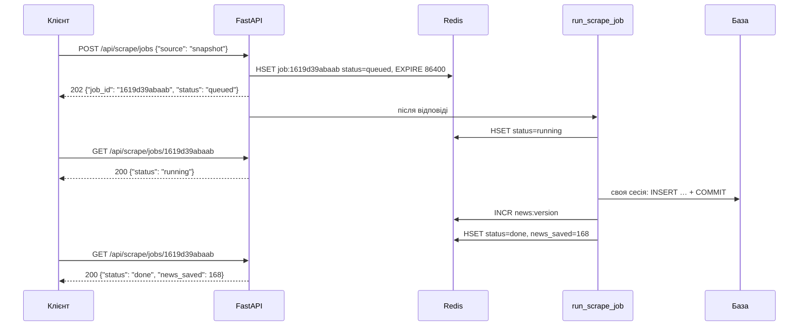

# Фоновий збір: `202` і статус задачі

> Крок 4 · розділ 4 з 4. Код: [`news_hub/jobs.py`](https://github.com/NikoriakViktor/news_hub/blob/main/steps/04_middleware_redis/news_hub/jobs.py), [`news_hub/api.py`](https://github.com/NikoriakViktor/news_hub/blob/main/steps/04_middleware_redis/news_hub/api.py).
> Теорія: [Частина VI. Middleware, кеш і фонові задачі](../../06_middleware_cache_jobs/README.md).

## Задача { #task }

Живий збір — сім сторінок rbc.ua з тайм-аутом 15 с кожна (крок 2). Тримати HTTP-запит відкритим стільки часу погано: клієнт може відвалитись за тайм-аутом, проксі — обірвати з'єднання, а користувач бота чи сторінки бачить «крутилку».

Треба **відповісти одразу** («прийнято»), збирати після відповіді, а результат віддавати окремим запитом.

## Зміна 1: спільний `collect` { #collect }

Звідки брати сирі новини (знімок чи сайт, разом чи по черзі) тепер потрібно у двох місцях: у звичайному `POST /api/scrape` і у фоновій задачі. Цю частину винесено з ендпоінта в окрему функцію:

```python title="news_hub/api.py (фрагмент)"
ScrapersDep = Annotated[dict[str, Scraper], Depends(get_scrapers)]


async def collect(request: ScrapeRequest, scrapers: dict[str, Scraper]) -> ScrapeOutcome:
    """Знімок або сторінки сайту → сирі новини (спільне для POST /api/scrape і фонового збору)."""
    if request.source == "snapshot":
        return ScrapeOutcome(pages=[], news=load_snapshot(), total_time=0.0)
    pages = [str(url) for url in request.pages] if request.pages else None
    return await scrapers[request.mode](pages)


@app.post("/api/scrape", response_model=ScrapeReport, tags=["scrape"], summary="Зібрати новини")
async def scrape(request: ScrapeRequest, repo: RepoDep, scrapers: ScrapersDep) -> ScrapeReport:
    """Завантажує сторінки (або знімок), перевіряє кожну новину моделлю `NewsItem`, зберігає нові."""
    outcome = await collect(request, scrapers)
    ...
```

`POST /api/scrape` працює як і раніше: синхронний збір лишився для тих, кому потрібен повний звіт одразу.

## Зміна 2: `202 Accepted` і `BackgroundTasks` { #endpoint }

```python title="news_hub/api.py (фрагмент)"
@app.post("/api/scrape/jobs", response_model=JobStatus, status_code=status.HTTP_202_ACCEPTED, tags=["scrape"],
          summary="Зібрати новини у фоні")
async def start_scrape_job(request: ScrapeRequest, background: BackgroundTasks, redis: RedisDep,
                           scrapers: ScrapersDep,
                           session_factory: Annotated[async_sessionmaker[AsyncSession], Depends(get_session_factory)],
                           ) -> JobStatus:
    """Відповідає одразу `202` з job_id; збір іде після відповіді. Статус — GET /api/scrape/jobs/{job_id}."""
    job = await JobStore(redis).create(request.source, request.mode)
    background.add_task(run_scrape_job, job.job_id, lambda: collect(request, scrapers), redis, session_factory)
    return job


@app.get("/api/scrape/jobs/{job_id}", response_model=JobStatus, tags=["scrape"],
         responses={404: {"description": "такої задачі немає (або минула доба)"}})
async def get_scrape_job(job_id: str, redis: RedisDep) -> JobStatus:
    job = await JobStore(redis).get(job_id)
    if job is None:
        raise HTTPException(status.HTTP_404_NOT_FOUND, detail=f"задачі {job_id} немає")
    return job
```

| Запис | Що означає |
|---|---|
| `status_code=202` | `202 Accepted` — «прийнято до роботи», а **не** «готово». Результату у відповіді ще немає, є лише `job_id` |
| `background: BackgroundTasks` | FastAPI підставляє об'єкт сам; усе, що в нього додано, виконується **після** того, як відповідь відправлено |
| `add_task(func, *args)` | функція й аргументи; викликати її зараз не можна — лише передати |
| `lambda: collect(request, scrapers)` | що зібрати, передано як функцію без аргументів: задача викличе її, коли настане її час |
| `get_session_factory` | фабрика сесій бази для задачі — залежність, щоб тести підставили тестову базу |

```python title="news_hub/api.py (фрагмент)"
def get_session_factory() -> async_sessionmaker[AsyncSession]:
    """Для фонових задач: у них своя сесія (тести підміняють на тестову базу)."""
    return SessionFactory
```

## Зміна 3: статус задачі в Redis { #job-store }

```python title="news_hub/jobs.py (фрагмент)"
JOB_TTL = 24 * 3600


class JobStatus(BaseModel):
    job_id: str
    status: Literal["queued", "running", "done", "failed"]
    source: str
    mode: str
    news_found: int = 0
    news_saved: int = 0
    error: str | None = None
    created_at: str
    finished_at: str | None = None


class JobStore:
    def __init__(self, redis: Redis) -> None:
        self._redis = redis

    async def create(self, source: str, mode: str) -> JobStatus:
        job = JobStatus(job_id=uuid.uuid4().hex[:12], status="queued", source=source, mode=mode, created_at=_now())
        await self._save(job.job_id, job.model_dump(exclude_none=True))
        return job

    async def update(self, job_id: str, **fields: str | int) -> None:
        await self._save(job_id, fields)

    async def get(self, job_id: str) -> JobStatus | None:
        data = await self._redis.hgetall(f"job:{job_id}")
        return JobStatus.model_validate(data) if data else None

    async def _save(self, job_id: str, fields: Mapping[str, object]) -> None:
        key = f"job:{job_id}"
        async with self._redis.pipeline(transaction=True) as pipe:
            pipe.hset(key, mapping={name: str(value) for name, value in fields.items()})
            pipe.expire(key, JOB_TTL)
            await pipe.execute()
```

- **Hash** `job:<id>` — один ключ Redis із полями (`status`, `news_found`, …). `HSET` оновлює лише передані поля, тому `update(job_id, status="running")` не стирає решту.
- **TTL на добу**, оновлюється з кожним записом. Статус — для зручності клієнта, а не архів; через добу ключ зникає, і `GET` дасть `404`. Типовий стартовий код тримав статуси задач у колекції основної бази поруч із новинами — їх доводилося б прибирати вручну.
- **У hash усе — рядки.** `str(value)` при записі; при читанні `JobStatus.model_validate` перетворює `'168'` назад на `168`. Поля `None` не записуються (`exclude_none=True`), і при читанні отримують значення за замовчуванням.

## Зміна 4: сама задача { #run-job }

```python title="news_hub/jobs.py (фрагмент)"
async def run_scrape_job(job_id: str, collect: Callable[[], Awaitable[ScrapeOutcome]], redis: Redis,
                         session_factory: async_sessionmaker[AsyncSession]) -> None:
    """Виконується ПІСЛЯ відповіді клієнту (BackgroundTasks)."""
    jobs = JobStore(redis)
    await jobs.update(job_id, status="running")
    try:
        outcome = await collect()
        valid, _ = validate_news(outcome.news)
        async with session_factory() as session:          # своя сесія: сесія запиту вже закрита
            saved = await NewsRepository(session).add_many(valid)
            await session.commit()
        await NewsCache(redis).invalidate()                # після COMMIT
        await jobs.update(job_id, status="done", news_found=len(outcome.news), news_saved=saved,
                          finished_at=_now())
    except Exception as error:                             # задачу ніхто не чекає — фіксуємо помилку в статусі
        logger.exception("scrape job %s failed", job_id)
        await jobs.update(job_id, status="failed", error=f"{type(error).__name__}: {error}", finished_at=_now())
```

- **Своя сесія бази.** Сесія запиту (`get_db`) закривається разом із запитом — ще до того, як почнеться фонова задача. Що буде, якщо все ж передати в задачу репозиторій запиту, — [«Знайди помилку» в контрольній точці](checkpoint.md#find-bug).
- **Свій COMMIT і своя інвалідація кешу.** Middleware `invalidate_cache` для `POST /api/scrape/jobs` не спрацьовує: на момент відповіді в базі ще нічого не змінилось. Версію кешу збільшує сама задача — після свого COMMIT.
- **Помилка не губиться.** У фоні виняток ніхто не побачить: клієнт уже отримав `202`. Тому `except Exception` записує в журнал повний traceback (`logger.exception`) і робить статус `failed` з текстом помилки.

Стани задачі:



## Як це виглядає в часі { #sequence }



## Результат: `202`, опитування, `done` { #result }

Клієнт **опитує** статус (polling), поки задача не завершиться. Сервер кроку з Redis 7; лічильник ліміту з [попереднього розділу](rate_limit.md) скинуто, базу очищено:

```python
import time

api.delete("/api/news")
job = api.post("/api/scrape/jobs", json={"source": "snapshot"})
print(job.status_code, job.json())
job_id = job.json()["job_id"]

seen = []
while (state := api.get(f"/api/scrape/jobs/{job_id}").json())["status"] in ("queued", "running"):
    seen.append(state["status"])
    time.sleep(0.05)
print("поки чекали:", sorted(set(seen)))
print(state)
print("у базі:", api.get("/api/news/count").json())
```

```text
202 {'job_id': '1619d39abaab', 'status': 'queued', 'source': 'snapshot', 'mode': 'async', 'news_found': 0, 'news_saved': 0, 'error': None, 'created_at': '2026-11-11T21:09:58+00:00', 'finished_at': None}
поки чекали: ['running']
{'job_id': '1619d39abaab', 'status': 'done', 'source': 'snapshot', 'mode': 'async', 'news_found': 168, 'news_saved': 168, 'error': None, 'created_at': '2026-11-11T21:09:58+00:00', 'finished_at': '2026-11-11T21:09:58+00:00'}
у базі: {'count': 168}
```

Що встигнемо побачити до завершення — `queued`, `running` чи нічого — залежить від швидкості машини: збір зі знімка триває частки секунди. У журналі сервера `POST /api/scrape/jobs → 202 6.9 ms` — клієнт не чекав на збір.

Сам hash у Redis і невідома задача:

```python
import redis as redis_sync

store = redis_sync.Redis(decode_responses=True)
print(store.hgetall(f"job:{job_id}"), "TTL", store.ttl(f"job:{job_id}"))
response = api.get("/api/scrape/jobs/nope")
print(response.status_code, response.json())
```

```text
{'job_id': '1619d39abaab', 'status': 'done', 'source': 'snapshot', 'mode': 'async', 'news_found': '168', 'news_saved': '168', 'created_at': '2026-11-11T21:09:58+00:00', 'finished_at': '2026-11-11T21:09:58+00:00'} TTL 86400
404 {'detail': 'задачі nope немає'}
```

У hash числа — рядки (`'168'`), поля `error` немає зовсім; у відповіді API — `168` і `None`: це зробила модель `JobStatus`.

## Результат: помилка стає статусом { #failure }

Скрапер, що падає (як у тесті `test_background_job_failure_is_recorded`), через `TestClient` і `fakeredis`:

```python
async def broken(pages: list[str] | None) -> ScrapeOutcome:
    raise ConnectionError("rbc.ua не відповідає")


with TestClient(app) as client:
    app.dependency_overrides[get_scrapers] = lambda: {"async": broken, "sequential": broken}
    started = client.post("/api/scrape/jobs", json={})
    print(started.status_code, started.json()["status"])
    job = client.get(f"/api/scrape/jobs/{started.json()['job_id']}").json()
    print({key: job[key] for key in ("status", "news_found", "error")})
    app.dependency_overrides.clear()
```

```text
202 queued
{'status': 'failed', 'news_found': 0, 'error': 'ConnectionError: rbc.ua не відповідає'}
```

А в журналі — повний traceback для розробника:

```text
21:10:21 ERROR news_hub: scrape job f9215257a4d0 failed
Traceback (most recent call last):
  File ".../news_hub/jobs.py", line 77, in run_scrape_job
    outcome = await collect()
...
ConnectionError: rbc.ua не відповідає
```

!!! note "`TestClient` чекає на фонові задачі"
    `TestClient` повертає відповідь лише тоді, коли застосунок повністю завершив обробку запиту — разом із фоновими задачами. Тому в тестах статус одразу `done` чи `failed`, а `queued`/`running` видно лише на справжньому сервері. Звідси коментар у `test_background_job_done`: «TestClient виконує задачу до повернення».

## Межі `BackgroundTasks` { #limits }

`BackgroundTasks` виконуються **в тому самому процесі**, що й сервер, після відповіді:

| Що | Наслідок |
|---|---|
| процес перезапустився посеред збору | задача пропала; статус назавжди лишиться `running` (поки добу не прибере TTL) |
| кілька процесів uvicorn | задачу виконує той процес, що прийняв запит; статус у Redis спільний для всіх |
| важка задача на CPU | займає процес сервера |
| повторні спроби, розклад, черга | нічого цього немає |

Для надійних черг беруть окремий процес-worker і чергу в Redis (Celery, RQ, arq): задача переживає перезапуск сервера, її можна повторити. Для «зібрати зараз і подивитись статус» агрегатору `BackgroundTasks` досить.

## Правило { #rule }

!!! tip "Правило"
    Довгу роботу — у фон: відповідай `202` з id задачі, статус тримай окремо (тут — hash у Redis з TTL), клієнт опитує. Фонова задача живе довше за запит, тож не бере в нього нічого з часом життя запиту — сесію бази, `Request`: створює свої ресурси, сама робить COMMIT, а помилку записує в статус.

**Далі:** [Контрольна точка](checkpoint.md).
