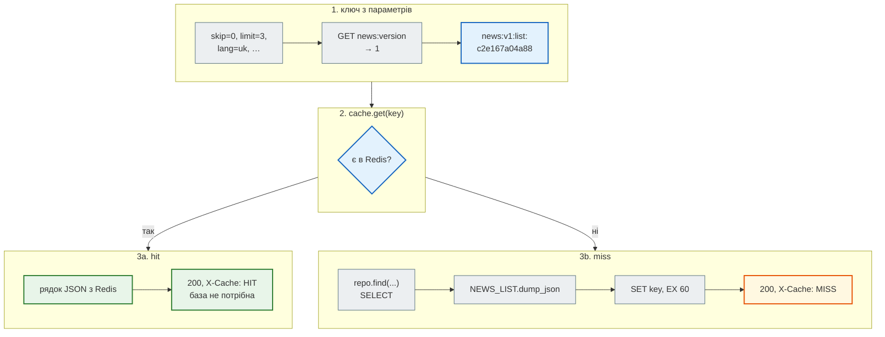
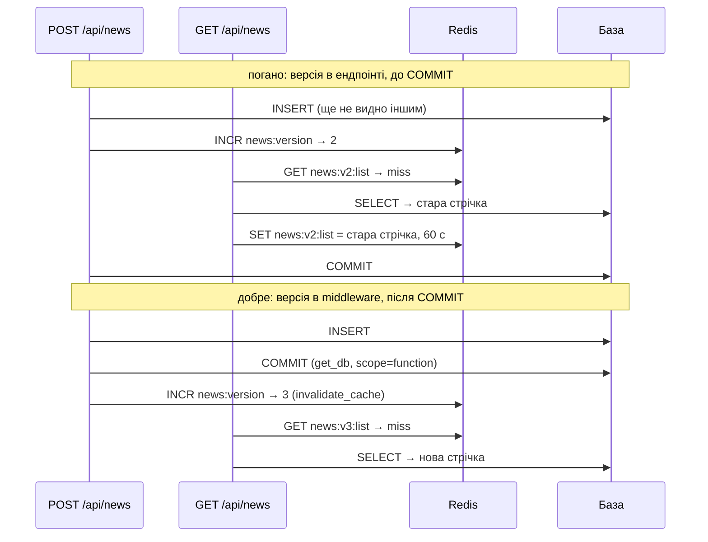

# Кеш стрічки в Redis

> Крок 4 · розділ 2 з 4. Код: [`news_hub/cache.py`](https://github.com/NikoriakViktor/news_hub/blob/main/steps/04_middleware_redis/news_hub/cache.py), [`news_hub/api.py`](https://github.com/NikoriakViktor/news_hub/blob/main/steps/04_middleware_redis/news_hub/api.py), [`news_hub/middleware.py`](https://github.com/NikoriakViktor/news_hub/blob/main/steps/04_middleware_redis/news_hub/middleware.py).
> Теорія: [Частина VI. Middleware, кеш і фонові задачі](../../06_middleware_cache_jobs/README.md).

## Задача { #task }

`GET /api/news` і `/api/news/stats` читають однакові дані сотні разів, а змінюються вони лише під час збору чи редагування. Кожне читання — SQL-запит, а для `stats` ще й три `GROUP BY`.

Треба віддавати повторні читання без бази і при цьому не показувати застарілу стрічку після запису.

## Ідея: cache-aside { #cache-aside }

**Cache-aside** («кеш збоку»): застосунок сам вирішує, коли читати кеш і коли його заповнювати.

1. Шукаємо відповідь у кеші за ключем.
2. Є (**hit**) — віддаємо, база не потрібна.
3. Немає (**miss**) — рахуємо з бази, кладемо в кеш **з TTL** і віддаємо.

TTL обов'язковий: кеш — копія, і вона застаріває. TTL обмежує, наскільки сильно: тут 60 секунд — найбільше, на скільки стрічка може «відставати» від бази, навіть якщо інвалідація з якоїсь причини не спрацювала.

## Зміна 1: клієнт Redis у `lifespan` { #client }

```python title="news_hub/cache.py (фрагмент)"
REDIS_URL = os.getenv("REDIS_URL", "redis://localhost:6379/0")


def make_redis(url: str = REDIS_URL) -> "Redis":
    if url.startswith("fakeredis://"):
        import fakeredis
        return fakeredis.FakeAsyncRedis(decode_responses=True)
    return Redis.from_url(url, decode_responses=True)


def get_redis(request: Request) -> "Redis":
    redis: Redis = request.app.state.redis
    return redis
```

```python title="news_hub/api.py (фрагмент)"
@asynccontextmanager
async def lifespan(app: FastAPI) -> AsyncIterator[None]:
    setup_logging()
    app.state.redis = make_redis()       # таблиці створює міграція: alembic upgrade head
    yield
    await app.state.redis.aclose()       # після зупинки — закрити з'єднання з Redis
    await engine.dispose()               # і пул з'єднань з базою
```

Той самий шаблон, що й сховище в кроці 2: ресурс на весь час роботи сервера створюється в `lifespan`, лежить в `app.state`, ендпоінти отримують його через `Depends(get_redis)`. Типовий стартовий код тримає клієнт у глобальній змінній модуля — такий не підміниш у тестах і не закриєш при зупинці.

| Запис | Що означає |
|---|---|
| `redis.asyncio.Redis` | асинхронний клієнт: кожна команда — `await`, цикл подій не блокується |
| `decode_responses=True` | Redis повертає `str`, а не `bytes` |
| `Redis.from_url(...)` | клієнт тримає пул з'єднань; створити один раз, а не на кожен запит |
| `fakeredis://` | `FakeAsyncRedis` — Redis у пам'яті процесу з тими самими командами; `conftest.py` ставить його в `REDIS_URL` до імпорту `news_hub` |

## Зміна 2: `NewsCache` { #news-cache }

```python title="news_hub/cache.py (фрагмент)"
class NewsCache:
    """Cache-aside: GET → є (hit) — віддати; немає (miss) — порахувати, SET з TTL, віддати."""

    TTL = 60                        # секунд: скільки стрічка може «відставати» від бази
    VERSION_KEY = "news:version"

    def __init__(self, redis: "Redis") -> None:
        self._redis = redis

    async def key(self, name: str, params: dict[str, Any]) -> str:
        version = _text(await self._redis.get(self.VERSION_KEY)) or "0"
        digest = hashlib.sha1(json.dumps(params, sort_keys=True, ensure_ascii=False).encode()).hexdigest()[:12]
        return f"news:v{version}:{name}:{digest}"

    async def get(self, key: str) -> str | None:
        return _text(await self._redis.get(key))

    async def set(self, key: str, payload: str) -> None:
        await self._redis.set(key, payload, ex=self.TTL)

    async def invalidate(self) -> int:
        """Нова версія — усі старі ключі кешу більше не читаються."""
        version: int = await self._redis.incr(self.VERSION_KEY)
        return version
```

Ключ має вигляд `news:v1:list:c2e167a04a88`:

| Частина | Звідки | Навіщо |
|---|---|---|
| `news:` | префікс | усі ключі кешу новин в одному «просторі імен» |
| `v1` | значення `news:version` (немає ключа — `0`) | [інвалідація](#invalidation) без видалення ключів |
| `list` / `stats` | який ендпоінт | різні відповіді — різні ключі |
| `c2e167a04a88` | перші 12 символів SHA-1 від параметрів у JSON | різні фільтри — різні записи; `sort_keys=True` — порядок параметрів не має значення |

## Зміна 3: кеш у `list_news` { #endpoint }

```diff title="news_hub/api.py: GET /api/news, крок 3 → крок 4"
-) -> list[NewsRow]:
-    """Новини з фільтрами й пагінацією: `?lang=uk&limit=5`."""
-    return await repo.find(skip=skip, limit=limit, category=category, source=source, lang=lang or "")
+) -> Response:
+    """Новини з фільтрами й пагінацією: `?lang=uk&limit=5`. Відповідь кешується в Redis на 60 с."""
+    key = await cache.key("list", {"skip": skip, "limit": limit, "category": category,
+                                   "source": source, "lang": lang or ""})
+    if (cached := await cache.get(key)) is not None:
+        return cached_json(cached, "HIT")                       # база не потрібна
+    rows = await repo.find(skip=skip, limit=limit, category=category, source=source, lang=lang or "")
+    payload = NEWS_LIST.dump_json([NewsOut.model_validate(row) for row in rows]).decode()
+    await cache.set(key, payload)
+    return cached_json(payload, "MISS")
```

```python title="news_hub/api.py (фрагмент)"
NEWS_LIST = TypeAdapter(list[NewsOut])


def cached_json(payload: str | bytes, state: str) -> Response:
    return Response(content=payload, media_type="application/json", headers={"X-Cache": state})


def get_cache(redis: RedisDep) -> NewsCache:
    return NewsCache(redis)


CacheDep = Annotated[NewsCache, Depends(get_cache)]
```

- **У кеші — готовий JSON.** Redis зберігає рядки, а об'єкти `NewsRow` прив'язані до сесії й не серіалізуються. При hit рядок віддається як є: ні бази, ні Pydantic.
- **Ендпоінт повертає `Response` сам**, тому FastAPI не перетворює результат через `response_model`. `response_model=list[NewsOut]` лишився в декораторі для схеми в `/docs`; форму JSON задає `NEWS_LIST.dump_json(...)` — `TypeAdapter` для списку моделей.
- **`X-Cache: HIT | MISS`** — заголовок для людей і тестів: видно, звідки відповідь.
- `news_stats` змінено так само, ключ — `cache.key("stats", {})`.

Покроково — запит `GET /api/news?lang=uk&limit=3` після збору знімка (версія — `1`):



## Результат: MISS, потім HIT { #result }

Сервер кроку з Redis 7, база й кеш порожні:

```python
api.post("/api/scrape", json={"source": "snapshot"})            # 168 новин у базі
for attempt in (1, 2, 3):
    response = api.get("/api/news", params={"lang": "uk", "limit": 3})
    print(attempt, response.headers["X-Cache"], len(response.json()), "новини")
print("інші параметри:", api.get("/api/news", params={"lang": "ru", "limit": 3}).headers["X-Cache"])
print("порядок параметрів:", api.get("/api/news?limit=3&lang=uk").headers["X-Cache"])
```

```text
1 MISS 3 новини
2 HIT 3 новини
3 HIT 3 новини
інші параметри: MISS
порядок параметрів: HIT
```

`?limit=3&lang=uk` — той самий запис, що й `?lang=uk&limit=3`: ключ будується з параметрів функції, а не з рядка URL.

Що лежить у Redis:

```python
import asyncio

from redis.asyncio import Redis


async def show_cache_keys() -> None:
    redis = Redis.from_url("redis://localhost:6379/0", decode_responses=True)
    print("news:version =", await redis.get("news:version"))
    for key in sorted(await redis.keys("news:v[0-9]*")):
        print(key, "TTL", await redis.ttl(key), "с")
    await redis.aclose()


asyncio.run(show_cache_keys())
```

```text
news:version = 1
news:v1:list:c2e167a04a88 TTL 60 с
news:v1:list:f0f06916a656 TTL 60 с
```

- Версія вже `1`, а не `0`: перший `POST /api/scrape` був записом і збільшив її.
- Два ключі — два набори параметрів (`uk` і `ru`).

!!! warning "`KEYS` — лише для розглядання"
    `KEYS` перебирає **всі** ключі бази й на цей час блокує Redis для всіх клієнтів. На кількох ключах це непомітно, на мільйонах — сервер стоїть. У коді застосунку `KEYS` немає; для обходу ключів у продакшені є `SCAN`.

## Інвалідація: версія кешу { #invalidation }

Після запису кеш має «забути» стару стрічку. Можна видаляти ключі за шаблоном (`KEYS news:*` → `DEL`), але це повільно (див. вище) і не атомарно: поки видаляємо, хтось уже кладе нові.

Натомість ключ містить **версію**. Запис → `INCR news:version` → нові запити будують ключі `news:v2:…`, старі `news:v1:…` просто ніхто не читає, а TTL їх прибирає. Одна команда, жодного перебору ключів.

## Коли збільшувати версію: після COMMIT { #commit }

Інтуїтивно — в ендпоінті, одразу після запису. Проблема: COMMIT робить `get_db` **після** ендпоінта (крок 3). Між «версія +1» і COMMIT паралельний `GET` встигне прочитати з бази ще **старі** дані й покласти їх у кеш під **новою** версією — і 60 секунд усі отримуватимуть застарілу стрічку:



Тому версію збільшує middleware: він отримує відповідь, коли COMMIT уже відбувся.

```python title="news_hub/middleware.py (фрагмент)"
WRITE_METHODS = {"POST", "PATCH", "PUT", "DELETE"}


async def invalidate_cache(request: Request, call_next: CallNext) -> Response:
    """Після успішного запису — нова версія кешу.

    Чому тут, а не в ендпоінті: COMMIT робить get_db (крок 3) уже ПІСЛЯ ендпоінта. Інвалідація в
    ендпоінті йшла б до COMMIT, і паралельний GET встиг би закешувати старі дані під новою версією.
    Middleware отримує відповідь, коли COMMIT уже відбувся (scope="function").
    """
    response = await call_next(request)
    path = request.url.path
    if (request.method in WRITE_METHODS and response.status_code < 400
            and (path.startswith("/api/news") or path == "/api/scrape")):
        await NewsCache(get_redis(request)).invalidate()
    return response
```

Умова — три перевірки разом:

| Перевірка | Чому |
|---|---|
| метод — `POST`, `PATCH`, `PUT` чи `DELETE` | `GET` нічого не змінює |
| `status_code < 400` | `409` (такий `url` уже є) чи `422` (невалідне тіло) — запису не було, кеш не чіпаємо |
| шлях `/api/news…` або рівно `/api/scrape` | `POST /api/scrape/jobs` відповідає ще до збору — версію збільшить сама [фонова задача](background_jobs.md) після свого COMMIT |

А якщо паралельний `GET` прочитав версію `1`, потім запис закомітився і версія стала `2`, а `GET` записав старі дані під `news:v1:…`? Нічого страшного: ключі `v1` вже ніхто не читає.

## Результат: запис скидає кеш, `409` — ні { #invalidation-result }

```python
print("до:   ", api.get("/api/news/stats").headers["X-Cache"], api.get("/api/news/stats").headers["X-Cache"])
created = api.post("/api/news", json={"title": "НБУ залишив облікову ставку без змін",
                                      "url": "https://www.rbc.ua/ukr/news/nbu-rate-778.html"})
stats = api.get("/api/news/stats")
print("після:", created.status_code, stats.headers["X-Cache"], "total =", stats.json()["total"])
again = api.post("/api/news", json={"title": "НБУ залишив облікову ставку без змін",
                                    "url": "https://www.rbc.ua/ukr/news/nbu-rate-778.html"})
print("409:  ", again.status_code, api.get("/api/news/stats").headers["X-Cache"])
```

```text
до:    MISS HIT
після: 201 MISS total = 169
409:   409 HIT
```

І ключі після цього (`show_cache_keys()` ще раз):

```text
news:version = 2
news:v1:list:c2e167a04a88 TTL 60 с
news:v1:list:f0f06916a656 TTL 60 с
news:v1:stats:bf21a9e8fbc5 TTL 60 с
news:v2:stats:bf21a9e8fbc5 TTL 60 с
```

Старі ключі `v1` ще лежать, але їх ніхто не прочитає; за хвилину TTL їх прибере. Ключ `stats` з тими самими параметрами в обох версіях має однаковий хеш — відрізняє їх лише версія.

Те саме перевіряють тести `test_cache_miss_then_hit`, `test_write_invalidates_cache` і `test_failed_write_keeps_cache` у [`tests/test_redis.py`](https://github.com/NikoriakViktor/news_hub/blob/main/steps/04_middleware_redis/tests/test_redis.py).

## Що кешувати, а що ні { #what-to-cache }

| Кешуємо | Не кешуємо |
|---|---|
| `GET /api/news` — читають найчастіше | `/api/news/search` — довільний `q`, ключів стане стільки ж, скільки запитів |
| `/api/news/stats` — три `GROUP BY` | `/api/news/count` — один дешевий `COUNT` |
| | відповіді з помилками (`404`, `422`): новина, створена за секунду, 60 с виглядала б відсутньою |

## Правило { #rule }

!!! tip "Правило"
    Кешуй готову відповідь (JSON), ключ будуй з параметрів запиту, кожному запису давай TTL. Скидай кеш **новою версією** (`INCR`), а не видаленням ключів, і лише **після COMMIT** успішного запису.

**Далі:** [Rate limit: `429` і `Retry-After`](rate_limit.md).
