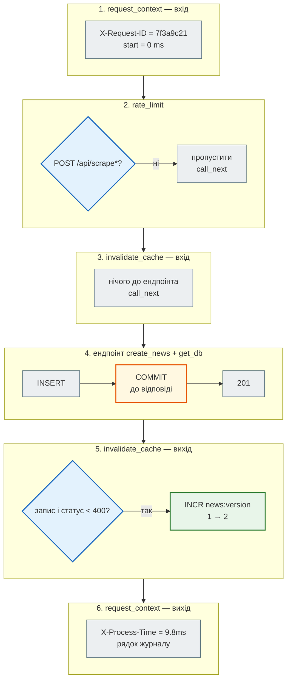

# Middleware: код навколо кожного запиту

> Крок 4 · розділ 1 з 4. Код: [`news_hub/middleware.py`](https://github.com/NikoriakViktor/news_hub/blob/main/steps/04_middleware_redis/news_hub/middleware.py), [`news_hub/api.py`](https://github.com/NikoriakViktor/news_hub/blob/main/steps/04_middleware_redis/news_hub/api.py).
> Теорія: [Частина VI. Middleware, кеш і фонові задачі](../../06_middleware_cache_jobs/README.md).

## Задача { #task }

Є речі, що стосуються **всіх** ендпоінтів одразу:

- позначити кожен запит, щоб потім знайти його в журналі;
- виміряти, скільки він обробляється;
- записати рядок журналу «метод, шлях, статус, час»;
- далі в цьому кроці — обмежити частоту запитів і скинути кеш після запису.

Копіювати це в кожен із 13 ендпоінтів — гарантовано забути в чотирнадцятому. Потрібне одне місце, через яке проходить кожен запит.

## Зміна: функція з `call_next` { #change }

**Middleware** — функція, через яку проходить **кожен** запит до ендпоінта і **кожна** відповідь після нього. Ендпоінти про неї не знають.

```python title="news_hub/middleware.py (фрагмент)"
CallNext = Callable[[Request], Awaitable[Response]]


async def request_context(request: Request, call_next: CallNext) -> Response:
    """Найзовнішній шар: бачить увесь час обробки, зокрема інших middleware."""
    request_id = request.headers.get("X-Request-ID") or uuid.uuid4().hex[:8]
    start = time.perf_counter()
    response = await call_next(request)
    elapsed_ms = (time.perf_counter() - start) * 1000
    response.headers["X-Request-ID"] = request_id
    response.headers["X-Process-Time"] = f"{elapsed_ms:.1f}ms"
    logger.info("%s %s %s → %s %.1f ms", request_id, request.method, request.url.path,
                response.status_code, elapsed_ms)
    return response
```

| Запис | Що означає |
|---|---|
| код до `await call_next(request)` | виконується **до** ендпоінта: запит уже є, відповіді ще немає |
| `await call_next(request)` | «передай запит далі» — наступному middleware, а останній — ендпоінту; повертає готову відповідь |
| код після `call_next` | виконується **після** ендпоінта: можна читати статус і дописувати заголовки |
| не викликати `call_next` | ендпоінт не виконається; middleware відповідає сам — так працює [rate limit](rate_limit.md) |
| `X-Request-ID` | позначка запиту: клієнт може передати свою, інакше генеруємо 8 символів з `uuid4` |
| `X-Process-Time` | скільки сервер обробляв запит, у мілісекундах |

За `X-Request-ID` у журналі знаходять усе, що стосується одного запиту. Якщо клієнт (інший сервіс, проксі) уже позначив запит, ми зберігаємо його позначку — тоді один і той самий id видно в журналах усіх сервісів, через які пройшов запит.

### Журнал: `setup_logging` { #logging }

`logger.info(...)` сам нічого не друкує: uvicorn налаштовує лише свої логери (`uvicorn`, `uvicorn.access`). Тому в `lifespan` з'явився виклик `setup_logging()`:

```python title="news_hub/api.py (фрагмент)"
def setup_logging() -> None:
    """uvicorn налаштовує лише свої логери; без цього рядки журналу news_hub нікуди не потрапили б."""
    logger = logging.getLogger("news_hub")
    if not logger.handlers:
        handler = logging.StreamHandler()
        handler.setFormatter(logging.Formatter("%(asctime)s %(levelname)s %(name)s: %(message)s", "%H:%M:%S"))
        logger.addHandler(handler)
        logger.setLevel(logging.INFO)
```

`if not logger.handlers` — щоб повторний запуск `lifespan` (кожен `with TestClient(app)` у тестах) не додавав другий обробник і рядки не дублювались.

## Зміна: реєстрація і порядок { #order }

У `api.py` три middleware реєструються одразу після створення застосунку. Порядок має значення:

```python title="news_hub/api.py (фрагмент)"
# Middleware: останній зареєстрований — зовнішній. Запит іде request_context → rate_limit → invalidate_cache
# → ендпоінт, відповідь — у зворотному порядку.
app.middleware("http")(invalidate_cache)
app.middleware("http")(rate_limit)
app.middleware("http")(request_context)
```

`app.middleware("http")` — той самий декоратор, що `@app.middleware("http")` над функцією, лише викликаний явно: функції лежать в окремому модулі `middleware.py`, а тут видно весь ланцюг і його порядок в одному місці.

Middleware вкладаються одне в одне, як шари цибулі. Запит іде всередину, відповідь — назовні у зворотному порядку. Покроково — один `POST /api/news` через три шари (id, час і номер версії — приклад значень):



Чому саме такий порядок:

| Шар | Чому тут |
|---|---|
| `request_context` — зовнішній | його час включає всі інші шари; заголовки й рядок журналу отримує **кожна** відповідь, зокрема `429` від rate limit |
| `rate_limit` — посередині | відкидає зайве якомога раніше: на `429` не виконуються ні `invalidate_cache`, ні ендпоінт, ні база |
| `invalidate_cache` — внутрішній | бачить відповідь ендпоінта одразу, коли COMMIT уже відбувся ([чому це важливо](cache.md#commit)) |

## Результат: заголовки і журнал { #result }

Сервер кроку (`uvicorn news_hub.api:app`, Redis 7, база SQLite):

```python
import httpx

api = httpx.Client(base_url="http://127.0.0.1:8000")
for headers in ({}, {"X-Request-ID": "step-04"}):
    response = api.get("/health", headers=headers)
    print(response.status_code, response.headers["X-Request-ID"], response.headers["X-Process-Time"])
```

```text
200 dda0826d 16.0ms
200 step-04 1.5ms
```

У консолі сервера — рядок журналу `news_hub` поруч із рядком uvicorn:

```text
21:09:17 INFO news_hub: dda0826d GET /health → 200 16.0 ms
INFO:     127.0.0.1:56614 - "GET /health HTTP/1.1" 200 OK
21:09:17 INFO news_hub: step-04 GET /health → 200 1.5 ms
INFO:     127.0.0.1:56614 - "GET /health HTTP/1.1" 200 OK
```

- Без заголовка id згенерований (`dda0826d`), з заголовком — той, що прислав клієнт (`step-04`).
- Час — приклад, залежить від машини; перший запит після старту зазвичай повільніший за наступні.
- У рядку `news_hub` є id, а в рядку uvicorn — ні. Саме id зв'язує журнал із відповіддю, яку бачив клієнт.

## Що буде, якщо переплутати порядок { #wrong-order }

Той самий застосунок, але `request_context` зареєстровано **першим** — тепер він найвнутрішній, а `rate_limit` — зовнішній. Шостий `POST /api/scrape` поспіль (ліміт — 5):

```python
app.middleware("http")(request_context)      # першим → найвнутрішній
app.middleware("http")(invalidate_cache)
app.middleware("http")(rate_limit)           # останнім → зовнішній
```

```text
429 X-Request-ID: None | X-Process-Time: None
```

`rate_limit` відповів `429`, не викликавши `call_next`, — до `request_context` запит не дійшов. Відповідь без id, без часу, без рядка журналу: якраз ті запити, які найцікавіше розслідувати, стали невидимими. З правильним порядком той самий `429` має обидва заголовки:

```text
429 {'X-Request-ID': '8afd252c', 'X-Process-Time': '0.8ms', 'Retry-After': '60', 'X-RateLimit-Remaining': '0'}
```

## Middleware чи `Depends` { #middleware-vs-depends }

Обидва виконують код «до ендпоінта». Різниця — у тому, що вони бачать:

| | Middleware | `Depends` |
|---|---|---|
| для яких запитів | **усіх**, зокрема `404` на неіснуючий шлях і `422` | лише для ендпоінтів, що її оголосили |
| що бачить | сирий `Request` і готовий `Response` | розібрані параметри, тіло, інші залежності |
| може змінити відповідь | так: заголовки, статус, власна відповідь | ні, лише кинути `HTTPException` |
| коли код «після» | коли відповідь готова, після COMMIT у `get_db` (`scope="function"`) | після `yield` |
| у `/docs` | не видно | параметри залежності видно в схемі |

Тому журнал, час, ліміт за адресою й інвалідація кешу — middleware; сесія бази, репозиторій, кеш як об'єкт (`CacheDep`) — залежності.

!!! note "Middleware в FastAPI бувають двох видів"
    `@app.middleware("http")` — функція з `call_next`, як тут: просто писати й читати. Класи на рівні ASGI (`app.add_middleware(CORSMiddleware, ...)`) — швидші й працюють і з WebSocket, але складніші. Приклад готового класу — [CORS](../../06_middleware_cache_jobs/cors.md).

## Правило { #rule }

!!! tip "Правило"
    Те, що стосується кожного запиту (позначка, час, журнал, ліміти), — у middleware, а не в ендпоінтах. Найзовнішнім ставай той шар, який мусить побачити **кожну** відповідь, зокрема ті, що інші шари повернули самі. Останній зареєстрований — зовнішній.

**Далі:** [Кеш стрічки в Redis](cache.md).
