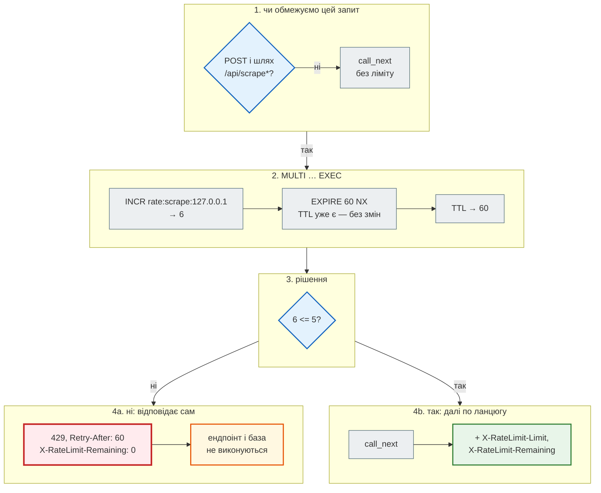
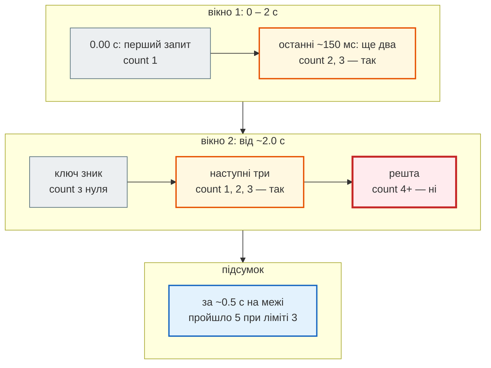

# Rate limit: `429` і `Retry-After`

> Крок 4 · розділ 3 з 4. Код: [`news_hub/middleware.py`](https://github.com/NikoriakViktor/news_hub/blob/main/steps/04_middleware_redis/news_hub/middleware.py).
> Теорія: [Частина VI. Middleware, кеш і фонові задачі](../../06_middleware_cache_jobs/README.md).

## Задача { #task }

`POST /api/scrape` — найдорожчий запит агрегатора: живий збір завантажує сім сторінок rbc.ua. Скрипт, що смикає його в циклі, навантажить наш сервер і змусить нас самих засипати запитами чужий сайт.

Треба обмежити частоту: **не більше 5 `POST /api/scrape*` за 60 секунд з однієї адреси**. Понад ліміт — відмова зі статусом `429 Too Many Requests` і підказкою, скільки чекати.

## Ідея: лічильник з TTL { #idea }

На кожну пару «дія + адреса клієнта» — ключ у Redis, наприклад `rate:scrape:127.0.0.1`:

- кожен запит робить `INCR` — Redis збільшує число на 1 і повертає нове значення (ключа не було — створює з `0`, повертає `1`);
- першому `INCR` у вікні ставимо TTL 60 с — через хвилину ключ зникне, і лічильник почнеться з нуля;
- значення більше за ліміт — `429`.

Ліміти для різних дій — різні ключі: `rate:scrape:…` не заважатиме, скажімо, `rate:create:…`.

## Зміна 1: `RateLimiter` — одна транзакція { #limiter }

```python title="news_hub/middleware.py (фрагмент)"
RATE_LIMIT_REQUESTS = int(os.getenv("RATE_LIMIT_REQUESTS", "5"))
RATE_LIMIT_WINDOW = int(os.getenv("RATE_LIMIT_WINDOW", "60"))      # секунд


class RateLimiter:
    """Фіксоване вікно: лічильник на ключ, що живе RATE_LIMIT_WINDOW секунд."""

    def __init__(self, redis: Redis, limit: int = RATE_LIMIT_REQUESTS, window: int = RATE_LIMIT_WINDOW) -> None:
        self._redis, self.limit, self.window = redis, limit, window

    async def hit(self, client: str, action: str) -> tuple[bool, int, int]:
        """+1 до лічильника; повертає (дозволено?, скільки запитів у вікні, секунд до нового вікна)."""
        key = f"rate:{action}:{client}"
        async with self._redis.pipeline(transaction=True) as pipe:      # MULTI … EXEC: разом або ніяк
            pipe.incr(key)
            pipe.expire(key, self.window, nx=True)                        # TTL лише новому ключу
            pipe.ttl(key)
            count, _, ttl = await pipe.execute()
        return count <= self.limit, count, max(ttl, 0)
```

Типовий стартовий код (наприклад, ліміт повідомлень у Telegram-боті) робить це двома окремими командами:

```diff title="rate limit: дві команди → одна транзакція"
-count = await self._redis.incr(key)
-if count == 1:
-    await self._redis.expire(key, config.RATE_LIMIT_WINDOW)
-is_allowed = count <= config.RATE_LIMIT_REQUESTS
+async with self._redis.pipeline(transaction=True) as pipe:      # MULTI … EXEC: разом або ніяк
+    pipe.incr(key)
+    pipe.expire(key, self.window, nx=True)                        # TTL лише новому ключу
+    pipe.ttl(key)
+    count, _, ttl = await pipe.execute()
+return count <= self.limit, count, max(ttl, 0)
```

| Запис | Що означає |
|---|---|
| `pipeline(transaction=True)` | команди збираються й відправляються разом у `MULTI … EXEC`: Redis виконує їх підряд, жодна чужа команда не вклиниться посередині |
| `expire(key, window, nx=True)` | `EXPIRE … NX` — поставити TTL, **лише якщо його ще немає**: перший запит вікна ставить, наступні не продовжують |
| `ttl(key)` | скільки секунд лишилось до кінця вікна — це й буде `Retry-After` |
| `count, _, ttl = await pipe.execute()` | результати трьох команд у тому самому порядку |

### Чому дві команди — погано { #two-commands }

Якщо `INCR` і `EXPIRE` — два окремі запити, а процес упаде між ними (перезапуск, обрив з'єднання), ключ залишиться **без TTL**. Наступні `INCR` дадуть 2, 3, 4… — умова `count == 1` більше ніколи не спрацює, ключ ніколи не зникне. Клієнта заблоковано назавжди.

Перевіримо на справжньому Redis. «Падіння» імітуємо, просто не викликаючи `EXPIRE` після першого `INCR`:

```python
import asyncio

from redis.asyncio import Redis

from news_hub.middleware import RateLimiter


async def old_vs_new() -> None:
    redis = Redis.from_url("redis://localhost:6379/0", decode_responses=True)
    await redis.delete("rate:old", "rate:scrape:crashed")

    await redis.incr("rate:old")                   # INCR… і процес «упав» до EXPIRE
    for _ in range(3):
        count = await redis.incr("rate:old")
        if count == 1:                             # ніколи не виконається
            await redis.expire("rate:old", 60)
    print("окремо:     count =", await redis.get("rate:old"), "| TTL =", await redis.ttl("rate:old"))

    await redis.set("rate:scrape:crashed", 99)     # той самий «залишок» без TTL
    allowed, count, ttl = await RateLimiter(redis).hit("crashed", "scrape")
    print("транзакція: count =", count, "| дозволено:", allowed, "| TTL =", ttl)
    await redis.aclose()


asyncio.run(old_vs_new())
```

```text
окремо:     count = 4 | TTL = -1
транзакція: count = 100 | дозволено: False | TTL = 60
```

`TTL = -1` означає «ключ без часу життя»: блокування назавжди. `EXPIRE … NX` ставить TTL, **якщо його немає**, у тій самій транзакції, що `INCR`, — навіть «залишок» після збою сам зникне за хвилину. Це перевіряє тест `test_rate_limit_key_without_ttl_heals`; зі старою логікою він падає.

## Зміна 2: middleware `rate_limit` { #middleware }

```python title="news_hub/middleware.py (фрагмент)"
async def rate_limit(request: Request, call_next: CallNext) -> Response:
    if request.method != "POST" or not request.url.path.startswith("/api/scrape"):
        return await call_next(request)
    limiter = RateLimiter(get_redis(request))
    client = request.client.host if request.client else "unknown"
    allowed, count, ttl = await limiter.hit(client, "scrape")
    headers = {"X-RateLimit-Limit": str(limiter.limit),
               "X-RateLimit-Remaining": str(max(limiter.limit - count, 0))}
    if not allowed:
        logger.warning("rate limit: %s count=%s", client, count)
        return JSONResponse(status_code=429, headers={**headers, "Retry-After": str(ttl)},
                            content={"detail": f"забагато запитів: {limiter.limit} за {limiter.window} с; "
                                               f"спробуй через {ttl} с"})
    response = await call_next(request)
    response.headers.update(headers)
    return response
```

Покроково — шостий `POST /api/scrape` у вікні (ліміт 5):



- **Шлях з `startswith("/api/scrape")`** — під ліміт потрапляють і `POST /api/scrape`, і `POST /api/scrape/jobs`, з **одним** лічильником (дія `"scrape"`): фоновий збір — той самий збір.
- **Ліміт рахує запит до перевірки тіла.** Middleware виконується раніше, ніж FastAPI розбирає JSON, тож невалідний запит (`422`) теж витрачає ліміт. Так і задумано: інакше помилковими запитами можна було б засипати сервер без обмежень.
- **`GET` не обмежується** — читання дешеве, його бере на себе [кеш](cache.md).

## Результат: `429`, `Retry-After`, `X-RateLimit-*` { #result }

Сервер кроку з Redis 7, лічильник цієї адреси скинуто:

```python
for attempt in range(1, 8):
    response = api.post("/api/scrape", json={"source": "snapshot"})
    print(attempt, response.status_code, "ліміт:", response.headers.get("X-RateLimit-Limit"),
          "залишилось:", response.headers.get("X-RateLimit-Remaining"),
          "| Retry-After:", response.headers.get("Retry-After"))
print(response.json())
print("GET не обмежується:", api.get("/api/news/count").status_code)
print("jobs теж під лімітом:", api.post("/api/scrape/jobs", json={"source": "snapshot"}).status_code)
```

```text
1 200 ліміт: 5 залишилось: 4 | Retry-After: None
2 200 ліміт: 5 залишилось: 3 | Retry-After: None
3 200 ліміт: 5 залишилось: 2 | Retry-After: None
4 200 ліміт: 5 залишилось: 1 | Retry-After: None
5 200 ліміт: 5 залишилось: 0 | Retry-After: None
6 429 ліміт: 5 залишилось: 0 | Retry-After: 60
7 429 ліміт: 5 залишилось: 0 | Retry-After: 60
{'detail': 'забагато запитів: 5 за 60 с; спробуй через 60 с'}
GET не обмежується: 200
jobs теж під лімітом: 429
```

У журналі сервера — попередження для кожної відмови:

```text
21:09:41 WARNING news_hub: rate limit: 127.0.0.1 count=8
21:09:41 INFO news_hub: 8580d3bf POST /api/scrape/jobs → 429 1.3 ms
```

- `Retry-After: 60` — бо всі сім запитів пройшли за частку секунди від першого; що далі від початку вікна, то менше число.
- `count=8` — відхилені запити теж рахуються, але вікно від цього **не подовжується**: `EXPIRE … NX` не чіпає наявний TTL.
- Через хвилину ключ зникне, і перший запит нового вікна знову отримає `залишилось: 4`.

| Заголовок | Значення | Для кого |
|---|---|---|
| `Retry-After` | секунд до нового вікна (лише в `429`) | стандартний заголовок HTTP: клієнти й бібліотеки повторних спроб знають, скільки чекати |
| `X-RateLimit-Limit` | ліміт на вікно | клієнт бачить правила |
| `X-RateLimit-Remaining` | скільки ще можна у цьому вікні | клієнт може пригальмувати до `429` |

## Фіксоване вікно: межа { #fixed-window }

Цей алгоритм — **фіксоване вікно**: лічильник живе, поки живе ключ, і обнуляється разом із ним. У стартовому коді він був названий «Sliding Window Counter» — це неправильно, ковзного вікна тут немає.

Різниця видна на межі двох вікон: залишок старого вікна + повне нове. Ліміт 3 за 2 секунди, перший запит відкрив вікно, чекаємо його кінця й шлемо запит кожні 50 мс протягом пів секунди:

```python
import time


async def window_edge() -> None:
    redis = Redis.from_url("redis://localhost:6379/0", decode_responses=True)
    await redis.delete("rate:edge:demo")
    limiter = RateLimiter(redis, limit=3, window=2)
    await limiter.hit("demo", "edge")                                  # 1-й запит відкрив вікно
    while await redis.pttl("rate:edge:demo") > 150:                    # чекаємо кінця вікна
        await asyncio.sleep(0.05)
    start, allowed = time.perf_counter(), 0
    while time.perf_counter() - start < 0.5:                           # пів секунди — запит кожні 50 мс
        allowed += (await limiter.hit("demo", "edge"))[0]
        await asyncio.sleep(0.05)
    print(f"за 0.5 с пройшло {allowed} запитів при ліміті 3 за 2 с")
    await redis.aclose()


asyncio.run(window_edge())
```

```text
за 0.5 с пройшло 5 запитів при ліміті 3 за 2 с
```

(Три запуски поспіль дали однаковий результат.) Два запити добрали старе вікно, три — відкрили нове. На межі фіксоване вікно пропускає майже вдвічі більше за ліміт.



| | Фіксоване вікно (тут) | Ковзне вікно |
|---|---|---|
| як рахує | лічильник `INCR` на ключ з TTL | час кожного запиту в sorted set; рахує ті, що за останні N секунд |
| пам'ять | одне число на клієнта | один запис на кожен запит у вікні |
| на межі вікон | до 2× ліміту | не більше ліміту за будь-які N секунд |
| коли брати | захист від спаму, як тут | де ліміт — частина договору (платне API) |

Для захисту від спаму зборами фіксованого вікна досить — простота важить більше. Ковзне вікно — завдання в [контрольній точці](checkpoint.md#try-yourself).

## За проксі { #proxy }

`request.client.host` — адреса того, хто відкрив TCP-з'єднання. Коли перед застосунком стоїть nginx, це адреса nginx: усі клієнти ділитимуть один лічильник, і п'ять зборів одного користувача заблокують усіх. Справжню адресу проксі передає в заголовку `X-Forwarded-For`, але вірити йому можна лише від **свого** проксі — інакше клієнт підставить туди що завгодно й обійде ліміт. Як це налаштовано — [крок 11](../11_compose_deploy/index.md).

## Правило { #rule }

!!! tip "Правило"
    Лічильник ліміту — `INCR` і `EXPIRE … NX` **однією транзакцією**, щоб ключ ніколи не лишився без TTL. Понад ліміт — `429` з `Retry-After`, і відповідає middleware сам, не доходячи до ендпоінта. Знай межу свого алгоритму: фіксоване вікно на стику пропускає до 2× ліміту.

**Далі:** [Фоновий збір: `202` і статус задачі](background_jobs.md).
