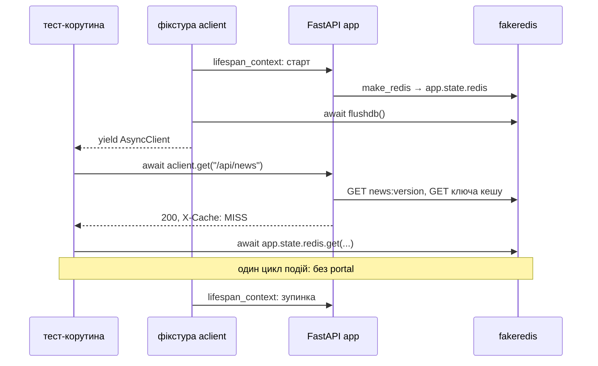

# API асинхронно: `httpx.AsyncClient`

> Крок 5 · розділ 5 з 7. Код: [`tests/integration/conftest.py`](https://github.com/NikoriakViktor/news_hub/blob/main/steps/05_api_testing/tests/integration/conftest.py), [`tests/integration/test_async_api.py`](https://github.com/NikoriakViktor/news_hub/blob/main/steps/05_api_testing/tests/integration/test_async_api.py), [`news_hub/middleware.py`](https://github.com/NikoriakViktor/news_hub/blob/main/steps/05_api_testing/news_hub/middleware.py).
> Теорія: [Частина VII. Тестування API](../../07_testing/README.md); FastAPI — [Async Tests](https://fastapi.tiangolo.com/advanced/async-tests/); HTTPX — [ASGI transport](https://www.python-httpx.org/advanced/transports/#asgi-transport).

## Задача { #task }

`TestClient` синхронний. Застосунок крутиться в окремому потоці зі своїм циклом подій, тест надсилає запити по одному, а до Redis чи бази тест дістається через `client.portal.call(...)`:

```python title="tests/integration/conftest.py (фрагмент): client"
with TestClient(app) as c:
    c.portal.call(db.create_tables)         # у циклі подій застосунку, де працюватиме engine
    c.portal.call(app.state.redis.flushdb)  # чистий Redis (для TEST_REDIS_URL — окрема база 15)
    yield c
```

Так не перевірити дві речі:

- **одночасні запити** — rate limit з кроку 4 має пропустити рівно 5 з 10, навіть якщо всі 10 прийшли разом;
- **async-стан застосунку** «звичайним» `await`, без `portal`.

## Зміна 1: спільна `TestDatabase` { #test-database }

У кроці 4 фікстура `client` робила все сама: engine, таблиці, тестовий `get_db`, підміни. Друга фікстура повторила б той самий код. Тому спільне винесено в клас:

```diff title="tests/integration/conftest.py: client (крок 4) → TestDatabase + client + aclient (крок 5)"
-@pytest.fixture
-def client() -> Iterator[TestClient]:
-    extra = {"poolclass": StaticPool} if TEST_DATABASE_URL.startswith("sqlite") else {}
-    engine = make_engine(TEST_DATABASE_URL, **extra)
-    ...
-    app.dependency_overrides[get_db] = test_db
+class TestDatabase:
+    """Тестова база + підміна залежностей застосунку. Спільне для `client` (sync) і `aclient` (async)."""
+    def __init__(self) -> None: ...                  # engine і фабрика сесій
+    async def create_tables(self) -> None: ...
+    async def get_db(self) -> AsyncIterator[AsyncSession]: ...
+    def install(self) -> None: ...                   # dependency_overrides
+
+@pytest.fixture
+def client() -> Iterator[TestClient]: ...           # як і було, через TestDatabase
+
+@pytest_asyncio.fixture
+async def aclient() -> AsyncIterator[httpx.AsyncClient]: ...
```

```python title="tests/integration/conftest.py (фрагмент)"
class TestDatabase:
    def __init__(self) -> None:
        # SQLite у пам'яті живе, поки відкрите з'єднання → StaticPool: одне з'єднання на весь тест
        extra = {"poolclass": StaticPool} if TEST_DATABASE_URL.startswith("sqlite") else {}
        self.engine = make_engine(TEST_DATABASE_URL, **extra)
        self.factory = async_sessionmaker(self.engine, expire_on_commit=False, autoflush=False)

    def install(self) -> None:
        app.dependency_overrides[get_db] = self.get_db
        app.dependency_overrides[get_session_factory] = lambda: self.factory   # фонові задачі — теж у тестову базу
        app.dependency_overrides[get_scrapers] = lambda: {"async": fake_scraper, "sequential": fake_scraper}
```

Назва `TestDatabase` нічого не ламає: pytest шукає тести лише у файлах `test_*.py`, а `conftest.py` до них не належить.

## Зміна 2: фікстура `aclient` { #aclient }

```python title="tests/integration/conftest.py (фрагмент)"
@pytest_asyncio.fixture
async def aclient() -> AsyncIterator[httpx.AsyncClient]:
    """Асинхронний клієнт (крок 5): тест і застосунок — в одному циклі подій, без portal.

    ASGITransport не запускає lifespan — запускаємо його самі, щоб з'явився app.state.redis.
    """
    db = TestDatabase()
    db.install()
    async with app.router.lifespan_context(app):
        await db.create_tables()
        await app.state.redis.flushdb()
        transport = httpx.ASGITransport(app=app)
        async with httpx.AsyncClient(transport=transport, base_url="http://test") as c:
            yield c
        await db.engine.dispose()
    app.dependency_overrides.clear()
```

| Запис | Що означає |
|---|---|
| `httpx.ASGITransport(app=app)` | запит не йде в мережу: httpx викликає ASGI-застосунок як функцію |
| `base_url="http://test"` | будь-яка адреса; потрібна, щоб писати `aclient.get("/health")` |
| `app.router.lifespan_context(app)` | той самий `lifespan`, що запускає uvicorn: Redis-клієнт у `app.state.redis` |
| `request.client.host` | для ASGITransport — `127.0.0.1`; з цієї адреси rate limit рахує ключ |

Без `lifespan_context` застосунок не має Redis-клієнта:

```python
async with httpx.AsyncClient(transport=httpx.ASGITransport(app=app), base_url="http://test") as c:
    await c.get("/api/news")
```

```text
E           KeyError: 'redis'
E           AttributeError: 'State' object has no attribute 'redis'
```

Це та сама помилка, що в `TestClient(app)` без `with` ([крок 2](../02_fastapi_basics/index.md)): `lifespan` не запустився.



## Результат: три тести { #result }

```python title="tests/integration/test_async_api.py (фрагмент)"
pytestmark = pytest.mark.asyncio


async def test_cache_state_is_awaited_directly(aclient: httpx.AsyncClient) -> None:
    """Без portal: той самий Redis-клієнт, що в застосунку, — просто await."""
    assert (await aclient.get("/api/news")).headers["X-Cache"] == "MISS"
    assert (await aclient.get("/api/news")).headers["X-Cache"] == "HIT"
    assert await app.state.redis.get("news:version") is None                  # записів ще не було
    await aclient.post("/api/scrape", json={"source": "snapshot"})
    assert await app.state.redis.get("news:version") == "1"
```

`pytestmark = pytest.mark.asyncio` на рівні модуля ставить маркер усім тестам файлу. Перший тест, `test_same_api_async`, повторює кілька запитів із синхронних тестів (`/health`, `POST /api/news` → `201`, `/api/news/count`): клієнт інший, а відповіді ті самі.

```text
$ pytest -q -p no:cacheprovider tests/integration/test_async_api.py
...                                                                      [100%]
3 passed in 0.17s
```

## Зміна 3: rate limit під одночасними запитами { #rate-limit }

```python title="tests/integration/test_async_api.py (фрагмент)"
async def test_concurrent_requests_hit_rate_limit_exactly(aclient: httpx.AsyncClient) -> None:
    total = RATE_LIMIT_REQUESTS * 2
    responses = await asyncio.gather(*(aclient.post("/api/scrape", json={"source": "ftp"}) for _ in range(total)))
    statuses = sorted(r.status_code for r in responses)
    assert statuses == [422] * RATE_LIMIT_REQUESTS + [429] * RATE_LIMIT_REQUESTS
    assert await app.state.redis.get("rate:scrape:127.0.0.1") == str(total)
```

`RATE_LIMIT_REQUESTS` — 5 (`middleware.py`), тож тест шле 10 запитів одночасно. Рівно 5 мають пройти далі, решта — `429`.

Тіло `{"source": "ftp"}` навмисно неправильне. Відповідь `422` замість `429` показує, що rate limit рахує запит **до** перевірки тіла: middleware спрацьовує раніше за валідацію. Інакше сервер можна було б засипати помилковими запитами без обмежень. А останній рядок доводить, що лічильник порахував усі 10.

Атомарність тут забезпечує `MULTI … EXEC` з кроку 4: «+1 і дізнатися результат» — одна дія:

```python title="news_hub/middleware.py (фрагмент)"
async with self._redis.pipeline(transaction=True) as pipe:      # MULTI … EXEC: разом або ніяк
    pipe.incr(key)
    pipe.expire(key, self.window, nx=True)                        # TTL лише новому ключу
    pipe.ttl(key)
    count, _, ttl = await pipe.execute()
```

Але на fakeredis цей тест пройде і з «наївним» лічильником — розбір і прогін на справжньому Redis у розділі [Межа фейку](fake_server.md#fakeredis-limit). Тому для цього тесту справжній прогін — `TEST_REDIS_URL=redis://localhost:6379/15 pytest`.

## Коли що брати { #when }

| | `TestClient` | `httpx.AsyncClient` + `ASGITransport` |
|---|---|---|
| тест | звичайна функція | корутина, `@pytest.mark.asyncio` |
| `lifespan` | запускає сам (`with TestClient(app)`) | запускаєш сам (`app.router.lifespan_context`) |
| Redis / база в тесті | `client.portal.call(redis.get, …)` | `await redis.get(…)` |
| одночасні запити | ні, по одному | `asyncio.gather` |
| коли | більшість тестів API | конкурентність, async-стан застосунку |

У кроці 5 обидва клієнти живуть поруч: 35 тестів `test_api.py`, `test_crud.py` і `test_redis.py` лишились на `TestClient`, три нові — на `aclient`. Переписувати робочі синхронні тести немає потреби.

## Правило { #rule }

!!! tip "Правило"
    Тест API за замовчуванням — `TestClient`. Коли треба одночасні запити або `await` до стану застосунку, бери `httpx.AsyncClient` з `ASGITransport` і запускай `lifespan` сам. Спільну підготовку бази й підміни тримай в одному місці (`TestDatabase`), щоб обидва клієнти бачили той самий застосунок.

**Далі:** [Покриття: що тести не зачепили](coverage.md) — червоні рядки як питання.
