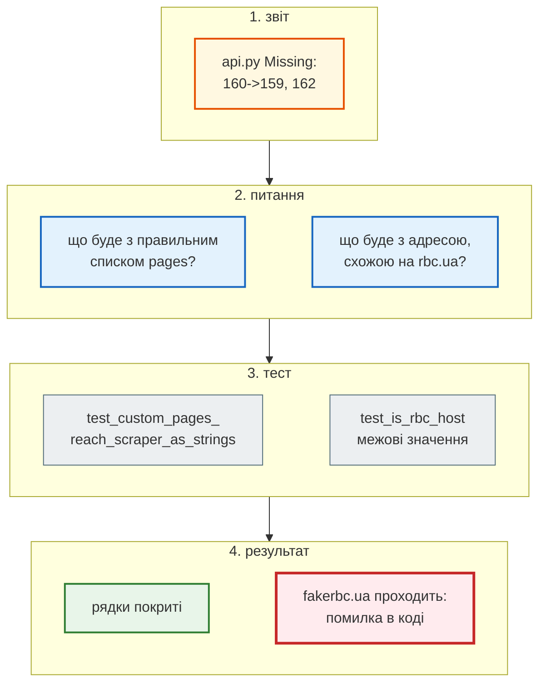
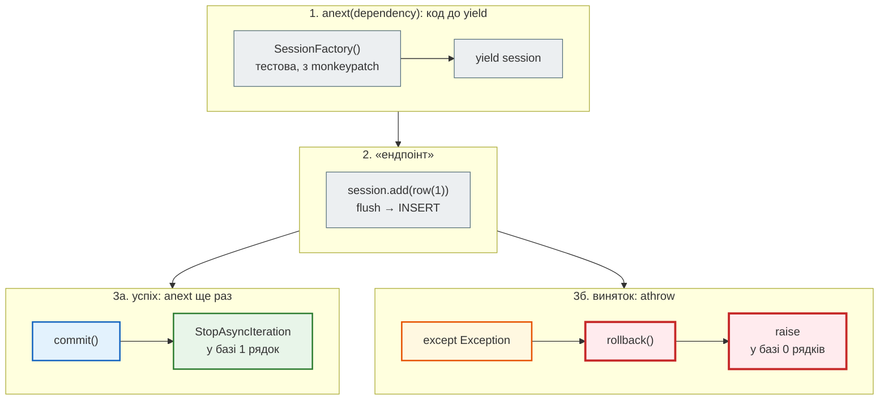

# Покриття: що тести не зачепили

> Крок 5 · розділ 6 з 7. Код: [`.coveragerc`](https://github.com/NikoriakViktor/news_hub/blob/main/steps/05_api_testing/.coveragerc), [`tests/integration/test_db.py`](https://github.com/NikoriakViktor/news_hub/blob/main/steps/05_api_testing/tests/integration/test_db.py), [`news_hub/models.py`](https://github.com/NikoriakViktor/news_hub/blob/main/steps/05_api_testing/news_hub/models.py), [`tests/integration/test_api.py`](https://github.com/NikoriakViktor/news_hub/blob/main/steps/05_api_testing/tests/integration/test_api.py).
> Теорія: [Частина VII. Тестування API](../../07_testing/README.md); coverage.py — [branch coverage](https://coverage.readthedocs.io/en/latest/branch.html), [concurrency](https://coverage.readthedocs.io/en/latest/config.html#run-concurrency); [pytest-cov](https://pytest-cov.readthedocs.io/).

## Задача { #task }

Скільки коду виконують тести кроку 4 і **що саме** вони не зачіпають? Стандартний звіт `pytest-cov` (`pip install pytest-cov`, з папки `steps/04_middleware_redis`):

```text
$ pytest -q -p no:cacheprovider --cov=news_hub --cov-report=term:skip-covered tests
news_hub/api.py            170     15    91%
news_hub/cache.py           33      1    97%
news_hub/db.py              26      8    69%
news_hub/jobs.py            58      1    98%
news_hub/parser.py          75     10    87%
news_hub/repository.py      58      6    90%
news_hub/scraper.py         49     28    43%
news_hub/tables.py          16      1    94%
--------------------------------------------
TOTAL                      596     70    88%

4 files skipped due to complete coverage.
41 passed in 5.61s
```

88% виглядає непогано. Але ця цифра неточна, і за нею не видно, **які** рядки не виконувались.

## Зміна 1: `.coveragerc` { #coveragerc }

```ini title=".coveragerc"
# Крок 5: pytest --cov=news_hub --cov-report=term-missing
[run]
source = news_hub
branch = true
# Без greenlet coverage не бачить рядків, які async SQLAlchemy виконує в greenlet
# (сесія, flush, commit) — і показує занижене покриття.
concurrency = thread,greenlet

[report]
show_missing = true
skip_covered = false
exclude_also =
    if TYPE_CHECKING:
```

| Рядок | Що змінює |
|---|---|
| `source = news_hub` | міряти лише код застосунку, не тести й не бібліотеки |
| `concurrency = thread,greenlet` | async SQLAlchemy виконує роботу з базою в greenlet ([крок 3](../03_sqlalchemy_alembic/index.md)); за замовчуванням coverage стежить лише за потоками і цих рядків не бачить |
| `branch = true` | рахує ще й **гілки**: чи виконувались обидва виходи кожного `if` і `for` |
| `show_missing = true` | стовпчик `Missing`: номери непокритих рядків і гілок (`160->159`) |
| `exclude_also = if TYPE_CHECKING:` | блок лише для mypy не рахується непокритим |

pytest-cov знаходить `.coveragerc` у папці запуску сам. Ті самі тести кроку 4 з налаштуваннями кроку 5:

```text
$ pytest -q -p no:cacheprovider --cov=news_hub --cov-config=../05_api_testing/.coveragerc --cov-report=term:skip-covered tests
Name                     Stmts   Miss Branch BrPart  Cover   Missing
--------------------------------------------------------------------
news_hub/api.py            170      3     18      2    97%   97, 110, 160->159, 162
news_hub/cache.py           33      1      2      1    94%   28
news_hub/db.py              26      8      2      1    68%   26, 54-60
news_hub/parser.py          75     10     26      9    81%   68, 72, 77, 88, 94-95, 107, 110, 115, 119
news_hub/repository.py      58      3     10      3    91%   57, 71, 73
news_hub/scraper.py         49     28      6      0    38%   50-61, 65-72, 78-81, 86-89
news_hub/tables.py          16      1      0      0    94%   28
--------------------------------------------------------------------
TOTAL                      596     54     80     16    89%

5 files skipped due to complete coverage.
41 passed in 4.76s
```

Що змінилось:

| Налаштування | Непокритих рядків | Загалом |
|---|---|---|
| за замовчуванням | 70 | 88% |
| лише `concurrency = thread,greenlet` | 54 | 91% |
| `greenlet` + `branch = true` | 54 | 89% |

Непокритих рядків стало 54 замість 70: ці 16 рядків виконувались і раніше, звіт їх просто не бачив (у `api.py` 15 → 3, у `repository.py` 6 → 3). Загальна цифра потім знижується до 89%, бо тепер рахуються ще й гілки: 16 з 80 пройдено лише в один бік. Колонка `BrPart` — скільки таких гілок у файлі, `160->159` у `Missing` — перехід, якого не було. У `ScrapeRequest.only_rbc` рядок 159 — `for url in pages or []:`, 160 — `if not (url.host or "").endswith("rbc.ua"):`, 162 — `return pages`. Перехід 160 → 159 означає «адреса пройшла перевірку, беремо наступну», і він не стався жодного разу, а `return pages` не виконався зовсім. Тобто валідатор у тестах тільки відхиляв: правильного списку `pages` не передавав ніхто (без `pages` валідатор не викликається, бо Pydantic не перевіряє значення за замовчуванням).

## Зміна 2: червоні рядки → питання → тести { #red-lines }

Червоний рядок — не завдання «покрий», а питання «а що тут має статися?». П'ять таких питань стали тестами кроку 5:

| Непокрите (крок 4) | Новий тест | Знайшов |
|---|---|---|
| `scraper.py` 38%: `fetch_one`, `scrape_*` | `unit/test_scraper.py` ([мок](mock_network.md)), `integration/test_scraper_server.py` ([фейк](fake_server.md)) | битий байт валить увесь збір |
| `db.py` 54–60: справжній `get_db`; 26: гілка PostgreSQL | `integration/test_db.py` | — (працює; тепер це доведено) |
| `api.py` 160→159, 162: правильний список `pages` | `test_custom_pages_reach_scraper_as_strings`, `test_is_rbc_host` | `fakerbc.ua` проходить перевірку |
| `repository.py` 71, 73: фільтри `category`, `source` | `test_filters_combine` | — |
| `parser.py`: гілки `continue` | `test_what_parser_skips` | — |



### Фільтри і власні `pages` { #api-tests }

```python title="tests/integration/test_api.py (фрагменти)"
@pytest.mark.parametrize(("params", "expected"), [
    ({"source": "auto.rbc.ua"}, 1),
    ({"category": "Новини", "source": "rbc.ua"}, 167),
    ({"category": "Спорт"}, 0),
    ({"source": "auto.rbc.ua", "lang": "uk"}, 0),                  # фільтри поєднуються через AND
])
def test_filters_combine(client: TestClient, params: dict[str, str], expected: int) -> None:
    """Крок 5: фільтри category і source не перевіряв жоден тест (покриття: repository.py, рядки 71, 73)."""
    client.post("/api/scrape", json={"source": "snapshot"})
    assert len(client.get("/api/news", params={**params, "limit": 1000}).json()) == expected


def test_custom_pages_reach_scraper_as_strings(client: TestClient) -> None:
    """Непокрита гілка (coverage): правильний список pages — дійшов до скрапера рядками, а не HttpUrl."""
    received: list[list[str] | None] = []

    async def spy(pages: list[str] | None) -> ScrapeOutcome:
        received.append(pages)
        return ScrapeOutcome(pages=[], news=[], total_time=0.0)

    app.dependency_overrides[get_scrapers] = lambda: {"async": spy, "sequential": spy}
    pages = ["https://www.rbc.ua/ukr/news/", "https://auto.rbc.ua/"]
    assert client.post("/api/scrape", json={"pages": pages}).status_code == 200
    assert received == [pages]
```

`spy` — «шпигун»: заглушка, яка запам'ятовує, з чим її викликали. Тест перевіряє не лише `200`, а й **що** дійшло до скрапера: рядки, а не об'єкти `HttpUrl`.

### Справжній `get_db` { #real-get-db }

API-тести підміняють `get_db` копією з `conftest.py`, тож оригінал не виконується ніколи (`db.py` 54–60). Копія може розійтися з оригіналом, а тести лишаться зеленими. `test_db.py` викликає **оригінал** так, як це робить FastAPI, а патчить лише фабрику сесій, яку `get_db` шукає в модулі `db`:

```python title="tests/integration/test_db.py (фрагменти)"
@pytest_asyncio.fixture
async def factory(monkeypatch: pytest.MonkeyPatch) -> AsyncIterator[async_sessionmaker[AsyncSession]]:
    engine = db.make_engine("sqlite+aiosqlite://", poolclass=StaticPool)
    async with engine.begin() as conn:
        await conn.run_sync(db.Base.metadata.create_all)
    test_factory = async_sessionmaker(engine, expire_on_commit=False)
    monkeypatch.setattr(db, "SessionFactory", test_factory)      # patch where used
    yield test_factory
    await engine.dispose()


@pytest.mark.asyncio
async def test_success_commits(factory: async_sessionmaker[AsyncSession]) -> None:
    dependency = db.get_db()                       # так його викликає FastAPI: до yield …
    session = await anext(dependency)
    session.add(row(1))
    with pytest.raises(StopAsyncIteration):        # … і після відповіді ендпоінта — код після yield
        await anext(dependency)
    assert await count(factory) == 1


@pytest.mark.asyncio
async def test_exception_rolls_back_and_propagates(factory: async_sessionmaker[AsyncSession]) -> None:
    dependency = db.get_db()
    session = await anext(dependency)
    session.add(row(1))
    await session.flush()                          # INSERT уже в базі, але в незавершеній транзакції
    with pytest.raises(RuntimeError, match="ендпоінт упав"):
        await dependency.athrow(RuntimeError("ендпоінт упав"))    # так FastAPI передає виняток у залежність
    assert await count(factory) == 0
```



Ще два тести без бази взагалі: `make_engine` з адресою PostgreSQL створює engine з `pool_size=10` (з'єднання не відкривається, сервер не потрібен), а `get_session_factory()` і `get_scrapers()` без підміни повертають справжні об'єкти. Те, що тести завжди підміняють, хоч раз виконується без підміни.

### Третя знахідка: `fakerbc.ua` { #fakerbc }

Гілка `160->159` у `ScrapeRequest.only_rbc`: жоден тест не передавав **правильний** список `pages`. Тест з межовими значеннями знайшов, що перевірка пропускає не лише rbc.ua:

```python
from news_hub.models import is_rbc_host

for host in ("rbc.ua", "www.rbc.ua", "auto.rbc.ua", "fakerbc.ua", "rbc.ua.evil.com"):
    print(f"{host:16} endswith('rbc.ua'): {host.endswith('rbc.ua')!s:5}  is_rbc_host: {is_rbc_host(host)}")
```

```text
rbc.ua           endswith('rbc.ua'): True   is_rbc_host: True
www.rbc.ua       endswith('rbc.ua'): True   is_rbc_host: True
auto.rbc.ua      endswith('rbc.ua'): True   is_rbc_host: True
fakerbc.ua       endswith('rbc.ua'): True   is_rbc_host: False
rbc.ua.evil.com  endswith('rbc.ua'): False  is_rbc_host: False
```

`POST /api/scrape` з `{"pages": ["https://fakerbc.ua/"]}` змушував сервер завантажити чужий сайт на прохання будь-кого (SSRF, [крок 8](../08_security/index.md)), і ту саму адресу пропускала модель `NewsItem`. Правильно — одна функція для обох місць:

```diff title="news_hub/models.py і news_hub/api.py"
+def is_rbc_host(host: str | None) -> bool:
+    """rbc.ua або його піддомен (www., auto.). Не endswith("rbc.ua"): тоді пройшов би і fakerbc.ua."""
+    return host == "rbc.ua" or (host or "").endswith(".rbc.ua")
 ...
-        if not (url.host or "").endswith("rbc.ua"):
+        if not is_rbc_host(url.host):
```

```python title="tests/unit/test_models.py (фрагмент)"
@pytest.mark.parametrize(("host", "allowed"), [
    ("rbc.ua", True), ("www.rbc.ua", True), ("auto.rbc.ua", True),
    ("fakerbc.ua", False), ("rbc.ua.evil.com", False), ("", False), (None, False),
])
def test_is_rbc_host(host: str | None, allowed: bool) -> None:
    """Межові значення: і те, що має пройти, і те, що «майже» rbc.ua."""
    assert is_rbc_host(host) is allowed
```

На коді кроку 4 новий випадок у `test_bad_input_is_422` падає: `assert 200 == 422`, тобто сервер прийняв `fakerbc.ua`.

## Результат { #result }

```text
$ pytest -q -p no:cacheprovider --cov=news_hub --cov-report=term:skip-covered
Name                 Stmts   Miss Branch BrPart  Cover   Missing
----------------------------------------------------------------
news_hub/cache.py       33      1      2      1    94%   28
news_hub/parser.py      75      1     26      1    98%   110
news_hub/tables.py      16      1      0      0    94%   28
----------------------------------------------------------------
TOTAL                  607      3     82      2    99%

9 files skipped due to complete coverage.
86 passed in 11.34s
```

Покриття збільшує час прогону (тут 3.92 с без нього → 11.34 с з ним), тож у щоденній роботі `--cov` не обов'язковий.

Лишились три рядки, і їх свідомо не покрито:

| Рядок | Що там | Чому не покрито |
|---|---|---|
| `cache.py:28` | `Redis.from_url(...)` — справжній Redis | у звичайному прогоні Redis — fakeredis; рядок покриває прогін з `TEST_REDIS_URL` |
| `parser.py:110` | `if not isinstance(a, Tag): continue` | перевірка типу для mypy: `find_all("a", href=True)` дає лише `Tag` |
| `tables.py:28` | `NewsRow.__repr__` | лише для налагодження |

З `TEST_DATABASE_URL` і `TEST_REDIS_URL` (PostgreSQL 16, Redis 7) картина дзеркальна: `cache.py:28` покрито, а непокритими стають 26–27 — гілка fakeredis:

```text
news_hub/cache.py       33      2      2      1    91%   26-27
news_hub/parser.py      75      1     26      1    98%   110
news_hub/tables.py      16      1      0      0    94%   28
TOTAL                  607      4     82      2    99%
86 passed in 18.45s
```

Два прогони можна скласти в один звіт: другий запуск з `--cov-append` додає дані до `.coverage` першого:

```text
$ pytest -q --cov=news_hub --cov-report=
$ TEST_REDIS_URL=redis://localhost:6379/15 pytest -q --cov=news_hub --cov-append --cov-report=term:skip-covered
news_hub/parser.py      75      1     26      1    98%   110
news_hub/tables.py      16      1      0      0    94%   28
TOTAL                  607      2     82      1    99%
10 files skipped due to complete coverage.
```

Файл `.coverage` з'являється в папці запуску; у git він не потрапляє (`.gitignore`). HTML-звіт по рядках — `pytest --cov=news_hub --cov-report=html` → `htmlcov/index.html`.

## Правило { #rule }

!!! tip "Правило"
    Для async SQLAlchemy вмикай `concurrency = thread,greenlet`, інакше звіт занижений; рахуй гілки (`branch = true`). Кожен червоний рядок — питання «що тут має статися?», а відповідь — тест. 100% — не мета: мета, щоб кожен непокритий рядок був рішенням, а не випадком.

**Далі:** [Мінімальні версії залежностей](min_versions.md) — що обіцяє `requirements.txt`.
