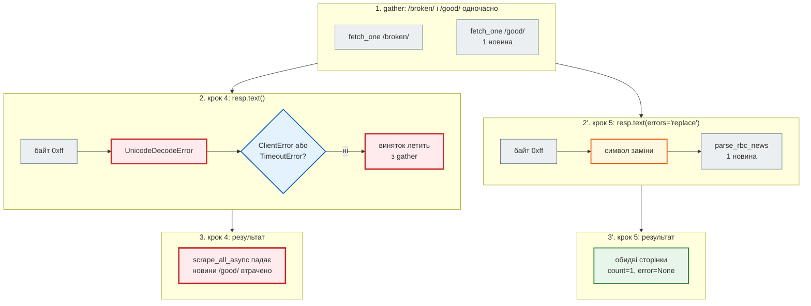
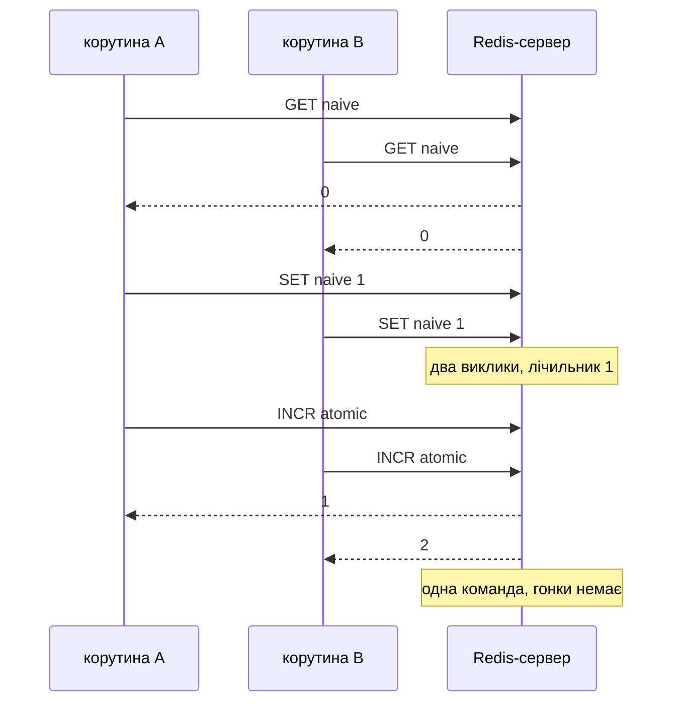
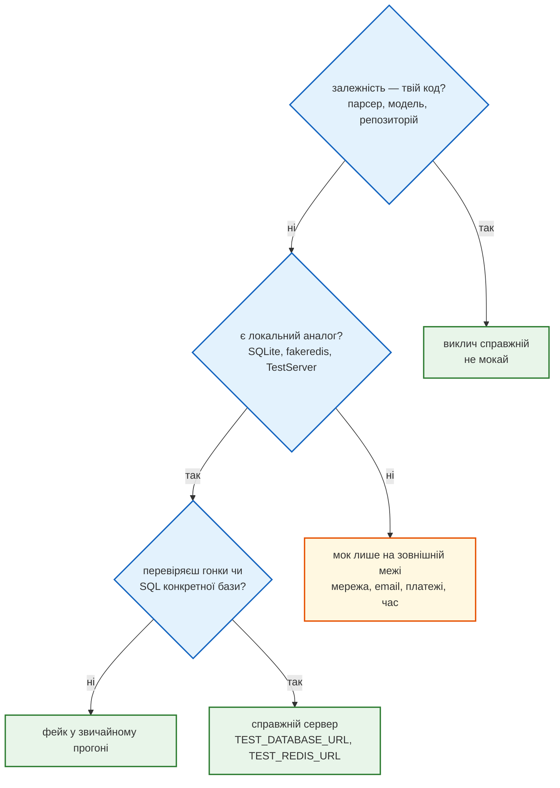

# Фейк замість моку: локальний HTTP-сервер

> Крок 5 · розділ 4 з 7. Код: [`tests/integration/test_scraper_server.py`](https://github.com/NikoriakViktor/news_hub/blob/main/steps/05_api_testing/tests/integration/test_scraper_server.py), [`news_hub/scraper.py`](https://github.com/NikoriakViktor/news_hub/blob/main/steps/05_api_testing/news_hub/scraper.py), [`tests/integration/test_async_api.py`](https://github.com/NikoriakViktor/news_hub/blob/main/steps/05_api_testing/tests/integration/test_async_api.py).
> Теорія: [Частина VII. Тестування API](../../07_testing/README.md); aiohttp — [Testing, `TestServer`](https://docs.aiohttp.org/en/stable/testing.html).

## Задача { #task }

Мок з [попереднього розділу](mock_network.md) відповідає тим, що йому сказали. Усе, що стоїть **між** запитом і рядком HTML, під моком не виконується: з'єднання, заголовки, статус відповіді, **декодування байтів**, тайм-аут. `response.text` у моку — `AsyncMock(return_value=html)`, тобто вже готовий рядок.

Треба запустити справжній `aiohttp` повністю, але без інтернету і без залежності від rbc.ua.

## Зміна: сервер на `127.0.0.1` з фікстур { #test-server }

**Фейк** — справжня, але спрощена реалізація залежності. Тут це HTTP-сервер з `aiohttp.test_utils`, який віддає сторінки з `tests/fixtures/`. `scrape_all_async` і `fetch_one` працюють проти нього без жодної підміни:

```python title="tests/integration/test_scraper_server.py (фрагмент)"
DELAY = 0.3          # «повільна» сторінка — щоб побачити різницю між gather і чергою
SEEN_AGENTS = web.AppKey("seen_agents", list[str])     # які User-Agent побачив сервер


@pytest_asyncio.fixture
async def site(html: Callable[[str], str]) -> AsyncIterator[TestServer]:
    seen_agents: list[str] = []

    async def page(name: str, request: web.Request) -> web.Response:
        seen_agents.append(request.headers.get("User-Agent", ""))
        return web.Response(text=html(name), content_type="text/html")

    async def feed(request: web.Request) -> web.Response:
        return await page("rbc_newsline_item", request)

    async def slow(request: web.Request) -> web.Response:
        await asyncio.sleep(DELAY)
        return await page("demo_newsline", request)

    async def forbidden(request: web.Request) -> web.Response:
        return web.Response(status=403, text="<h1>403 Forbidden</h1>", content_type="text/html")

    async def broken_bytes(request: web.Request) -> web.Response:       # сервер обіцяє UTF-8, а байт 0xff — ні
        body = html("rbc_newsline_item").encode() + b"<p>\xff</p>"
        return web.Response(body=body, content_type="text/html", charset="utf-8")

    app = web.Application()
    app.router.add_get("/ukr/news/", feed)
    app.router.add_get("/slow-1/", slow)
    app.router.add_get("/slow-2/", slow)
    app.router.add_get("/forbidden/", forbidden)
    app.router.add_get("/broken/", broken_bytes)
    app[SEEN_AGENTS] = seen_agents
    async with TestServer(app) as server:       # вільний порт на 127.0.0.1
        yield server


def urls(server: TestServer, *paths: str) -> list[str]:
    return [str(server.make_url(path)) for path in paths]
```

| Запис | Що означає |
|---|---|
| `@pytest_asyncio.fixture` | async-фікстура: код до `yield` — старт сервера, після — зупинка |
| `TestServer(app)` | справжній HTTP-сервер aiohttp на вільному порту `127.0.0.1` |
| `server.make_url("/ukr/news/")` | `http://127.0.0.1:<порт>/ukr/news/` |
| `web.AppKey(...)` | типізований ключ для даних у `web.Application`: сюди сервер записує, що він побачив |

Мок і фейк поруч:

| | Мок (`unit/test_scraper.py`) | Фейк (`integration/test_scraper_server.py`) |
|---|---|---|
| що підміняється | `session.get`, `resp.text` | лише адреса сайту |
| HTTP-з'єднання, заголовки | ні | так |
| статус і `raise_for_status` | задає тест (`side_effect`) | справжній статус 403 |
| байти → рядок | ні: рядок готовий | так: `resp.text()` декодує |
| тайм-аут | виняток задає тест | справжній `ClientTimeout` |
| шар | unit (0.33 с на 6 тестів) | integration (1.06 с на 5 тестів) |

## Результат: друга знахідка { #finding }

Перший же прогін знайшов помилку, якої мок не бачив: сторінка з одним невалідним байтом UTF-8 — і **весь** збір падає. Окремий скрипт (з папки кроку, `PYTHONPATH=.`), який сам піднімає такий сервер:

```python
import asyncio
from pathlib import Path
from urllib.parse import urlsplit

import aiohttp
from aiohttp import web
from aiohttp.test_utils import TestServer

from news_hub import scraper

FEED = Path("tests/fixtures/rbc_newsline_item.html").read_bytes()


async def good(request: web.Request) -> web.Response:
    return web.Response(body=FEED, content_type="text/html", charset="utf-8")


async def broken(request: web.Request) -> web.Response:
    return web.Response(body=FEED + b"<p>\xff</p>", content_type="text/html", charset="utf-8")


async def main() -> None:
    app = web.Application()
    app.router.add_get("/good/", good)
    app.router.add_get("/broken/", broken)
    async with TestServer(app) as server:
        async with aiohttp.ClientSession() as session, session.get(server.make_url("/broken/")) as resp:
            try:
                await resp.text()                                   # так було до кроку 5
            except UnicodeDecodeError as error:
                print(f"resp.text(): {type(error).__name__}; це aiohttp.ClientError? "
                      f"{isinstance(error, aiohttp.ClientError)}")
        try:
            outcome = await scraper.scrape_all_async([str(server.make_url(p)) for p in ("/broken/", "/good/")])
            print("scrape_all_async:", [(urlsplit(p.url).path, p.count, p.error) for p in outcome.pages])
        except Exception as error:
            print("scrape_all_async:", type(error).__name__)

asyncio.run(main())
```

```text title="news_hub кроку 4"
resp.text(): UnicodeDecodeError; це aiohttp.ClientError? False
scrape_all_async: UnicodeDecodeError
```

```text title="news_hub кроку 5"
resp.text(): UnicodeDecodeError; це aiohttp.ClientError? False
scrape_all_async: [('/broken/', 1, None), ('/good/', 1, None)]
```



`fetch_one` ловить лише `aiohttp.ClientError` і `asyncio.TimeoutError`. `UnicodeDecodeError` пролітав повз, `asyncio.gather` передавав його нагору, і разом з ним губилися новини решти сторінок через один байт. Правильно — один аргумент:

```diff title="news_hub/scraper.py: fetch_one"
-            html = await resp.text()
+            html = await resp.text(errors="replace")   # один битий байт ≠ втрачена сторінка
```

Під моком цієї помилки не видно в принципі: декодування там немає. Тести кроку 5 на коді кроку 4 це підтверджують — усі шість мок-тестів зелені, падає лише фейковий:

```text
FAILED tests/integration/test_scraper_server.py::test_undecodable_page_does_not_kill_scrape
E       UnicodeDecodeError: 'utf-8' codec can't decode byte 0xff in position 1080: invalid start byte
```

## Що ще перевіряє фейк { #more-tests }

Чотири тести, неможливі з моком:

| Тест | Що доводить |
|---|---|
| `test_real_http_round_trip` | запит справді пройшов, а сервер побачив `User-Agent` з `scraper.HEADERS` |
| `test_403_is_page_error_others_survive` | справжній 403 → `error` у своєї сторінки, друга сторінка зберегла новину |
| `test_gather_is_concurrent_queue_is_not` | дві «повільні» сторінки: `gather` швидший за `2 × DELAY`, черга — ні |
| `test_timeout_is_page_error` | справжній `ClientTimeout` спрацьовує і стає `error` сторінки |

Асинхронність зі [кроку 2](../02_fastapi_basics/index.md) тепер перевіряє тест, а не ручний вимір. Той самий сервер з двома сторінками по 0.3 с:

```text
gather: 0.31 с, по черзі: 0.60 с, новин: 2 і 2
```

Тайм-аут у `fetch_one` — 15 с, а чекати 15 с у тесті не годиться. Тест підміняє `ClientTimeout` там, де його шукає `fetch_one` (те саме [«patch where used»](mock_network.md#patch-where-used)), через `monkeypatch`:

```python title="tests/integration/test_scraper_server.py (фрагмент)"
@pytest.mark.asyncio
async def test_timeout_is_page_error(site: TestServer, monkeypatch: pytest.MonkeyPatch) -> None:
    """Тайм-аут 15 с у тесті не чекаємо: підміняємо ClientTimeout там, де його шукає fetch_one."""
    real_timeout = scraper.aiohttp.ClientTimeout
    monkeypatch.setattr(scraper.aiohttp, "ClientTimeout", lambda total: real_timeout(total=DELAY / 3))
    outcome = await scraper.scrape_all_async(urls(site, "/slow-1/"))
    assert outcome.pages[0].error is not None and outcome.pages[0].error.startswith("TimeoutError")
```

`monkeypatch.setattr` повертає старе значення після тесту сам. `scraper.aiohttp` — це той самий об'єкт модуля `aiohttp`, тому підміна діє глобально до кінця тесту; на сусідні тести вона не впливає.

## Межа фейку: fakeredis і гонка { #fakeredis-limit }

Фейк теж щось спрощує. `fakeredis` виконує команду одразу і **не віддає керування** циклу подій, тож одночасні корутини на ньому ніколи не перемежовуються. Ось лічильник «прочитати → +1 → записати» (дві команди) і `INCR` (одна), по 10 одночасних викликів:

```python
import asyncio
import sys

import fakeredis
from redis.asyncio import Redis


async def naive_hit(redis: Redis, key: str) -> None:     # прочитати → +1 → записати
    count = int(await redis.get(key) or 0) + 1
    await redis.set(key, count)


async def run(redis: Redis) -> tuple[str, str]:
    await redis.delete("naive", "atomic")
    await asyncio.gather(*(naive_hit(redis, "naive") for _ in range(10)))
    await asyncio.gather(*(redis.incr("atomic") for _ in range(10)))
    result = (await redis.get("naive"), await redis.get("atomic"))
    await redis.aclose()
    return result

print("fakeredis:     naive, atomic =", asyncio.run(run(fakeredis.FakeAsyncRedis(decode_responses=True))))
if len(sys.argv) > 1:          # python race.py redis://localhost:6379/15
    print("Redis-сервер:  naive, atomic =", asyncio.run(run(Redis.from_url(sys.argv[1], decode_responses=True))))
```

```text
fakeredis:     naive, atomic = ('10', '10')
Redis-сервер:  naive, atomic = ('3', '10')
```

На fakeredis «наївний» лічильник дорахував до 10, і гонки не видно. На справжньому Redis 7 — 3 (у різних прогонах і на різних машинах число може відрізнятися): поки одна корутина чекала відповіді на `GET`, інші прочитали те саме значення і записали те саме.



Тому тест rate limit на одночасних запитах ([`httpx.AsyncClient`](async_client.md#rate-limit)) доводить атомарність **лише** з `TEST_REDIS_URL`. Про це сказано в docstring тесту. Ми перевірили це, підставивши в `RateLimiter.hit` «наївний» лічильник (`GET`, потім `SET`):

```text
== fakeredis
1 passed in 0.13s
== TEST_REDIS_URL=redis://…/15
E       assert [422, 422, 42...422, 422, ...] == [422, 422, 42...422, 429, ...]
E         At index 5 diff: 422 != 429
1 failed in 0.11s
```

## Як обрати підміну { #choose }



У `news_hub` це виглядає так: парсер і модель — справжні завжди; `aiohttp` у unit-тестах — мок, в integration — проти `TestServer`; база — SQLite у пам'яті, а для SQL PostgreSQL — `TEST_DATABASE_URL`; Redis — fakeredis, а для гонок — `TEST_REDIS_URL`.

## Правило { #rule }

!!! tip "Правило"
    Мок перевіряє твою логіку навколо залежності, фейк — що твій код справді працює з нею. Коли між запитом і результатом є власна обробка (декодування, заголовки, тайм-аути), потрібен фейк. І знай межу фейку: те, чого він не вміє (гонки на fakeredis), доводить лише справжній сервер.

**Далі:** [API асинхронно: `httpx.AsyncClient`](async_client.md) — тест і застосунок в одному циклі подій.
