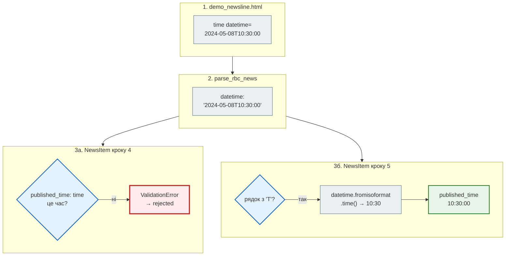

# Збережені сторінки замість рядків

> Крок 5 · розділ 2 з 7. Код: [`tests/fixtures/`](https://github.com/NikoriakViktor/news_hub/tree/main/steps/05_api_testing/tests/fixtures), [`tests/factories.py`](https://github.com/NikoriakViktor/news_hub/blob/main/steps/05_api_testing/tests/factories.py), [`tests/unit/test_pipeline.py`](https://github.com/NikoriakViktor/news_hub/blob/main/steps/05_api_testing/tests/unit/test_pipeline.py), [`news_hub/models.py`](https://github.com/NikoriakViktor/news_hub/blob/main/steps/05_api_testing/news_hub/models.py).
> Теорія: [тестові дані й фікстури](https://nikoriakviktor.github.io/notes_chat_app/08_testing_and_quality/test_data_and_fixtures_full/) у Django-книзі.

## Задача { #task }

Тести парсера в кроках 1–4 містили HTML прямо в коді — рядки, які автор тесту придумав сам. Такий рядок перевіряє, що парсер розуміє **уявлення автора** про сторінку, а не саму сторінку. Коли rbc.ua змінить розмітку, тест цього не помітить: рядок у тесті лишиться старим.

А тести моделі повторювали в кожному тесті той самий словник з п'ятьма полями, хоча тест перевіряв одне.

## Зміна 1: розмітка у файлах { #fixture-files }

Розмітка тепер лежить у `tests/fixtures/`:

| Файл | Що там | Стратегія парсера |
|---|---|---|
| `rbc_newsline_item.html` | **справжній** фрагмент стрічки rbc.ua, скопійований з інспектора браузера: `div.item > a > span.time` | посилання (`_parse_links`): контейнерів `newsline__item` немає |
| `demo_newsline.html` | демо-розмітка з контейнерами `newsline__item`, час в атрибуті `<time datetime="…">` | контейнери |

```html title="tests/fixtures/rbc_newsline_item.html (скорочено)"
<!-- Фрагмент стрічки rbc.ua: розмітка скопійована з інспектора браузера.
     Шлях у DOM: #app > div > div.left-col > div.newsline > div > div.nano-content > div.item -->
<div class="item">
    <a href="https://www.rbc.ua/rus/news/ssha-hochut-pidkupiti-kubintsiv-bezpaltnim-1778194920.html">
        <span class="time">02:06</span>
        США хочуть підкупити кубинців безплатним інтернетом, - AP          </a>
</div>
```

Файл видно в браузері. Коли сайт змінить розмітку, його замінюють свіжою збереженою сторінкою, і тести показують, що саме зламалось. А ще один файл можуть читати різні тести: тести парсера, тест конвеєра і [фейковий HTTP-сервер](fake_server.md).

Фікстура віддає вміст за назвою:

```python title="tests/conftest.py (фрагмент)"
FIXTURES = Path(__file__).parent / "fixtures"


@pytest.fixture
def html() -> Callable[[str], str]:
    """html("demo_newsline") → вміст tests/fixtures/demo_newsline.html."""
    return lambda name: (FIXTURES / f"{name}.html").read_text(encoding="utf-8")
```

```python title="tests/unit/test_parser.py (фрагмент)"
def test_real_rbc_markup_links_strategy(html: Callable[[str], str]) -> None:
    """Справжній фрагмент стрічки: div.item > a > span.time — контейнерів newsline__item немає."""
    assert parse_rbc_news(html("rbc_newsline_item")) == [{
        "title": "США хочуть підкупити кубинців безплатним інтернетом, - AP",
        "url": "https://www.rbc.ua/rus/news/ssha-hochut-pidkupiti-kubintsiv-bezpaltnim-1778194920.html",
        "category": "", "description": "", "datetime": "02:06"}]
```

Шлях до файлу рахується від `conftest.py` (`Path(__file__).parent`), а не від поточної папки. Тому `pytest` працює однаково з папки кроку, з `tests/` чи з IDE. Фікстура повертає функцію, а не рядок: так один тест може прочитати кілька сторінок.

Рядки в коді тесту не зникли зовсім. Для крихітних випадків — «посилання без заголовка», «той самий `url` двічі» — короткий рядок у `parametrize` читається краще за окремий файл:

```python title="tests/unit/test_parser.py (фрагмент)"
@pytest.mark.parametrize(("html_page", "titles"), [
    (item("<span>без посилання й заголовка</span>") + GOOD, ["Уряд затвердив новий бюджет"]),
    (item('<a class="title" href="/ukr/news/s.html">Коротко</a>') + GOOD, ["Уряд затвердив новий бюджет"]),
    (GOOD + GOOD, ["Уряд затвердив новий бюджет"]),                              # той самий url двічі
    ...
], ids=["no-title-tag", "short-title", "duplicate-url", "links-skip-rules"])
def test_what_parser_skips(html_page: str, titles: list[str]) -> None:
```

Межа проста: **справжня сторінка** — у файл, **штучний межовий випадок** — рядком поруч з тестом.

## Зміна 2: фабрика тестових даних { #factory }

```python title="tests/factories.py"
def make_raw(**overrides: str) -> RawNews:
    """make_raw(title="Коротко") — сира новина, як її дає парсер, з одним зміненим полем."""
    item: RawNews = {"title": "Уряд затвердив новий бюджет", "url": "https://www.rbc.ua/ukr/news/budget-1.html",
                     "category": "", "description": "", "datetime": "14:19"}
    return {**item, **overrides}  # type: ignore[typeddict-item]
```

Фабрика за замовчуванням дає **правильну** новину. Тест змінює лише поле, яке перевіряє, і читач одразу бачить, про що тест:

```python title="tests/unit/test_models.py (фрагмент)"
@pytest.mark.parametrize(("field", "value", "loc"), [
    ("title", "Коротко", "title"),
    ("url", "https://example.com/ukr/news/x.html", "url"),
    ("url", "https://www.fakerbc.ua/ukr/news/x.html", "url"),       # крок 5: endswith("rbc.ua") його пропускав
    ("url", "не посилання", "url"),
    ("datetime", "25:99", "published_time"),
])
def test_invalid_values(field, value, loc):
    with pytest.raises(ValidationError) as error:
        NewsItem.from_raw(make_raw(**{field: value}))
    assert loc in {e["loc"][0] for e in error.value.errors()}
```

`factories.py` — звичайний модуль, а не фікстура: його імпортують (`from tests.factories import make_raw`) і викликають з різними аргументами в одному тесті. Ним користуються і тести моделі, і тести скрапера.

## Зміна 3: тест конвеєра { #pipeline }

Найважливіший новий тест. Тести парсера перевіряють лише парсер, тести моделі — лише модель, кожен на своїх даних. Тест конвеєра з'єднує їх на збереженій сторінці: **те, що дає парсер, модель має прийняти**.

```python title="tests/unit/test_pipeline.py"
@pytest.mark.parametrize(("page", "expected"), [
    ("rbc_newsline_item", [("США хочуть підкупити кубинців безплатним інтернетом, - AP", "ru", "02:06:00")]),
    ("demo_newsline", [("Уряд затвердив новий бюджет на 2024 рік", "uk", "10:30:00"),
                       ("Збірна України перемогла у фіналі", "uk", "09:15:00")]),
])
def test_every_parsed_item_passes_the_model(html: Callable[[str], str], page: str,
                                            expected: list[tuple[str, str, str]]) -> None:
    valid, rejected = validate_news(parse_rbc_news(html(page)))
    assert rejected == []
    assert [(n.title, n.lang, n.published_time.isoformat() if n.published_time else "") for n in valid] == expected
```

Він досі unit: бази, Redis і мережі немає, лише дві чисті функції. «Unit» означає «без зовнішніх ресурсів», а не обов'язково «одна функція».

## Результат: перша знахідка { #finding }

На коді кроку 4 цей тест падає, хоча тести парсера й моделі зелені:

```text
FAILED tests/unit/test_pipeline.py::test_every_parsed_item_passes_the_model[demo_newsline-expected1]
E       AssertionError: assert [Rejected(raw...pected `:`'])] == []
E         Left contains 2 more items, first extra item: Rejected(raw={'title': 'Уряд затвердив новий бюджет на 2024 рік', 'url': 'https://www.rbc.ua/ukr/news/2024/1234/', 'ca...08T10:30:00'},
```

Обидві новини з `demo_newsline` модель **відхилила**. Парсер бере час з атрибута `<time datetime="2024-05-08T10:30:00">` — це дата й час, а поле `published_time: time` приймає лише час:

```text
'2024-05-08T10:30:00' → Input should be in a valid time format, invalid time separator, expected `:`
'2024-05-08T09:15:00' → Input should be in a valid time format, invalid time separator, expected `:`
```



`validate_news` таку новину не губить мовчки, а кладе в `rejected` з причиною. Але на сайті з контейнерами `newsline__item` звіт `POST /api/scrape` показував би «знайдено N, збережено 0».

## Виправлення: валідатор `mode="before"` { #fix }

```python title="news_hub/models.py (фрагмент)"
@field_validator("published_time", mode="before")
@classmethod
def time_from_iso_datetime(cls, value: Any) -> Any:
    """Стрічка дає «14:19», а атрибут <time datetime> — «2024-05-08T10:30:00»: беремо час."""
    if isinstance(value, str) and "T" in value:
        try:
            return datetime.fromisoformat(value).time()
        except ValueError:
            return value                    # хай помилку сформулює сама перевірка поля
    return value
```

| Рішення | Чому |
|---|---|
| `mode="before"` | валідатор отримує сирий рядок **до** того, як Pydantic спробує перетворити його на `time` |
| `"T" in value` | «14:19» іде далі без змін; змінюється лише ISO-рядок з датою |
| `except ValueError: return value` | битий ISO-рядок не ховається: перевірка поля поверне звичайну помилку `published_time` |

Тести на обидва формати і на битий рядок:

```python title="tests/unit/test_models.py (фрагмент)"
@pytest.mark.parametrize(("value", "expected"), [
    ("14:19", "14:19:00"),
    ("2024-05-08T10:30:00", "10:30:00"),       # атрибут <time datetime> — знайдено тестом конвеєра (крок 5)
    ("", None),
])
def test_published_time_formats(value, expected): ...


def test_broken_iso_datetime_is_rejected():
    with pytest.raises(ValidationError) as error:
        NewsItem.from_raw(make_raw(datetime="2024-13-45T99:99:00"))
    assert error.value.errors()[0]["loc"] == ("published_time",)
```

Чому окремі тести парсера й моделі цю помилку пропустили — розбір у [контрольній точці](checkpoint.md#find-bug).

## Правило { #rule }

!!! tip "Правило"
    Справжню розмітку тримай у файлах `tests/fixtures/`, а не в рядках тесту, і оновлюй її, коли сайт змінюється. Коли дві частини з'єднані даними (парсер → модель), потрібен хоча б один тест, у якому вихід першої справді йде на вхід другої.

**Далі:** [Мок мережі: patch where used](mock_network.md) — `fetch_one` без інтернету.
