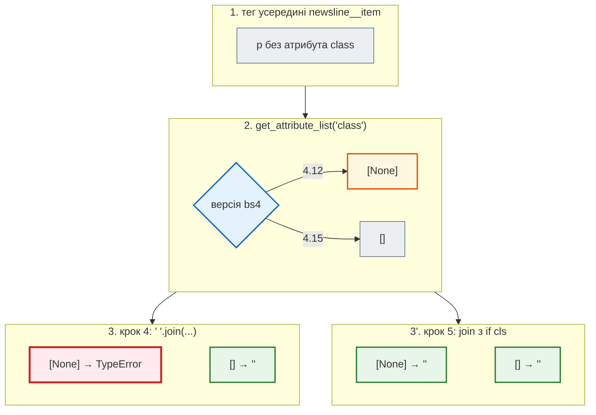

# Мінімальні версії залежностей

> Крок 5 · розділ 7 з 7. Код: [`requirements.txt`](https://github.com/NikoriakViktor/news_hub/blob/main/steps/05_api_testing/requirements.txt), [`news_hub/parser.py`](https://github.com/NikoriakViktor/news_hub/blob/main/steps/05_api_testing/news_hub/parser.py).
> Теорія: [Частина VII. Тестування API](../../07_testing/README.md).

## Задача { #task }

`requirements.txt` обіцяє, що проєкт працює з `beautifulsoup4>=4.12`, `fastapi>=0.121`, `aiohttp>=3.10`, `pydantic>=2.9`… Але `pip install -r requirements.txt` ставить **найновіші** версії, і всі тести досі ганялись лише на них. Хто встановить проєкт поруч з іншим, де, скажімо, `beautifulsoup4` закріплено на 4.12, отримає комбінацію, яку не перевіряв ніхто.

Нижня межа в `>=` — це теж обіцянка. Її треба перевірити так само, як код.

## Зміна: окреме середовище з найнижчими версіями { #lowest-env }

`pip` не вміє «встанови найнижчі дозволені версії». Це вміє [`uv`](https://docs.astral.sh/uv/): `--resolution lowest-direct` бере мінімальні версії для **прямих** залежностей з `requirements.txt`, а їхні власні залежності розв'язує як звичайно. Найстаріший Python, який має підтримувати проєкт, тут — 3.10.

З папки `steps/05_api_testing`:

```bash
uv venv -p 3.10 ~/venvs/news_hub_min
VIRTUAL_ENV=~/venvs/news_hub_min uv pip install --resolution lowest-direct -r requirements.txt
~/venvs/news_hub_min/bin/python -m pytest -q -p no:cacheprovider
```

Що встановилось (`uv pip list`, скорочено):

```text
aiohttp           3.10.0
aiosqlite         0.20.0
alembic           1.13.0
beautifulsoup4    4.12.0
fakeredis         2.26.0
fastapi           0.121.0
httpx             0.27.0
httpx2            2.0.0
mypy              1.10.0
pydantic          2.9.0
pytest            8.2.0
pytest-asyncio    0.24.0
pytest-cov        5.0.0
redis             5.0.1
sqlalchemy        2.0.30
starlette         0.49.3
typing-extensions 4.12.0
uvicorn           0.30.0
```

Майже все — рівно нижня межа з `requirements.txt`. Виняток — `pytest 8.2.0` замість `8`: `pytest-asyncio 0.24` сам вимагає `pytest<9,>=8.2`. Отже, справжня нижня межа pytest у цьому проєкті — 8.2, хоч у файлі написано `pytest>=8`. А `starlette` — непряма залежність (через FastAPI), тому її версію вибрав FastAPI 0.121.

Середовище створюємо поза репозиторієм: `.gitignore` проєкту ігнорує `.venv` і `venv/`, а будь-яку іншу назву — ні.

## Результат: четверта знахідка { #finding }

Тести кроку 5 на парсері кроку 4 (Python 3.10, beautifulsoup4 4.12.0):

```text
$ ~/venvs/news_hub_min/bin/python -m pytest -q -p no:cacheprovider tests/unit/test_parser.py
E       TypeError: sequence item 0: expected str instance, NoneType found
FAILED tests/unit/test_parser.py::test_description_equal_to_title_is_dropped_time_from_class
1 failed, 8 passed in 0.15s
```

На найновішій beautifulsoup4 той самий тест зелений. Різниця — в одному методі:

```python
from bs4 import BeautifulSoup
import bs4

print("bs4", bs4.__version__, BeautifulSoup("<p>x</p>", "html.parser").p.get_attribute_list("class"))
```

```text
bs4 4.12.0 [None]
bs4 4.15.0 []
```

Для тегу без атрибута `class` bs4 4.12 повертає `[None]`, а 4.15 — `[]`. А `" ".join([None])` падає. `_classes` викликається для кожного тегу всередині контейнера новини, тож на справжній сторінці з тегом `<p>` без класу парсер падав би на bs4 4.12.



Виправлення не залежить від версії:

```diff title="news_hub/parser.py"
 def _classes(tag: Tag) -> str:
-    return " ".join(tag.get_attribute_list("class"))
+    # Тег без class: beautifulsoup4 4.12 дає [None] (join падав з TypeError), новіші — [] (крок 5)
+    return " ".join(cls for cls in tag.get_attribute_list("class") if cls)
```

З виправленням увесь набір на мінімальних версіях зелений:

```text
$ ~/venvs/news_hub_min/bin/python --version
Python 3.10.19
$ ~/venvs/news_hub_min/bin/python -m pytest -q -p no:cacheprovider
...
tests/integration/test_api.py::test_openapi_lists_endpoints
  .../pydantic/main.py:1085: PydanticDeprecatedSince20: The `__fields__` attribute is deprecated, use `model_fields` instead
86 passed, 2 warnings in 9.26s
```

Два попередження — з бібліотек (`pydantic/main.py`, під час побудови `/openapi.json`), а не з коду `news_hub`; на найновіших версіях їх немає.

## Які набори перевіряти { #matrix }

| Набір | Що ловить | Перевірено для кроку 5 |
|---|---|---|
| Python 3.12, найновіші версії | звичайна робота | `86 passed` |
| Python 3.10, `--resolution lowest-direct` | обіцянки `>=` у `requirements.txt`, синтаксис новіших Python | `86 passed, 2 warnings` |
| PostgreSQL 16 + Redis 7 (`TEST_DATABASE_URL`, `TEST_REDIS_URL`) | SQL конкретної бази, гонки ([межа фейку](fake_server.md#fakeredis-limit)) | `86 passed` |

Вручну ганяти три набори після кожної зміни ніхто не буде. У [кроці 12](../12_ci_cd/index.md) ці набори стануть матрицею CI, і кожен push перевірятиметься на всіх.

## Правило { #rule }

!!! tip "Правило"
    Нижня межа версії в `requirements.txt` — така сама обіцянка, як код: перевір її прогоном тестів на найнижчих версіях і найстарішому підтримуваному Python. Знайшов несумісність — виправ код так, щоб він працював на обох кінцях діапазону, або підніми нижню межу.

**Далі:** [Контрольна точка](checkpoint.md) — перевірка кроку, практика, самоперевірка.
