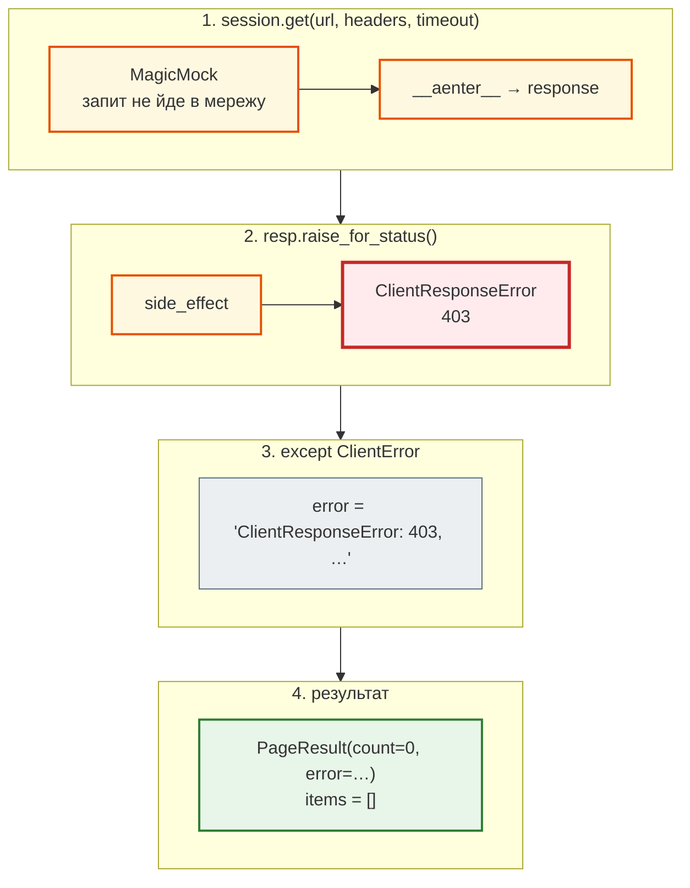
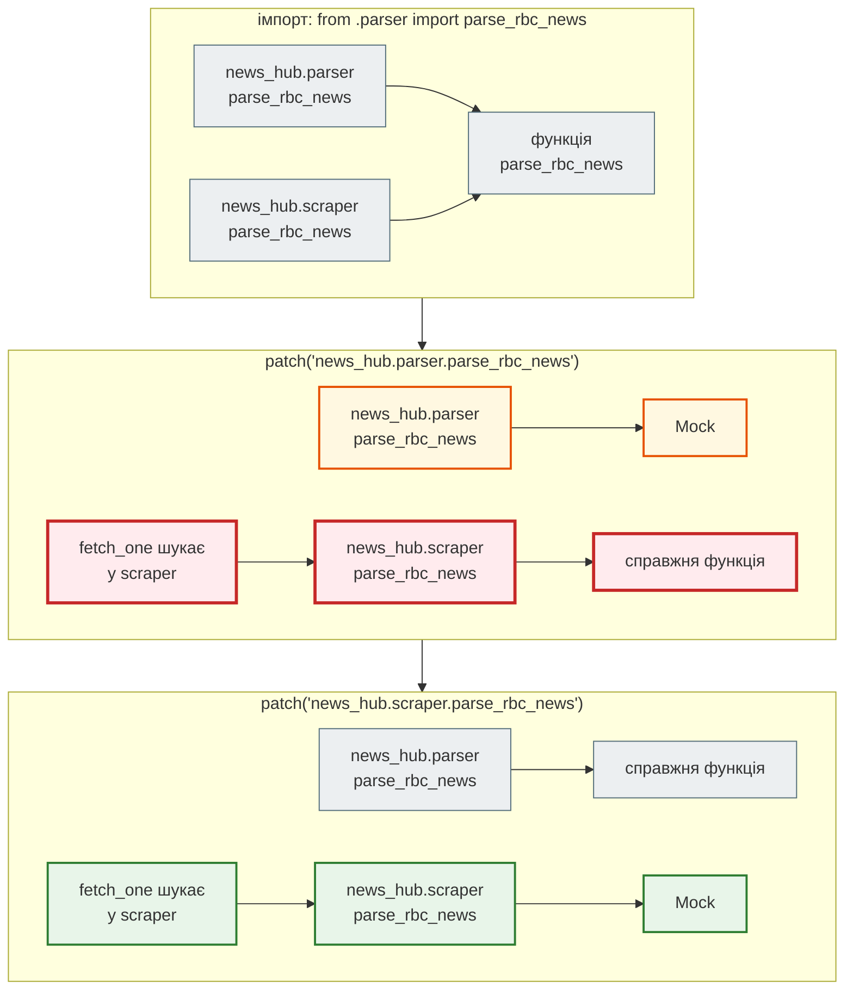

# Мок мережі: patch where used

> Крок 5 · розділ 3 з 7. Код: [`tests/unit/test_scraper.py`](https://github.com/NikoriakViktor/news_hub/blob/main/steps/05_api_testing/tests/unit/test_scraper.py), [`news_hub/scraper.py`](https://github.com/NikoriakViktor/news_hub/blob/main/steps/05_api_testing/news_hub/scraper.py).
> Теорія: [Mock і patch](https://nikoriakviktor.github.io/notes_chat_app/08_testing_and_quality/mocking_and_patching_full/) у Django-книзі; Python — [where to patch](https://docs.python.org/3/library/unittest.mock.html#where-to-patch), [`AsyncMock`](https://docs.python.org/3/library/unittest.mock.html#unittest.mock.AsyncMock).

## Задача { #task }

`fetch_one` робить HTTP-запит до rbc.ua. У кроці 4 його не виконує жоден тест: API-тести підміняють увесь скрапер заглушкою. А саме тут живе логіка, яку треба перевірити:

```python title="news_hub/scraper.py (фрагмент)"
async def fetch_one(session: aiohttp.ClientSession, url: str, t0: float) -> tuple[PageResult, list[RawNews]]:
    ...
    try:
        async with session.get(url, headers=HEADERS, timeout=aiohttp.ClientTimeout(total=15)) as resp:
            resp.raise_for_status()
            html = await resp.text(errors="replace")   # один битий байт ≠ втрачена сторінка
        items = parse_rbc_news(html)
    except (aiohttp.ClientError, asyncio.TimeoutError) as e:
        error = f"{type(e).__name__}: {e}"
```

Сторінка з помилкою — 403, тайм-аут, обрив з'єднання — має стати `PageResult` з `error`, а не винятком на весь збір. Але в тесті інтернету може не бути, а rbc.ua може відповісти 403 будь-коли: тест залежав би від погоди.

## Зміна 1: мок `ClientSession` { #mock-session }

**Мок** — об'єкт, що прикидається справжнім і відповідає так, як скаже тест: 200 з HTML, 403, тайм-аут, обрив з'єднання.

```python title="tests/unit/test_scraper.py (фрагмент)"
def fake_session(html: str = "", error: BaseException | None = None) -> mock.MagicMock:
    """Замість aiohttp.ClientSession: session.get(...) — async-контекст, що віддає відповідь з html.

    error — виняток, який «кине мережа»: з raise_for_status (статус 4xx/5xx) або з самого запиту.
    """
    response = mock.MagicMock()
    response.text = mock.AsyncMock(return_value=html)
    session = mock.MagicMock()
    if isinstance(error, aiohttp.ClientResponseError):
        response.raise_for_status.side_effect = error       # статус 4xx/5xx
    elif error is not None:
        session.get.side_effect = error                     # мережа впала до відповіді
    session.get.return_value.__aenter__.return_value = response
    return session


def http_error(status: int) -> aiohttp.ClientResponseError:
    return aiohttp.ClientResponseError(request_info=mock.MagicMock(real_url=URL), history=(), status=status,
                                      message="Forbidden")
```

| Запис | Що означає |
|---|---|
| `MagicMock()` | будь-який атрибут і виклик повертає новий мок; підтримує `async with`: `__aenter__` / `__aexit__` у нього — `AsyncMock` |
| `AsyncMock(return_value=html)` | `await response.text()` поверне `html` |
| `session.get.return_value.__aenter__.return_value = response` | `async with session.get(...) as resp` → `resp is response` |
| `side_effect = error` | замість повернення — кинути виняток |

Шлях `fetch_one` з моком, коли сервер «відповів» 403:



## Зміна 2: три помилки мережі в одному тесті { #network-errors }

```python title="tests/unit/test_scraper.py (фрагмент)"
@pytest.mark.asyncio
@pytest.mark.parametrize(("error", "expected"), [
    (http_error(403), "ClientResponseError: 403"),
    (asyncio.TimeoutError(), "TimeoutError"),
    (aiohttp.ClientConnectionError("Connection reset by peer"), "ClientConnectionError: Connection reset"),
], ids=["403", "timeout", "connection-reset"])
async def test_network_errors_become_page_error(error: BaseException, expected: str) -> None:
    """Сторінка з помилкою — не виняток на весь збір, а PageResult з error і нулем новин."""
    page, items = await scraper.fetch_one(fake_session(error=error), URL, t0=0.0)
    assert (page.count, items) == (0, [])
    assert page.error is not None and page.error.startswith(expected)
```

`@pytest.mark.asyncio` (пакет `pytest-asyncio`) запускає тест-корутину в циклі подій. Без нього pytest не виконує `async def`, а падає:

```text
async def functions are not natively supported.
You need to install a suitable plugin for your async framework, for example:
  - anyio
  - pytest-asyncio
  ...
FAILED tests/unit/test_noasync.py::test_forgot_marker - Failed: async def fun...
```

Ті самі три помилки поза pytest (з папки кроку, `PYTHONPATH=.`):

```python
import asyncio

import aiohttp

from news_hub import scraper
from tests.unit.test_scraper import URL, fake_session, http_error

for error in (http_error(403), asyncio.TimeoutError(), aiohttp.ClientConnectionError("Connection reset by peer")):
    page, items = asyncio.run(scraper.fetch_one(fake_session(error=error), URL, t0=0.0))
    print(f"{page.count} новин, error = {page.error!r}")
```

```text
0 новин, error = "ClientResponseError: 403, message='Forbidden', url='https://www.rbc.ua/ukr/news/'"
0 новин, error = 'TimeoutError: '
0 новин, error = 'ClientConnectionError: Connection reset by peer'
```

Ще один тест перевіряє, що запит іде із заголовками: `session.get.assert_called_once_with(URL, headers=scraper.HEADERS, timeout=mock.ANY)`. `mock.ANY` дорівнює будь-чому: об'єкт `ClientTimeout` нам тут не важливий.

## Зміна 3: patch where used { #patch-where-used }

Друга підміна — функція, яку `fetch_one` викликає. `scraper.py` робить:

```python title="news_hub/scraper.py (фрагмент)"
from .parser import RawNews, parse_rbc_news
```

Після такого імпорту в модулі `scraper` з'являється **власне** ім'я `parse_rbc_news`, що вказує на ту саму функцію. `mock.patch` міняє ім'я лише в одному модулі:

```python
from unittest import mock

from news_hub import parser, scraper

print("одна функція, два імена:", scraper.parse_rbc_news is parser.parse_rbc_news)
with mock.patch("news_hub.parser.parse_rbc_news") as fake:
    print("patch news_hub.parser  → scraper бачить мок:", scraper.parse_rbc_news is fake)
with mock.patch("news_hub.scraper.parse_rbc_news") as fake:
    print("patch news_hub.scraper → scraper бачить мок:", scraper.parse_rbc_news is fake)
print("після with — знову справжня:", scraper.parse_rbc_news is parser.parse_rbc_news)
```

```text
одна функція, два імена: True
patch news_hub.parser  → scraper бачить мок: False
patch news_hub.scraper → scraper бачить мок: True
після with — знову справжня: True
```



Тест `test_patch_where_used` фіксує обидва випадки:

```python title="tests/unit/test_scraper.py (фрагмент)"
@pytest.mark.asyncio
async def test_patch_where_used() -> None:
    """Одна функція — два імені: news_hub.parser.parse_rbc_news і news_hub.scraper.parse_rbc_news."""
    fake = [make_raw()]
    with mock.patch("news_hub.parser.parse_rbc_news", return_value=fake) as where_defined:
        _, items = await scraper.fetch_one(fake_session("<html></html>"), URL, t0=0.0)
    assert (where_defined.called, items) == (False, [])          # scraper цю підміну не побачив

    with mock.patch("news_hub.scraper.parse_rbc_news", return_value=fake) as where_used:
        _, items = await scraper.fetch_one(fake_session("<html></html>"), URL, t0=0.0)
    where_used.assert_called_once_with("<html></html>")
    assert items == fake
```

Після патча `news_hub.parser` мок не викликано жодного разу, і `fetch_one` розібрав сторінку справжнім парсером (порожній `<html></html>` → `[]`). Якщо ж написати тест «наївно», з патчем там, де функцію **визначено**, і чекати виклику мока:

```python
with mock.patch("news_hub.parser.parse_rbc_news", return_value=[make_raw()]) as fake:
    _, items = await scraper.fetch_one(fake_session("<html></html>"), URL, t0=0.0)
fake.assert_called_once_with("<html></html>")
```

```text
E           AssertionError: Expected 'parse_rbc_news' to be called once. Called 0 times.
```

## Зміна 4: мок іншої функції того ж модуля { #mock-fetch-one }

Те саме правило, коли тест перевіряє `scrape_all_async` — склеювання результатів сторінок без дублікатів. Мережа тут не потрібна взагалі, тож підміняємо `fetch_one` там, де його шукає `scrape_all_async`, — у модулі `scraper`:

```python title="tests/unit/test_scraper.py (фрагмент)"
with mock.patch("news_hub.scraper.fetch_one", side_effect=fake_fetch):
    outcome = await scraper.scrape_all_async(["https://x/a/", "https://x/b/"])
assert [p.count for p in outcome.pages] == [1, 2]
assert [n["url"] for n in outcome.news] == [same["url"], other["url"]]     # «same» — один раз
```

`side_effect` — функція: мок викликає її з тими самими аргументами і повертає її результат. Так «відповідь сторінки» залежить від `url`.

## Результат { #result }

```text
$ pytest -q -p no:cacheprovider tests/unit/test_scraper.py
......                                                                   [100%]
6 passed in 0.33s
$ pytest -q -p no:cacheprovider --cov=news_hub tests/unit/test_scraper.py | grep scraper.py
news_hub/scraper.py         49      4      6      0    93%   91-94
```

У кроці 4 `scraper.py` був покритий на 43%; шість мок-тестів дають 93%. Лишились рядки 91–94 — `scrape_sequential`, його виконують тести [фейкового сервера](fake_server.md). Але чого мок **не** бачить навіть у покритих рядках — у наступному розділі.

## Правило { #rule }

!!! tip "Правило"
    Мокай лише зовнішню межу (мережа, пошта, платежі, час), а не власний код. Патч ставиться на ім'я там, де його **шукає** код, що тестується: після `from .parser import parse_rbc_news` у `scraper.py` — це `news_hub.scraper.parse_rbc_news`, а не `news_hub.parser.parse_rbc_news`.

**Далі:** [Фейк замість моку: локальний HTTP-сервер](fake_server.md) — що лежить між запитом і рядком HTML.
