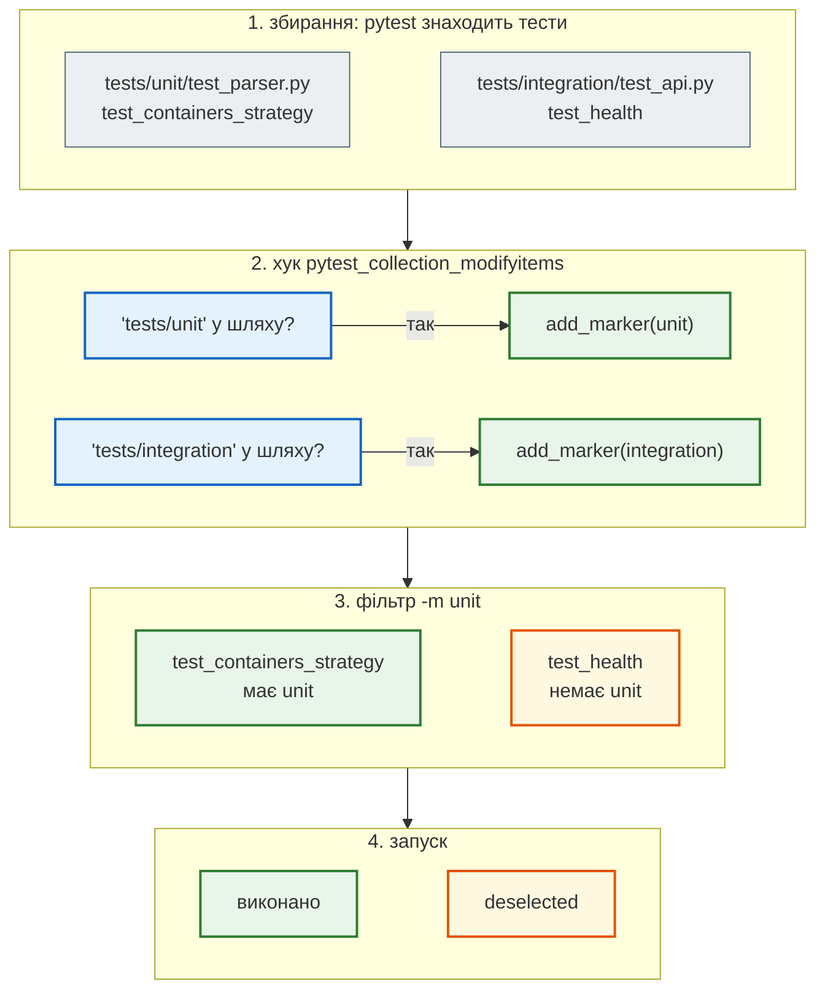
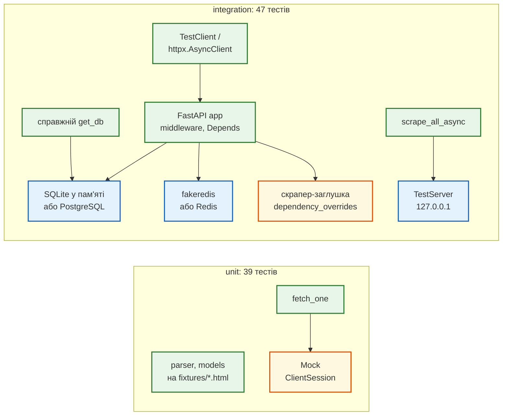

# Шари тестів: unit і integration

> Крок 5 · розділ 1 з 7. Код: [`tests/conftest.py`](https://github.com/NikoriakViktor/news_hub/blob/main/steps/05_api_testing/tests/conftest.py), [`pytest.ini`](https://github.com/NikoriakViktor/news_hub/blob/main/steps/05_api_testing/pytest.ini), [`tests/integration/conftest.py`](https://github.com/NikoriakViktor/news_hub/blob/main/steps/05_api_testing/tests/integration/conftest.py).
> Теорія: [Частина VII. Тестування API](../../07_testing/README.md); [піраміда тестів](https://nikoriakviktor.github.io/notes_chat_app/08_testing_and_quality/testing_foundations_full/) і [маркери pytest](https://nikoriakviktor.github.io/notes_chat_app/08_testing_and_quality/pytest_basics_full/) у Django-книзі.

## Задача { #task }

У кроці 4 тести лежать поруч: `test_models.py`, `test_parser.py`, `test_api.py`, `test_crud.py`, `test_redis.py`, а спільний `conftest.py` піднімає тестову базу й Redis. Щоб перевірити одну функцію парсера, pytest однаково збирає тести, які запускають застосунок, базу й Redis, і всім їм доступні фікстури бази.

Нам потрібні два режими:

- **після кожної зміни** — лише швидкі тести однієї функції чи класу, за секунду;
- **перед комітом і в CI** — усе, разом із застосунком, базою, Redis і HTTP.

## Зміна 1: дві папки { #folders }

```text title="tests/: крок 4 → крок 5"
tests/                              tests/
├── conftest.py                     ├── conftest.py        ← фікстура html(), маркер за папкою
├── test_models.py                  ├── factories.py       ← make_raw(**зміни)
├── test_parser.py                  ├── fixtures/          ← збережені сторінки *.html
├── test_api.py                     ├── unit/              ← без бази, Redis і мережі
├── test_crud.py                    │   ├── test_parser.py, test_models.py
└── test_redis.py                   │   ├── test_pipeline.py    ← парсер → модель
                                    │   └── test_scraper.py     ← мережа під моком
                                    └── integration/       ← застосунок цілком
                                        ├── conftest.py    ← client, aclient, тестова база
                                        ├── test_api.py, test_crud.py, test_redis.py
                                        ├── test_async_api.py       ← httpx.AsyncClient
                                        ├── test_db.py              ← справжній get_db
                                        └── test_scraper_server.py  ← локальний HTTP-сервер
```

`conftest.py` діє на свою папку і всі вкладені. Тому все про базу, Redis і `TestClient` переїхало в `tests/integration/conftest.py`: unit-тести цих фікстур не бачать і не можуть випадково підняти застосунок. У кореневому `tests/conftest.py` лишилось лише спільне: HTML-фікстури і маркери.

| Шар | Що перевіряє | Що справжнє | Приклади |
|---|---|---|---|
| unit | одну функцію чи клас | лише код, що тестується; мережа — мок | `test_parser.py`, `test_models.py`, `test_pipeline.py`, `test_scraper.py` |
| integration | кілька частин разом | застосунок, SQLite/PostgreSQL, fakeredis/Redis, aiohttp | `test_api.py`, `test_crud.py`, `test_db.py`, `test_scraper_server.py` |

## Зміна 2: маркер ставить папка { #marker-hook }

Можна писати `@pytest.mark.unit` над кожним тестом. Але про нього легко забути, а тест без маркера тихо випаде з `pytest -m unit`. Тому маркер ставить хук:

```python title="tests/conftest.py (фрагмент)"
def pytest_collection_modifyitems(items: list[pytest.Item]) -> None:
    """Маркер з назви папки: не треба пам'ятати про @pytest.mark.unit у кожному файлі."""
    for item in items:
        for layer in ("unit", "integration"):
            if f"{Path('tests') / layer}" in str(item.path):
                item.add_marker(getattr(pytest.mark, layer))
```

`pytest_collection_modifyitems` — **хук** pytest: функцію з цим ім'ям у `conftest.py` pytest викликає сам, коли вже зібрав усі тести, але ще не запустив жодного. `Path('tests') / layer` дає `tests/unit` на Linux і `tests\unit` на Windows, тому перевірка працює на обох системах.

Шлях одного тесту від збирання до запуску з `-m unit`:



## Зміна 3: маркери оголошено в `pytest.ini` { #pytest-ini }

```ini title="pytest.ini"
[pytest]
testpaths = tests
pythonpath = .
markers =
    unit: швидкі тести однієї функції чи класу — без бази, Redis і мережі
    integration: API разом з базою й Redis
asyncio_default_fixture_loop_scope = function
```

| Рядок | Що робить |
|---|---|
| `markers = …` | реєструє маркери; `pytest --markers` покаже їх з описом |
| `asyncio_default_fixture_loop_scope = function` | кожна async-фікстура (пакет `pytest-asyncio`) отримує свій цикл подій на тест — тести не ділять стан циклу |
| `pythonpath = .` | `from tests.factories import make_raw` працює з будь-якої папки запуску |

Без `markers` pytest не впаде, а попередить. Ось той самий прогін з видаленими рядками `markers`:

```text
tests/conftest.py:19: PytestUnknownMarkWarning: Unknown pytest.mark.unit - is this a typo?  You can register custom marks to avoid this warning - for details, see https://docs.pytest.org/en/stable/how-to/mark.html
tests/conftest.py:19: PytestUnknownMarkWarning: Unknown pytest.mark.integration - is this a typo?  ...
39 passed, 47 deselected, 2 warnings in 0.92s
```

## Результат { #result }

```text
$ pytest -q -p no:cacheprovider -m unit
.......................................                                  [100%]
39 passed, 47 deselected in 1.47s
$ pytest -q -p no:cacheprovider -m integration
...............................................                          [100%]
47 passed, 39 deselected in 5.02s
$ pytest -q -p no:cacheprovider
........................................................................ [ 83%]
..............                                                           [100%]
86 passed in 3.92s
```

Час залежить від машини. Співвідношення лишається: unit — секунда, integration — у кілька разів довше, бо кожен тест піднімає застосунок, базу і Redis.

| Файл | Тестів | Шар |
|---|---|---|
| `unit/test_models.py` | 22 | unit |
| `unit/test_parser.py` | 9 | unit |
| `unit/test_pipeline.py` | 2 | unit |
| `unit/test_scraper.py` | 6 | unit |
| `integration/test_api.py` | 17 | integration |
| `integration/test_crud.py` | 9 | integration |
| `integration/test_redis.py` | 9 | integration |
| `integration/test_async_api.py` | 3 | integration |
| `integration/test_db.py` | 4 | integration |
| `integration/test_scraper_server.py` | 5 | integration |
| **усього** | **86** | 39 + 47 |

`-m` приймає вираз: `-m "unit and not asyncio"` — лише синхронні unit-тести (33 passed, 53 deselected), `-m "not integration"` — те саме, що `-m unit`.

## Що справжнє, а що підмінене { #what-is-real }

Кожен шар відповідає на своє питання. Різниця між ними — в тому, що в тесті справжнє, а що підмінене:



- **зелене** — справжній код застосунку, який тест виконує;
- **жовте** — мок або заглушка: тест вирішує, що вона відповість;
- **синє** — фейк або справжній сервер: поводиться як реальний (SQL, команди Redis, HTTP), лише локально.

Як обрати підміну для конкретної залежності — схема в розділі [Фейк замість моку](fake_server.md#choose).

## Правило { #rule }

!!! tip "Правило"
    Шар тесту видно з його розташування: `tests/unit/` — без бази, Redis і мережі, `tests/integration/` — разом з ними. Маркер ставить папка, а не пам'ять автора тесту. Unit-тести запускай після кожної зміни, повний набір — перед комітом і в CI.

**Далі:** [Збережені сторінки замість рядків](html_fixtures.md) — HTML у файлах і тест конвеєра.
