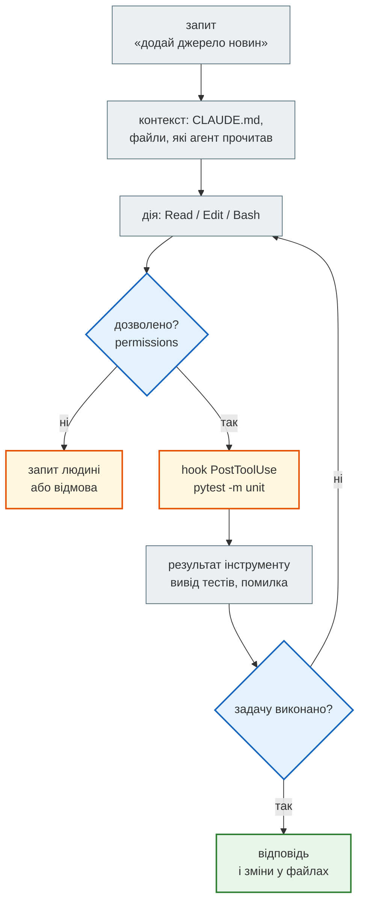
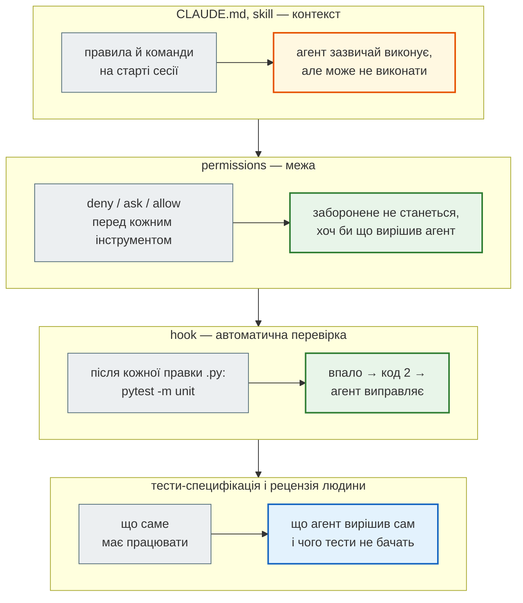

# Проєкт, у якому AI може працювати

> Крок 6 · розділ 1 з 3. Код: [`CLAUDE.md`](https://github.com/NikoriakViktor/news_hub/blob/main/steps/06_ai_dev_tools/CLAUDE.md), [`.claude/settings.json`](https://github.com/NikoriakViktor/news_hub/blob/main/steps/06_ai_dev_tools/.claude/settings.json), [`.claude/hooks/unit_tests.py`](https://github.com/NikoriakViktor/news_hub/blob/main/steps/06_ai_dev_tools/.claude/hooks/unit_tests.py), [`.claude/skills/add-news-source/SKILL.md`](https://github.com/NikoriakViktor/news_hub/blob/main/steps/06_ai_dev_tools/.claude/skills/add-news-source/SKILL.md).
> Теорія: [Частина IX. Інтеграції: AI, LLM, Telegram](../../09_integrations/README.md).

## Задача { #task }

**Claude Code** — AI-агент для розробки. Він читає код проєкту, редагує файли, запускає команди (тести, `mypy`, `git`) і сам вирішує, що робити далі, доки задачу не виконано. Від чату він відрізняється тим, що **діє** в репозиторії, а не лише пише текст.

Агент бачить лише те, що є в репозиторії та в запиті. Він не знає, що в `news_hub`:

- домени перевіряють без `endswith` (крок 5 знайшов `fakerbc.ua`);
- тести не ходять у мережу, нова розмітка — це файл у `tests/fixtures/`;
- `pytest -m unit` треба запускати після кожної зміни;
- змінювати наявні тести, щоб вони пройшли, не можна.

Усе це треба **записати** — і розділити: що агентові варто знати, а що мусить статися незалежно від того, що він вирішить.



Головне в схемі — **цикл**: агент сам запускає тести, читає помилку й виправляє. Тому якість результату визначає не лише запит, а й те, **чим агент може себе перевірити**: тести, типи, hook.

## Зміна 1: `CLAUDE.md` — контекст проєкту { #claude-md }

`CLAUDE.md` — Markdown-файл у корені проєкту, який Claude Code читає на початку **кожної** сесії. Файл кроку:

```markdown title="CLAUDE.md"
# news_hub — новинний агрегатор

Сторінки rbc.ua → `parse_rbc_news` → `RawNews` → перевірка `NewsItem` (Pydantic) → PostgreSQL / SQLite
(SQLAlchemy 2 async) → кеш Redis → FastAPI. Python 3.10+.

## Команди
- `pytest -m unit` — швидкі тести без бази, Redis і мережі; запускати після кожної зміни
- `pytest` — усі тести (SQLite у пам'яті + fakeredis + локальний aiohttp-сервер)
- `mypy --strict news_hub` — типи; має бути чисто
- `alembic revision --autogenerate -m "…"` після зміни `tables.py`; міграцію перечитати очима

## Структура
- `news_hub/parser.py` — HTML rbc.ua → `list[RawNews]` (лише рядки, без перевірок)
- `news_hub/models.py` — `NewsItem`, `validate_news`, перевірка доменів
- `news_hub/scraper.py` — aiohttp; `repository.py` — увесь SQL; `api.py` — ендпоінти
- `tests/unit/`, `tests/integration/`, `tests/fixtures/` — збережені сторінки для тестів

## Правила
- Будь-яке джерело новин повертає `list[RawNews]`; перевіряє лише `NewsItem`. Відхилене — у `rejected`, не мовчки.
- Домени — лише точний збіг або піддомен (`host == d or host.endswith("." + d)`), ніколи `endswith(d)`.
- Тести не ходять у мережу: нова розмітка → файл у `tests/fixtures/` + тест конвеєра «парсер → модель».
- Не змінюй наявні тести, щоб вони пройшли. Якщо тест здається хибним — зупинись і поясни чому.
- Нових залежностей не додавай; якщо без неї ніяк — зупинись і поясни, навіщо вона.
- Секрети — лише зі змінних середовища; `.env` не читати й не комітити.
- Анотації типів скрізь; `logging.getLogger("news_hub")` замість `print`; коментарі й docstring — українською.
```

Три розділи — три питання, які агент інакше вирішував би здогадкою:

| Розділ | Що дає агентові | Звідки правило |
|---|---|---|
| **Команди** | чим перевірити себе: швидко (`-m unit`), повністю (`pytest`), типи | `pytest.ini` і маркери — крок 5 |
| **Структура** | куди дивитися й що за що відповідає: парсер лише розбирає, модель лише перевіряє | шари з кроків 1–3 |
| **Правила** | те, чого **не видно з коду** | кожне — висновок одного з попередніх кроків |

Правила — найцінніша частина, бо кожне з них хтось уже порушив:

- «ніколи `endswith(d)`» — крок 5, покриття гілок знайшло `fakerbc.ua`;
- «тести не ходять у мережу» — крок 5, фікстури й мок мережі;
- «відхилене — у `rejected`, не мовчки» — крок 1, `validate_news`;
- «не змінюй наявні тести» — «тести проходять, бо їх змінили» — найпростіший спосіб отримати зелений прогін без робочого коду.

### Застарілий `CLAUDE.md` гірший за відсутній { #stale }

Початковий приклад `CLAUDE.md` для агрегатора лишився з часів, коли проєкт був `news_dashboard` на MongoDB:

```diff title="CLAUDE.md: старий приклад → news_hub"
-# Проект: News Dashboard API
-## Технологічний стек
-- Python 3.12, FastAPI 0.115, MongoDB (motor 3.7)
-## Команди розробки
-- `docker compose up --build` — запустити всі сервіси
-- `pytest tests/ -v` — запустити тести
-## Структура проекту
-- `app/main.py` — FastAPI ендпоінти
-- `app/nlp.py` — NLP pipeline (pymorphy3 + spaCy)
-## Важливі правила
-- Завжди використовуй async/await для MongoDB (motor)
+# news_hub — новинний агрегатор
+## Команди
+- `pytest -m unit` — швидкі тести без бази, Redis і мережі; запускати після кожної зміни
+- `mypy --strict news_hub` — типи; має бути чисто
+## Структура
+- `news_hub/parser.py` — HTML rbc.ua → `list[RawNews]` (лише рядки, без перевірок)
+- `news_hub/models.py` — `NewsItem`, `validate_news`, перевірка доменів
+## Правила
+- Будь-яке джерело новин повертає `list[RawNews]`; перевіряє лише `NewsItem`.
+- Домени — лише точний збіг або піддомен, ніколи `endswith(d)`.
+- Тести не ходять у мережу: нова розмітка → файл у `tests/fixtures/` + тест конвеєра.
+- Не змінюй наявні тести, щоб вони пройшли. Якщо тест здається хибним — зупинись і поясни.
+- Нових залежностей не додавай; якщо без неї ніяк — зупинись і поясни.
```

Старий приклад описує MongoDB, `app/nlp.py` і spaCy — нічого з цього в `news_hub` немає. Агент повірить файлу й упевнено піде шукати `motor`. Тому `CLAUDE.md` міняється разом з кодом, як README: новий шар, нова команда, нове правило — новий рядок.

Що ще варто знати про `CLAUDE.md`:

- **Він додається, а не замінює.** `./CLAUDE.md` у git — для всієї команди; `~/.claude/CLAUDE.md` — твої правила для всіх проєктів; `./CLAUDE.local.md` — твої правила лише для цього проєкту (додай у `.gitignore`). Агент отримує їх усі разом.
- **Короткий і конкретний.** До ~200 рядків. «`pytest -m unit` після кожної зміни» корисне, «пиши якісний код» — ні.
- **Це контекст, а не замок.** Агент зазвичай виконує `CLAUDE.md`, але не гарантовано. Те, що *мусить* статися, — у дозволах і hook.

## Зміна 2: дозволи — межа, яку агент не перейде { #permissions }

```json title=".claude/settings.json"
{
  "permissions": {
    "allow": [
      "Bash(pytest *)",
      "Bash(python -m pytest *)",
      "Bash(mypy *)",
      "Bash(git diff *)",
      "Bash(git status *)"
    ],
    "ask": [
      "Edit(./tests/**)"
    ],
    "deny": [
      "Read(./.env)",
      "Read(./.env.*)",
      "Bash(pip install *)",
      "Bash(git push *)",
      "Bash(alembic downgrade *)",
      "WebFetch"
    ]
  },
  "hooks": { … }
}
```

Перед **кожним** викликом інструменту Claude Code звіряє його з правилами: `deny` — відмовити, `ask` — спитати людину, `allow` — виконати без запиту.

| Рядок | Навіщо |
|---|---|
| `allow: pytest, python -m pytest, mypy` | агент сам перевіряє себе, не питаючи людину на кожен прогін |
| `allow: git diff, git status` | агент бачить, що змінив, і може показати діф у звіті |
| `ask: Edit(./tests/**)` | зміна тестів — лише з твого дозволу: «тести проходять, бо їх змінили» — найчастіший обман |
| `deny: Read(./.env)`, `Read(./.env.*)` | секрети не потрапляють у контекст агента, а отже й у код чи журнал |
| `deny: pip install` | жодних нових (або вигаданих) пакетів без людини; правило з `CLAUDE.md` стає межею |
| `deny: git push` | на віддалений репозиторій пушить людина |
| `deny: alembic downgrade` | відкат міграції видаляє таблиці й дані |
| `deny: WebFetch` | чужі сторінки — джерело промпт-ін'єкцій: інструкцій, захованих у тексті, який агент читає |

Як читати правила:

- **`deny` сильніший за `allow`.** Широке `Bash(git *)` в `allow` не відкрило б `git push`, бо його заборонено.
- **`Bash(pytest *)`** — `*` після пробілу покриває будь-які аргументи (`pytest -m unit -q`). Складену команду (`&&`, `|`, `;`) перевіряють частинами: `Bash(pytest *)` не дозволить `pytest && rm -rf .`.
- **Шляхи** `./.env`, `./tests/**` — відносно папки проєкту.

### Знахідка: `allow` з репозиторію не діє без довіри { #trust }

Перший запуск агента в налаштованій папці закінчився несподівано: жодного разу не вдалося запустити `pytest` — «This command requires approval», хоча `Bash(pytest *)` стоїть в `allow`. Hook при цьому працював. Причина — у повідомленні, яке Claude Code вивів у stderr того запуску (запис експерименту, не відтворюється без агента):

```text
Ignoring 5 permissions.allow entries from .claude/settings.json: this workspace has not been trusted.
Run Claude Code interactively here once and accept the trust dialog, …
```

Так і задумано. `allow`-правила з `.claude/settings.json` діють лише після того, як ти **довірив папку** — діалог при першому інтерактивному запуску `claude`. Інакше будь-який клонований репозиторій сам собі дозволив би команди. `deny` і `ask` діють одразу: вони лише звужують можливості. Режим без інтерфейсу `claude -p` діалог пропускає, тому в недовіреній папці `allow` з файлу мовчки ігнорується.

Для чесного порівняння обидва запуски в [експерименті](two_prompts.md) отримали однакові дозволи прапорцем `--allowedTools`.

!!! warning "Чужий репозиторій"
    `.claude/settings.json` з `allow` і hooks — це код, який виконається на твоїй машині. Перш ніж довірити папку з клонованого репозиторію, переглянь `.claude/` так само уважно, як `setup.py`.

## Зміна 3: hook — перевірка, яку агент не може забути { #hook }

**Hook** — команда, яку Claude Code запускає сам у певний момент роботи агента. На відміну від `CLAUDE.md`, hook виконується **завжди**.

```json title=".claude/settings.json (фрагмент)"
"hooks": {
  "PostToolUse": [
    {
      "matcher": "Edit|Write",
      "hooks": [
        {
          "type": "command",
          "command": "python \"$CLAUDE_PROJECT_DIR/.claude/hooks/unit_tests.py\""
        }
      ]
    }
  ]
}
```

| Запис | Що означає |
|---|---|
| `PostToolUse` | подія: **після** того, як інструмент виконано |
| `"matcher": "Edit\|Write"` | лише для інструментів редагування й створення файлів, не для `Read` чи `Bash` |
| `"type": "command"` | запустити команду оболонки |
| `$CLAUDE_PROJECT_DIR` | корінь проєкту — hook знайдеться, хоч би в якій підпапці агент працював |

Сам hook — 20 рядків Python:

```python title=".claude/hooks/unit_tests.py"
"""PostToolUse-хук Claude Code: після кожної зміни .py-файлу проєкту — швидкі тести.

Claude Code передає на stdin JSON з полями tool_name і tool_input.file_path. Якщо тести впали,
код виходу 2: Claude бачить stderr (хвіст виводу pytest) і мусить виправити, перш ніж іти далі.
"""
import json
import subprocess
import sys

event = json.load(sys.stdin)
path = event.get("tool_input", {}).get("file_path", "")
if not path.endswith(".py"):
    sys.exit(0)

result = subprocess.run([sys.executable, "-m", "pytest", "-m", "unit", "-q", "-p", "no:cacheprovider", "-x"],
                        capture_output=True, text=True)
if result.returncode != 0:
    print("pytest -m unit впав після зміни", path, file=sys.stderr)
    print("\n".join(result.stdout.splitlines()[-25:]), file=sys.stderr)
    sys.exit(2)
```

- **Вхід** — JSON події на stdin: `tool_name` і `tool_input.file_path` (який файл змінено).
- **Лише `.py`.** Правка README чи фікстури тестів не запускає.
- **`pytest -m unit -x`** — лише швидкі тести, до першого падіння: hook запускається після кожної правки, тож має тривати секунди.
- **Код виходу** — мова, якою hook говорить з агентом:

| Код виходу | Для `PostToolUse` |
|---|---|
| `0` | усе гаразд, агент іде далі |
| `2` | правку вже зроблено, але stderr іде агентові як помилка, яку треба виправити |
| інший | некритична помилка hook; агент продовжує |

### Результат: hook без агента { #hook-result }

Hook — звичайний скрипт, тож його можна перевірити руками, подавши ту саму подію, яку надіслав би Claude Code. З папки кроку:

```text
$ echo '{"tool_name": "Edit", "tool_input": {"file_path": "README.md"}}' | python .claude/hooks/unit_tests.py; echo "exit=$?"
exit=0
$ time (echo '{"tool_name": "Edit", "tool_input": {"file_path": "news_hub/rss.py"}}' | python .claude/hooks/unit_tests.py; echo "exit=$?")
exit=0

real	0m1.904s
```

`README.md` — не `.py`, тести не запускались. Правка `rss.py` — усі 60 швидких тестів (`pytest -m unit`) менш ніж за 2 с, мовчки, код 0.

А так hook відповідає, коли код зламано. Тут — копія кроку з кодом агента **до** рецензії ([розбір](review_with_tests.md#before)):

```text
$ echo '{"tool_name":"Edit","tool_input":{"file_path":"/home/you/news_hub/news_hub/rss.py"}}' | python .claude/hooks/unit_tests.py; echo "exit=$?"
pytest -m unit впав після зміни /home/you/news_hub/news_hub/rss.py
...................................................F
=================================== FAILURES ===================================
______________ test_item_without_category_is_not_named_after_year ______________

    def test_item_without_category_is_not_named_after_year() -> None:
        """Без <category> категорію брали з URL: /news/2026/09/26/… → «2026»."""
        valid, _ = validate_news(parse_pravda_rss(feed(ITEM.format(extra="<pubDate>Sat, 26 Sep 2026 21:40:00 +0300</pubDate>"))))
>       assert [n.category for n in valid] == ["Новини"]
E       AssertionError: assert ['2026'] == ['Новини']
E         
E         At index 0 diff: '2026' != 'Новини'
E         Use -v to get more diff

tests/unit/test_pravda_review.py:23: AssertionError
=========================== short test summary info ============================
FAILED tests/unit/test_pravda_review.py::test_item_without_category_is_not_named_after_year
!!!!!!!!!!!!!!!!!!!!!!!!!! stopping after 1 failures !!!!!!!!!!!!!!!!!!!!!!!!!!!
1 failed, 51 passed, 47 deselected in 1.38s
exit=2
```

Саме цей текст агент отримує після своєї правки — з іменем файлу, тестом і різницею `'2026' != 'Новини'`. Йому не треба «пам'ятати» запустити тести: результат приходить сам.

!!! warning "Hook-«чорний список» — не захист"
    Типовий приклад — hook, що блокує `rm -rf` регулярним виразом `^rm -rf`. Агент (або промпт-ін'єкція в прочитаному файлі) обходить його командою `cd / && rm -rf …`, `/bin/rm -rf …` чи `python -c "…"`. Небезпечні дії закриває `permissions.deny`. Hook — для перевірок якості, а не межа безпеки.

## Зміна 4: skill — порядок роботи, записаний один раз { #skill }

**Skill** — власна команда агента: папка з `SKILL.md`. У проєкті вона лежить у `.claude/skills/<назва>/` і потрапляє в git разом з кодом. Додавання нового джерела новин — задача, яка повторюватиметься (RSS «Української правди» — друге джерело, не останнє), тож порядок роботи записано як `/add-news-source`:

```markdown title=".claude/skills/add-news-source/SKILL.md"
---
name: add-news-source
description: Додати нове джерело новин у news_hub (HTML-сторінка або RSS) за правилами проєкту — фікстура, тести-специфікація, парсер, перевірка доменів.
argument-hint: "[назва джерела] [URL стрічки]"
disable-model-invocation: true
---

Додаємо джерело новин $ARGUMENTS.

1. Спершу збережи зразок стрічки у `tests/fixtures/` (мережі в тестах немає). Якщо зразка немає — зупинись і попроси його.
2. Тести-специфікація в `tests/unit/test_<джерело>.py`: порядок і дублікати, чисті поля `RawNews`,
   час (місцевий київський), конвеєр «парсер → `validate_news`», межові домени (`fake<домен>`, `<домен>.evil.com`).
   Запусти — тести мають ВПАСТИ (коду ще немає).
3. Парсер повертає `list[RawNews]` і нічого не перевіряє; биту розмітку — `ValueError`.
4. Домен — у список дозволених у `models.py` (точний збіг або піддомен). `lang` і `category` — з даних джерела,
   якщо в URL їх немає.
5. `pytest`, `mypy --strict news_hub`. Покажи `git diff --stat` і перелік рішень, які ти ухвалив сам.

Поточний стан:
!`git status --short`
```

| Запис | Що робить |
|---|---|
| `name`, `description` | назва в меню `/`; опис, за яким видно, для чого skill |
| `argument-hint` | підказка аргументів: `/add-news-source Суспільне https://…` |
| `disable-model-invocation: true` | skill викликаєш лише ти; агент сам його не запускає |
| `$ARGUMENTS` | усе, що написано після `/add-news-source` |
| `` !`git status --short` `` | команда виконується **до** того, як текст skill потрапить до агента: у текст підставляється її вивід — агент одразу бачить, які файли вже змінено |

Кроки skill — це правила `CLAUDE.md`, розкладені в порядку виконання: спершу фікстура, потім тести, які **мають впасти**, потім код. Крок 2 зачіпає `tests/`, тому спрацює `ask: Edit(./tests/**)`: агент попросить дозволу на кожен новий тест. Так і задумано — тести-специфікацію людина бачить до коду.

## Чотири шари — жоден не замінює інший { #layers }



| Шар | Що знає | Чого не знає |
|---|---|---|
| `CLAUDE.md`, skill | наміри: як тут прийнято | не гарантує виконання |
| `permissions` | які дії дозволено | нічого про логіку коду |
| hook | чи пройшли швидкі тести | нічого про те, чого тести не питають |
| специфікація + рецензія | що має працювати й що могло піти не так | — це людина |

Останній шар — тема наступних двох розділів.

## Правило { #rule }

!!! tip "Правило"
    Що агентові варто знати — у `CLAUDE.md` (команди перевірки й правила, яких не видно з коду). Що не повинно статися — у `permissions.deny` / `ask`. Що мусить статися після кожної правки — у hook. Повторюваний порядок роботи — у skill. І пам'ятай: `allow` з репозиторію діє лише в довіреній папці.

**Далі:** [Експеримент: одне завдання — два запити](two_prompts.md).
