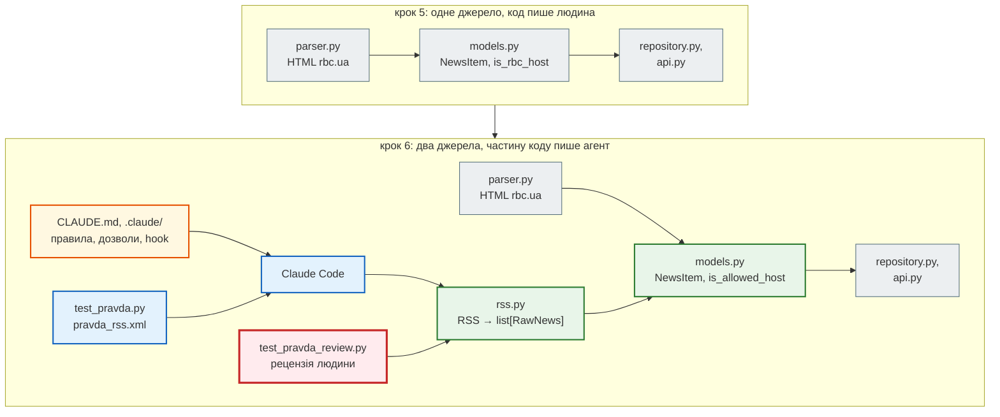

# Крок 6. AI-інструменти розробника

> **Код кроку:** [`steps/06_ai_dev_tools`](https://github.com/NikoriakViktor/news_hub/tree/main/steps/06_ai_dev_tools).
>
> **Передумови:** [Крок 5. Тестування API](../05_api_testing/index.md) — 86 тестів, маркери `unit` / `integration`, тест конвеєра «парсер → модель», `is_rbc_host` замість `endswith("rbc.ua")`.

## Де ми зараз { #where }

Після кроку 5 агрегатор має 86 тестів: `pytest -m unit` перевіряє парсер, модель і скрапер без бази та мережі, інтеграційні тести — API разом з базою й Redis. Тест конвеєра на збереженій розмітці знайшов, що модель відхиляла новини з контейнерів, а покриття гілок — що `endswith("rbc.ua")` пропускав `fakerbc.ua`.

Але джерело новин досі одне — rbc.ua. І весь код проєкту написала людина.

## Проблема { #problem }

У проєкт приходить **AI-агент** — Claude Code, який сам читає файли, редагує їх і запускає команди. Він працює швидко, але:

- бачить лише те, що є в репозиторії та в запиті: не знає, що домени тут не перевіряють через `endswith`, що тести не ходять у мережу, що `pytest -m unit` треба запускати після кожної зміни;
- може «зробити тести зеленими», змінивши тести, а не код;
- пише тести під власні припущення — і тоді зелений прогін нічого не доводить.

Два питання кроку: як налаштувати проєкт, щоб агент працював **за його правилами**, а не за своїми здогадками, і як перевірити написане агентом — навіть коли всі його тести зелені. Відповіді — на справжньому експерименті: агент двічі додає друге джерело новин, RSS «Української правди», — з голим запитом і з налаштованим проєктом та тестами-специфікацією.

## Що додаємо { #what }

| Що | Де | Розділ |
|---|---|---|
| інструкції для агента: команди, структура, правила, яких не видно з коду | `CLAUDE.md` | [Проєкт, у якому AI може працювати](ai_ready_project.md) |
| дозволи `allow` / `ask` / `deny`, hook з `pytest -m unit` після кожної правки | `.claude/settings.json`, `.claude/hooks/unit_tests.py` | [Проєкт, у якому AI може працювати](ai_ready_project.md#permissions) |
| skill `/add-news-source` — порядок роботи з новим джерелом | `.claude/skills/add-news-source/SKILL.md` | [Проєкт, у якому AI може працювати](ai_ready_project.md#skill) |
| специфікація нового джерела: зразок стрічки й 18 тестів до коду | `tests/fixtures/pravda_rss.xml`, `tests/unit/test_pravda.py` | [Експеримент: одне завдання — два запити](two_prompts.md) |
| RSS «Української правди» → `list[RawNews]`; дозволені домени `is_allowed_host` | `news_hub/rss.py`, `news_hub/models.py` | [Експеримент: одне завдання — два запити](two_prompts.md#run-b) |
| 3 тести рецензента і виправлення коду агента; `tzdata` для Windows | `tests/unit/test_pravda_review.py`, `requirements.txt` | [Рецензія AI-коду тестами](review_with_tests.md) |

## Архітектура: було → стало { #architecture }



- **Новий код — у тих самих межах.** `rss.py` повертає ті самі сирі `RawNews`, що й `parser.py`; перевіряє їх лише `NewsItem`. Решта застосунку про друге джерело не знає.
- **Два списки доменів.** `is_allowed_host` — звідки новина може прийти в модель (rbc.ua, pravda.com.ua, epravda.com.ua). `is_rbc_host` — які сторінки сервер завантажує за `POST /api/scrape`: як і раніше, лише rbc.ua. Нове джерело не відкриває SSRF на нові домени.
- **Агент працює між специфікацією і рецензією.** На вході людина дає тести, які мають пройти; на виході — шукає те, про що тести не питали.
- **У кроці 6 RSS ще не під'єднано до API.** `parse_pravda_rss` викликають лише тести. Збір з RSS через API з'явиться в [кроці 8](../08_security/index.md), разом із повним захистом від SSRF.

## Файли кроку { #files }

| Файл | Що в ньому | Новий? |
|---|---|---|
| [`CLAUDE.md`](https://github.com/NikoriakViktor/news_hub/blob/main/steps/06_ai_dev_tools/CLAUDE.md) | інструкції агентові: команди, структура, 7 правил | новий |
| [`.claude/settings.json`](https://github.com/NikoriakViktor/news_hub/blob/main/steps/06_ai_dev_tools/.claude/settings.json) | дозволи `allow` / `ask` / `deny` і hook `PostToolUse` | новий |
| [`.claude/hooks/unit_tests.py`](https://github.com/NikoriakViktor/news_hub/blob/main/steps/06_ai_dev_tools/.claude/hooks/unit_tests.py) | після правки `.py` — `pytest -m unit`; впав → код виходу 2 | новий |
| [`.claude/skills/add-news-source/SKILL.md`](https://github.com/NikoriakViktor/news_hub/blob/main/steps/06_ai_dev_tools/.claude/skills/add-news-source/SKILL.md) | `/add-news-source`: фікстура → тести, що падають → парсер → домени → перевірка | новий |
| [`news_hub/rss.py`](https://github.com/NikoriakViktor/news_hub/blob/main/steps/06_ai_dev_tools/news_hub/rss.py) | `parse_pravda_rss`: RSS 2.0 → `list[RawNews]`, київський час, битий XML → `ValueError` | новий, написав агент |
| [`news_hub/models.py`](https://github.com/NikoriakViktor/news_hub/blob/main/steps/06_ai_dev_tools/news_hub/models.py) | `ALLOWED_DOMAINS`, `is_allowed_host`, `lang` і категорія для URL без `/ukr/`, валідатор `only_allowed` | змінили агент і рецензент |
| [`tests/fixtures/pravda_rss.xml`](https://github.com/NikoriakViktor/news_hub/blob/main/steps/06_ai_dev_tools/tests/fixtures/pravda_rss.xml) | навчальний знімок стрічки у форматі RSS 2.0, 5 записів | новий |
| [`tests/unit/test_pravda.py`](https://github.com/NikoriakViktor/news_hub/blob/main/steps/06_ai_dev_tools/tests/unit/test_pravda.py) | специфікація: 18 тестів, написаних до коду | новий |
| [`tests/unit/test_pravda_review.py`](https://github.com/NikoriakViktor/news_hub/blob/main/steps/06_ai_dev_tools/tests/unit/test_pravda_review.py) | 3 тести рецензента: чого специфікація не передбачила | новий |
| [`requirements.txt`](https://github.com/NikoriakViktor/news_hub/blob/main/steps/06_ai_dev_tools/requirements.txt) | `+ tzdata>=2024.1` — база часових поясів для Windows | змінено |
| `news_hub/api.py` | лише опис і версія `0.6.0` | змінено |
| `parser.py`, `scraper.py`, `db.py`, `repository.py`, `cache.py`, `middleware.py`, `jobs.py`, решта тестів | з кроку 5 | без змін |

## Порядок читання { #reading-order }

1. [Проєкт, у якому AI може працювати](ai_ready_project.md) — `CLAUDE.md`, дозволи, довіра до папки, hook, skill.
2. [Експеримент: одне завдання — два запити](two_prompts.md) — голий запит проти специфікації на тому самому проєкті.
3. [Рецензія AI-коду тестами](review_with_tests.md) — три вади поза специфікацією, чекліст рецензії, кейс AI-проєкту, що «працював».
4. [Контрольна точка](checkpoint.md) — тести, практика, самоперевірка.

Теорія до кроку — [Частина IX. Інтеграції: AI, LLM, Telegram](../../09_integrations/README.md).

## Запуск { #run }

З папки кроку `steps/06_ai_dev_tools`:

```bash
pip install -r requirements.txt
pytest -q                                   # 107 passed
pytest -m unit -q                           # 60 passed, 47 deselected
pytest -q tests/unit/test_pravda.py tests/unit/test_pravda_review.py   # 21 passed
mypy --strict news_hub                      # Success: no issues found in 13 source files
```

Hook можна запустити й без агента — так, як його запускає Claude Code, з JSON події на stdin:

```bash
echo '{"tool_name": "Edit", "tool_input": {"file_path": "news_hub/rss.py"}}' | python .claude/hooks/unit_tests.py
echo $?                                     # 0 — швидкі тести пройшли
```

Сам Claude Code для цього кроку не обов'язковий: увесь код, тести й налаштування вже в папці кроку. З ним — `claude` у папці кроку і, перший раз, діалог довіри до папки ([чому це важливо](ai_ready_project.md#trust)).

## Порівняння з кроком 5 { #diff }

```bash
git diff --no-index --stat steps/05_api_testing steps/06_ai_dev_tools
git diff --no-index steps/05_api_testing/news_hub steps/06_ai_dev_tools/news_hub
```

Нові файли — `CLAUDE.md`, `.claude/` (3 файли), `news_hub/rss.py`, фікстура й два файли тестів. У наявному коді змінено лише `models.py` (+27 / −7 рядків), `api.py` (опис і версія) і `requirements.txt` (`tzdata`).

## Що далі { #next }

[Крок 7. Аналіз новин через LLM API](../07_llm_api/index.md): LLM переходить з інструмента розробника всередину агрегатора — дає новині підсумок, тему й тональність. Відповідь моделі — теж «дані від AI»: її перевірятиме Pydantic, як `NewsItem` перевіряє дані з парсера.
