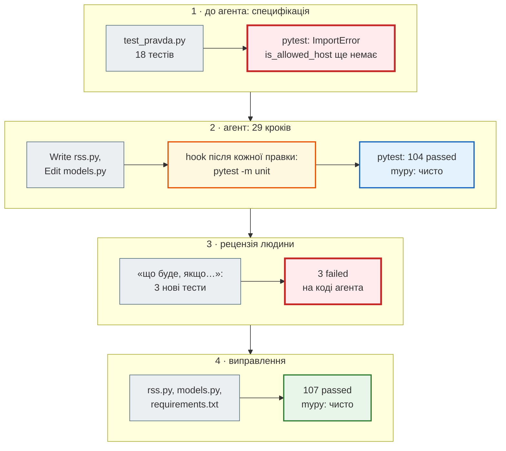
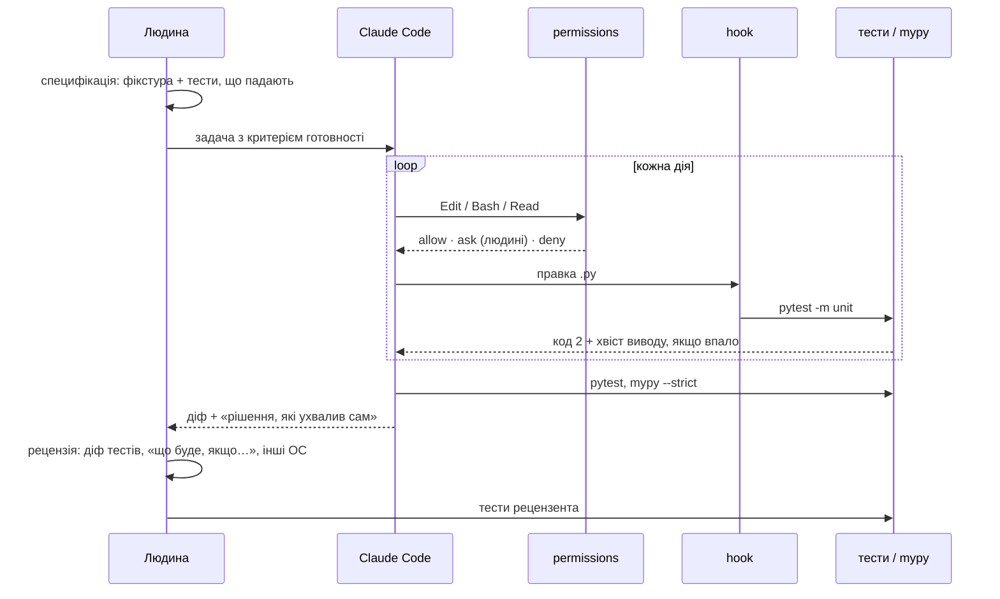

# Рецензія AI-коду тестами

> Крок 6 · розділ 3 з 3. Код: [`tests/unit/test_pravda_review.py`](https://github.com/NikoriakViktor/news_hub/blob/main/steps/06_ai_dev_tools/tests/unit/test_pravda_review.py), [`news_hub/rss.py`](https://github.com/NikoriakViktor/news_hub/blob/main/steps/06_ai_dev_tools/news_hub/rss.py), [`news_hub/models.py`](https://github.com/NikoriakViktor/news_hub/blob/main/steps/06_ai_dev_tools/news_hub/models.py), [`requirements.txt`](https://github.com/NikoriakViktor/news_hub/blob/main/steps/06_ai_dev_tools/requirements.txt).
> Теорія: [Частина IX. Інтеграції: AI, LLM, Telegram](../../09_integrations/README.md).

## Задача { #task }

Запуск B з [експерименту](two_prompts.md#run-b) зробив усі 18 тестів специфікації зеленими, `mypy --strict` чистий, тести не змінено. Чи можна зливати?

Зелена специфікація — не кінець роботи. Вона перевіряє те, про що її **спитали**. Рецензент шукає інше: що буде з кодом там, де специфікація мовчала. Метод — читати код агента рядок за рядком з питанням **«що буде, якщо…»**, і кожну відповідь, що не влаштовує, записувати тестом.

## Три випадки поза специфікацією { #findings }

| Що буде, якщо… | Код агента | Має бути |
|---|---|---|
| у новини немає `<category>` | категорія з URL: `/news/2026/09/26/…` → **«2026»** (для rbc.ua розділ — другий сегмент шляху, для правди — перший) | «Новини» |
| у новини немає `<pubDate>` або він битий | `ValueError` — і **вся стрічка** губиться через одну новину | ця новина без часу, решта — як є |
| Windows без пакета `tzdata` | `ZoneInfoNotFoundError` під час `import news_hub.rss`: у Windows немає системної бази часових поясів | `tzdata` у `requirements.txt` |

Жоден випадок не видно на фікстурі специфікації: у кожної новини там є `<category>` і правильний `pubDate`, а тести йдуть на Linux із системною базою поясів.

## Зміна 1: тести рецензента { #review-tests }

Кожна знахідка — тест, який **падає на коді агента**. Без такого тесту виправлення — лише думка рецензента; з ним — вимога, яку наступна зміна (людини чи агента) не зламає непомітно.

```python title="tests/unit/test_pravda_review.py"
ITEM = ('<item><title>Уряд оновив правила вступу до університетів</title>'
        '<link>https://www.pravda.com.ua/news/2026/09/26/7501001/</link>{extra}</item>')


def feed(*items: str) -> str:
    return "<rss><channel>" + "".join(items) + "</channel></rss>"


def test_item_without_category_is_not_named_after_year() -> None:
    """Без <category> категорію брали з URL: /news/2026/09/26/… → «2026»."""
    valid, _ = validate_news(parse_pravda_rss(feed(ITEM.format(extra="<pubDate>Sat, 26 Sep 2026 21:40:00 +0300</pubDate>"))))
    assert [n.category for n in valid] == ["Новини"]


def test_item_without_pub_date_does_not_break_feed() -> None:
    """Одна новина без <pubDate> кидала ValueError — і губилася вся стрічка."""
    news = parse_pravda_rss(feed(ITEM.format(extra="<category>Новини</category>"),
                                 ITEM.replace("7501001", "7501002").format(extra="<pubDate>garbage</pubDate>")))
    assert [n["datetime"] for n in news] == ["", ""]
    valid, rejected = validate_news(news)
    assert (len(valid), rejected, valid[0].published_time) == (2, [], None)


def test_rss_module_imports_without_system_tz_database() -> None:
    """Windows не має системної бази часових поясів: ZoneInfo("Europe/Kyiv") бере її з пакета tzdata.

    Імітуємо: PYTHONTZPATH вказує в порожнечу. Без tzdata в requirements.txt імпорт падав
    (ZoneInfoNotFoundError) — на Windows news_hub.rss не імпортувався б узагалі.
    """
    code = "import news_hub.rss as r; print(r.KYIV)"
    result = subprocess.run([sys.executable, "-c", code], capture_output=True, text=True,
                            env={"PYTHONTZPATH": "/nonexistent", "PATH": ""}, cwd=".")
    assert result.returncode == 0, result.stderr[-300:]
    assert result.stdout.strip() == "Europe/Kyiv"
```

- **Мінімальна стрічка в самому тесті.** `feed(ITEM…)` — одна-дві новини саме з тим дефектом, який перевіряємо. Велика фікстура тут лише заважала б побачити, про що тест.
- **Два рівні в другому тесті.** Сирі `RawNews` — `datetime == ""`; після моделі — обидві новини валідні, `rejected` порожній, `published_time is None`. Новина без часу — легальна, втрачена стрічка — ні.
- **Інша ОС без іншої ОС.** Третій тест запускає окремий процес Python з `PYTHONTZPATH`, що вказує в порожнечу: так Linux поводиться як Windows без системної бази поясів. Знайти базу можна лише в пакеті `tzdata` — якщо він встановлений.

### Результат: на коді агента — 3 failed { #before }

Код агента до рецензії відновлено в копії кроку за діфом нижче, `tzdata` у тому оточенні не встановлено:

```text
$ pytest -q -p no:cacheprovider tests/unit/test_pravda.py tests/unit/test_pravda_review.py
…
FAILED tests/unit/test_pravda_review.py::test_item_without_category_is_not_named_after_year
FAILED tests/unit/test_pravda_review.py::test_item_without_pub_date_does_not_break_feed
FAILED tests/unit/test_pravda_review.py::test_rss_module_imports_without_system_tz_database
3 failed, 18 passed in 0.27s
```

Специфікація — 18 passed, як і звітував агент. Тести рецензента — усі три червоні. Третій показує причину в `stderr` дочірнього процесу:

```text
$ PYTHONTZPATH=/nonexistent python -c "import news_hub.rss"
…
  File "/usr/lib/python3.12/zoneinfo/_common.py", line 24, in load_tzdata
    raise ZoneInfoNotFoundError(f"No time zone found with key {key}")
zoneinfo._common.ZoneInfoNotFoundError: 'No time zone found with key Europe/Kyiv'
```

## Зміна 2: виправлення — кілька рядків { #fix }

У коді кроку виправлення позначено коментарем «Рецензія»:

```diff title="news_hub/rss.py і models.py: код агента → після рецензії"
 def _kyiv_datetime(pub_date: str) -> str:
-    parsed = parsedate_to_datetime(pub_date)
+    try:
+        parsed = parsedate_to_datetime(pub_date)
+    except (TypeError, ValueError):
+        return ""                                   # новина без часу, а не втрачена стрічка
+    if parsed.tzinfo is None:
+        parsed = parsed.replace(tzinfo=timezone.utc)  # «-0000» — це UTC, а не час сервера
     return parsed.astimezone(KYIV).replace(tzinfo=None).isoformat()
 ...
-        if len(path) > 1:
-            derived["category"] = CATEGORIES.get(path[1], path[1].capitalize())
+        section = path[1] if is_rbc_host(parts.hostname) and len(path) > 1 else (path[0] if path else "")
+        if section:
+            derived["category"] = CATEGORIES.get(section, section.capitalize())
```

```text title="requirements.txt"
tzdata>=2024.1          # крок 6: ZoneInfo("Europe/Kyiv") у Windows (немає системної бази поясів)
```

Чому саме так — на справжніх викликах:

```python
from email.utils import parsedate_to_datetime

no_tz = parsedate_to_datetime("Sat, 26 Sep 2026 17:05:00 -0000")
print("-0000 → tzinfo:", no_tz.tzinfo)
for value in ["garbage", ""]:
    try:
        parsedate_to_datetime(value)
    except ValueError as error:
        print(repr(value), "→", type(error).__name__, error)
```

```text
-0000 → tzinfo: None
'garbage' → ValueError Invalid date value or format "garbage"
'' → ValueError Invalid date value or format ""
```

- **Битий і порожній `pubDate` → `ValueError`.** Без `try` один такий запис обриває весь цикл у `parse_pravda_rss` — губляться і правильні новини.
- **`-0000` дає datetime без поясу.** За RFC 2822 це UTC з невідомим місцевим поясом. `astimezone` на такому значенні вважав би його **часом сервера** — і результат залежав би від того, де запущено код. Тому `replace(tzinfo=timezone.utc)` до перетворення.
- **Розділ URL залежить від джерела.** rbc.ua: `/ukr/news/…` — розділ другий; pravda.com.ua: `/news/2026/09/26/…` — перший. Агент узяв правило rbc.ua для всіх доменів.

### Результат: після рецензії { #after }

```text
$ pytest -q -p no:cacheprovider
........................................................................ [ 67%]
...................................                                      [100%]
107 passed in 5.50s
$ mypy --strict news_hub
Success: no issues found in 13 source files
```

86 тестів кроку 5 + 18 специфікації + 3 рецензента = 107.

Третій тест рецензента стереже `requirements.txt` і на Linux: в оточенні без `tzdata` повний прогін дає `1 failed, 106 passed` — падає саме `test_rss_module_imports_without_system_tz_database`. Хто прибере `tzdata` «як непотрібну на Linux», побачить це одразу.

## Увесь шлях: специфікація → агент → рецензія { #trace }



Хто що робить у цьому циклі — у часі:



Агент працює всередині циклу «дія → перевірка», але **на вході** (що вважати готовим) і **на виході** (що тести не питали) стоїть людина. Жоден шар не замінює інший: `CLAUDE.md` агент може не виконати, `deny` не знає про логіку, тести не бачать того, про що їх не питали.

## Чекліст рецензії AI-коду { #checklist }

1. **Спершу специфікація** — тести й фікстура до коду. Запусти: вони мають впасти.
2. **Діф тестів окремо.** Чи змінено наявні тести? Чи не закріплює новий тест «тиху» помилку (`== []` на битих даних)?
3. **Дані агента — під підозрою.** Фікстури, яких ти не давав, — вигадані. Чи позначено це?
4. **«Рішення, які ухвалив сам»** — кожне перевір: чи не розширено доступ (домени, ендпоінти, адреси, які завантажує сервер), чи не додано залежність.
5. **«Що буде, якщо…»** — порожнє, відсутнє, битий формат, інший часовий пояс, інша ОС.
6. **Мінімальні версії й інші платформи** — `requirements.txt` мусить казати правду.
7. **Нічого не пропадає мовчки** — кожна відмова видна: `rejected`, `422`, запис у журналі.

## Кейс: AI-проєкт, що «працював» { #case }

Той самий метод на більшому проєкті. AI отримав рольові промпти («You are a Senior Python Architect and Data Scientist…», 12 етапів від EDA до Docker) і згенерував аналітичну платформу: Flask API, Streamlit-дашборд, RandomForest, KMeans, IsolationForest, 57-мегабайтний pickle моделі. Застосунок запускався, усі ендпоінти відповідали `200`, дашборд малював графіки. У промптах жодного разу не попрошено тестів чи критеріїв прийняття; про витік даних сказано одним рядком — і він у коді є.

!!! warning "Чутлива тема"
    Застосунок оцінював ризик депресії студентів і питав про суїцидальні думки. Тут це **кейс рецензії коду**, а не інструмент. Модель на відкритому датасеті не є діагнозом. Цього проєкту немає в репозиторії книги: нижче — знахідки рецензії, а не код для запуску.

Рецензія — тестами на синтетичних даних з колонками справжнього датасету. Кожен тест — одна знахідка; на згенерованому коді падали всі.

### Вада, яку не видно на скриншоті: порядок ключів JSON { #json-order }

Сервіс повертав важливість ознак, відсортовану за спаданням, а дашборд брав перші 12. Але `jsonify` у Flask за замовчуванням **сортує ключі за алфавітом**:

```python
from flask import Flask, jsonify

importance = {"Suicidal_enc": 0.27, "Risk_Score": 0.14, "Academic Pressure": 0.11, "Age": 0.03}   # як віддає сервіс
app = Flask("demo")
with app.app_context():
    print("Flask за замовчуванням:", jsonify(importance).get_data(as_text=True).strip())
    app.json.sort_keys = False
    print("sort_keys = False:     ", jsonify(importance).get_data(as_text=True).strip())
```

```text
Flask за замовчуванням: {"Academic Pressure":0.11,"Age":0.03,"Risk_Score":0.14,"Suicidal_enc":0.27}
sort_keys = False:      {"Suicidal_enc":0.27,"Risk_Score":0.14,"Academic Pressure":0.11,"Age":0.03}
```

(Flask 3.1.3.) Графік «Top Feature Importances» показував перші 12 ознак **за абеткою**. Блок «Strongest positive predictors» — `Academic Pressure`, `Age`, `CGPA`. Жодної помилки, жодного попередження, гарний графік. Правильно — `sort_keys = False` у власному JSON-провайдері, а UI сортує сам, не покладаючись на порядок ключів.

Для порівняння, FastAPI той самий словник ключів не переставляє:

```python
from fastapi import FastAPI
from fastapi.testclient import TestClient

app = FastAPI()


@app.get("/importance")
async def importance() -> dict[str, float]:
    return {"Suicidal_enc": 0.27, "Risk_Score": 0.14, "Academic Pressure": 0.11, "Age": 0.03}


print(TestClient(app).get("/importance").text)
```

```text
{"Suicidal_enc":0.27,"Risk_Score":0.14,"Academic Pressure":0.11,"Age":0.03}
```

Але висновок не «FastAPI безпечніший». Порядок ключів JSON-об'єкта — не частина контракту: проміжний сервіс, кеш чи інша бібліотека можуть його змінити. Якщо порядок важливий — віддавай список `[{"name": …, "value": …}]` або сортуй на клієнті.

### Усі знахідки { #case-findings }

| # | Знахідка | Як доведено | Як правильно |
|---|---|---|---|
| 1 | «топ-ознаки» й «найсильніші предиктори» — за абеткою | тест порядку після `jsonify` | `sort_keys=False` у JSON-провайдері, сортування в UI |
| 2 | назви кластерів вшиті в UI: «Sleep Deprived» — кластер, що спить **найбільше** (8,15 год), «Financially Stressed» — кластер з 2 людей | центроїди згенерованої моделі; тест «назва відповідає профілю» | назву дає профіль кластера порівняно з середнім |
| 3 | `/api/predict` приймав похідні ознаки від клієнта: `Risk_Score=-100` змінював прогноз; `Age=-500` → `200`; пропущене поле → `500` з текстом pandas | тести з поганими даними | Pydantic-модель профілю з `extra="forbid"` → `422`; похідні ознаки рахує сервер, одна функція для навчання й прогнозу |
| 4 | повзунок CGPA ні на що не впливав: CGPA немає в ознаках моделі | прогноз з CGPA 0,1 і 10 однаковий | повзунок прибрано; невідоме поле → `422` |
| 5 | `POST /api/train` без захисту перезаписував модель | тест: без токена → `403` | заголовок `X-Admin-Token` проти `ADMIN_TOKEN` через `hmac.compare_digest`; без змінної — ендпоінт вимкнено |
| 6 | витік даних: імпутер і скейлер навчались на всіх рядках до `train_test_split` | тест: медіани імпутера = медіани навчальної вибірки | `Pipeline`, навчений лише на навчальній частині; скейлер для лісу прибрано |
| 7 | pickle на 57 МБ читався з диска на кожен запит; перезапис на місці | тест: 3 прогнози — 0 читань з диска | кеш у пам'яті, атомарна заміна файлу, версія scikit-learn у файлі |
| 8 | `/api/groups` дописував колонку в кешований DataFrame | тест: після `/api/groups` у `/api/summary` є чужа колонка | `.copy()` |
| 9 | невідоме значення у стовпці → `NaN` у відповіді — невалідний JSON | тест зі строгим парсером JSON | `null`, `allow_nan=False` |
| 10 | папка `ui/pages/` — Streamlit автоматично додає 5 порожніх сторінок у меню | Streamlit AppTest | `ui/views/` |

А ще: пороги ризику в UI (0,3 / 0,5) не збігались з бекендом (0,5 / 0,75); `delta="vs overall"` — підпис без порівняння; `requirements.txt` з `==` під Python 3.11, без колес для 3.13.

Жодна з десяти вад не падає з помилкою. Кожна дає **правдоподібну неправду**: відсортований не за тим графік, упевнену назву кластера, прогноз, що реагує на підроблене поле. Це головний ризик AI-коду — і саме тому рецензія пише тести, а не дивиться на скриншот.

Знахідки 3 і 5 — це теми книги: перевірка вхідних даних моделлю з `422` ([крок 2](../02_fastapi_basics/index.md)) і захист ендпоінтів, що змінюють стан ([крок 8](../08_security/index.md)).

## Правило { #rule }

!!! tip "Правило"
    Зелена специфікація — початок рецензії, а не кінець. Читай код агента з питанням «що буде, якщо…» (порожнє, відсутнє, битий формат, інший пояс, інша ОС) і кожну знахідку записуй тестом, який **падає на коді агента** і проходить після виправлення. Головний ризик AI-коду — не падіння, а правдоподібна неправда.

**Далі:** [Контрольна точка](checkpoint.md).
