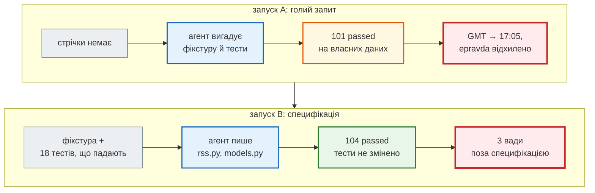

# Експеримент: одне завдання — два запити

> Крок 6 · розділ 2 з 3. Код: [`news_hub/rss.py`](https://github.com/NikoriakViktor/news_hub/blob/main/steps/06_ai_dev_tools/news_hub/rss.py), [`news_hub/models.py`](https://github.com/NikoriakViktor/news_hub/blob/main/steps/06_ai_dev_tools/news_hub/models.py), [`tests/unit/test_pravda.py`](https://github.com/NikoriakViktor/news_hub/blob/main/steps/06_ai_dev_tools/tests/unit/test_pravda.py), [`tests/fixtures/pravda_rss.xml`](https://github.com/NikoriakViktor/news_hub/blob/main/steps/06_ai_dev_tools/tests/fixtures/pravda_rss.xml).
> Теорія: [Частина IX. Інтеграції: AI, LLM, Telegram](../../09_integrations/README.md).

## Задача { #task }

Додати друге джерело новин — RSS «Української правди» (`https://www.pravda.com.ua/rss/view_news/`). Новини з нього мають проходити той самий шлях, що й з rbc.ua: сирі `RawNews` → перевірка `NewsItem` → база.

Код пише Claude Code. Питання експерименту: **що змінює підготовка проєкту й запиту**, якщо задача та сама?

## Зміна: специфікація до коду { #spec }

Справжня стрічка з середовища, де проводився експеримент, була недоступна (мережева політика), а тестам у будь-якому разі потрібні сталі дані: справжня стрічка щодня інша. Тому зразок — `tests/fixtures/pravda_rss.xml`, **навчальний знімок у форматі RSS 2.0** з вигаданими заголовками і позначкою про це в коментарі. У ньому навмисно є те, що буває в справжніх стрічках:

```xml title="tests/fixtures/pravda_rss.xml (фрагмент)"
<!-- Навчальний знімок стрічки у форматі RSS 2.0, як https://www.pravda.com.ua/rss/view_news/.
     Заголовки вигадані для кроку 6: справжня стрічка щодня інша, а тестам потрібні сталі дані. -->
<rss version="2.0">
  <channel>
    <item>
      <title>Уряд оновив правила вступу до університетів</title>
      <link>https://www.pravda.com.ua/news/2026/09/26/7501001/</link>
      <description><![CDATA[<p>Кабінет міністрів затвердив зміни до порядку прийому.</p>]]></description>
      <category>Суспільство</category>
      <pubDate>Sat, 26 Sep 2026 21:40:00 +0300</pubDate>
    </item>
    <item>
      <title>НБУ залишив облікову ставку без змін</title>
      <link>https://www.epravda.com.ua/news/2026/09/26/712345/</link>
      <category>Економіка</category>
      <pubDate>Sat, 26 Sep 2026 17:05:00 GMT</pubDate>
    </item>
    …
```

| Що у знімку | Навіщо |
|---|---|
| `pubDate` з `+0300` і в `GMT` | час має стати київським в обох випадках |
| `&quot;` у заголовку, `<p>` у CDATA опису | поля — чистий текст |
| той самий `link` двічі | дублікати відкидаються |
| заголовок «Відео дня» (9 символів) | `NewsItem` відхиляє — і це видно в `rejected` |
| новина з `epravda.com.ua` | сестринський сайт — дозволене джерело |

Специфікація — `tests/unit/test_pravda.py`, **18 тестів, написаних до коду** (8 функцій, одна з них параметризована на 11 доменів):

```python title="tests/unit/test_pravda.py (фрагмент)"
def test_time_is_kyiv_local() -> None:
    """pubDate буває з +0300 і в GMT; у RawNews — місцевий київський час без поясу, як у rbc.ua."""
    assert [n["datetime"] for n in parse_pravda_rss(FEED)] == [
        "2026-09-26T21:40:00", "2026-09-26T20:05:00", "2026-09-26T20:15:00", "2026-09-26T19:00:00"]


def test_pipeline_rss_to_model() -> None:
    valid, rejected = validate_news(parse_pravda_rss(FEED))
    assert [(n.source, n.lang, n.category, n.published_time.isoformat() if n.published_time else None)
            for n in valid] == [
        ("pravda.com.ua", "uk", "Суспільство", "21:40:00"),
        ("epravda.com.ua", "uk", "Економіка", "20:05:00"),
        ("pravda.com.ua", "uk", "Новини", "20:15:00"),
    ]
    assert [r.raw["title"] for r in rejected] == ["Відео дня"]          # закороткий заголовок — не мовчки


@pytest.mark.parametrize(("host", "allowed"), [
    ("rbc.ua", True), ("www.rbc.ua", True), ("pravda.com.ua", True), ("www.pravda.com.ua", True),
    ("epravda.com.ua", True), ("www.epravda.com.ua", True),
    ("fakerbc.ua", False), ("fakepravda.com.ua", False), ("pravda.com.ua.evil.com", False),
    ("", False), (None, False),
])
def test_allowed_hosts(host: str | None, allowed: bool) -> None:
    assert is_allowed_host(host) is allowed


def test_scrape_request_still_accepts_only_rbc_pages() -> None:
    """Сторінки для POST /api/scrape — як і раніше, лише rbc.ua: RSS не відкриває SSRF на нові домени."""
    assert is_rbc_host("www.rbc.ua") and not is_rbc_host("www.pravda.com.ua")
```

| Тест | Що вимагає |
|---|---|
| `test_items_in_feed_order_without_duplicates` | порядок стрічки, дубль за `url` відкинуто — 4 новини |
| `test_fields_are_clean_text` | поля `RawNews` без тегів і `&quot;`; немає опису → `""` |
| `test_time_is_kyiv_local` | `+0300` і `GMT` → київський час без поясу |
| `test_pipeline_rss_to_model` | конвеєр «RSS → `validate_news`»: джерело, мова, категорія, час; «Відео дня» — у `rejected` |
| `test_allowed_hosts` (×11) | точний збіг або піддомен; `fakepravda.com.ua`, `pravda.com.ua.evil.com`, `""`, `None` — ні |
| `test_scrape_request_still_accepts_only_rbc_pages` | `POST /api/scrape` лишається лише для rbc.ua |
| `test_parser_does_not_touch_network` | `socket.create_connection` під забороною — парсер працює з рядком, не з мережею |
| `test_broken_xml_raises_value_error` | обрізаний XML → `ValueError`, а не `[]` |

### Результат: специфікація падає до коду { #spec-fails }

Специфікація, яка проходить ще до коду, нічого не специфікує. Перевірка — фікстура й `test_pravda.py` поверх коду кроку 5:

```text
$ pytest -q -p no:cacheprovider
…
tests/unit/test_pravda.py:10: in <module>
    from news_hub.models import is_allowed_host, is_rbc_host, validate_news
E   ImportError: cannot import name 'is_allowed_host' from 'news_hub.models' (…/news_hub/models.py)
=========================== short test summary info ============================
ERROR tests/unit/test_pravda.py
!!!!!!!!!!!!!!!!!!!! Interrupted: 1 error during collection !!!!!!!!!!!!!!!!!!!!
1 error in 1.01s
```

Помилка імпорту зупиняє збір **усіх** тестів, не лише нових: агентові з першого ж прогону видно, що бракує `is_allowed_host` у `models.py` і модуля `news_hub.rss`.

## Два запуски { #runs }

Два запуски Claude Code в режимі `claude -p` (один запит без інтерфейсу) на двох копіях проєкту зі станом кроку 5:

| | Запуск A | Запуск B |
|---|---|---|
| Запит | «Додай у news_hub нове джерело новин — Українська правда, RSS https://www.pravda.com.ua/rss/view_news/. Новини з нього мають зберігатися так само, як з rbc.ua.» | «Додай у news_hub джерело «Українська правда» (RSS). Специфікація — `tests/unit/test_pravda.py`, зразок стрічки — `tests/fixtures/pravda_rss.xml`. Зроби так, щоб проходили всі тести (pytest) і `mypy --strict news_hub`, не змінюючи тестів. Наприкінці коротко перелічи рішення, які ти ухвалив сам.» |
| У проєкті | стан кроку 5 | + `CLAUDE.md`, `.claude/` (hook), фікстура, 18 тестів-специфікація (падають: коду ще немає) |
| Дозволи | `--allowedTools "Bash(pytest *)" "Bash(python -m pytest *)" "Bash(mypy *)" "Bash(git diff *)" "Bash(git status *)"` | ті самі |
| Кроків агента | 54 | 29 |
| Час | 9 хв | 5 хв |
| Вартість (з JSON-звіту запуску) | 1,54 $ | 0,75 $ |
| Змінено файлів | 10, з них 6 — наявні тести | `models.py` + новий `rss.py`; тести не змінено |
| Звіт агента | «Test suite passes (101/101)» | «усі тести (pytest — 104 passed) і mypy --strict проходять» |

Кроки, час, вартість і звіти — запис самого експерименту (`--output-format json`), їх не відтворити без агента: інший запуск дасть інші цифри. Код запуску B з виправленнями рецензента — у папці кроку.

Обидва звіти правдиві: тести справді зелені. Питання в тому, **чиї** тести.

## Запуск A: зелений на власних тестах { #run-a }

Стрічка недоступна — агент спробував `curl` і `WebFetch`, отримав відмову, **вигадав** власний зразок RSS і написав тести на ньому. У його фікстурі — правдоподібні заголовки на кшталт «Зеленський підписав новий закон про бюджет», без позначки, що це вигадка, і лише час з `+0300`.

Прогін коду A на нашій стрічці-специфікації (якої агент не бачив), із запису експерименту:

```text
21:40:00 www.pravda.com.ua/news/2026/09/2 Уряд оновив правила вступу до університе
17:05:00 www.epravda.com.ua/news/2026/09/ НБУ залишив облікову ставку без змін
20:15:00 www.pravda.com.ua/news/2026/09/2 Синоптики: "Перші заморозки прийдуть у ж
valid [('pravda.com.ua', 'Суспільство', '21:40:00'), ('pravda.com.ua', 'Новини', '20:15:00')]
rejected [('www.epravda.com.ua/new', ['url: Value error, очікуємо новину з rbc.ua або pravda.com.ua', 'lang: Field required'])]
broken xml -> []
html error page -> []
```

| Знахідка | Чому тести агента її не бачили |
|---|---|
| `17:05` для `pubDate` у GMT — час Лондона, а не Києва (має бути `20:05`) | у його фікстурі всі дати з `+0300` |
| новину з `epravda.com.ua` відхилено | стрічки не бачив — не знав, що там бувають сестринські сайти |
| битий XML і HTML-сторінка помилки замість RSS → `[]`, без жодної помилки | **тест агента закріплює це як правильну поведінку**: `assert parse_pravda_rss("не xml") == []` |
| вигадані «новини» реального видання у фікстурі без позначки | — |
| `pravda.com.ua` дописано в список сторінок для `POST /api/scrape` і в стандартний збір | запит «зберігати так само» агент прочитав як «збирати так само» — і розширив, які адреси завантажує сервер |
| змінено 6 файлів наявних тестів | — (нічого не послаблено, але рецензувати треба кожен рядок) |

### Як GMT стає часом Лондона { #gmt }

Помилка з часом — не в розборі дати, а в тому, що з поясом робиться далі. Той самий `pubDate`, два способи прибрати пояс:

```python
from email.utils import parsedate_to_datetime
from zoneinfo import ZoneInfo

gmt = parsedate_to_datetime("Sat, 26 Sep 2026 17:05:00 GMT")
print("як у рядку:   ", gmt.replace(tzinfo=None).time())
print("київський час:", gmt.astimezone(ZoneInfo("Europe/Kyiv")).time())
```

```text
як у рядку:    17:05:00
київський час: 20:05:00
```

`replace(tzinfo=None)` просто відкидає пояс — лишаються цифри з рядка. Для `+0300` це випадково правильно, тож фікстура лише з `+0300` помилки не покаже. Потрібно спершу **перевести** в київський пояс (`astimezone`), а потім відкинути пояс — так і робить `_kyiv_datetime` у `rss.py`.

## Запуск B: специфікація, яку не можна обійти { #run-b }

Агент B прочитав специфікацію, `CLAUDE.md`, наявні `parser.py` і `models.py`. Написав `rss.py` лише на стандартній бібліотеці (`xml.etree`, `email.utils`, `zoneinfo`) і додав `is_allowed_host` з правилом «точний збіг або піддомен». `is_rbc_host` лишив окремо — для `POST /api/scrape`. Наприкінці перелічив свої рішення:

- нових залежностей немає;
- битий XML → `ValueError`;
- `lang = "uk"` для доменів без `/ukr/` у шляху;
- категорія — з `<category>`.

Ядро `rss.py` (у папці кроку — уже з виправленнями рецензента, про них [наступний розділ](review_with_tests.md)):

```python title="news_hub/rss.py (фрагмент)"
KYIV = ZoneInfo("Europe/Kyiv")


def _text(item: ET.Element, tag: str) -> str:
    found = item.find(tag)
    return (found.text or "").strip() if found is not None else ""


def _clean_description(raw: str) -> str:
    """CDATA іноді містить <p>…</p> — лишаємо чистий текст, без тегів."""
    return BeautifulSoup(raw, "html.parser").get_text().strip()


def parse_pravda_rss(feed: str) -> list[RawNews]:
    """RSS-стрічка «Української правди» → список сирих новин без дублікатів за url (порядок стрічки)."""
    try:
        root = ET.fromstring(feed)
    except ET.ParseError as error:
        raise ValueError(f"пошкоджений RSS: {error}") from error

    news_list: list[RawNews] = []
    seen_urls: set[str] = set()
    for item in root.iter("item"):
        url = _text(item, "link")
        if not url or url in seen_urls:
            continue
        seen_urls.add(url)
        news_list.append({
            "title": _text(item, "title"),
            "url": url,
            "category": _text(item, "category"),
            "description": _clean_description(_text(item, "description")),
            "datetime": _kyiv_datetime(_text(item, "pubDate")),
        })
    return news_list
```

`BeautifulSoup` — не нова залежність: вона вже є для `parser.py`. `ET.ParseError` перетворено на `ValueError` — той самий виняток, що кидає `parse_rbc_news` на биту розмітку.

І домени в `models.py`:

```python title="news_hub/models.py (фрагмент)"
ALLOWED_DOMAINS: tuple[str, ...] = ("rbc.ua", "pravda.com.ua", "epravda.com.ua")


def _matches_domain(host: str, domain: str) -> bool:
    # Точний збіг або піддомен — ніколи host.endswith(domain), інакше пройшов би і fakerbc.ua
    return host == domain or host.endswith("." + domain)


def is_rbc_host(host: str | None) -> bool:
    """rbc.ua або його піддомен (www., auto.) — для POST /api/scrape: лише сторінки rbc.ua, не RSS-джерела."""
    return _matches_domain(host, "rbc.ua") if host else False


def is_allowed_host(host: str | None) -> bool:
    """Джерела, з яких новина може прийти в NewsItem: rbc.ua, pravda.com.ua, epravda.com.ua (і піддомени)."""
    return any(_matches_domain(host, domain) for domain in ALLOWED_DOMAINS) if host else False
```

Чому `epravda.com.ua` — окремий рядок у списку, а не «піддомен» `pravda.com.ua`:

```python
from news_hub.models import is_allowed_host, is_rbc_host

for host in ["www.pravda.com.ua", "epravda.com.ua", "fakepravda.com.ua", "pravda.com.ua.evil.com"]:
    print(f"{host:24} endswith: {host.endswith('pravda.com.ua')!s:5}  is_allowed_host: {is_allowed_host(host)!s:5}  is_rbc_host: {is_rbc_host(host)}")
```

```text
www.pravda.com.ua        endswith: True   is_allowed_host: True   is_rbc_host: False
epravda.com.ua           endswith: True   is_allowed_host: True   is_rbc_host: False
fakepravda.com.ua        endswith: True   is_allowed_host: False  is_rbc_host: False
pravda.com.ua.evil.com   endswith: False  is_allowed_host: False  is_rbc_host: False
```

`endswith("pravda.com.ua")` пропустив би `epravda.com.ua` — і разом з ним `fakepravda.com.ua`. Правило з `CLAUDE.md` змушує назвати кожен дозволений домен явно.

### Результат: стрічка → модель { #result }

З папки кроку:

```python
from pathlib import Path

from news_hub.models import validate_news
from news_hub.rss import parse_pravda_rss

feed = Path("tests/fixtures/pravda_rss.xml").read_text(encoding="utf-8")
raw = parse_pravda_rss(feed)
print("сирих новин:", len(raw))
valid, rejected = validate_news(raw)
for item in valid:
    print(item.source, item.lang, item.category, item.published_time, "|", item.title)
print("відхилено:", [(r.raw["title"], r.errors) for r in rejected])
```

```text
сирих новин: 4
pravda.com.ua uk Суспільство 21:40:00 | Уряд оновив правила вступу до університетів
epravda.com.ua uk Економіка 20:05:00 | НБУ залишив облікову ставку без змін
pravda.com.ua uk Новини 20:15:00 | Синоптики: "Перші заморозки прийдуть у жовтні"
відхилено: [('Відео дня', ['title: String should have at least 10 characters'])]
```

- 5 записів у стрічці → 4 сирі новини: дубль відкинуто за `url`.
- GMT-новина з `epravda.com.ua` — `20:05`, київський час; домен дозволено.
- «Відео дня» не зникла мовчки: вона в `rejected` з причиною, як новини rbc.ua з кроку 1.

## Що показав експеримент { #findings }



- **Без специфікації агент пише тести під свій код.** Запуск A — 101 зелений тест, помилка з часовим поясом і тест, що закріплює «тиху» відмову. Тести, що їх агент написав сам, перевіряють його ж припущення.
- **Специфікація робить результат перевірним.** Запуск B — удвічі швидше й дешевше, 2 файли замість 10, тести не змінено. Кожне рішення агента або перевірене тестом, або назване у звіті.
- **Специфікація не замінює рецензію.** У B лишились три вади — саме там, де специфікація мовчала (червоний вузол B4). Їх розбирає [наступний розділ](review_with_tests.md).
- **Однаковий запит не дає однакового коду.** Інший запуск може помилитися інакше. Тому перевіряють кожен результат, а не «модель загалом».

Прийоми запиту, які дав експеримент:

| Прийом | Навіщо |
|---|---|
| критерій готовності — тест і команда: «проходять `pytest` і `mypy --strict`» | агент знає, коли зупинитися, і перевіряє себе сам |
| «не змінюй тести» | зелений прогін означає робочий код, а не змінені очікування |
| «перелічи рішення, які ухвалив сам» | неявні рішення стають видимими для рецензії |
| обмеж простір: назви файли, які можна змінювати | менший діф — легше рецензувати |
| спершу план: «не пиши код, лише план» | побачити підхід до того, як змінено 10 файлів |
| вставляй помилку повністю (traceback) | агент бачить те саме, що й ти |
| великі задачі — частинами | кожну частину перевіряєш тестами до наступної |

## Правило { #rule }

!!! tip "Правило"
    Ставиш задачу агентові — дай йому **специфікацію, яку не можна обійти**: зразок даних у `tests/fixtures/` і тести, написані до коду, які зараз падають. У запиті: «зроби, щоб проходили, тести не змінюй, перелічи рішення, які ухвалив сам». Тести, які агент написав сам на своїх даних, перевіряють його припущення, а не вимоги.

**Далі:** [Рецензія AI-коду тестами](review_with_tests.md).
