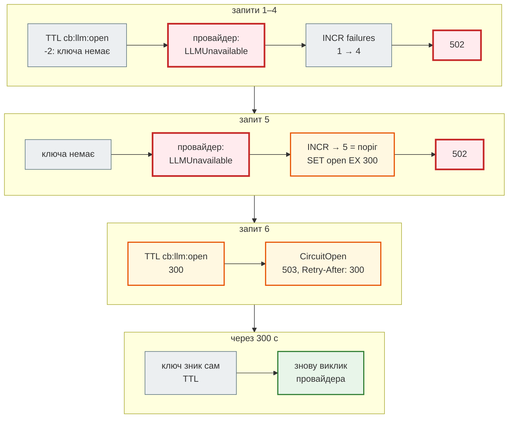

# Circuit breaker: атомарний і окремо від провайдера

> Крок 7 · розділ 5 з 7. Код: [`news_hub/llm.py`](https://github.com/NikoriakViktor/news_hub/blob/main/steps/07_llm_api/news_hub/llm.py) (`CircuitBreaker`, `GuardedLLM`), [`news_hub/api.py`](https://github.com/NikoriakViktor/news_hub/blob/main/steps/07_llm_api/news_hub/api.py) (`get_llm`, обробник `LLMError`).
> Теорія: [Частина VI. Middleware, кеш, фонові задачі](../../06_middleware_cache_jobs/README.md).

## Задача { #task }

Якщо провайдер лежить, кожен запит на аналіз пройде весь пул: 4 моделі × тайм-аут до 30 с. Клієнти чекають, сервер тримає з'єднання, провайдер, що й так перевантажений, отримує ще більше запитів. Фонова задача на 20 новин пройде весь пул 20 разів.

**Circuit breaker** («запобіжник») після серії збоїв перестає викликати провайдера на кілька хвилин і одразу відповідає `503`. Минула пауза — пробує знову.

## Зміна 1: стан у Redis { #breaker }

```python title="news_hub/llm.py — CircuitBreaker"
class CircuitBreaker:
    """N збоїв поспіль (за `window` секунд) → «відкрито» на `cooldown` секунд: провайдера не викликаємо.

    Закрито ─N збоїв→ Відкрито ─минув TTL→ Закрито (ключ зник сам). Успіх обнуляє лічильник.
    Лічильник — INCR (атомарно): при одночасних збоях жоден не губиться.
    """

    def __init__(self, redis: Redis, name: str = "llm", threshold: int = 5, window: int = 300,
                 cooldown: int = 300) -> None:
        self._redis = redis
        self.threshold, self.window, self.cooldown = threshold, window, cooldown
        self.failures_key, self.open_key = f"cb:{name}:failures", f"cb:{name}:open"

    async def retry_after(self) -> int:
        """0 — закрито (можна викликати); >0 — відкрито, стільки секунд лишилось."""
        try:
            ttl: int = await self._redis.ttl(self.open_key)
        except RedisError:
            logger.warning("breaker: Redis недоступний — вважаємо закритим")
            return 0                              # Redis упав — не вимикаємо через це LLM
        return max(ttl, 0)

    async def record_failure(self) -> None:
        try:
            async with self._redis.pipeline(transaction=True) as pipe:
                pipe.incr(self.failures_key)
                pipe.expire(self.failures_key, self.window, nx=True)     # вікно — від першого збою
                failures, _ = await pipe.execute()
            if failures >= self.threshold:
                await self._redis.set(self.open_key, 1, ex=self.cooldown)
                await self._redis.delete(self.failures_key)             # після паузи — рахуємо заново
                logger.error("breaker: відкрито після %s збоїв на %s с", failures, self.cooldown)
        except RedisError:
            logger.warning("breaker: Redis недоступний — збій не записано")

    async def record_success(self) -> None:
        try:
            await self._redis.delete(self.failures_key)
        except RedisError:
            pass
```

| Параметр / ключ | Значення | Що означає |
|---|---|---|
| `threshold` | `5` | стільки збоїв поспіль відкривають breaker |
| `window` | `300` с | TTL лічильника, від **першого** збою (`EXPIRE … NX`) |
| `cooldown` | `300` с | скільки breaker відкритий |
| `cb:llm:failures` | число | лічильник збоїв |
| `cb:llm:open` | `1` з TTL | «відкрито»; `TTL` ключа — це `Retry-After` |

Стану «напіввідкрито» окремо немає: коли TTL `cb:llm:open` минув, ключ зникає сам, і наступний запит іде до провайдера. Збій — лічильник знову росте з нуля; успіх — `record_success` його видаляє.

| Було (стартовий код) | Стало | Навіщо |
|---|---|---|
| `failures = int(await redis.get(key) or 0) + 1`, потім `SETEX` | `INCR` + `EXPIRE … NX` в одній транзакції | одночасні збої не губляться |
| breaker усередині `ask()` | `GuardedLLM(inner, breaker)` — той самий інтерфейс | один breaker для будь-якого провайдера |
| відкритий breaker — рядок «🔴 AI сервіс тимчасово недоступний» | `CircuitOpen(retry_after)` → `503` + `Retry-After` | клієнт знає, коли повторити |

## Чому `INCR`, а не `GET` + `SET` { #incr }

20 одночасних збоїв на справжньому Redis 7 (скрипт: `asyncio.gather` з 20 корутин, кожна або читає-збільшує-пише, або робить `INCR`; три запуски):

```text
GET, потім SETEX:  3      (у трьох запусках: 3, 2, 3)
INCR:              20
```

Між `GET` і `SETEX` — мережа: 20 корутин прочитали майже одне й те саме число й записали те саме «+1». Поріг «5 збоїв» на такому лічильнику спрацював би приблизно на 30-му збої, а не на 5-му — саме тоді, коли провайдер лежить і запити сиплються разом. Той самий принцип, що в rate limit кроку 4. На fakeredis різниці не видно: він не віддає керування між командами (крок 5). Тест `test_breaker_counts_concurrent_failures` перевіряє, що 20 одночасних `record_failure` дають `"20"` і TTL у межах `window`.

## Зміна 2: `GuardedLLM` — breaker як обгортка { #guarded }

```python title="news_hub/llm.py (фрагмент)"
class CircuitOpen(LLMError):
    """Breaker відкритий: провайдера не викликаємо, поки не мине retry_after секунд → 503."""

    def __init__(self, retry_after: int) -> None:
        super().__init__(f"LLM тимчасово вимкнено після серії збоїв; спробуй через {retry_after} с")
        self.retry_after = retry_after


class GuardedLLM:
    """Будь-який LLMClient + breaker: той самий інтерфейс, тож код, що викликає, не змінюється."""

    def __init__(self, inner: LLMClient, breaker: CircuitBreaker) -> None:
        self.inner, self.breaker = inner, breaker
        self.name = inner.name

    async def generate(self, prompt: str, *, system: str, schema: type[BaseModel]) -> LLMReply:
        if wait := await self.breaker.retry_after():
            raise CircuitOpen(wait)
        try:
            reply = await self.inner.generate(prompt, system=system, schema=schema)
        except LLMUnavailable:
            await self.breaker.record_failure()
            raise
        await self.breaker.record_success()
        return reply
```

`GuardedLLM` сам є `LLMClient`, тож `analyze_news` не знає, чи є breaker. В API кожен клієнт загортається залежністю:

```python title="news_hub/api.py (фрагмент)"
def get_llm(client: Annotated[LLMClient, Depends(get_llm_client)], redis: RedisDep) -> LLMClient:
    """Будь-який клієнт — лише через breaker."""
    return GuardedLLM(client, CircuitBreaker(redis))
```

Що breaker вважає збоєм: лише `LLMUnavailable` (провайдер не відповів). `InvalidLLMOutput` — провайдер **відповів**, хай і погано, — breaker не рахує. Зверни увагу: `400` від Gemini (невалідний ключ) — теж `LLMUnavailable`, тож неправильний ключ відкриє breaker після п'яти запитів. Це на краще: п'ятсот запитів з тим самим поганим ключем нічого б не дали.

Покроково — поріг 5, провайдер не відповідає:



## Результат { #result }

`GuardedLLM(FakeLLM([LLMUnavailable(…)] * 5), CircuitBreaker(redis))`, шість викликів поспіль; після кожного — стан ключів Redis:

```text
threshold/window/cooldown: 5 300 300 cb:llm:failures cb:llm:open
1 LLMUnavailable | failures = 1 | open TTL = -2
2 LLMUnavailable | failures = 2 | open TTL = -2
3 LLMUnavailable | failures = 3 | open TTL = -2
4 LLMUnavailable | failures = 4 | open TTL = -2
ERROR news_hub: breaker: відкрито після 5 збоїв на 300 с
5 LLMUnavailable | failures = None | open TTL = 300
6 CircuitOpen 300 | LLM тимчасово вимкнено після серії збоїв; спробуй через 300 с
provider calls: 5
```

`TTL = -2` — ключа немає. Після п'ятого збою лічильник видалено, `cb:llm:open` живе 300 с, шостий виклик до провайдера не дійшов (`provider calls: 5`).

Той самий сценарій через API (`TestClient`, `FakeLLM` через `dependency_overrides[get_llm_client]`, Redis 7):

```text
1 502 None провайдер LLM недоступний: усі моделі Gemini недоступні: gemini-2.5-flash: 503
2 502 None провайдер LLM недоступний: усі моделі Gemini недоступні: gemini-2.5-flash: 503
3 502 None провайдер LLM недоступний: усі моделі Gemini недоступні: gemini-2.5-flash: 503
4 502 None провайдер LLM недоступний: усі моделі Gemini недоступні: gemini-2.5-flash: 503
5 502 None провайдер LLM недоступний: усі моделі Gemini недоступні: gemini-2.5-flash: 503
6 503 300 LLM тимчасово вимкнено після серії збоїв; спробуй через 300 с
provider calls: 5
ttl cb:llm:open = 300
analyzed_at: None
```

Колонки: номер запиту, статус, заголовок `Retry-After`, `detail`. Після серії збоїв новина так і лишилась без аналізу (`analyzed_at: None`) — у базу нічого не записано.

## Два свідомі рішення { #decisions }

- **Redis упав — breaker пропускає виклики.** `retry_after()` повертає `0`, `record_failure` лише пише в журнал. Кеш і breaker — захист, а не умова роботи; без Redis аналіз працює, лише без захисту:

    ```text
    WARNING news_hub: breaker: Redis недоступний — збій не записано
    WARNING news_hub: breaker: Redis недоступний — вважаємо закритим
    retry_after: 0
    ```

- **Стан — у Redis, а не в пам'яті процесу.** Кілька процесів чи контейнерів застосунку (крок 11 масштабує кількістю контейнерів) бачать той самий breaker, і перезапуск його не скидає.

Поглиблено: [Martin Fowler — CircuitBreaker](https://martinfowler.com/bliki/CircuitBreaker.html).

## Правило { #rule }

!!! tip "Правило"
    Зовнішній сервіс, що може лежати хвилинами, — за circuit breaker: N збоїв → пауза → `503` з `Retry-After`. Лічильник — атомарний (`INCR` + `EXPIRE … NX` в одній транзакції), стан — спільний для всіх процесів (Redis). Breaker — обгортка з тим самим інтерфейсом, а не код усередині клієнта.

**Далі:** [База, кеш і вартість](db_cache_cost.md).
