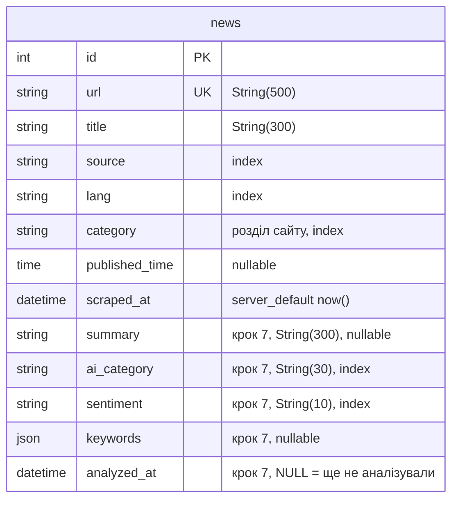
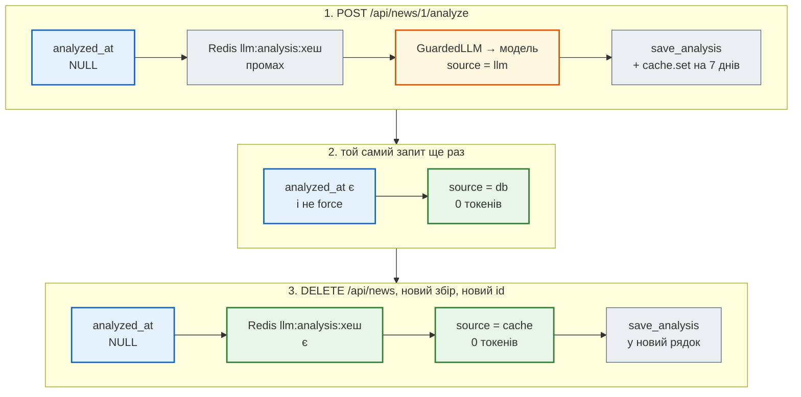

# База, кеш і вартість

> Крок 7 · розділ 6 з 7. Код: [`news_hub/tables.py`](https://github.com/NikoriakViktor/news_hub/blob/main/steps/07_llm_api/news_hub/tables.py), [`migrations/versions/0002_llm_analysis.py`](https://github.com/NikoriakViktor/news_hub/blob/main/steps/07_llm_api/migrations/versions/0002_llm_analysis.py), [`news_hub/analysis.py`](https://github.com/NikoriakViktor/news_hub/blob/main/steps/07_llm_api/news_hub/analysis.py) (`AnalysisCache`), [`news_hub/middleware.py`](https://github.com/NikoriakViktor/news_hub/blob/main/steps/07_llm_api/news_hub/middleware.py).
> Теорія: [Частина V. Бази даних](../../05_databases/README.md), [Частина VI. Middleware, кеш, фонові задачі](../../06_middleware_cache_jobs/README.md).

## Задача { #task }

Аналіз коштує токенів, а безкоштовний ключ Gemini обмежений запитами за хвилину й за добу. Тож модель має бачити кожен текст **один раз**: ні повторний запит на ту саму новину, ні той самий заголовок після `DELETE /api/news` і нового збору не повинні йти до провайдера.

## Зміна 1: результат — у рядку новини { #db }

```python title="news_hub/tables.py (фрагмент)"
    # Аналіз LLM (крок 7): NULL — ще не аналізували
    summary: Mapped[str | None] = mapped_column(String(300))
    ai_category: Mapped[str | None] = mapped_column(String(30), index=True)
    sentiment: Mapped[str | None] = mapped_column(String(10), index=True)
    keywords: Mapped[list[str] | None] = mapped_column(JSON)
    analyzed_at: Mapped[datetime | None] = mapped_column(DateTime(timezone=True))
```



Міграцію згенеровано `alembic revision --autogenerate` і перечитано очима:

```python title="migrations/versions/0002_llm_analysis.py (фрагмент)"
def upgrade() -> None:
    """Upgrade schema."""
    with op.batch_alter_table('news', schema=None) as batch_op:
        batch_op.add_column(sa.Column('summary', sa.String(length=300), nullable=True))
        batch_op.add_column(sa.Column('ai_category', sa.String(length=30), nullable=True))
        batch_op.add_column(sa.Column('sentiment', sa.String(length=10), nullable=True))
        batch_op.add_column(sa.Column('keywords', sa.JSON(), nullable=True))
        batch_op.add_column(sa.Column('analyzed_at', sa.DateTime(timezone=True), nullable=True))
        batch_op.create_index(batch_op.f('ix_news_ai_category'), ['ai_category'], unique=False)
        batch_op.create_index(batch_op.f('ix_news_sentiment'), ['sentiment'], unique=False)
```

- **Усі колонки `nullable`.** Наявні рядки лишаються «ще не аналізованими» (`NULL`), дані не переписуються. Новину зберігаємо одразу, аналізуємо пізніше (або ніколи).
- **`batch_alter_table`** — бо `env.py` вмикає `render_as_batch` для SQLite (там немає `ALTER COLUMN`); у PostgreSQL це звичайні `ALTER TABLE`.
- **Індекси** на `ai_category` і `sentiment` — під нові фільтри `GET /api/news?ai_category=…&sentiment=…`.

Перевірка на SQLite: вгору, вниз і знову вгору.

```text
$ alembic upgrade head
INFO  [alembic.runtime.migration] Running upgrade  -> 0001, news table — таблиця новин агрегатора (крок 3)
INFO  [alembic.runtime.migration] Running upgrade 0001 -> 0002, llm analysis — колонки аналізу LLM у таблиці news (крок 7)
$ alembic downgrade 0001
INFO  [alembic.runtime.migration] Running downgrade 0002 -> 0001, llm analysis — колонки аналізу LLM у таблиці news (крок 7)
$ alembic upgrade head
INFO  [alembic.runtime.migration] Running upgrade 0001 -> 0002, llm analysis — колонки аналізу LLM у таблиці news (крок 7)
```

```text
колонки: ['id', 'url', 'title', 'source', 'lang', 'category', 'published_time', 'scraped_at', 'summary', 'ai_category', 'sentiment', 'keywords', 'analyzed_at']
індекси: ['ix_news_sentiment', 'ix_news_ai_category', 'ix_news_lang', 'ix_news_category', 'ix_news_source', 'sqlite_autoindex_news_1']
```

Запис — один метод репозиторію; пакетна задача бере новини, де `analyzed_at IS NULL`:

```python title="news_hub/repository.py (фрагмент)"
    async def find_unanalyzed(self, limit: int) -> list[NewsRow]:
        stmt = select(NewsRow).where(NewsRow.analyzed_at.is_(None)).order_by(NewsRow.id).limit(limit)
        return list((await self._session.scalars(stmt)).all())

    async def save_analysis(self, row: NewsRow, analysis: NewsAnalysis) -> datetime:
        """Записує аналіз у рядок новини; повертає час аналізу."""
        row.summary, row.ai_category, row.sentiment = analysis.summary, analysis.category, analysis.sentiment
        row.keywords = list(analysis.keywords)
        row.analyzed_at = analyzed_at = datetime.now(timezone.utc)
        await self._session.flush()
        return analyzed_at
```

## Зміна 2: кеш за хешем тексту { #cache }

База знає аналіз **рядка**. Але `DELETE /api/news` і новий збір дають нові рядки з новими `id` — а тексти ті самі. Для цього кеш у Redis за хешем **заголовка**:

```python title="news_hub/analysis.py (фрагмент)"
PROMPT_VERSION = 1          # змінили промпт чи схему → нова версія → старий кеш не читається


def text_hash(title: str) -> str:
    return hashlib.sha256(f"v{PROMPT_VERSION}:{title.strip()}".encode()).hexdigest()[:16]


class AnalysisCache:
    """Готовий аналіз за хешем тексту: той самий заголовок після DELETE і нового збору — без платного виклику."""

    TTL = 7 * 24 * 3600

    def __init__(self, redis: Redis) -> None:
        self._redis = redis

    async def get(self, title: str) -> NewsAnalysis | None:
        try:
            raw = await self._redis.get(f"llm:analysis:{text_hash(title)}")
        except RedisError:
            return None                               # кеш — прискорення, а не умова роботи
        try:
            return NewsAnalysis.model_validate_json(raw) if raw else None
        except ValidationError:                       # запис старого формату — просто промах кешу
            return None

    async def set(self, title: str, analysis: NewsAnalysis) -> None:
        try:
            await self._redis.set(f"llm:analysis:{text_hash(title)}", analysis.model_dump_json(), ex=self.TTL)
        except RedisError:
            logger.warning("кеш аналізу недоступний")
```

- **`PROMPT_VERSION` у ключі.** Змінив промпт чи схему — збільш версію, і старі відповіді більше не читаються (тест `test_cache_key_depends_on_prompt_version`).
- **`title.strip()`** — `"  заголовок "` і `"заголовок"` дають один ключ.
- **Запис з кешу теж проходить `NewsAnalysis`.** Запис старого формату — просто промах, а не `500` (тест `test_broken_cache_entry_is_a_miss`).
- **Redis упав — кеш мовчки вимкнено.** Аналіз працює, лише без економії (тест `test_works_without_redis`).

Сам `analyze_news` спершу питає кеш, а після успішного аналізу записує в нього; `refresh=True` кеш не читає, але оновлює:

```python title="news_hub/analysis.py — analyze_news (фрагмент)"
    if cache and not refresh and (hit := await cache.get(title)):
        return AnalysisResult(hit, model="cache", cached=True)
    ...
    if cache:
        await cache.set(title, analysis)
    return AnalysisResult(analysis, model=reply.model, cached=False, input_tokens=tokens_in, output_tokens=tokens_out)
```

## Три шари, від найдешевшого { #layers }

```python title="news_hub/api.py — analyze (фрагмент)"
    if row.analyzed_at is not None and not force:
        stored = NewsAnalysis.model_validate({"summary": row.summary, "category": row.ai_category,
                                              "sentiment": row.sentiment, "keywords": row.keywords or []})
        return AnalyzeOut(news_id=row.id, source="db", model=None, analyzed_at=row.analyzed_at, analysis=stored)
    result = await analyze_news(row.title, llm, AnalysisCache(redis), refresh=force)
    analyzed_at = await repo.save_analysis(row, result.analysis)
```

Покроково — три запити на ту саму новину:



`?force=true` — аналізувати заново: перший шар пропущено, кеш не читається (`refresh=True`), новий результат перезаписує і рядок, і кеш.

## Результат { #result }

`analyze_news` двічі з тим самим кешем (вдруге — з пробілами навколо заголовка):

```text
first: fake False 18 33
second: cache True 0 0
calls: 1 | key: llm:analysis:c78716db3a20303d
```

Через API, сервер з `LLM_PROVIDER=fake`, SQLite і Redis 7:

```text
$ curl -X POST localhost:8000/api/news/1/analyze
{"news_id":1,"source":"llm","model":"fake","input_tokens":11,"output_tokens":24,"analyzed_at":"2026-11-11T21:11:07.183484Z","analysis":{"summary":"Реформа ЗСУ","category":"Інше","sentiment":"нейтральна","keywords":["реформа"]}}
$ curl -X POST localhost:8000/api/news/1/analyze
{"news_id":1,"source":"db","model":null,"input_tokens":0,"output_tokens":0,"analyzed_at":"2026-11-11T21:11:07.183484","analysis":{"summary":"Реформа ЗСУ","category":"Інше","sentiment":"нейтральна","keywords":["реформа"]}}
$ redis-cli --scan --pattern 'llm:*'
llm:analysis:e65ff22328aabb46
llm:analysis:437439a64783da76
llm:analysis:11ef698f09bb3a68
…
```

!!! note "Чому в `source: db` немає `Z`"
    Перша відповідь віддає час, який щойно створив Python (`datetime.now(timezone.utc)`), друга — прочитаний з бази. SQLite не зберігає часовий пояс, і `DateTime(timezone=True)` повертає naive `datetime`, тож у JSON немає `Z`. На PostgreSQL обидві відповіді однакові. Та сама причина, чому `NewsOut` пише `datetime`, а не `AwareDatetime`, — [`AwareDatetime` і SQLite](../../02_typing_and_pydantic/special_types.md#aware-response).

Тест `test_same_title_after_rescrape_comes_from_cache` перевіряє третій шар: після `DELETE /api/news` і нової новини з тим самим заголовком відповідь має `source == "cache"`, а модель викликано лише раз.

## Скільки це коштує { #cost }

`LLMReply` несе вхідні й вихідні токени, відповідь API — теж (`input_tokens`, `output_tokens`). Вартість одного аналізу:

```text
вартість = input_tokens × ціна_входу + output_tokens × ціна_виходу      (ціни — за 1 млн токенів)
```

Ціни змінюються й різні для моделей — дивись [Gemini pricing](https://ai.google.dev/gemini-api/docs/pricing) і [Anthropic pricing](https://platform.claude.com/docs/en/about-claude/pricing). У безкоштовного ключа Gemini головне обмеження — не гроші, а [запити за хвилину й за добу](https://ai.google.dev/gemini-api/docs/rate-limits). Що в `news_hub` тримає витрати:

| Механізм | Де |
|---|---|
| аналіз не повторюється: база → кеш → модель | `analyze`, `AnalysisCache` |
| одна повторна спроба, не цикл | `analyze_news` |
| стеля відповіді | `LLM_MAX_TOKENS=2048` |
| свій rate limit на аналіз: 10 за 60 с з адреси | `ANALYZE_RATE_LIMIT`, `middleware.py` |
| пакетний аналіз — по одній новині, зупинка на відкритому breaker | `run_analyze_job` |
| токени обох спроб рахуються | `AnalysisResult.input_tokens`, `output_tokens` |
| у кеш-відповіді й `source: db` — `0` токенів | `AnalyzeOut` |

## Свій rate limit для аналізу { #rate-limit }

Rate limit з кроку 4 захищав `POST /api/scrape*` (5 за 60 с). Аналіз дорожчий і часто частіший, тому в нього **свій** ліміт і свій лічильник:

```python title="news_hub/middleware.py (фрагмент)"
ANALYZE_RATE_LIMIT = int(os.getenv("ANALYZE_RATE_LIMIT", "10"))    # запитів до LLM за вікно


def limited_action(request: Request) -> str | None:
    """Яка «дорога» дія: scrape — завантаження сайту, analyze — виклик LLM; None — без ліміту."""
    path = request.url.path
    if request.method != "POST":
        return None
    if path.startswith("/api/scrape"):
        return "scrape"
    if path.endswith("/analyze") or path.startswith("/api/analyze"):
        return "analyze"
    return None
```

11 запитів на аналіз поспіль, потім ще один і збір:

```text
[200, 200, 200, 200, 200, 200, 200, 200, 200, 200, 429]
429 60 {'detail': 'забагато запитів: 10 за 60 с; спробуй через 60 с'}
scrape: 200
```

Ключі в Redis — окремі: `rate:analyze:127.0.0.1` і `rate:scrape:127.0.0.1`. Вичерпаний ліміт аналізу не заважає збору. Ліміт рахує й запити, що закінчились `503` «LLM не налаштовано»: middleware спрацьовує раніше за ендпоінт.

## Правило { #rule }

!!! tip "Правило"
    Платну відповідь зберігай там, де її шукатимеш: результат — у рядку даних, а за хешем вхідного тексту — у кеші з версією промпту в ключі. Перш ніж викликати модель, пройди шари від найдешевшого: база → кеш → модель. Кожен виклик звітує токени, а дорогий ендпоінт має власний rate limit.

**Далі:** [Нові ендпоінти й тести](endpoints_and_tests.md).
