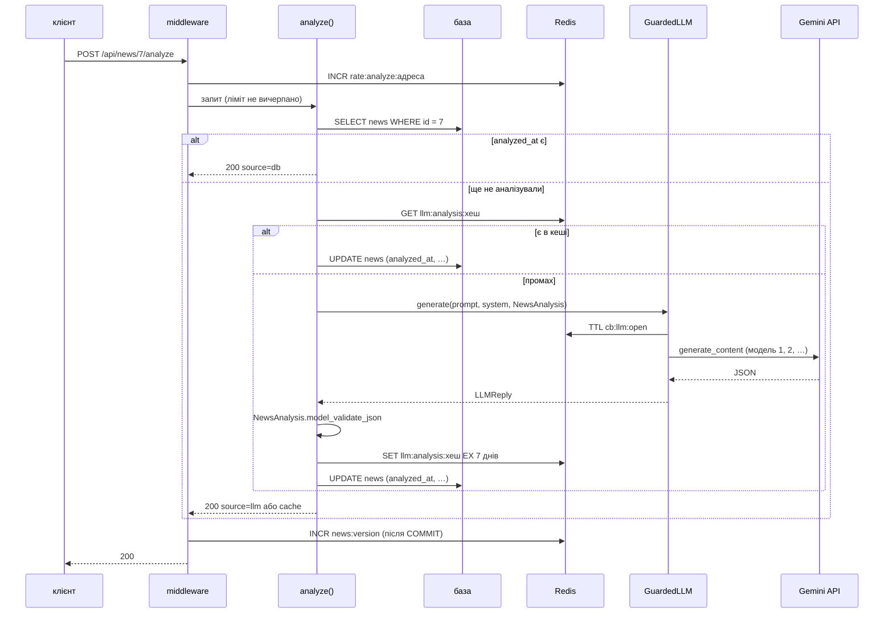

# Нові ендпоінти й тести

> Крок 7 · розділ 7 з 7. Код: [`news_hub/api.py`](https://github.com/NikoriakViktor/news_hub/blob/main/steps/07_llm_api/news_hub/api.py), [`news_hub/jobs.py`](https://github.com/NikoriakViktor/news_hub/blob/main/steps/07_llm_api/news_hub/jobs.py), тести: [`tests/integration/test_analyze_api.py`](https://github.com/NikoriakViktor/news_hub/blob/main/steps/07_llm_api/tests/integration/test_analyze_api.py), [`tests/live/test_llm_live.py`](https://github.com/NikoriakViktor/news_hub/blob/main/steps/07_llm_api/tests/live/test_llm_live.py).
> Теорія: [Залежності: `Depends` і `lifespan`](../../03_fastapi_core/dependencies.md), [Частина VII. Тестування](../../07_testing/README.md).

## Задача { #task }

Усе з попередніх розділів треба вивести в API: аналіз однієї новини, пакетний аналіз у фоні, фільтри й статистику за темою й тональністю. Помилки LLM мають ставати зрозумілими HTTP-кодами, а не `500`. І все це — з тестами, які не ходять у мережу й не витрачають квоту.

## Зміна 1: ендпоінти { #endpoints }

| Запит | Відповідь |
|---|---|
| `POST /api/news/{news_id}/analyze` | `200` `AnalyzeOut`: `source` (`db` / `cache` / `llm`), `model`, токени, `analysis`; `404`, `429`, `502`, `503` |
| `POST /api/news/{news_id}/analyze?force=true` | аналіз заново |
| `POST /api/analyze/jobs` `{"limit": 20}` | `202` + `job_id`: неаналізовані новини у фоні, по одній; `limit` — від 1 до 200 |
| `GET /api/analyze/jobs/{job_id}` | `queued` → `running` → `done` / `failed`; `news_found`, `news_analyzed`, `news_failed`; `404` для чужої або задачі збору |
| `GET /api/news?ai_category=Політика&sentiment=негативна` | фільтри за аналізом; значення поза переліком → `422` |
| `GET /api/news/stats` | + `ai_category`, `sentiment` (лише проаналізовані) |

```python title="news_hub/api.py (фрагмент)"
class AnalyzeOut(BaseModel):
    news_id: int
    source: Literal["db", "cache", "llm"] = Field(description="db — уже був у базі; cache — з Redis; llm — новий виклик")
    model: str | None = Field(description="яка модель відповіла (None — без виклику)")
    input_tokens: int = 0
    output_tokens: int = 0
    analyzed_at: datetime
    analysis: NewsAnalysis


class AnalyzeJobRequest(BaseModel):
    limit: int = Field(20, ge=1, le=200, description="скільки неаналізованих новин обробити")
```

`NewsAnalysis` тут працює втретє: у запиті до моделі (схема), у перевірці відповіді й у відповіді нашого API (`/docs` показує ту саму схему).

## Зміна 2: клієнт LLM — дві залежності { #deps }

```python title="news_hub/api.py (фрагмент)"
def get_llm_client(request: Request) -> LLMClient:
    """Клієнт провайдера з lifespan. Тести підміняють саме цю залежність (FakeLLM)."""
    llm: LLMClient | None = request.app.state.llm
    if llm is None:
        raise HTTPException(status.HTTP_503_SERVICE_UNAVAILABLE,
                            detail="LLM не налаштовано: задай GEMINI_API_KEY (або LLM_PROVIDER=anthropic + "
                                   "ANTHROPIC_API_KEY і ANTHROPIC_MODEL)")
    return llm


def get_llm(client: Annotated[LLMClient, Depends(get_llm_client)], redis: RedisDep) -> LLMClient:
    """Будь-який клієнт — лише через breaker."""
    return GuardedLLM(client, CircuitBreaker(redis))


LLMDep = Annotated[LLMClient, Depends(get_llm)]
```

Тести підміняють **першу** залежність — і breaker лишається справжнім. Тому тест `test_breaker_opens_503_with_retry_after` перевіряє справжній `CircuitBreaker` на тестовому Redis, а не його імітацію.

## Зміна 3: помилки LLM → HTTP одним обробником { #errors }

```python title="news_hub/api.py (фрагмент)"
@app.exception_handler(LLMError)
async def llm_error_handler(request: Request, error: Exception) -> JSONResponse:
    """Помилки LLM → HTTP: відкритий breaker — 503 з Retry-After; збій провайдера чи невалідна відповідь — 502."""
    if isinstance(error, CircuitOpen):
        return JSONResponse(status_code=503, headers={"Retry-After": str(error.retry_after)},
                            content={"detail": str(error)})
    reason = "невалідна відповідь моделі" if isinstance(error, InvalidLLMOutput) else "провайдер LLM недоступний"
    return JSONResponse(status_code=502, content={"detail": f"{reason}: {error}"})
```

| Виняток | Код | Чому |
|---|---|---|
| `LLMUnavailable` | `502 Bad Gateway` | сервер, до якого ми звертались, не відповів або відповів помилкою |
| `InvalidLLMOutput` | `502 Bad Gateway` | відповів, але двічі не за схемою |
| `CircuitOpen` | `503` + `Retry-After` | зараз не викликаємо; клієнт знає, коли повторити |
| немає клієнта (`get_llm_client`) | `503` | LLM не налаштовано |

Жоден з них не `500`: помилка не в нашому коді. Ендпоінти про ці винятки не знають — вони просто летять з `analyze_news`.

```text
502 {'detail': 'невалідна відповідь моделі: fake: відповідь не пройшла перевірку двічі: 1 помилок'}
```

## Шлях одного запиту { #flow }



Останній крок — інвалідація кешу стрічки з кроку 4: шлях `/api/news/{news_id}/analyze` починається з `/api/news`, тож після успішного `POST` middleware `invalidate_cache` збільшує `news:version`, і `GET /api/news` уже показує аналіз (тест `test_analyze_invalidates_list_cache`).

## Зміна 4: пакетний аналіз у фоні { #job }

```python title="news_hub/jobs.py (фрагмент)"
async def run_analyze_job(job_id: str, llm: LLMClient, limit: int, redis: Redis,
                          session_factory: async_sessionmaker[AsyncSession]) -> None:
    """Аналізує до `limit` новин без аналізу — по одній (безкоштовна квота Gemini — кілька запитів за хвилину).

    Кожна новина комітиться окремо: збій на 30-й не скасовує 29 уже оплачених аналізів.
    Відкритий breaker зупиняє задачу — решта новин однаково отримала б 503.
    """
    jobs, cache = JobStore(redis), AnalysisCache(redis)
    await jobs.update(job_id, status="running")
    analyzed = failed = 0
    try:
        async with session_factory() as session:
            repo = NewsRepository(session)
            rows = await repo.find_unanalyzed(limit)
            await jobs.update(job_id, news_found=len(rows))
            for row in rows:
                try:
                    result = await analyze_news(row.title, llm, cache)
                except CircuitOpen:
                    raise
                except LLMError as error:                  # одна новина не вдалась — ідемо далі
                    failed += 1
                    logger.warning("analyze job %s: новина %s — %s", job_id, row.id, error)
                    continue
                await repo.save_analysis(row, result.analysis)
                await session.commit()
                analyzed += 1
                await jobs.update(job_id, news_analyzed=analyzed, news_failed=failed)
        await jobs.update(job_id, status="done", news_analyzed=analyzed, news_failed=failed, finished_at=_now())
    except Exception as error:
        logger.exception("analyze job %s failed", job_id)
        await jobs.update(job_id, status="failed", news_analyzed=analyzed, news_failed=failed,
                          error=f"{type(error).__name__}: {error}", finished_at=_now())
    finally:
        if analyzed:
            await NewsCache(redis).invalidate()            # стрічка й статистика тепер з аналізом
```

- **Своя сесія** (`session_factory`), як у фоновому зборі кроку 4: сесія запиту вже закрита.
- **`COMMIT` після кожної новини**: збій посередині не скасовує вже оплачені аналізи.
- **Одна новина не вдалась** (`LLMUnavailable`, `InvalidLLMOutput`) — `news_failed += 1`, далі.
- **`CircuitOpen` зупиняє задачу**: решта новин однаково отримала б відмову.
- `JobStatus.kind` — `"analyze"` або `"scrape"`: `GET /api/analyze/jobs/{job_id}` для задачі збору відповідає `404`.

Задача, коли провайдер лежить (`FakeLLM` з п'ятьма `LLMUnavailable("503")`, `limit=20`; трасу винятку скорочено до останнього рядка):

```text
WARNING news_hub: analyze job ab04bbd823b2: новина 2 — 503
WARNING news_hub: analyze job ab04bbd823b2: новина 3 — 503
WARNING news_hub: analyze job ab04bbd823b2: новина 4 — 503
WARNING news_hub: analyze job ab04bbd823b2: новина 5 — 503
ERROR news_hub: breaker: відкрито після 5 збоїв на 300 с
WARNING news_hub: analyze job ab04bbd823b2: новина 6 — 503
ERROR news_hub: analyze job ab04bbd823b2 failed
news_hub.llm.CircuitOpen: LLM тимчасово вимкнено після серії збоїв; спробуй через 300 с
{'job_id': 'ab04bbd823b2', 'kind': 'analyze', 'status': 'failed', 'source': 'db', 'mode': 'fake', 'news_found': 20, 'news_saved': 0, 'news_analyzed': 0, 'news_failed': 5, 'error': 'CircuitOpen: LLM тимчасово вимкнено після серії збоїв; спробуй через 300 с', 'created_at': '2026-11-11T21:12:27+00:00', 'finished_at': '2026-11-11T21:12:27+00:00'}
provider calls: 5
```

П'ять новин не вдались, на шостій breaker уже відкритий — задача `failed`, а 15 новин (шосту й ще 14) модель не бачила.

## Результат: увесь сценарій через HTTP { #result }

Сервер з `LLM_PROVIDER=fake`, SQLite після `alembic upgrade head`, Redis 7:

```text
$ curl -X POST localhost:8000/api/scrape -H 'content-type: application/json' -d '{"source":"snapshot"}'
{"source":"snapshot","mode":"async","total_time":0.0,"pages":[],"news_found":168,"news_valid":168,"news_saved":168,"news_total":168,"rejected":[]}
$ curl -X POST localhost:8000/api/news/1/analyze
{"news_id":1,"source":"llm","model":"fake","input_tokens":11,"output_tokens":24,"analyzed_at":"2026-11-11T21:11:07.183484Z","analysis":{"summary":"Реформа ЗСУ","category":"Інше","sentiment":"нейтральна","keywords":["реформа"]}}
$ curl -X POST localhost:8000/api/analyze/jobs -H 'content-type: application/json' -d '{"limit":5}'
{"job_id":"17279a056936","kind":"analyze","status":"queued","source":"db","mode":"fake","news_found":0,"news_saved":0,"news_analyzed":0,"news_failed":0,"error":null,"created_at":"2026-11-11T21:11:07+00:00","finished_at":null}
$ curl localhost:8000/api/analyze/jobs/17279a056936
{"job_id":"17279a056936","kind":"analyze","status":"done","source":"db","mode":"fake","news_found":5,"news_saved":0,"news_analyzed":5,"news_failed":0,"error":null,"created_at":"2026-11-11T21:11:07+00:00","finished_at":"2026-11-11T21:11:07+00:00"}
$ curl localhost:8000/api/news/stats
{"total":168,"category":{"Новини":168},"lang":{"ru":138,"uk":30},"source":{"rbc.ua":167,"auto.rbc.ua":1},"ai_category":{"Інше":6},"sentiment":{"нейтральна":6}}
$ curl -G localhost:8000/api/news --data-urlencode "sentiment=дуже погана"
{"detail":[{"type":"literal_error","loc":["query","sentiment"],"msg":"Input should be 'позитивна', 'нейтральна' or 'негативна'","input":"дуже погана","ctx":{"expected":"'позитивна', 'нейтральна' or 'негативна'"}}]}
```

- Новина 1 проаналізована окремо, задача взяла наступні 5 без аналізу — у статистиці `6`.
- У статусі задачі `mode` — назва провайдера (`llm.name`), `source` — `"db"`: аналізуються новини з бази.
- Фільтр `sentiment` має тип `Sentiment`, тож значення поза переліком — `422` ще до запиту в базу.
- `FakeLLM` без сценарію відповідає «Інше / нейтральна» — щоб ендпоінти, фронтенд і бот можна було розробляти без ключа й мережі. З `GEMINI_API_KEY` той самий запит повертає справжній аналіз.

## Тести: що справжнє, а що підмінене { #tests }

| Шар | Файл | Тестів | Що підмінено | Що перевіряє |
|---|---|---:|---|---|
| unit | `tests/unit/test_llm.py` | 25 | HTTP-виклик SDK (`client.aio.models`, `messages`) | пул моделей, коди помилок, тайм-аути, що йде в запит; breaker на fakeredis |
| unit | `tests/unit/test_analysis.py` | 20 | `FakeLLM` | перевірка відповіді, повтор, промпт-ін'єкція, кеш, `PROMPT_VERSION` |
| integration | `tests/integration/test_analyze_api.py` | 16 | `FakeLLM` через `dependency_overrides[get_llm_client]` | API, база, кеш, breaker → `503`, rate limit, фонова задача |
| live | `tests/live/test_llm_live.py` | 2 | нічого | справжній провайдер; лише `pytest -m llm` |

Фікстура підміняє клієнт і дає тесту сценарій:

```python title="tests/integration/conftest.py (фрагмент)"
@pytest.fixture
def fake_llm() -> Iterator[FakeLLM]:
    """Крок 7: клієнт LLM для API — FakeLLM зі сценарієм: fake_llm.replies.extend([...]); виклики — fake_llm.calls."""
    fake = FakeLLM()
    app.dependency_overrides[get_llm_client] = lambda: fake
    yield fake
    app.dependency_overrides.pop(get_llm_client, None)
```

А фікстура `client` після старту застосунку ставить `app.state.llm = FakeLLM()` — навіть з `GEMINI_API_KEY` у середовищі звичайний прогін не зробить жодного платного виклику.

```python title="tests/integration/test_analyze_api.py (фрагмент)"
def test_breaker_opens_503_with_retry_after(client: TestClient, fake_llm: FakeLLM) -> None:
    news_id = create(client)
    fake_llm.replies.extend([LLMUnavailable("503")] * 5)
    statuses = [client.post(f"/api/news/{news_id}/analyze").status_code for _ in range(6)]
    assert statuses == [502] * 5 + [503]
    blocked = client.post(f"/api/news/{news_id}/analyze")
    assert 0 < int(blocked.headers["Retry-After"]) <= 300
    assert len(fake_llm.calls) == 5                               # після відкриття провайдера не чіпаємо
```

`pytest.ini` виключає `llm` зі звичайного прогону:

```ini title="pytest.ini (фрагмент)"
markers =
    unit: швидкі тести однієї функції чи класу — без бази, Redis і мережі
    integration: API разом з базою й Redis
    llm: справжні виклики LLM (потрібен ключ, витрачає квоту) — лише pytest -m llm
addopts = -m "not llm"
```

```text
$ pytest -q -p no:cacheprovider
........................................................................ [ 42%]
........................................................................ [ 85%]
........................                                                 [100%]
168 passed, 2 deselected in 15.08s
$ mypy --strict news_hub
Success: no issues found in 15 source files
```

`2 deselected` — два тести `tests/live/`. У кроці 6 було 107 тестів, стало 168: +25 `test_llm.py`, +20 `test_analysis.py`, +16 `test_analyze_api.py`.

## Контракт з провайдером { #contract }

`FakeLLM` перевіряє **наш** код, але не те, чи приймає провайдер **наш запит**. Для цього — тест проти справжнього API, якому навіть не потрібен ключ: Google перевіряє структуру запиту **раніше** за ключ. Невірна схема — `400` про запит; правильна — `400 API key not valid`:

```python title="tests/live/test_llm_live.py (фрагмент)"
@pytest.mark.asyncio
async def test_gemini_accepts_request_shape() -> None:
    """Невалідний ключ → запит дійшов до перевірки ключа, тобто схема й параметри Google прийняв."""
    client = GeminiClient(api_key="invalid-key-for-contract-test", models=["gemini-2.5-flash"])
    with pytest.raises(LLMUnavailable) as error:
        try:
            await client.generate(build_prompt("Нацбанк знизив облікову ставку"), system=SYSTEM_PROMPT,
                                  schema=NewsAnalysis)
        finally:
            await client.aclose()                                # інакше aiohttp-сесія переживе цикл подій
    assert "API key not valid" in str(error.value)
```

Без ключа, але з мережею: контрактний тест проходить, а тест справжньої відповіді пропускається:

```text
$ pytest -q -p no:cacheprovider -m llm
1 passed, 1 skipped, 168 deselected, 1 warning in 5.54s
```

З ключем `test_real_model_answers_valid_analysis` аналізує три заголовки знімка й перевіряє не текст (він щоразу інший), а контракт: відповідь проходить `NewsAnalysis`, токени більші за нуль. Навіщо контрактний тест — у [«Знайди помилку»](checkpoint.md#find-bug).

## Мінімальні версії залежностей { #min-versions }

```text title="requirements.txt (нове й змінене)"
typing-extensions>=4.14 # anthropic 1.x
aiohttp>=3.10.10       # крок 7: google-genai звертається до aiohttp.ClientConnectorDNSError (з 3.10.10)
google-genai>=1.39     # крок 7: Gemini (client.aio + aclose, response_json_schema)
anthropic>=1.0         # крок 7: Claude (structured outputs: output_config)
httpx>=0.28.1          # … (google-genai потребує ≥ 0.28.1)
```

Кожну межу знайшов прогін на мінімальних версіях (Python 3.10):

| Межа | Що ламалось нижче |
|---|---|
| `google-genai>=1.39` | до 1.22 немає `response_json_schema` у `GenerateContentConfig`; до 1.39 — `client.aio.aclose()` (закриття HTTP-сесії в `lifespan`) |
| `aiohttp>=3.10.10` | `google-genai` при помилці запиту звертається до `aiohttp.ClientConnectorDNSError` — з aiohttp 3.10.0–3.10.9 замість `LLMUnavailable` вилітав `AttributeError`. Знайшов **контрактний тест** на мінімальних версіях: з `FakeLLM` і моком SDK до цього коду справа не доходить |
| `httpx>=0.28.1`, `typing-extensions>=4.14` | вимоги самих `google-genai` і `anthropic` 1.x — pip не встановив би їх разом зі старими межами |

Мінімальні версії в CI — [крок 12](../12_ci_cd/index.md).

## Правило { #rule }

!!! tip "Правило"
    Зовнішній сервіс у тестах підміняй на межі (одна залежність, `get_llm_client`), а все між межею й відповіддю — breaker, кеш, база, rate limit — лишай справжнім. Помилки сервісу перетворюй на HTTP в одному обробнику (`502` / `503`, не `500`). І тримай хоча б один контрактний тест проти справжнього API: фейк приймає будь-який запит.

**Далі:** [Контрольна точка](checkpoint.md).
