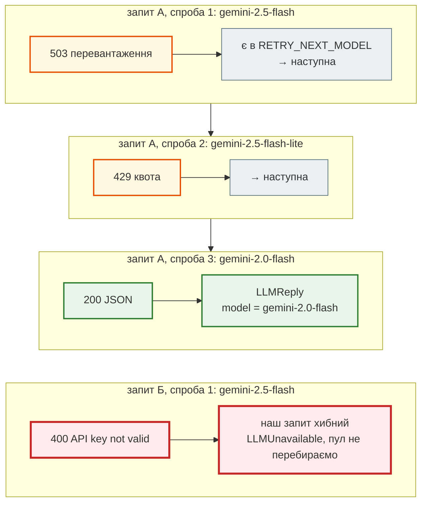

# Асинхронний клієнт і пул моделей

> Крок 7 · розділ 2 з 7. Код: [`news_hub/llm.py`](https://github.com/NikoriakViktor/news_hub/blob/main/steps/07_llm_api/news_hub/llm.py) (`GeminiClient`, `AnthropicClient`), тести: [`tests/unit/test_llm.py`](https://github.com/NikoriakViktor/news_hub/blob/main/steps/07_llm_api/tests/unit/test_llm.py).
> Теорія: [Частина IV. Async](../../04_async/README.md).

## Задача { #task }

Виклик моделі триває секунди. Поки він іде, сервер має відповідати іншим запитам. А коли модель не відповідає (квота, перевантаження, тайм-аут), варто спробувати іншу — у кожної моделі Gemini **своя** квота. Але не завжди: якщо винен наш запит чи ключ, інша модель отримає те саме й відповість так само.

## Було: синхронний SDK у потоці { #before }

Стартовий код бота запускав синхронний виклик SDK у потоці й щоразу створював новий клієнт:

```python title="ai_service.py (стартовий код, скорочено)"
text = await asyncio.to_thread(_call_gemini_sync, model, conversation, sys_prompt)

def _call_gemini_sync(model: str, prompt: str, system_prompt: str) -> str:
    client = genai.Client(api_key=config.GEMINI_API_KEY,
                          http_options=genai_types.HttpOptions(timeout=_HTTP_TIMEOUT_MS))
    response = client.models.generate_content(model=model, contents=prompt, config=...)
    return response.text
```

Новий клієнт на кожен виклик — нове HTTP-з'єднання (TCP + TLS) щоразу. Потік — зайвий: у `google-genai` є асинхронний клієнт.

## Зміна 1: `client.aio` і один клієнт на застосунок { #aio }

```python title="news_hub/llm.py — GeminiClient (фрагмент)"
MODEL_POOL: list[str] = ["gemini-2.5-flash", "gemini-2.5-flash-lite", "gemini-2.0-flash", "gemini-2.0-flash-lite"]

class GeminiClient:
    name = "gemini"

    def __init__(self, api_key: str, models: Iterable[str] = MODEL_POOL, timeout: float = LLM_TIMEOUT,
                 max_tokens: int = LLM_MAX_TOKENS) -> None:
        self.models = list(models)
        self.max_tokens = max_tokens
        # Один клієнт на весь застосунок: він тримає пул HTTP-з'єднань
        self._client = genai.Client(api_key=api_key,
                                    http_options=genai_types.HttpOptions(timeout=int(timeout * 1000)))

    async def generate(self, prompt: str, *, system: str, schema: type[BaseModel]) -> LLMReply:
        config = genai_types.GenerateContentConfig(...)          # схема, temperature — розділ 3
        failures: list[str] = []
        for model in self.models:
            start = time.perf_counter()
            try:
                response = await self._client.aio.models.generate_content(model=model, contents=prompt,
                                                                          config=config)
            except genai_errors.APIError as error:
                failures.append(f"{model}: {error.code}")
                logger.warning("gemini %s → %s за %.1f с", model, error.code, time.perf_counter() - start)
                if error.code not in RETRY_NEXT_MODEL:
                    raise LLMUnavailable(f"gemini відхилив запит ({error.code}): {error.message}") from error
                continue
            except NETWORK_ERRORS as error:                 # тайм-аут, обрив з'єднання
                failures.append(f"{model}: {type(error).__name__}")
                logger.warning("gemini %s → %s", model, type(error).__name__)
                continue
            usage = response.usage_metadata
            reply = LLMReply(
                text=response.text or "", model=model,
                input_tokens=(usage.prompt_token_count or 0) if usage else 0,
                # «думки» моделі (thinking) оплачуються як вихідні токени
                output_tokens=((usage.candidates_token_count or 0) + (usage.thoughts_token_count or 0))
                if usage else 0,
            )
            logger.info("gemini %s: %s+%s токенів за %.1f с", model, reply.input_tokens, reply.output_tokens,
                        time.perf_counter() - start)
            return reply
        raise LLMUnavailable("усі моделі Gemini недоступні: " + ", ".join(failures))

    async def aclose(self) -> None:
        await self._client.aio.aclose()
```

- `await self._client.aio.models.generate_content(...)` не блокує цикл подій, тож `asyncio.to_thread` не потрібен.
- Тайм-аут у `HttpOptions` — у **мілісекундах**: `LLM_TIMEOUT=30` секунд → `30000`.
- `response.text or ""`: заблокована чи обрізана відповідь має `text=None`. Порожній рядок потім не пройде `NewsAnalysis` — і це буде видно ([розділ 3](json_schema.md)).
- `output_tokens` = кандидати + «думки» (thinking): моделі 2.5 «думають» перед відповіддю, і ці токени теж у рахунку.

Клієнт живе, поки живе застосунок: `lifespan` при зупинці викликає `await app.state.llm.aclose()`, як `redis.aclose()` у кроці 4. Без цього незакрита aiohttp-сесія SDK «переживає» цикл подій, і Python 3.10 друкує при виході `RuntimeError: Event loop is closed`.

## Зміна 2: яка помилка — яка дія { #errors }

Помилку розпізнаємо за **кодом** (`APIError.code`), а не за словами в тексті винятку:

```python title="news_hub/llm.py (фрагмент)"
# Коди, після яких варто спробувати іншу модель: 404 — модель прибрали, 429 — квота, 5xx — перевантаження
RETRY_NEXT_MODEL = {404, 408, 429, 500, 502, 503, 504}
```

| Код | Що сталося | Дія |
|---|---|---|
| `404` | модель прибрали або перейменували | наступна модель пулу |
| `408` | тайм-аут на боці провайдера | наступна |
| `429` | квота моделі вичерпана | наступна: у кожної моделі своя квота |
| `500`, `502`, `503`, `504` | провайдер перевантажений | наступна |
| тайм-аут, обрив з'єднання | мережа | наступна |
| `400`, `401`, `403` | **наш** запит: невалідна схема, ключ, доступ | одразу `LLMUnavailable` — інша модель отримає той самий запит і той самий ключ |

Покроково — два запити з різними збоями:



## Результат: той самий сценарій без мережі { #result }

Справжній `GeminiClient`, але його `client.aio.models` підмінено об'єктом, що кидає задані помилки, — так само роблять тести в `test_llm.py`. Журнал `news_hub` увімкнено:

```text
===== pool: 503, 429, ok =====
WARNING news_hub: gemini gemini-2.5-flash → 503 за 0.0 с
WARNING news_hub: gemini gemini-2.5-flash-lite → 429 за 0.0 с
INFO news_hub: gemini gemini-2.0-flash: 120+55 токенів за 0.0 с
tried: ['gemini-2.5-flash', 'gemini-2.5-flash-lite', 'gemini-2.0-flash']
reply: gemini-2.0-flash 120 55

===== pool: 400 =====
WARNING news_hub: gemini gemini-2.5-flash → 400 за 0.0 с
LLMUnavailable: gemini відхилив запит (400): test
tried: ['gemini-2.5-flash']

===== pool: timeouts / all fail =====
WARNING news_hub: gemini gemini-2.5-flash → TimeoutError
WARNING news_hub: gemini gemini-2.5-flash-lite → 429 за 0.0 с
WARNING news_hub: gemini gemini-2.0-flash → 404 за 0.0 с
WARNING news_hub: gemini gemini-2.0-flash-lite → 503 за 0.0 с
LLMUnavailable: усі моделі Gemini недоступні: gemini-2.5-flash: TimeoutError, gemini-2.5-flash-lite: 429, gemini-2.0-flash: 404, gemini-2.0-flash-lite: 503
```

- `120+55`: підмінена відповідь має `prompt_token_count=120`, `candidates_token_count=40`, `thoughts_token_count=15`; «думки» додались до вихідних.
- На `400` пул не перебирається: одна спроба, одразу виняток.
- Коли всі моделі впали, у тексті винятку — що сталося з **кожною**. Цей текст дійде до клієнта в `502` і в журнал.

Зі справжнім Gemini API і навмисно невалідним ключем запит виглядав так:

```text
$ GEMINI_API_KEY=invalid-demo-key uvicorn news_hub.api:app
$ curl -X POST localhost:8000/api/news/7/analyze
{"detail":"провайдер LLM недоступний: gemini відхилив запит (400): API key not valid. Please pass a valid API key."}
# журнал сервера
17:22:39 WARNING news_hub: gemini gemini-2.5-flash → 400 за 0.5 с
```

Gemini відповідає на невалідний ключ кодом **400** (`INVALID_ARGUMENT`), а не `401`. Тому рішення «переходити чи ні» ухвалюється за кодом, а таблицю кодів звіряють зі справжніми відповідями провайдера, а не з пам'яттю. Контрактний тест `test_gemini_accepts_request_shape` ([розділ 7](endpoints_and_tests.md#contract)) перевіряє саме цю відповідь.

## Мережеві збої: який саме виняток { #network }

SDK ходить у мережу через `aiohttp`, якщо він встановлений (у `news_hub` — так, скрапер з кроку 2), інакше через `httpx`. Тож тайм-аут — це різні винятки:

```python title="news_hub/llm.py (фрагмент)"
# Мережеві збої: SDK ходить через aiohttp, якщо він встановлений (у нас — так), інакше через httpx.
# Тайм-аут aiohttp — TimeoutError (у 3.10 — asyncio.TimeoutError, окремий клас).
NETWORK_ERRORS = (TimeoutError, asyncio.TimeoutError, aiohttp.ClientError, httpx.TransportError)
```

Перевірка проти справжнього API з тайм-аутом в 1 мс показала, що саме летить:

```text
>>> await GeminiClient("…", models=["gemini-2.5-flash", "gemini-2.5-flash-lite"], timeout=0.001).generate(...)
gemini gemini-2.5-flash → TimeoutError
gemini gemini-2.5-flash-lite → TimeoutError
LLMUnavailable: усі моделі Gemini недоступні: gemini-2.5-flash: TimeoutError, gemini-2.5-flash-lite: TimeoutError
```

Перша версія цього коду ловила лише `httpx.TransportError`, і тайм-аут пролітав повз `except` аж до `500 Internal Server Error`. Мок SDK цього не показав би: мок кидає той виняток, який ти йому дав. Тепер тест `test_gemini_network_error_falls_back` перевіряє всі чотири варіанти: `TimeoutError`, `asyncio.TimeoutError`, `aiohttp.ServerDisconnectedError`, `httpx.ReadTimeout`.

Список моделей змінюється: моделі виводять з обігу, тож `404` — теж «наступна модель», а пул можна задати без зміни коду: `GEMINI_MODELS=gemini-2.5-flash,gemini-2.5-flash-lite`. Актуальні назви — на сторінці [Gemini models](https://ai.google.dev/gemini-api/docs/models).

## Той самий інтерфейс — Anthropic { #anthropic }

```python title="news_hub/llm.py — AnthropicClient (фрагмент)"
class AnthropicClient:
    name = "anthropic"

    def __init__(self, api_key: str, model: str, timeout: float = LLM_TIMEOUT,
                 max_tokens: int = LLM_MAX_TOKENS) -> None:
        self.model = model
        self.max_tokens = max_tokens
        # SDK сам повторює запит при 429/5xx (max_retries), тож пулу моделей тут немає
        self._client = anthropic.AsyncAnthropic(api_key=api_key, timeout=timeout, max_retries=2)

    async def generate(self, prompt: str, *, system: str, schema: type[BaseModel]) -> LLMReply:
        try:
            response = await self._client.messages.create(
                model=self.model,
                max_tokens=self.max_tokens,
                system=system,
                messages=[{"role": "user", "content": prompt}],
                # structured outputs: відповідь — JSON за схемою (transform_schema пристосовує схему Pydantic)
                output_config={"format": {"type": "json_schema", "schema": anthropic.transform_schema(schema)}},
            )
        except anthropic.APIError as error:
            raise LLMUnavailable(f"anthropic: {type(error).__name__}: {error}") from error
        text = "".join(block.text for block in response.content if block.type == "text")
        return LLMReply(text=text, model=response.model, input_tokens=response.usage.input_tokens,
                        output_tokens=response.usage.output_tokens)
```

| | Gemini | Anthropic |
|---|---|---|
| системна інструкція | `system_instruction=` у `GenerateContentConfig` | `system=` |
| вміст | `contents=prompt` | `messages=[{"role": "user", "content": prompt}]` |
| схема відповіді | `response_json_schema=schema.model_json_schema()` | `output_config={"format": {"type": "json_schema", …}}` |
| збій | пул моделей, рішення за кодом | SDK сам повторює (`max_retries=2`), потім `LLMUnavailable` |
| токени | `usage_metadata.prompt_token_count`, `candidates_token_count + thoughts_token_count` | `usage.input_tokens`, `usage.output_tokens` |

Різниця між провайдерами — лише всередині класу. Решта `news_hub` цього не бачить. Перемикання — змінними: `LLM_PROVIDER=anthropic ANTHROPIC_API_KEY=… ANTHROPIC_MODEL=…`.

## Правило { #rule }

!!! tip "Правило"
    Асинхронний SDK — один клієнт на застосунок, створений у `lifespan` і закритий у ньому ж. Помилку провайдера розбирай за **кодом**: «спробуй іншу модель» лише тоді, коли інша модель справді може відповісти (квота, перевантаження, мережа); помилка твого запиту чи ключа — одразу виняток.

**Далі:** [JSON за схемою + Pydantic](json_schema.md).
