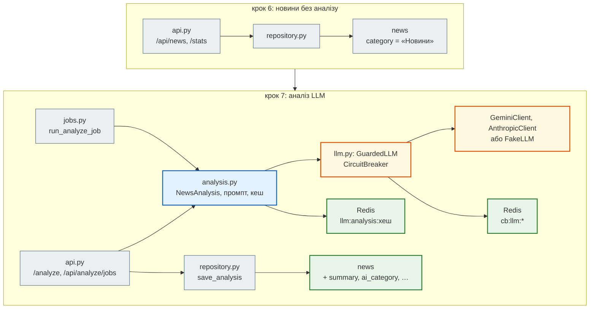

# Крок 7. Аналіз новин через LLM API

> **Код кроку:** [`steps/07_llm_api`](https://github.com/NikoriakViktor/news_hub/tree/main/steps/07_llm_api).
>
> **Передумови:** [Крок 6. AI-інструменти розробника](../06_ai_dev_tools/index.md): є друге джерело (RSS «Української правди»), `CLAUDE.md` з правилами проєкту, 107 тестів.

## Де ми зараз { #where }

Після кроку 6 агрегатор збирає новини з rbc.ua і RSS, перевіряє їх моделлю `NewsItem`, зберігає в базі (крок 3), кешує стрічку в Redis, обмежує дорогі запити rate limit-ом і збирає у фоні (крок 4). Тести покривають усе це без мережі (крок 5).

Але подивись на статистику після збору знімка rbc.ua:

```text
$ curl localhost:8000/api/news/stats
{"total":168,"category":{"Новини":168},"lang":{"ru":138,"uk":30},"source":{"rbc.ua":167,"auto.rbc.ua":1}}
```

Усі 168 новин — у категорії «Новини». Це розділ сайту з URL (`/rus/news/…`), а не тема: політика, економіка й погода лежать в одному кошику. Тональності, підсумку, ключових слів немає зовсім.

## Проблема { #problem }

У прототипі тему, тональність і ключові слова рахував `nlp.py` — за списками основ слів: `+1` за кожне слово з «позитивною» основою, `−1` — з «негативною». Так він відповідав на заголовки зі знімка:

```text
>>> nlp.analyze("Україна випробувала ШІ-турель для перехоплення російських дронів, - Федоров", "")
{'keywords': ['україна', 'випробувала', 'турель', 'перехоплення', 'російських'], 'sentiment_score': -1.0, ...}
>>> nlp.analyze("Реформа ЗСУ", "")
{'keywords': ['реформа'], 'sentiment_score': 1.0, ...}
```

Новина про українську зброю отримала «−1», бо в ній є слово «дронів». «Реформа ЗСУ» — «+1», бо «реформ» у списку позитивних основ. Правила не бачать, **хто** що робить.

Мовна модель (LLM) розуміє заголовок цілком. Але це не звичайна функція, і в неї чотири незручні властивості:

- відповідає **повільно** (секунди) і **платно** — за кожен токен;
- може **не відповісти**: вичерпана квота (`429`), перевантаження (`503`), тайм-аут;
- відповідає **вільним текстом**, навіть коли просиш JSON;
- **читає інструкції**, зокрема ті, що хтось заховав у тексті новини.

Крок 7 — про те, як вбудувати таку залежність в API, щоб агрегатор лишився швидким, передбачуваним і не платив двічі за те саме.

## Що додаємо { #what }

| Що | Де | Розділ |
|---|---|---|
| протокол `LLMClient`, `LLMReply`, `make_llm`, `FakeLLM` | `news_hub/llm.py` | [Один інтерфейс `LLMClient`](llm_client.md) |
| `GeminiClient`: `client.aio`, пул моделей, коди помилок; `AnthropicClient` | `news_hub/llm.py` | [Асинхронний клієнт і пул моделей](gemini_pool.md) |
| `NewsAnalysis`: JSON Schema в запиті, перевірка Pydantic, один повтор | `news_hub/analysis.py` | [JSON за схемою + Pydantic](json_schema.md) |
| `SYSTEM_PROMPT`, `build_prompt`: інструкція окремо, новина між `<news>` і `</news>` | `news_hub/analysis.py` | [Промпт: новина — як дані](prompt_injection.md) |
| `CircuitBreaker` у Redis, `GuardedLLM`, `CircuitOpen` → `503` | `news_hub/llm.py` | [Circuit breaker](circuit_breaker.md) |
| колонки аналізу (міграція `0002`), `AnalysisCache`, `PROMPT_VERSION`, ліміт `ANALYZE_RATE_LIMIT` | `tables.py`, `analysis.py`, `middleware.py` | [База, кеш і вартість](db_cache_cost.md) |
| `POST /api/news/{news_id}/analyze`, `/api/analyze/jobs`, фільтри, обробник `LLMError`; тести з `FakeLLM` і контрактний тест | `api.py`, `jobs.py`, `tests/` | [Нові ендпоінти й тести](endpoints_and_tests.md) |

## Архітектура: було → стало { #architecture }



- **`analysis.py` не знає про FastAPI і базу, `llm.py` — про новини.** Тому `analyze_news` однаково працює з ендпоінта, з фонової задачі й (крок 9) з Telegram-бота.
- **Провайдер — деталь.** Решта коду бачить лише `LLMClient.generate(prompt, *, system, schema) → LLMReply`. Gemini, Anthropic і фейк взаємозамінні; вибір — змінна `LLM_PROVIDER`.
- **Нічого від моделі не йде в базу без перевірки.** Відповідь проходить `NewsAnalysis`, як дані з парсера проходять `NewsItem` у кроці 1.
- **Тести не ходять у мережу.** Підміняється одна залежність, `get_llm_client`; breaker, кеш, база й rate limit лишаються справжніми.

## Файли кроку { #files }

| Файл | Що в ньому | Новий? |
|---|---|---|
| [`news_hub/llm.py`](https://github.com/NikoriakViktor/news_hub/blob/main/steps/07_llm_api/news_hub/llm.py) | `LLMClient`, `LLMReply`, `GeminiClient`, `AnthropicClient`, `FakeLLM`, `CircuitBreaker`, `GuardedLLM`, `make_llm` | новий |
| [`news_hub/analysis.py`](https://github.com/NikoriakViktor/news_hub/blob/main/steps/07_llm_api/news_hub/analysis.py) | `NewsAnalysis`, `SYSTEM_PROMPT`, `build_prompt`, `AnalysisCache`, `analyze_news` | новий |
| [`migrations/versions/0002_llm_analysis.py`](https://github.com/NikoriakViktor/news_hub/blob/main/steps/07_llm_api/migrations/versions/0002_llm_analysis.py) | 5 колонок аналізу й 2 індекси в `news` | новий |
| [`news_hub/api.py`](https://github.com/NikoriakViktor/news_hub/blob/main/steps/07_llm_api/news_hub/api.py) | `get_llm_client`, `get_llm`, обробник `LLMError`, `AnalyzeOut`, 3 нові ендпоінти, фільтри `ai_category`/`sentiment` | змінено |
| [`news_hub/jobs.py`](https://github.com/NikoriakViktor/news_hub/blob/main/steps/07_llm_api/news_hub/jobs.py) | `JobStatus.kind`, `run_analyze_job` | змінено |
| [`news_hub/repository.py`](https://github.com/NikoriakViktor/news_hub/blob/main/steps/07_llm_api/news_hub/repository.py), [`tables.py`](https://github.com/NikoriakViktor/news_hub/blob/main/steps/07_llm_api/news_hub/tables.py) | `save_analysis`, `find_unanalyzed`, фільтри й статистика; колонки в `NewsRow` | змінено |
| [`news_hub/middleware.py`](https://github.com/NikoriakViktor/news_hub/blob/main/steps/07_llm_api/news_hub/middleware.py) | свій ліміт для аналізу: `ANALYZE_RATE_LIMIT`, ключ `rate:analyze:<адреса>` | змінено |
| [`tests/unit/test_llm.py`](https://github.com/NikoriakViktor/news_hub/blob/main/steps/07_llm_api/tests/unit/test_llm.py) | 25 тестів: пул моделей, коди помилок, запит до SDK, breaker | новий |
| [`tests/unit/test_analysis.py`](https://github.com/NikoriakViktor/news_hub/blob/main/steps/07_llm_api/tests/unit/test_analysis.py) | 20 тестів: перевірка відповіді, повтор, промпт-ін'єкція, кеш | новий |
| [`tests/integration/test_analyze_api.py`](https://github.com/NikoriakViktor/news_hub/blob/main/steps/07_llm_api/tests/integration/test_analyze_api.py) | 16 тестів API з `FakeLLM` | новий |
| [`tests/live/test_llm_live.py`](https://github.com/NikoriakViktor/news_hub/blob/main/steps/07_llm_api/tests/live/test_llm_live.py) | 2 тести проти справжнього провайдера, лише `pytest -m llm` | новий |
| [`pytest.ini`](https://github.com/NikoriakViktor/news_hub/blob/main/steps/07_llm_api/pytest.ini), [`requirements.txt`](https://github.com/NikoriakViktor/news_hub/blob/main/steps/07_llm_api/requirements.txt), [`CLAUDE.md`](https://github.com/NikoriakViktor/news_hub/blob/main/steps/07_llm_api/CLAUDE.md) | маркер `llm`; `google-genai`, `anthropic`; правила для LLM | змінено |
| `parser.py`, `rss.py`, `models.py`, `scraper.py`, `db.py`, `cache.py`, колекція Postman | з кроку 6 | без змін |

## Порядок читання { #reading-order }

1. [Один інтерфейс `LLMClient`](llm_client.md) — що спільного в усіх провайдерів, `make_llm`, `FakeLLM`.
2. [Асинхронний клієнт і пул моделей](gemini_pool.md) — `client.aio`, перехід на наступну модель, яка помилка — яка дія.
3. [JSON за схемою + Pydantic](json_schema.md) — `NewsAnalysis`, перевірка, один повтор, `InvalidLLMOutput`.
4. [Промпт: інструкція окремо, новина — як дані](prompt_injection.md) — промпт-ін'єкція і шари захисту.
5. [Circuit breaker](circuit_breaker.md) — 5 збоїв → пауза 300 с → `503` з `Retry-After`.
6. [База, кеш і вартість](db_cache_cost.md) — модель бачить кожен текст один раз.
7. [Нові ендпоінти й тести](endpoints_and_tests.md) — API, фонова задача, що підмінено в тестах, контрактний тест.
8. [Контрольна точка](checkpoint.md) — тести, практика, самоперевірка.

Теорія до кроку — [Частина IX. Інтеграції: AI, LLM, Telegram](../../09_integrations/README.md); Pydantic — [`ConfigDict`](../../02_typing_and_pydantic/config_dict.md) і [`ValidationError`](../../02_typing_and_pydantic/validation_error.md).

## Запуск { #run }

З папки кроку `steps/07_llm_api`:

```bash
pip install -r requirements.txt
pytest -q                           # 168 passed, 2 deselected — SQLite у пам'яті + fakeredis + FakeLLM
pytest -q -m unit                   # 105 passed, 65 deselected — без бази, Redis і мережі
mypy --strict news_hub              # Success: no issues found in 15 source files
alembic upgrade head                # 0001 → 0002: колонки аналізу
LLM_PROVIDER=fake uvicorn news_hub.api:app --reload   # без ключа й мережі → http://127.0.0.1:8000/docs
```

Зі справжньою моделлю ключ задається лише змінною середовища, ніколи в коді чи git:

```bash
export GEMINI_API_KEY=…          # безкоштовний ключ: aistudio.google.com → Get API key
uvicorn news_hub.api:app --reload
# Anthropic замість Gemini:
# LLM_PROVIDER=anthropic ANTHROPIC_API_KEY=… ANTHROPIC_MODEL=<назва моделі> uvicorn news_hub.api:app --reload
```

| Змінна | За замовчуванням | Що робить |
|---|---|---|
| `LLM_PROVIDER` | `gemini` | `gemini`, `anthropic` або `fake` |
| `GEMINI_API_KEY` | — | без нього (і без `fake`) аналіз відповідає `503`, решта API працює |
| `GEMINI_MODELS` | `gemini-2.5-flash,gemini-2.5-flash-lite,gemini-2.0-flash,gemini-2.0-flash-lite` | пул моделей через кому |
| `ANTHROPIC_API_KEY`, `ANTHROPIC_MODEL` | — | потрібні обидві, інакше клієнта немає |
| `LLM_TIMEOUT` / `LLM_MAX_TOKENS` | `30` / `2048` | секунд на запит / стеля відповіді в токенах |
| `ANALYZE_RATE_LIMIT` | `10` | запитів на аналіз за вікно `RATE_LIMIT_WINDOW` (`60` с) з однієї адреси |

Сценарій у Swagger: `POST /api/scrape` (`{"source": "snapshot"}`) → `POST /api/news/1/analyze` → `POST /api/analyze/jobs` (`{"limit": 20}`) → `GET /api/news/stats` (поля `ai_category`, `sentiment`) → `GET /api/news?sentiment=нейтральна`.

## Порівняння з кроком 6 { #diff }

```bash
git diff --no-index --stat steps/06_ai_dev_tools steps/07_llm_api
git diff --no-index steps/06_ai_dev_tools/news_hub steps/07_llm_api/news_hub
```

Основне з `--stat` (без `__pycache__` і `.mypy_cache`, які з'являються локально після тестів і mypy):

```text
 .../migrations/versions/0002_llm_analysis.py       |  46 ++++
 /dev/null => 07_llm_api/news_hub/analysis.py       | 133 +++++++++
 {06_ai_dev_tools => 07_llm_api}/news_hub/api.py    | 127 ++++++++-
 {06_ai_dev_tools => 07_llm_api}/news_hub/jobs.py   |  49 +++-
 /dev/null => 07_llm_api/news_hub/llm.py            | 304 +++++++++++++++++++++
 .../news_hub/middleware.py                         |  26 +-
 .../news_hub/repository.py                         |  30 +-
 {06_ai_dev_tools => 07_llm_api}/news_hub/tables.py |  12 +-
 .../tests/integration/test_analyze_api.py          | 177 ++++++++++++
 .../null => 07_llm_api/tests/live/test_llm_live.py |  57 ++++
 .../null => 07_llm_api/tests/unit/test_analysis.py | 153 +++++++++++
 /dev/null => 07_llm_api/tests/unit/test_llm.py     | 273 ++++++++++++++++++
```

## Що далі { #next }

[Крок 8. Безпека: JWT, SSRF, webhook](../08_security/index.md): аналіз коштує грошей, а викликати його зараз може будь-хто, хто дістався до API. Крок 8 пускає до записів і до аналізу лише адміна з JWT і доводить до кінця захист від SSRF.
